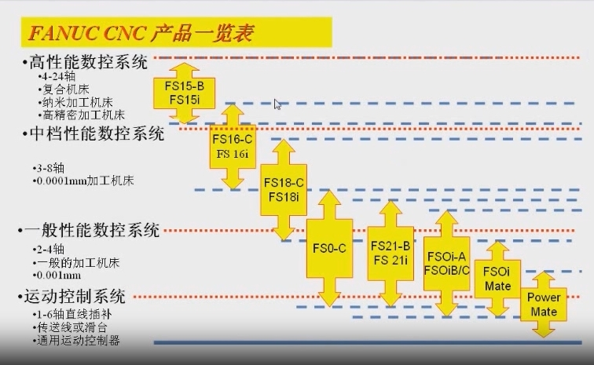
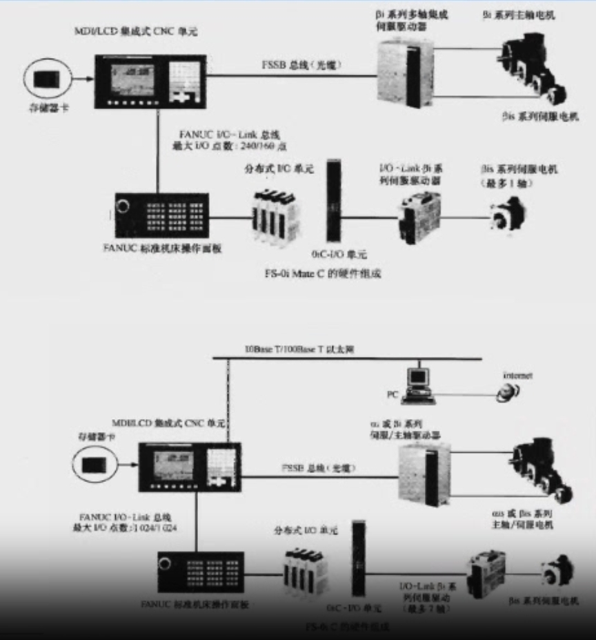
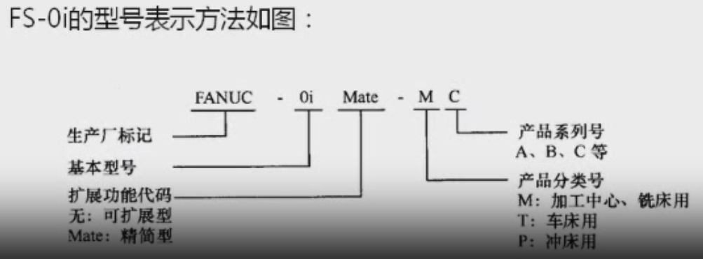
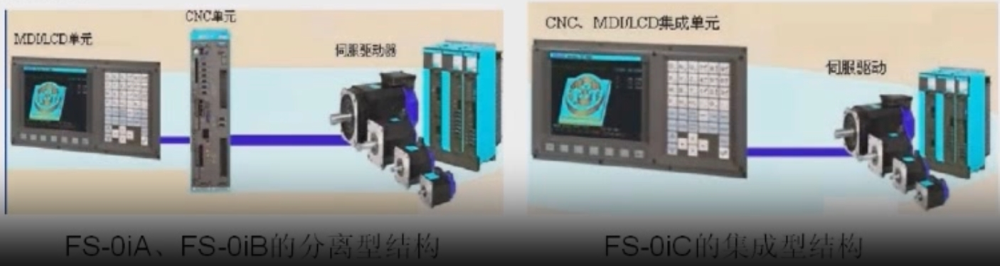

# FANUC OiC 數控機床電氣連接教程（第 1 課時）

> 本課時內容：FANUC OiC 數控系統概述
>
> 課程大綱：
> 1. FANUC OiC 數控系統概述
> 2. FANUC OiC 數控系統接口
> 3. FANUC OiC 數控機床電氣連接案例

---

## 本課時學習目標

1. 了解 FANUC 系統的發展歷程與 CNC 產品定位
2. 看懂 FS-0i 的型號表示方法
3. 區分 FS-0iA / 0iB / 0iC 三大系列的差異
4. 區分可擴展型 FS-0i 與精簡型 FS-0i Mate
5. 理解 FS-0iC 的組成與網路控制架構（I/O Link、FSSB）

## 本課時目錄

1. [FANUC 系統發展](#一fanuc-系統發展)
2. [產品型號表示](#二產品型號表示)
3. [產品系列及區別](#三產品系列及區別)
4. [FS-0i 與 FS-0i Mate](#四fs-0i-與-fs-0i-mate)
5. [FS-0iC 的組成](#五fs-0ic-的組成)
6. [重點整理與練習題](#六重點整理與練習題)

---

## 一、FANUC 系統發展

### 1. FANUC 公司的成立

1982 年以前，發那科公司隸屬於富士通 FANUC，之後正式獨立，成立 FANUC 公司。

### 2. 發展歷程

- 發那科公司飛躍性的發展，在於以**交流電機取代了直流電機**。直流電機的控制結構經常損壞，交流電機正好克服了這個缺點。
- 早期產品為 FANUC 5、FANUC 6 系統；1984 年之後，在 6 系統基礎上又研製出 10/11/12 系統，成為廣泛應用的系統。
- 與此同時，0 系統研製成功，標誌著 **FANUC 數位伺服開發成功**（即 0-TD）。
- 隨後相繼研製出：15 系統（1987 年）、16 系統（1990 年）、18 系統（1991 年）、21 系統（1991 年），以及 i 系列，即 0i、16i、18i、21i 系列。

### 3. FANUC CNC 產品一覽

下圖依性能將 FANUC CNC 分為四個層級：

| 性能層級 | 典型規格 | 對應機型 |
|---|---|---|
| 高性能數控系統 | 4～24 軸；複合機床、奈米加工機床、高精密加工機床 | FS15-B / FS15i |
| 中檔性能數控系統 | 3～8 軸；0.0001 mm 加工機床 | FS16-C / FS16i、FS18-C / FS18i |
| 一般性能數控系統 | 2～4 軸；一般加工機床；0.001 mm | FS0-C、FS21-B / FS21i、FS0i-A、FS0i-B/C、FS0i Mate |
| 運動控制系統 | 1～6 軸直線插補；傳送線或滑台；通用運動控制器 | Power Mate |

> 由圖可見：FS-0i 系列定位在「一般性能」層級，是面向量產、普及型機床的實用系統。

---

## 二、產品型號表示

### 1. FS-0i 系列簡介

FANUC-0i 系列數控系統（FS-0i）是 FANUC 公司為**大批量、普及型**數控機床開發的實用型數控系統，以**可靠性強、性價比高**著稱，在中國大陸與韓國等地生產的中低檔數控機床上應用極為廣泛。

與早期的 FS-0 系列 CNC 相比，FS-0i 最主要的區別在於採用了**網路控制技術**（如 I/O Link 匯流排、FSSB 匯流排等）：

- CNC 與驅動器、PMC 與 I/O 單元之間，可直接透過網路匯流排連接
- 節省大量連接線纜
- 減小 CNC 體積
- 提高可靠性

### 2. 三大產品系列與規格

- 依開發時間與結構，FS-0 推出三大系列：**FANUC 0i-MODEL A、MODEL B、MODEL C**，簡稱 **FS-0iA、FS-0iB、FS-0iC**。
- 依功能與擴展性能，每個系列又分兩種規格：
  - **可擴展型**：直接以 FS-0iA / 0iB / 0iC 表示
  - **功能精簡型**：型號中加「Mate」
- 依控制對象（機床類型），可分為車床用、銑床／加工中心用、沖床用等不同品種。

### 3. 型號表示方法

以 `FANUC-0i Mate-MC` 為例：

| 部分 | 意義 | 說明 |
|---|---|---|
| FANUC | 生產廠標記 | — |
| 0i | 基本型號 | — |
| Mate | 擴展功能代碼 | 無：可擴展型；Mate：精簡型 |
| M | 產品分類號 | M：加工中心、銑床用；T：車床用；P：沖床用 |
| C | 產品系列號 | A、B、C 等 |

> 範例解讀：`FANUC-0i Mate-MC` ＝ FANUC 的 0i 精簡型、加工中心／銑床用、C 系列。

---

## 三、產品系列及區別

FS-0iA、FS-0iB、FS-0iC 三大系列的**硬體、軟體設計與結構均有較大區別，性能依次提高**，但操作、編程方法類似。對設計、維修人員而言，系統選型、設計與維修時的主要區別有以下三方面。

### 1. CNC 結構

| 系列 | 結構 | 特點 |
|---|---|---|
| FS-0iA、FS-0iB（含 0i Mate A / B） | **分離型**：MDI/LCD 單元與 CNC 單元分離 | 可獨立安裝，兩者透過外部電纜連接；操作台一般只裝 MDI/LCD 單元，CNC 單元裝在電氣櫃中 |
| FS-0iC（含 0i Mate C） | **三位一體集成型**：MDI/LCD/CNC 集成 | 相互之間無需外接電纜，可同時安裝在操作台上；安裝更方便、體積更小、可靠性更高 |

### 2. 網路連接

- **FS-0iA**：雖然採用 I/O Link 內部匯流排技術，但僅限於 PMC 的 I/O Link 從站（如 FANUC 操作面板 I/O 單元、分散式 I/O 等）；**CNC 與伺服驅動器之間仍使用傳統 PWM 電纜**，即未採用網路匯流排技術。
- **FS-0iB、FS-0iC**：
  - I/O Link 從站可透過 I/O Link 內部匯流排網路連接
  - **CNC 與伺服驅動器之間也可透過以光纜為傳輸介質的 FSSB**（FANUC Serial Servo Bus，FANUC 高速串列伺服匯流排）連接
  - 資料傳輸速度更高，連接更簡單、可靠

### 3. 配套驅動

FS-0 配套的驅動器，與驅動器和 CNC 之間的連接方式有關：

- **FS-0iA**：採用傳統 PWM 電纜連接，須配套早期的 **α 系列**驅動器
- **FS-0iB、FS-0iC**：已採用 FSSB 匯流排連接，需配套 **αi / βi 系列**驅動器

### 小結對照表

| 項目 | FS-0iA | FS-0iB | FS-0iC |
|---|---|---|---|
| CNC 結構 | 分離型 | 分離型 | 集成型（三位一體） |
| I/O Link | 有（僅 PMC 從站） | 有 | 有 |
| CNC—驅動器連接 | PWM 電纜 | FSSB 光纜 | FSSB 光纜 |
| 配套驅動器 | 早期 α 系列 | αi / βi 系列 | αi / βi 系列 |

---

## 四、FS-0i 與 FS-0i Mate

精簡型 FS-0i Mate A / B / C 與可擴展型 FS-0i A / B / C 的主要區別，體現在**硬體擴展性能**與**軟體功能**上。與系統設計、選型密切相關的有以下幾方面。

### 1. 硬體擴展性能

- FS-0i Mate 主板上**沒有安裝選擇功能板所需的附加插槽**，因此不能增加附加硬體模組（插卡）與相關選擇功能，例如：串列通信接口板、資料服務板、附加 HSSB 接口板等。
- FS-0i Mate 也**沒有附加軸控制功能**（FS-0i Mate MC 的第 4 軸控制、FS-0i Mate TC 的第 3 軸控制）、**第 2 主軸控制功能**與 **PMC 擴展功能**。
- 也不能選用 10.4 吋彩色 LCD 顯示器等特殊部件。

### 2. I/O Link 匯流排連接

| 項目 | FS-0i Mate | FS-0i |
|---|---|---|
| 開關量 I/O 點數上限（輸入／輸出） | 240 / 160 點 | 1024 / 1024 點 |
| 透過 I/O Link 連接的 βi 系列伺服驅動器 | 最多 1 個 | 較多（教材文字為 8 個，圖中標示最多 7 軸） |
| 限制原因 | 受 PMC 的 CPU 性能、運算速度、定址能力限制 | — |

### 3. PMC 性能

| 項目 | FS-0i Mate | FS-0i |
|---|---|---|
| 擴展功能 | 內建 PMC 不可選用擴展功能 | 可選用 |
| 用戶程式容量 | 最大 5000 步（PMC-SA1 型） | 最大 16000 步（PMC-SA3）、24000 步（PMC-SB7） |
| 每步平均處理時間 | 5 μs | 0.15 μs |

### 4. 配套驅動

- **FS-0i Mate**：考慮系統成本與性價比，一般以 **βi 系列**驅動器為主。
- **FS-0i**：可配套 **αi 系列**驅動器。

### 5. 軟體功能

FS-0i Mate 不具備同步軸控制、傾斜軸控制、電子凸輪控制、雙向螺距誤差補償等特殊控制功能。

- **簡易同步控制**（Simple Synchronous Control）：兩個進給軸，一個為主動軸，另一個為從動軸。主動軸接收 CNC 的移動指令，從動軸跟隨主動軸運動，實現兩軸同步移動。CNC 隨時監視兩軸的移動位置，但**不對兩者的誤差進行補償**；若兩軸位置偏差超過參數設定值，CNC 即發出報警並停止各軸運動。此功能用於大工作台的雙軸驅動。
- **傾斜軸控制**：對 T 系列而言，即使實際的 X 軸不垂直於 Z 軸，也可假設兩者相互垂直而建立直角坐標系，以簡化編程；每個軸的運動根據傾斜角自動控制。

---

## 五、FS-0iC 的組成

### 1. 傳統 CNC 控制系統角度

從傳統角度看，FS-0iC / FS-0i Mate C 由以下部件組成：

- MDI/LCD/CNC 集成單元及其附件（如操作面板、手持式操作盒等）
- 伺服驅動器
- PMC 的開關量 I/O 連接單元（包括 FANUC 操作面板）

### 2. 網路控制角度

從網路控制角度看，FS-0iC / FS-0i Mate C 包含 **I/O Link 內部匯流排**與 **FSSB 高速串列伺服匯流排**兩大網路控制系統，由下列部分組成：

- I/O Link 主站
- I/O Link 匯流排
- I/O Link 從站
- FSSB 匯流排
- FSSB 主站（CNC）
- FSSB 從站設備
- 公用的人機界面（MDI/LCD 單元）

### 3. 硬體組成圖

**上圖：FS-0i Mate C 的硬體組成**

- MDI/LCD 集成式 CNC 單元，配記憶卡
- **FSSB 匯流排（光纜）** → βi 系列多軸集成伺服驅動器 → βi 系列主軸電機、βis 系列伺服電機
- **FANUC I/O Link 匯流排**（最大 I/O 點數：240/160 點）→ FANUC 標準機床操作面板、分散式 I/O 單元、0iC-I/O 單元
- I/O Link βi 系列伺服驅動器 → βis 系列伺服電機（最多 1 軸）

**下圖：FS-0iC 的硬體組成**

- MDI/LCD 集成式 CNC 單元，配記憶卡，並可透過 10Base-T/100Base-T 乙太網路連接 PC 與 Internet
- **FSSB 匯流排（光纜）** → αi 或 βi 系列伺服／主軸驅動器 → αis 或 βis 系列主軸／伺服電機
- **FANUC I/O Link 匯流排**（最大 I/O 點數：1024/1024 點）→ FANUC 標準機床操作面板、分散式 I/O 單元、0iC-I/O 單元
- I/O Link βi 系列伺服驅動 → βis 系列伺服電機（最多 7 軸）

### 4. 兩條匯流排各管什麼

| 匯流排 | 傳輸介質 | 連接對象 | 傳遞的信號 |
|---|---|---|---|
| FSSB | 光纜 | CNC ↔ 伺服／主軸驅動器 | 位置、速度等伺服控制數據 |
| I/O Link | 專用電纜 | CNC(PMC) ↔ 操作面板、分散式 I/O、I/O 單元 | 開關量輸入／輸出 |

---

## 六、重點整理與練習題

### 重點整理

1. FS-0i 以網路匯流排（I/O Link、FSSB）取代大量傳統連接線，是與早期 FS-0 最大的差別。
2. 型號 `FANUC-0i Mate-MC`：Mate＝精簡型；M＝銑床／加工中心；C＝C 系列。
3. 0iA / 0iB 為分離型結構；**0iC 為 MDI/LCD/CNC 三位一體**。
4. 0iA 的 CNC 與驅動器用 PWM 電纜（配 α 系列）；0iB / 0iC 用 FSSB 光纜（配 αi / βi 系列）。
5. 0i Mate 在 I/O 點數、PMC 容量、擴展插槽、特殊軟體功能上均受限。

### 練習題

1. 請解釋型號 `FANUC-0i Mate-TC` 各部分的含義。
2. FS-0iC 與 FS-0iA / 0iB 在 CNC 結構上有何不同？對安裝有什麼好處？
3. FSSB 的全稱是什麼？它連接哪兩類設備？傳輸介質是什麼？
4. FS-0i Mate 與 FS-0i 在 I/O Link 的開關量 I/O 點數上限分別是多少？
5. 為什麼 FS-0iA 要配套早期 α 系列驅動器，而 0iB / 0iC 要配套 αi / βi 系列？
6. 簡述「簡易同步控制」的原理，以及它適用於什麼場合。

### 參考答案

1. FANUC＝廠商標記；0i＝基本型號；Mate＝精簡型；T＝車床用；C＝C 系列。
2. 0iA / 0iB 為 MDI/LCD 與 CNC 單元分離，需外接電纜；0iC 為三位一體集成，無需外接電纜，安裝方便、體積小、可靠性高。
3. FANUC Serial Servo Bus（FANUC 高速串列伺服匯流排）；連接 CNC 與伺服／主軸驅動器；傳輸介質為光纜。
4. FS-0i Mate：240/160 點；FS-0i：1024/1024 點。
5. 0iA 的 CNC 與驅動器之間使用傳統 PWM 電纜，只能配早期 α 系列；0iB / 0iC 採用 FSSB 匯流排連接，故需配支援 FSSB 的 αi / βi 系列。
6. 一軸為主動軸、另一軸為從動軸，從動軸跟隨主動軸；CNC 監視兩軸位置但不補償誤差，超過參數設定值即報警並停軸；用於大工作台的雙軸驅動。

---

*下一課時預告：FANUC OiC 數控系統接口。*
