# FANUC 0i-C 數控機床電氣連接（第 2 課時）

> 本課內容：延續第 1 課時的「FS-0iC 系統概述」，從網路控制角度講完 FS-0iC 的組成，接著說明控制單元的原理框圖、CNC 單元及其附件，以及 I/O Link、FSSB 兩條網路上的從站設備。

---

## 4. FS-0iC 的組成（續）：從網路控制的角度

FS-0iC 內部有兩大網路匯流排：**I/O Link** 與 **FSSB**。每條匯流排都有「主站」與「從站」。

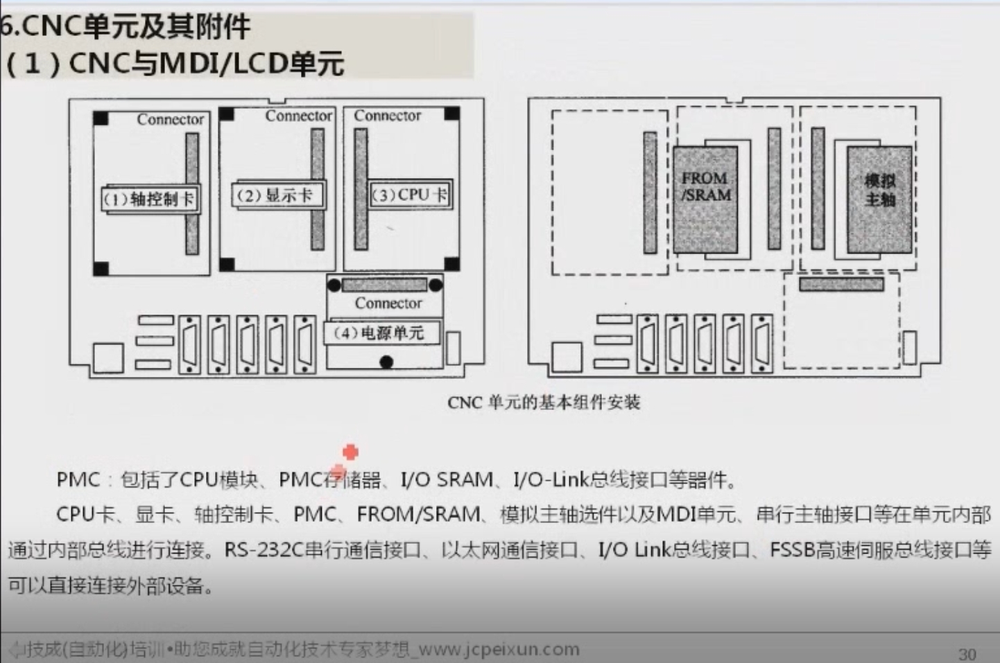

*圖：上為 FS-0i Mate C 的硬體組成，下為 FS-0iC 的硬體組成。*

### 4.1 I/O Link 內部匯流排

| 角色 | 設備 |
|---|---|
| **主站** | CNC 內建的 PMC |
| **從站** | 所有具備 I/O Link 介面的設備： • FANUC 標準機床操作面板、操作面板 I/O 單元 • 0iC-I/O 單元（機床 I/O 連接單元） • 分佈式 I/O 單元 • 帶 I/O Link 介面的 βi 系列伺服驅動器 |

### 4.2 FSSB 高速串列伺服匯流排

| 角色 | 設備 |
|---|---|
| **主站** | CNC |
| **從站** | • αi 系列或 βi 系列伺服／主軸驅動器 • 分離型檢測介面（外置式測量檢測介面） |

說明：

- **0i Mate C** 基於經濟考量，通常配套 **βi 系列**驅動器。
- **0i C** 則可配 **αi 或 βi 系列**驅動器。
- 兩種系統的最大 I/O 點數不同（見下圖）：0i Mate C 為 240/160 點，0iC 為 1024/1024 點；I/O Link 上的 βi 伺服驅動器，0i Mate C 最多 1 軸，0iC 最多 7 軸。

### 4.3 乙太網與人機介面

- FS-0iC（**不含** FS-0i Mate C）可透過**功能選件**增加 CNC 與**工業乙太網**連接的介面，使整個 CNC 系統成為上一級工業乙太網系統的**從站**。
- CNC 單元所整合的 **MDI/LCD 單元**，是 I/O Link 與 FSSB 兩大網路控制系統**共用的人機操作介面**。

> 小結：第 1 課時是從「傳統角度」看 FS-0iC 的組成，本課則是從「網路控制角度」再看一次。

---

## 5. FS-0iC 的原理框圖

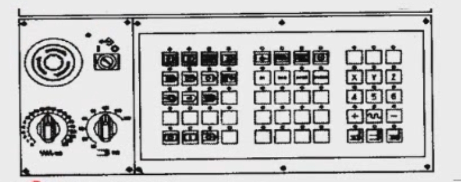

*圖：CNC 的內部結構原理框圖。*

CNC 控制單元內部主要由下列部分組成：

| 組成 | 內含器件 |
|---|---|
| **CPU 卡** | CNC 的 CPU 模組、作業系統（引導軟體）、DRAM、標準 RS-232C 串列通訊介面等 |
| **顯卡** | 顯示控制用 CPU 模組、DRAM、VGA 控制器、圖形控制器、乙太網通訊介面等 |
| **軸控制卡** | DSP 模組、SRAM 模組、SRAM 與 FSSB 匯流排介面等 |
| **PMC** | CPU 模組、PMC 記憶體、I/O SRAM、I/O Link 匯流排介面等 |
| **電源單元** | 輸入 DC 24V，經變壓後在印刷板內部產生 5V、3.3V、15V 三種電壓；**3.3V 供內部 CPU 使用** |

此外，框圖中還有 FROM/SRAM（由 3V 鋰電池備份）、字元產生器、類比主軸、串列主軸介面等。

**連接關係：**

- CPU 卡、顯卡、軸控制卡、PMC、FROM/SRAM、類比主軸選件、MDI 單元、串列主軸介面等，在單元**內部**透過**內部匯流排**連接。
- RS-232C 串列通訊介面、乙太網通訊介面、I/O Link 匯流排介面、FSSB 高速伺服匯流排介面等，可以**直接連接外部設備**。

---

## 6. CNC 單元及其附件

### （1）CNC 與 MDI/LCD 單元

#### ① 基本功能與選件功能

**基本結構（主板）** 包含：CNC 用主 CPU、電源、2 軸至 4 軸控制、主軸介面、LCD/MDI、I/O Link、PMC-SA1/SB7、類比輸出／高速 DI、RS-232C×2、記憶卡介面。

**選擇配置（選件）**：

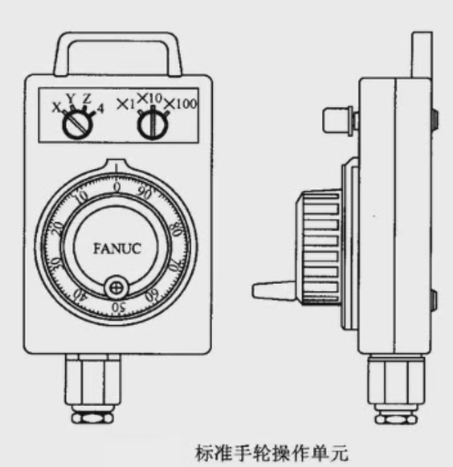

*圖：左上為選擇配置，右上為基本結構。*

- 串列通訊板（DNC2）
- HSSB 介面板（高速串列匯流排介面）
- 網板（乙太網板、PROFIBUS-DP 板、DeviceNet 板）
- 資料伺服器板（資料伺服器功能）

> 注意：**0i 系統**的控制單元有兩個選擇插槽，或者沒有選擇插槽；**0i Mate 系統**沒有選擇插槽，因此不能增加選擇配置板。

##### DNC1

- 實現 CNC 系統與主電腦之間傳送資料資訊的一種**通訊協定及通訊指令庫**，由 FANUC 公司開發，用於 **FMS 中加工單元的控制**。
- 可實現的功能：加工設備的運行監視；加工與輔助設備的控制；加工資料（包括參數）與檢測資料的上傳下送；故障診斷等。
- 硬體連接為**一點對多點**，**一台電腦可連 16 台 CNC 機床**。

##### DNC2

- 功能與 DNC1 基本相同，只是**通訊協定不同**：DNC2 採用歐洲常用的 **LSV2 協定**。
- 硬體連接為**點對點**，**一台電腦可連 8 台 CNC 機床**。
- 通訊速率最快為 19 Kb/秒。

> **補充：FMC 與 FMS**
>
> - **FMC（柔性製造單元）**：Flexible Manufacturing Cell，通常由單台數控加工設備加上「自動上下料機構」構成，可視為規模最小的 FMS，特點是實現**單機柔性化及自動化**。
>   - 一般單台加工設備：工件靠人工裝上、再執行加工程式、加工完再人工卸下。
>   - 加上機械手自動把工件從料倉取出、夾到工作台、加工完再取下放回料倉，就成為 FMC。
> - **FMS（柔性製造系統）**：把 cell 擴大為 system，通常包括**多台**數控機床，由**集中的控制系統**及**物料搬運系統**連接，可在不停機的情況下實現**多品種、中小批量**的加工與管理。
>   - 例如：工件自動從第一台機床（加工箱體）搬到第二台（鑽孔），再搬到第三台（下一道加工）。

##### HSSB（高速串列匯流排，High Speed Serial Bus）

- 是 CNC 系統與主電腦的**連接介面**，用於兩者間的資料傳送。
- 傳送的資料除了 DNC1、DNC2 的資料外，還可傳送 **CNC 的各種顯示畫面資料**，因此可以用電腦的螢幕和鍵盤來操作機床。
- ⚠️ 不要與 **FSSB**（CNC 與伺服之間的匯流排）混淆。

##### 乙太網口（Ethernet）

FANUC 提供兩種乙太網口：

| 類型 | 特點 |
|---|---|
| **PCMCIA 卡口** | 可臨時傳送一些資料，用完即可將卡拔下 |
| **內嵌乙太網板** | 裝在 CNC 系統內部，用於**長期**與主機連結，實施加工單元的**即時控制** |

##### 資料伺服器功能

- 主要用於**線上加工**與**程式傳輸**，相比傳統 RS-232 通訊方式**更加穩定**。
- 使用時必須選配**高速乙太網板**和**資料伺服器功能**，電腦需安裝 **Serv-U** 軟體。

#### ② 顯示器外形與接口（0i-C）

0i-C 的 CNC 與 MDI/LCD 是**整合為一體**的結構（顯示器與主板為一體型）。

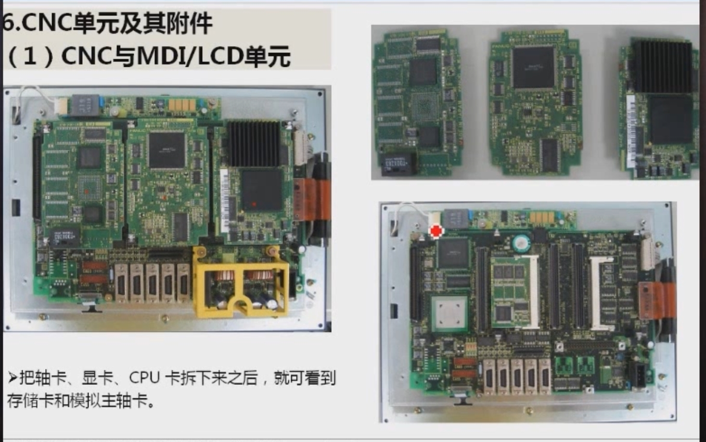

*圖：0i-C 顯示器外形結構（單元背面）。*

背面可看到風扇、電池，以及下列接口：

| 插座號 | 用途 |
|---|---|
| COP10A | 伺服放大器（FSSB） |
| CA55 | MDI |
| CA69 | 伺服檢查板 |
| JD36A | RS-232C 串口 |
| JD36B | RS-232C 串口 |
| JA40 | 類比輸出／高速 DI（接類比主軸） |
| JD1A | I/O Link |
| JA7A | 串列主軸／位置編碼器 |
| CP1 | DC24V 輸入 |

> COP10A-1 是安裝在伺服板上的插頭。

#### ③ 內部結構：四大部分

拆開外殼後，最明顯可見四大部分：

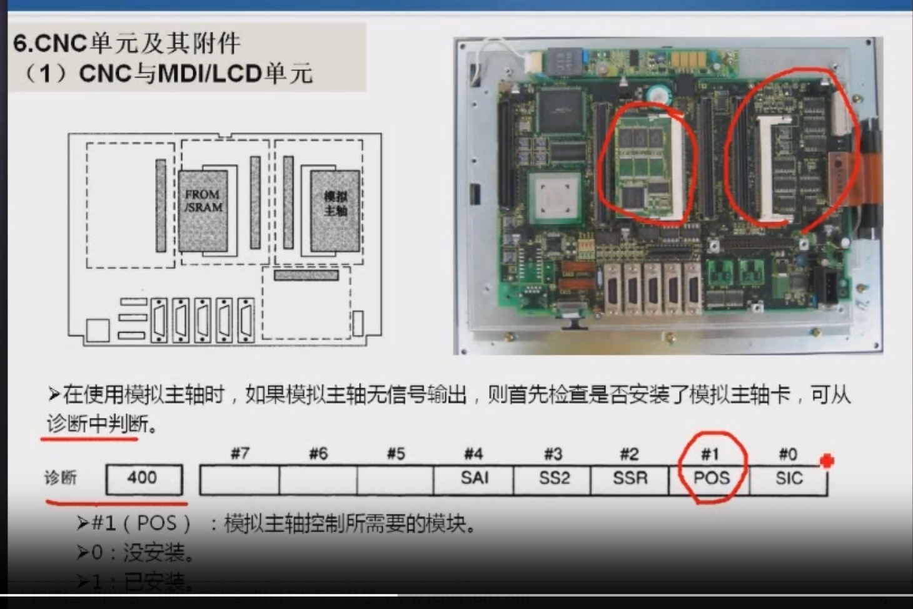

*圖：左為實物，右為示意圖。*

1. **軸控制卡**（左）
2. **顯卡**（中）
3. **CPU 卡**（右）
4. **電源單元**（下方黃色部分）

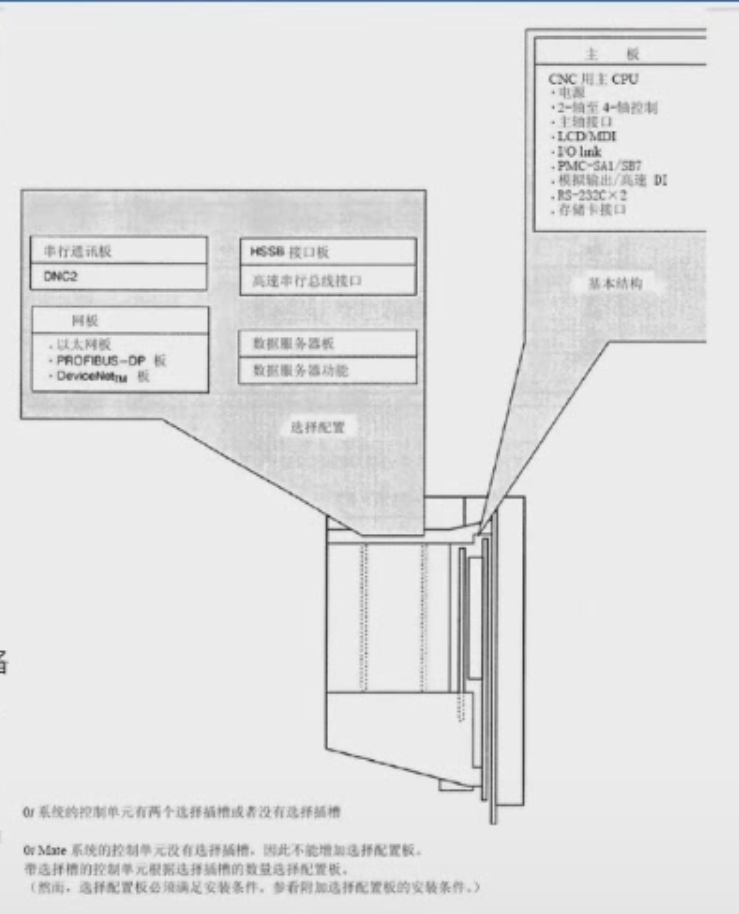

*圖：CNC 單元的基本組件安裝（右圖為把三塊卡拆下後的結構，可見 FROM/SRAM 與類比主軸）。*

#### ④ 拆下三塊卡之後

把軸卡、顯卡、CPU 卡拆下來之後，就可看到**存儲卡（FROM/SRAM）**和**類比主軸卡**。

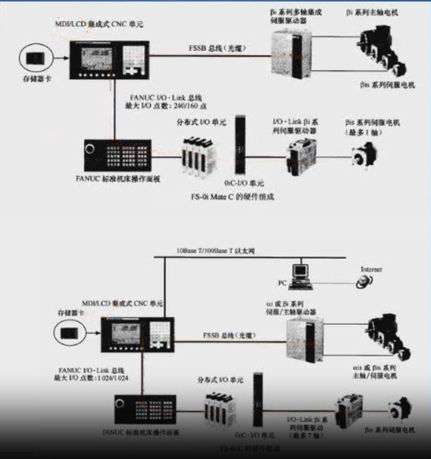

*圖：左為整機，右上為三塊卡實物，右下為拆卡後的主板。*

#### ⑤ 類比主軸卡的檢查（診斷號 400）

使用**類比主軸**時，必須安裝類比主軸卡，否則類比主軸**無訊號輸出**。是否已安裝，可從**診斷**中判斷：

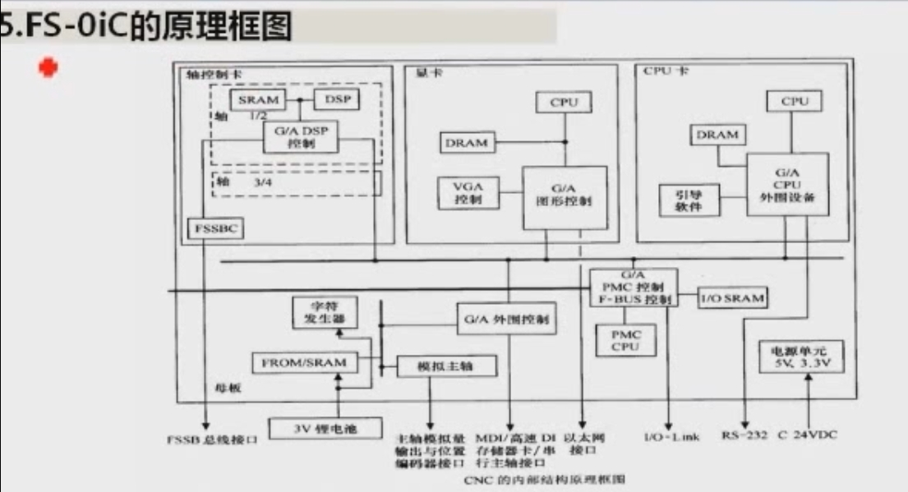

| 位元 | #7 | #6 | #5 | #4 | #3 | #2 | #1 | #0 |
|---|---|---|---|---|---|---|---|---|
| **診斷 400** | | | | SAI | SS2 | SSR | **POS** | SIC |

- **#1（POS）**：類比主軸控制所需要的模組。
  - `0`：沒安裝
  - `1`：已安裝

> **提醒：**
>
> - **診斷號 400 與參數號 400 不是同一回事。** 參數可以修改；診斷**不能修改**，只是給你**檢查、查看**用的。
> - 位元由右往左數，**第一個是 #0，第二個才是 #1**。

#### ⑥ 鍵盤的布置方式

在 MDI/LCD/CNC 整合式結構中，根據機床操作台的布局，可以選擇**鍵盤水平布置**或**鍵盤垂直布置**。

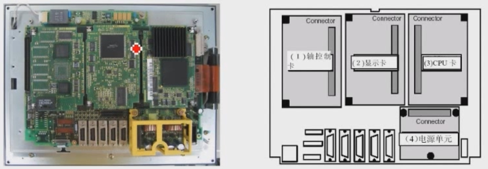

*圖：左為鍵盤水平布置，右為鍵盤垂直布置。*

### （2）標準操作面板

- 標準操作面板是 FANUC 公司針對**典型加工中心／銑床／車床**的要求專門設計的**通用面板**，屬於 CNC **附件（選件）**。用戶可根據需要選用（FANUC 原廠面板價格較高），也可以**自製**。
- 分為**主操作面板（主面板）**與**子操作面板（子面板）**。

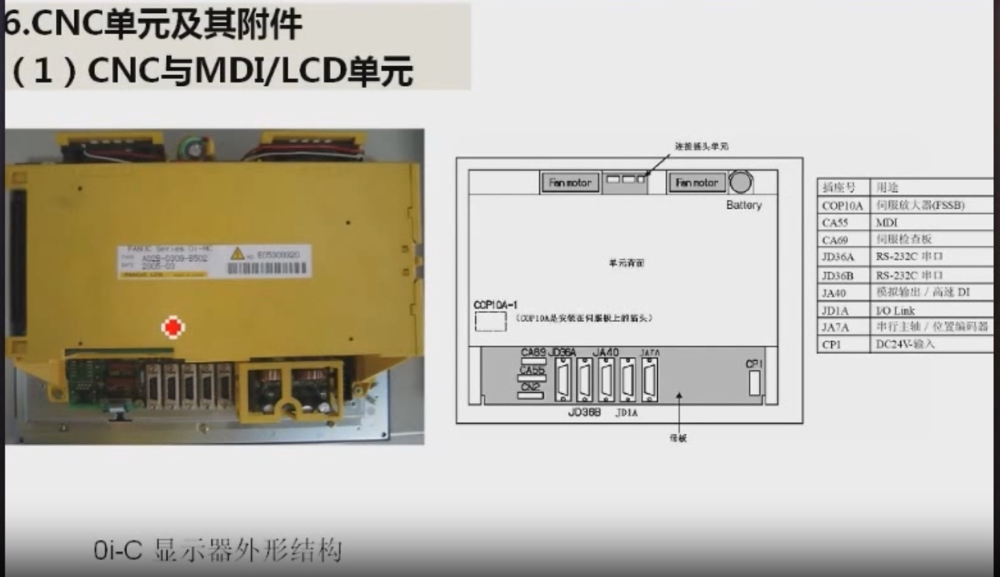

*圖：標準操作面板的布置 —（a）7.2 英寸／8.4 英寸水平布置；（b）7.2 英寸／8.4 英寸垂直布置；（c）10.4 英寸垂直布置。*

#### 主面板

- 有：**操作方式選擇**（如自動運行、編輯 EDIT、手動資料輸入 MDI 等）、**軸選擇**（X、Y、Z、第 4、第 5 軸）、**程序運行控制**（如程序啟動）、**主軸控制**等按鍵與指示燈。
- 並整合有 **I/O Link 匯流排介面電路**，透過 JD1A、JD1B 接入 CNC 的 I/O Link。

#### 子面板

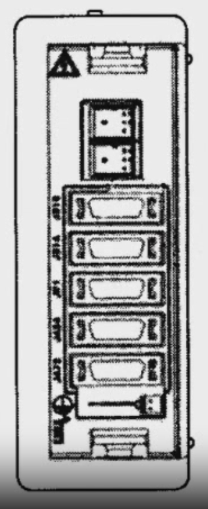

*圖：左側為子面板（急停、旋鈕開關等），右側為主面板的按鍵區。*

| 型式 | 布置 | 配備 |
|---|---|---|
| **A 型** | 水平布置 | 進給速度倍率開關、主軸轉速倍率開關、急停按鈕、程序保護按鈕、**CNC 啟動／停止按鈕** |
| **B 型** | 垂直布置 | 進給速度倍率開關、主軸轉速倍率開關、急停按鈕、程序保護按鈕（**沒有** CNC 啟動／停止按鈕） |

顯示器 MDI 與標準操作面板可有多種組合方式：水平布置、垂直布置，以及子面板、主面板、顯示器和鍵盤垂直布置等。

### （3）手輪

FANUC 標準手輪操作單元為**懸掛式**，單元上裝有：

- **手輪軸選擇開關**：例如要用手輪控制 X 軸，就把開關撥到 X；要控制 Z 軸，就撥到 Z。
- **手輪倍率選擇開關**：×1、×10、×100。
- **手輪**（脈衝產生器）。

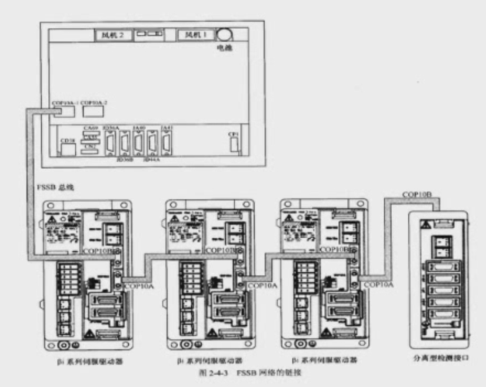

*圖：標準手輪操作單元（正面與側面）。*

**倍率說明：** 手輪刻度 0～100 共 100 格，搖動**一格**（不是一圈）時：

| 倍率 | 機床移動量 |
|---|---|
| ×1 | 1 μm（0.001 mm） |
| ×10 | 10 μm（0.01 mm） |
| ×100 | 100 μm（0.1 mm） |

> 手輪又稱 **MPG**（Manual Pulse Generator，**手搖脈衝發生器**）。

---

## 7. I/O Link 從站設備

**從站**是網路控制系統上的名稱：受**主站（PMC）**控制，以網路通訊方式進行資料傳輸的 I/O 設備。在 CNC 系統上，就是傳統意義上連接機床或操作面板中的**按鈕、行程開關、指示燈、電磁閥**等開關量 I/O 的連接單元，或 PLC 的 I/O 模組。

在 FS-0iC 系統中，I/O Link 從站連接在匯流排上；**所有從站都必須具備 FANUC 標準 I/O Link 匯流排介面**（標誌就是 **JD1A / JD1B**），才能透過 FANUC 的網路傳輸協定與 I/O Link 匯流排連接和通訊。

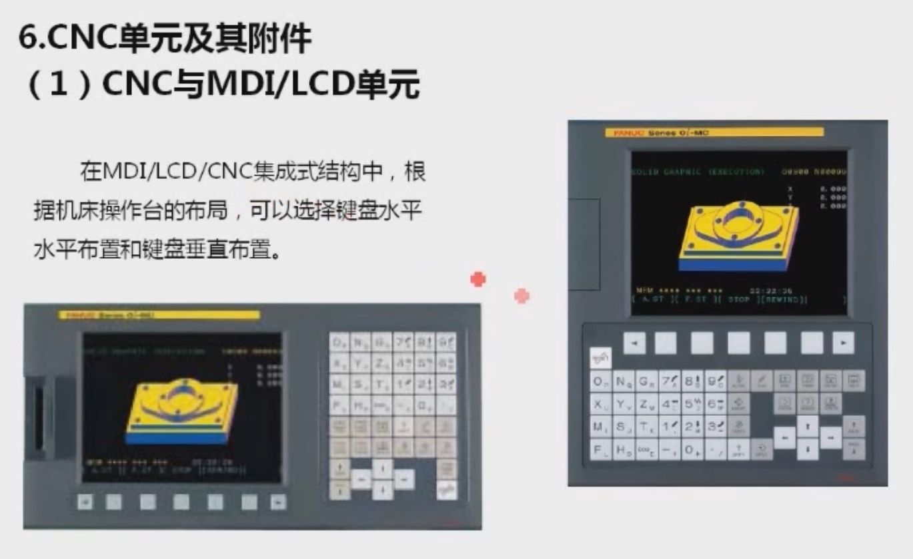

*圖：I/O Link 網路的連接（FS-0iC CNC 單元、機床操作面板、操作面板 I/O 單元、0iC-I/O 單元、分佈式 I/O 單元、βi 伺服驅動器）。*

### 7.1 分佈式 I/O 單元

- 是 PLC 控制系統的**標準設備**。
- 特點：利用網路通訊功能，把分佈在主機各部分、但又相對集中的各種**執行元件、檢測元件**的 I/O 訊號統一匯總後，用簡單的通訊匯流排與 PLC 連接，**大幅減少現場接線工作量**。
- 其實質相當於把 PLC 的 I/O 模組佈置到**遠離 PLC 主機**的位置。

### 7.2 機床 I/O 連接單元（0iC-I/O 單元）

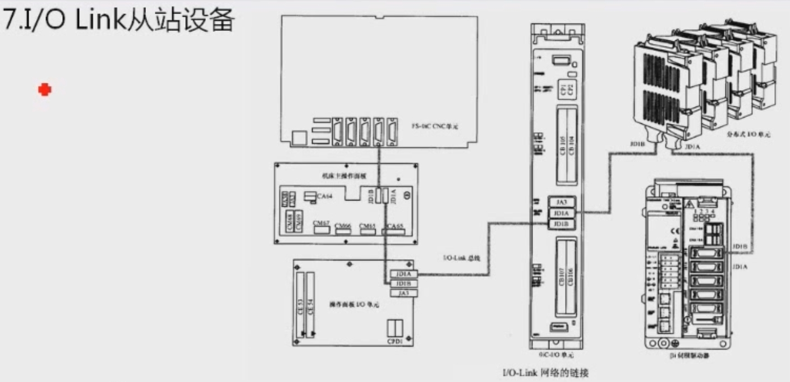

與分佈式 I/O 單元比較：

| 項目 | 機床 I/O 連接單元 | 分佈式 I/O 單元 |
|---|---|---|
| I/O 點數 | **多** | 可變（後面有擴充模組，可增減） |
| 體積 | **小** | 較大 |
| 成本 | **低** | 較高 |
| I/O 規格 | **固定**（點數由 CB104～CB107 等固定接口決定，無法改變） | 通用性強，點數與規格可變 |
| 類比量輸入 | 無 | **有**（具備類比量輸入功能） |

### 7.3 帶 I/O Link 介面的 βi 系列伺服驅動器

- 帶有 I/O Link 介面的 βi 系列伺服放大器，可透過 I/O Link 匯流排與 PMC 連接，成為 PMC 的**輔助控制軸**。
- 典型用途：**刀庫定位軸**、**分度工作台定位軸**（工件加工完一面後旋轉到另一面）、**機械手**、自動送料等。

> **I/O Link 軸 與 PMC 軸的區別（不要混淆）：**
>
> | | 控制對象 | 控制權 |
> |---|---|---|
> | **PMC 軸** | **CNC 軸**（如銑床的 X、Y、Z 軸），改由 PMC 程序控制 | PMC |
> | **I/O Link 軸** | **機床輔助驅動軸**（不是 CNC 軸） | PMC |

### 7.4 I/O Link 從站設備配置原則

1. 網路採用**匯流排拓撲結構**，各從站**依次串聯**連接（由 JD1A 接到下一站的 JD1B）。
2. 每個 PMC 主站**最多**連接 **16 個** I/O Link 從站。
3. 不同規格的 I/O Link 從站在網路上的**位置沒有固定要求**（例如分佈式 I/O 與 0iC-I/O 單元可以互換位置），但各從站的**地址需要設定**，地址可透過 **MDI/LCD 面板**設定。
4. 連接時：
   - **JD1A**：匯流排**輸出端**，連接**下一個**從站；
   - **JD1B**：匯流排**輸入端**，與**上一級**從站相連；
   - 匯流排**終端不需要**終端連接器（最後一個從站的 JD1A 空著即可）。
5. **單個從站**所連接的 I/O 點數不能超過 **256 / 256 點**（16 位元組輸入／16 位元組輸出）。
6. 所有從站實際使用的 I/O 點總數受 PMC 功能限制：
   - **FS-0iC**：最大 **1024 / 1024** 點
   - **FS-0i Mate C**：最大 **240 / 160** 點
7. 機床上**每個手輪佔用 8 點輸入**，FS-0iC 最多可配 **3 個手輪**，共 **24 點輸入**。

---

## 8. FSSB 從站設備

**FSSB**：FANUC Serial Servo Bus，**FANUC 高速串列伺服匯流排**。

- 連接 FS-0iC 系統的 CNC 與伺服驅動器等。
- 傳輸介質為**光纜**。
- 可在 CNC 的 MDI/LCD 單元上，直接對驅動器的**參數、狀態**進行集中統一的**設定、調整和監控**。
- FSSB 從站只有兩大類：**伺服驅動器**與**分離型檢測介面**。
- FSSB 從站**最大數**：FS-0i MC 為 **5 個**（4 軸 + 1 個分離型檢測介面）。

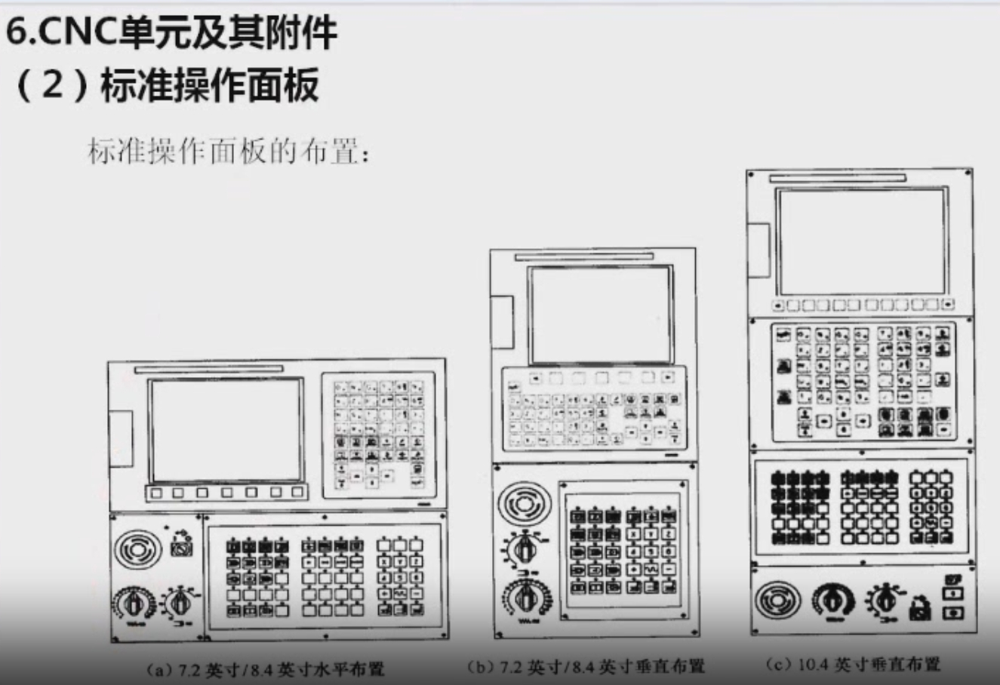

*圖 2-4-3：FSSB 網路的連接。CNC 的 COP10A 以光纜接到第一台驅動器的 COP10B，再由其 COP10A 依序串接到下一台，最後接分離型檢測介面。*

### 8.1 伺服驅動器

分為 **αi 系列**與 **βi 系列**（0i 主要配 αi，0i Mate 因成本考量配 βi）。

**αi 系列**

- **模組化結構**：由電源模組、伺服驅動模組、主軸驅動模組等組成，**電源模組公用**（同時供電給伺服驅動與主軸驅動）。
- 為縮小體積，小功率電機的驅動模組往往採用**雙軸、三軸驅動一體型**結構（一個模組可驅動 2～3 個電機）。

**βi 系列**

可分為兩類：

| 類型 | 說明 |
|---|---|
| **單軸型（SVM）** | 電源、伺服驅動一體型 |
| **多軸一體型（SVPM）** | 兩軸＋主軸（SVPM2）、三軸＋主軸（SVPM3）兩種結構 |

一體型驅動的全部伺服軸、主軸、電源等控制電路均採用**一體化設計，無法分離**。

### 8.2 分離型檢測介面

- 可將**座標軸獨立位置檢測器件**（如光柵尺、編碼器等）的檢測訊號，轉換為高速光纜 **FSSB 匯流排**傳輸的訊號。
- 介面可直接連接**差分脈衝訊號**或**串列脈衝輸入訊號**。
- 主要用於**全閉環**控制：直接從工作台檢測位置並回饋給系統。一般機床用**半閉環**（由電機端編碼器回饋）即可。

---

## 本課重點整理

1. FS-0iC 有兩大網路：**I/O Link**（主站＝內建 PMC）與 **FSSB**（主站＝CNC）。
2. 控制單元由 **CPU 卡、顯卡、軸控制卡、PMC、電源單元**組成；拆下三塊卡後可見 **FROM/SRAM 與類比主軸卡**。
3. 使用類比主軸時，用 **診斷 400 的 #1（POS）** 檢查是否裝了類比主軸卡（診斷只能看、不能改）。
4. 選件功能：**DNC1／DNC2、HSSB、乙太網、資料伺服器**。
5. 附件：**標準操作面板（主面板＋A/B 型子面板）**、**手輪（MPG）**。
6. I/O Link 從站：**最多 16 個**，**JD1A 出、JD1B 入**，單站 **256/256 點**，FS-0iC 總計 **1024/1024 點**；每個手輪佔 **8 點**輸入。
7. FSSB 從站：**光纜**連接，伺服驅動器（αi／βi）＋分離型檢測介面，**最多 5 個**。

> 下一課時將學習 FANUC 0i-C 數控系統的**接口**。
