# FANUC 0i-C 數控機床電氣連接（第 3 課時）

> 本課內容：進入第二大部分「FANUC 0i-C 數控系統接口」。簡要介紹 0i-C／0i Mate-C 系統與外部設備（輸入電源、放大器、I/O 等）之間的總體連接，包括放大器（αi 系列電源模塊、主軸模塊、伺服模塊，βi 系列放大器）之間的連接、與電源和電機的連接、與 RS-232C 設備的連接，最後介紹存儲卡的使用（資料備份、DNC 加工等）。

---

## 二、FANUC 0i-C 數控系統接口（本部分的 11 個小節）

1. 總體連接圖
2. CNC 的連接
3. 伺服／主軸放大器的連接
4. 模擬主軸的連接
5. I/O 的連接
6. 急停的連接
7. 電源的連接
8. 電機的連接
9. 分離型檢測器的連接
10. 其他設備的安裝和連接：（1）和電腦的連接；（2）使用 M-CARD 備份參數／加工程序等
11. I/O Link 軸的連接

本課時講解第 1、2 節，以及第 3 節中的 **αi 系列**伺服驅動器。

---

## 1. 總體示意圖

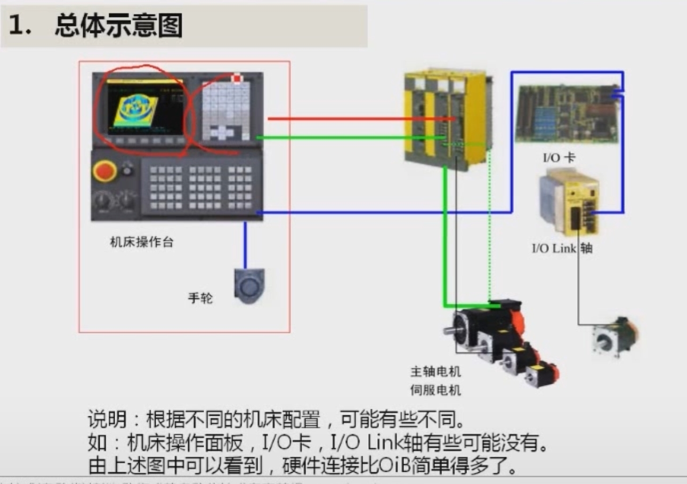

*圖：FS-0iC 的總體連接示意。*

圖中各部分：

- **LCD／MDI／CNC**：三者整合成一體，CNC 位於顯示器背面。
- **機床操作台**：包括主面板、子面板，另有**手輪**。
- **αi 放大器**（一體型）：包含電源模塊、主軸模塊、伺服模塊，再接出**主軸電機**與**伺服電機**。CNC 與放大器之間透過 **FSSB 匯流排**連接。
- **I/O Link 匯流排**：連接 **I/O 卡**與 **I/O Link 軸**（I/O Link 軸驅動器及其電機）。

> **說明：** 根據不同的機床配置，連接可能有些不同。例如機床操作面板、I/O 卡、I/O Link 軸，有些機床可能沒有（操作面板也可能不用標準面板而是自製）。由圖可見，**硬件連接比 0i-B 簡單得多**。

---

## 綜合連接圖

綜合連接圖篇幅較大。**最右邊**是 FSSB 等**基本功能**的連接圖；I/O Link 的連接另用兩個小圖表示（0i 系列與 0i Mate 系列）；左側的是 0i **選用功能**。

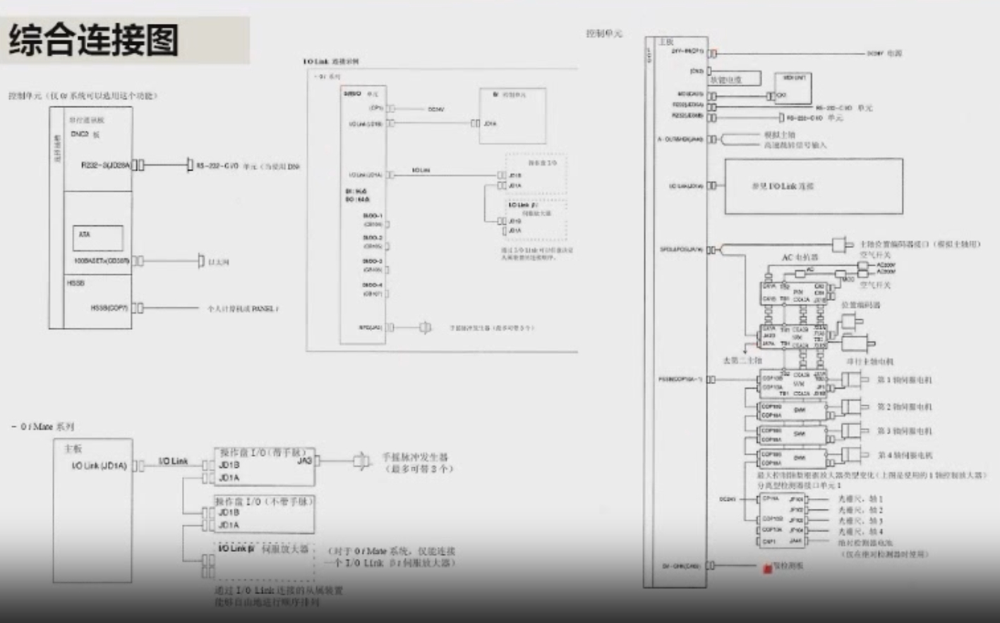

*圖：綜合連接圖（原課件）。*

下面是重新整理繪製的版本（便於閱讀；另附向量檔 [綜合連接圖_重建.svg](images/綜合連接圖_重建.svg)，可放大查看）：

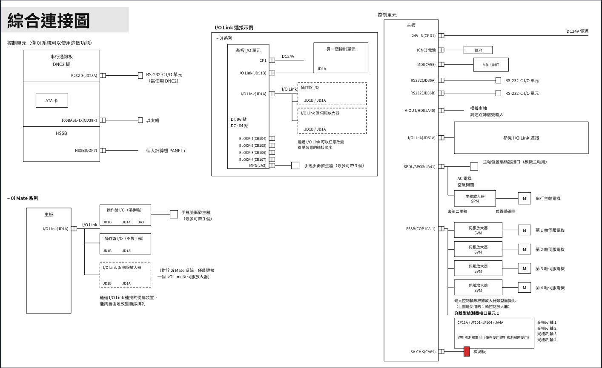

> ⚠️ 重建版圖中部分接口標示與原課件不同：重建版寫 `CPD1`、`JD51A`／`JD51B`、`JA41`，而本課件（0i-C）與講課內容用的是 **`CP1`、`JD1A`／`JD1B`、`JA7A`**（`CPD1`、`JD51A`、`JA41` 是 0i-D 系列的接口名稱）。學習 0i-C 時請以 CP1／JD1A／JA7A 為準。

### （一）控制單元基本功能的接線圖

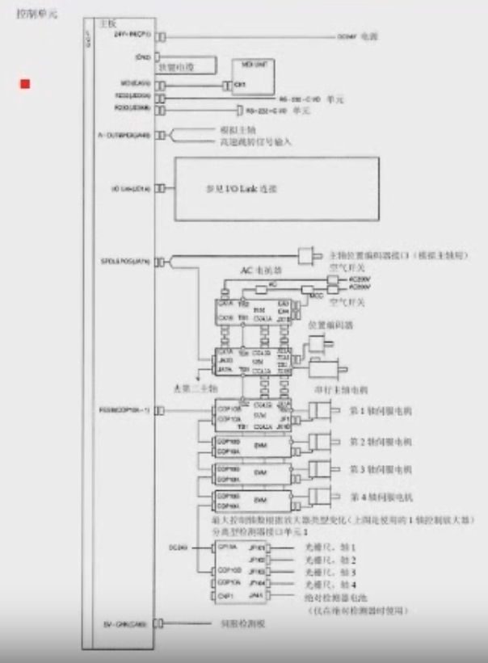

先看上半部分：

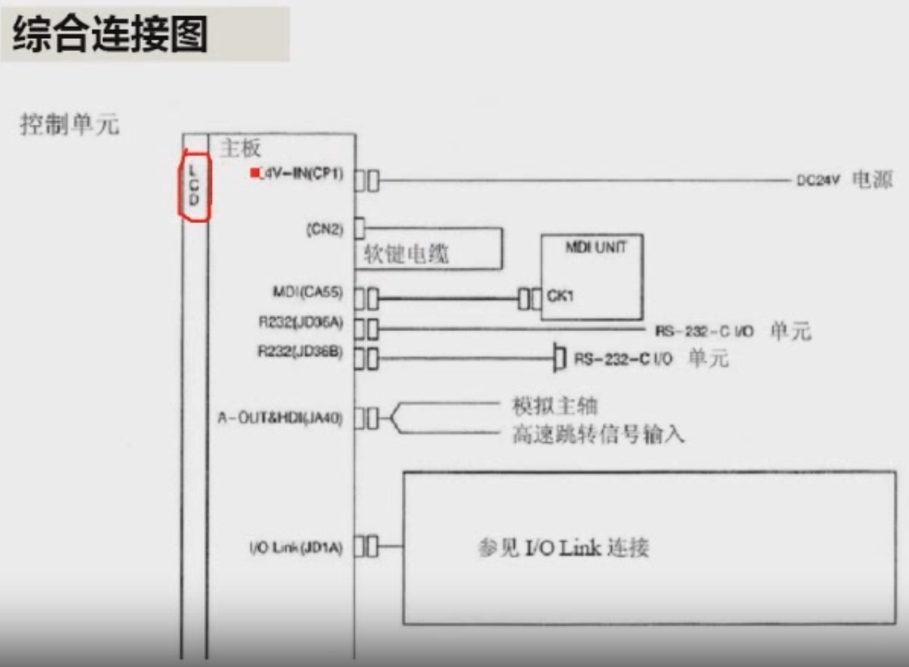

| 接口 | 用途 |
|---|---|
| **LCD** | 液晶顯示器，與 CNC 連為一體 |
| **CP1** | CNC 的 **DC 24V 電源輸入** |
| **CN2** | 主板內部的**軟鍵電纜**：要使用機床顯示器下方那一排軟鍵，就要接上此線（出廠時已接好） |
| **CA55** | **MDI 連接線**，接 MDI 單元的 CK1。MDI 與 LCD 實際上是兩部分，但出廠時已連在一起 |
| **JD36A、JD36B** | 兩個 **RS-232C** 口，接電腦。通常使用第一個口 JD36A，第二個口備用 |
| **JA40** | **A-OUT**（Analog，**模擬主軸**輸出）與 **HDI**（高速跳轉信號輸入） |
| **JD1A** | **I/O Link** 匯流排（見下方 I/O Link 連接示例） |

> **RS-232C 通道選擇**：講課中提到，使用第一個口（JD36A）時對應參數選「0 通道」，使用第二個口（JD36B）時選「1 通道」，由 **20 號參數**設定。（依 FANUC 參數說明書，20 號參數 I/O CHANNEL 為 0 或 1 對應 JD36A，2 對應 JD36B，實機操作請以說明書為準。）

**兩大網路匯流排：** 前面已講過 FS-0iC 有兩大網路匯流排——**I/O Link**（接口 JD1A）與 **FSSB**（接口 COP10A-1）。

### （二）I/O Link 的連接

#### 0i 系列

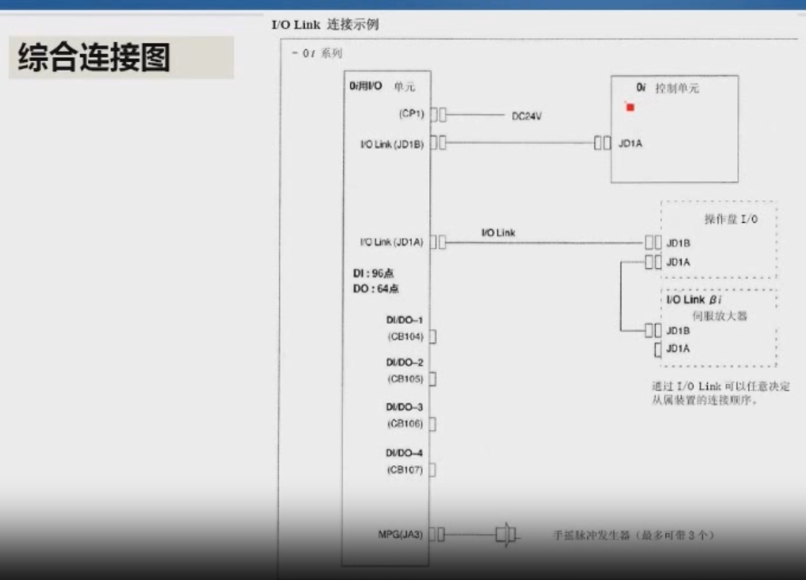

*圖：I/O Link 連接示例（0i 系列）。*

- 從 CNC 的 **JD1A** 出來，接第一個從站的 **JD1B**；該從站再由 **JD1A** 接到下一個從站的 **JD1B**，依此類推。
- 圖中第一個從站是 **0i 用 I/O 單元**：
  - **CP1** 接 DC 24V（I/O 單元本身也需要 24V 直流電）。
  - **JD1B** 接系統；**JD1A** 接下一個從站（如操作盤 I/O、I/O Link βi 伺服放大器）。
  - **CB104、CB105、CB106、CB107**：四個接口，用 50 芯扁平線引出，共 **96 點輸入（DI）、64 點輸出（DO）**。
  - **JA3**：接 **MPG（手搖脈衝發生器）**，最多可帶 **3 個**。
- 重點：**通過 I/O Link 可以任意決定從屬裝置的連接順序**（操作盤、βi 放大器、I/O 單元都可以互換位置）。

#### 0i Mate 系列

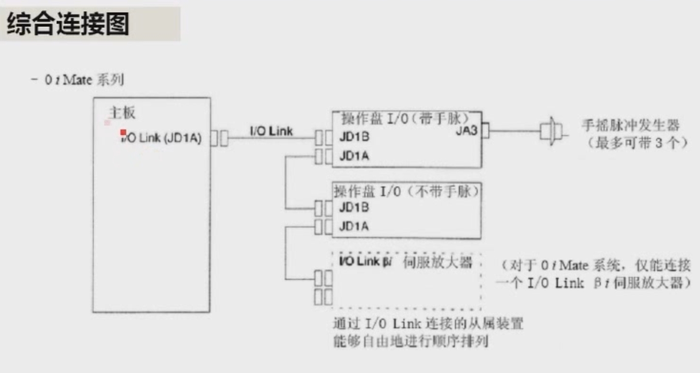

*圖：I/O Link 連接示例（0i Mate 系列）。*

- 主板的 **JD1A** 經 I/O Link 接**操作盤 I/O（帶手輪，JA3 接手搖脈衝發生器，最多 3 個）**、**操作盤 I/O（不帶手輪）**、**I/O Link βi 伺服放大器**。
- 同樣，I/O Link 連接的從屬裝置可以自由地改變順序排列。
- 注意：對於 0i Mate 系統，**僅能連接一個 I/O Link βi 伺服放大器**。

### （三）主軸與 FSSB 的連接（基本功能下半部）

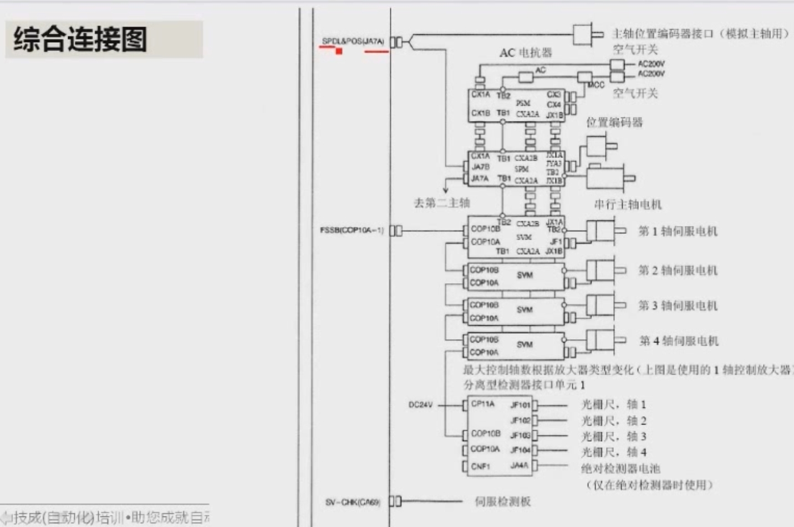

*圖：JA7A、FSSB、αi 一體型放大器與分離型檢測器的連接。*

**JA7A（SPDL & POS）** — 一個接口兩種用途：

1. 接**串列主軸**（FANUC 主軸放大器）；
2. 接**模擬主軸的位置編碼器**。（模擬主軸的指令信號從 JA40 出去，它的位置編碼器則接在 JA7A。）

**FSSB（COP10A-1）**：FANUC 串列伺服匯流排，接伺服模塊。

- 連接方式：**COP10A → COP10B**，一級接一級：第一軸驅動器的 COP10A 接第二軸的 COP10B……直到第四軸，最後還可接**分離型檢測器接口單元**。

**αi 系列一體型驅動器**（包含 PSM、SPM、SVM）的主要接口：

| 接口 | 說明 |
|---|---|
| **CX1A** | 200V 交流**控制電源** |
| **TB1** | **三相主電源** |
| **CXA2A／CXA2B** | 內部信號（24V 電源、急停信號等）的連接 |
| **CX3** | 主電源控制**接觸器（MCC）**的觸點 |
| **CX4** | **外部急停**輸入 |
| **JYA3**（主軸模塊） | 接主軸**位置編碼器** |
| **TB2**（主軸模塊） | 接**串列主軸電機** |
| **TB2、JF1**（SVM） | TB2 接伺服電機動力線，JF1 接編碼器反饋線 |

**分離型檢測器接口單元：**

- **CP11A**：接 DC 24V。
- **JF101、JF102、JF103、JF104**：接 4 個軸的光柵尺位置信號。
- **JA4A**：絕對檢測器電池（僅在使用絕對檢測器時使用）。

**CA69**（SV-CHK）：伺服檢測板，一般**不使用**。

### （四）選用功能

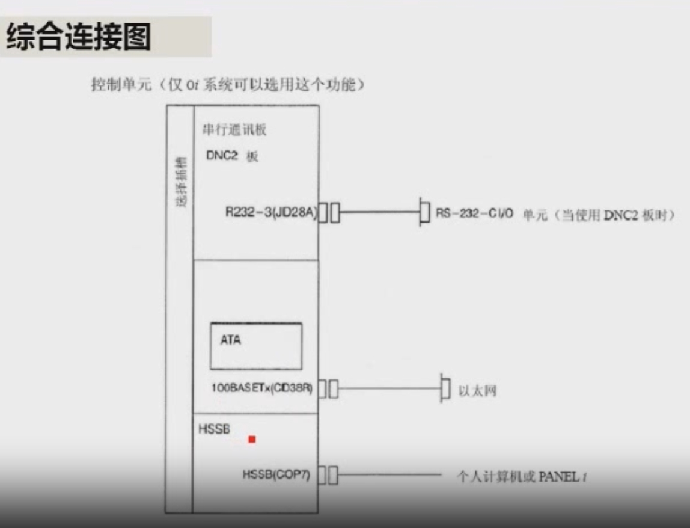

*圖：控制單元的選用功能（僅 0i 系統可以選用）。*

選用功能需要使用**選擇插槽**：

| 選件 | 接口 | 連接對象 |
|---|---|---|
| **DNC2 板**（串行通訊板） | R232-3（JD28A） | RS-232-C I/O 單元（使用 DNC2 板時） |
| **乙太網板** | 100BASE-TX（CD38R） | 乙太網 |
| **HSSB 板**（高速串列匯流排） | HSSB（COP7） | 個人電腦或 PANEL i |

---

## 2. CNC 的連接

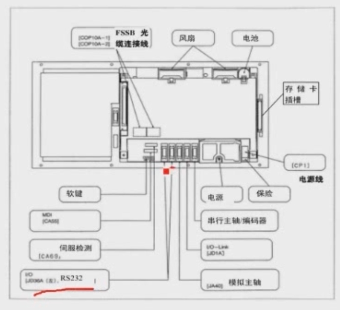

*圖：CNC 單元的接口位置（FSSB 光纜、風扇、電池、存儲卡插槽、CP1 電源線、軟鍵、MDI、伺服檢測、RS232、串列主軸／編碼器、I/O Link、模擬主軸、電源、保險）。*

### ① FSSB 光纜

FSSB 光纜一般接在**左邊**的插口（COP10A-1）。

### ② 風扇、電池、軟鍵、MDI 等

這些在系統出廠時**都已經連接好，不要改動**。但可以檢查在運輸過程中是否有鬆動；如果有，需重新連接牢固，否則會出現異常現象。

### ③ 伺服檢測口 CA69

**不需要連接**。

### ④ 電源線（CP1）

電源線可能有兩個插頭：一個為 **24V 輸入（左）**，另一個為 **+24V 輸出（右）**。具體接線：

| 腳位 | 信號 |
|---|---|
| 1 | 24V |
| 2 | 0V |
| 3 | 地線（FG） |

> ⚠️ **注意正負極性，不要接錯。**

### ⑤ RS-232C 接口（JD36A／JD36B）

- 與電腦連接用，**共兩個接口**。一般使用**左邊**（JD36A），**右邊（232-2 口）為備用**。
- 如果不與電腦連接，可不接此線。
- **使用存儲卡就可以替代 RS-232 口**，而且傳輸速度和安全性都比 RS-232 口優越。

### ⑥ 串列主軸／編碼器（JA7A）

- 若使用 **FANUC 的主軸放大器**：此接口連接放大器的**指令線**（接主軸放大器的 JA7B）。
- 若主軸使用的是**變頻器**（指令線由 JA40 模擬主軸接口連接）：此處改接**主軸位置編碼器**。
- **車床**一般都要接編碼器（車螺紋時需要）。若是 FANUC 主軸放大器，編碼器則接到**主軸放大器的 JYA3**，不是接到 CNC。

> **補充：串列主軸輸出與模擬主軸輸出（Spindle serial output / Spindle analog output）**
>
> 主軸控制有兩種介面：
>
> | 方式 | 說明 | 必須使用的設備 |
> |---|---|---|
> | **串列輸出** | 以**串列方式**傳送資料（CNC 給主軸電機的指令） | 必須使用 **FANUC 的主軸驅動單元和電機** |
> | **模擬輸出** | 輸出**模擬電壓量**作為主軸電機的指令 | 模擬量控制的主軸驅動單元（如**變頻器**）和電機 |

### ⑦ I/O Link（JD1A）

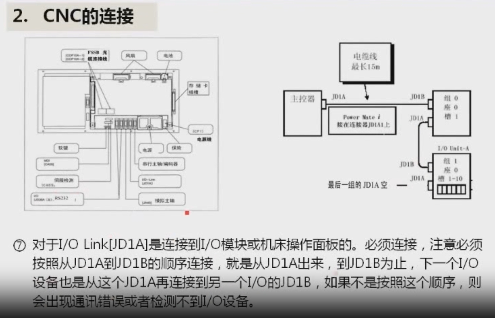

*圖：左為 CNC 接口圖，右為 I/O Link 連接順序（電纜線最長 15 m）。*

- JD1A 連接到 **I/O 模塊**或**機床操作面板**，**必須連接**。
- ⚠️ **必須按照 JD1A → JD1B 的順序連接**：從 JD1A 出來，到 JD1B 為止；下一個 I/O 設備也是從這個設備的 JD1A 再接到另一個設備的 JD1B。最後一個從站的 JD1A 空著。
- 如果不按此順序（例如 JD1A 接 JD1A），會出現**通訊錯誤**或**檢測不到 I/O 設備**。

### ⑧ 存儲卡插槽（位於系統正面）

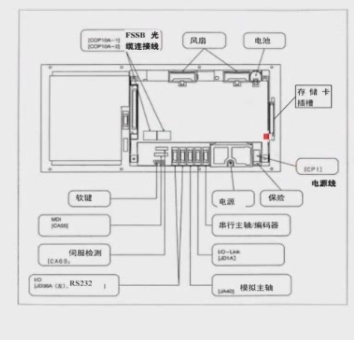

*圖：存儲卡插槽在系統正面（圖中紅點處）。*

用於連接存儲卡，可對**參數、程序、梯形圖（PMC 程序）**等資料進行輸入／輸出，也可進行 **DNC 加工**。

> **什麼是 DNC 加工？**
>
> 當機床本身的存儲容量不夠大時，可以把程序存在**存儲卡**或**電腦**裡（它們容量足夠大），然後機床**一邊加工、一邊傳輸**：傳一段程序、加工一段，再傳一段、再加工一段。程序被分成一段一段，系統會自動連續加工、自動連續傳送存儲。這就叫 DNC 加工。

---

## 3. 伺服／主軸放大器的連接 — αi 系列伺服驅動器

### 3.1 αi 放大器規格

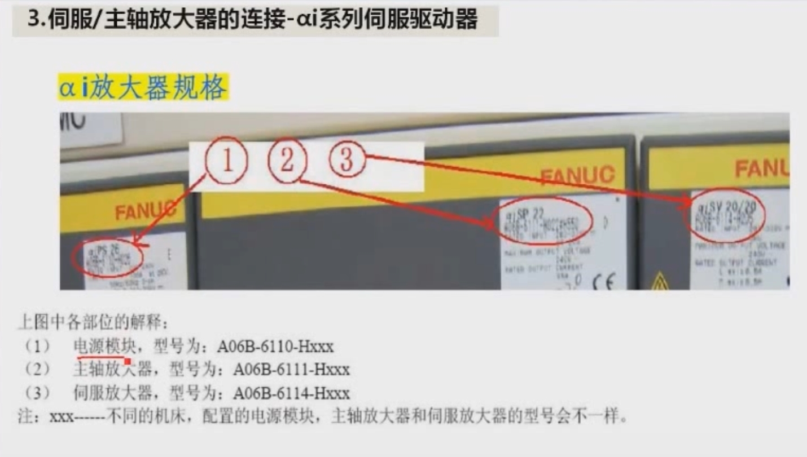

*圖：αi 放大器的銘牌 —— ① 電源模塊（αiPS）、② 主軸放大器（αiSP）、③ 伺服放大器（αiSV）。*

| 編號 | 模塊 | 型號 |
|---|---|---|
| ① | **電源模塊** | A06B-6110-Hxxx |
| ② | **主軸放大器** | A06B-6111-Hxxx |
| ③ | **伺服放大器** | A06B-6114-Hxxx |

> 注：xxx 部分因機床而異——不同的機床配置的電源模塊、主軸放大器和伺服放大器的型號會不一樣。

### 3.2 放大器結構

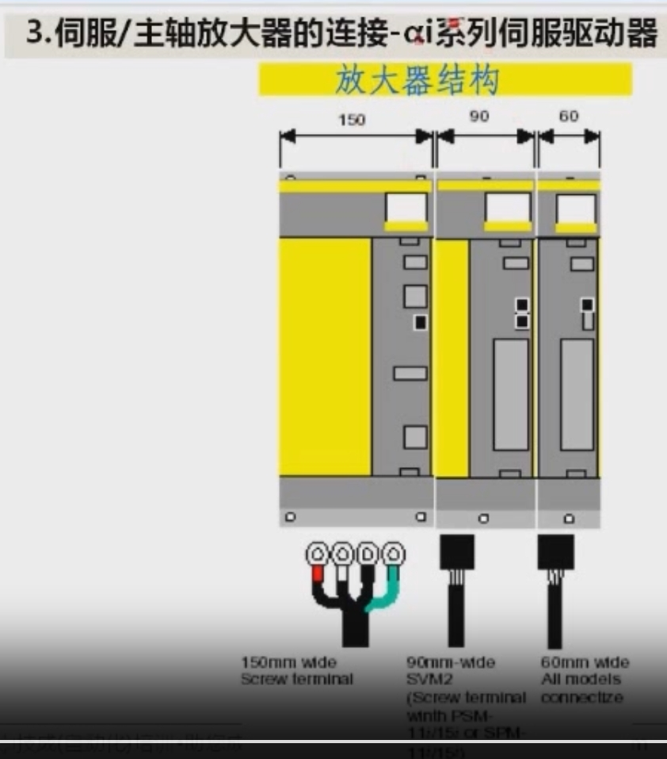

*圖：放大器寬度與端子型式 —— 150 mm 寬（螺絲端子）；90 mm 寬（SVM2，使用 PSM-11i/15i 或 SPM-11i/15i 時為螺絲端子）；60 mm 寬（所有型號均為連接器式）。*

### 3.3 αi 放大器接口詳解

αi 系列為**一體型**，由三部分組成：**左邊是電源模塊（PSM）**、**中間是主軸放大器（SPM）**、**右邊是伺服放大器（SVM）**。

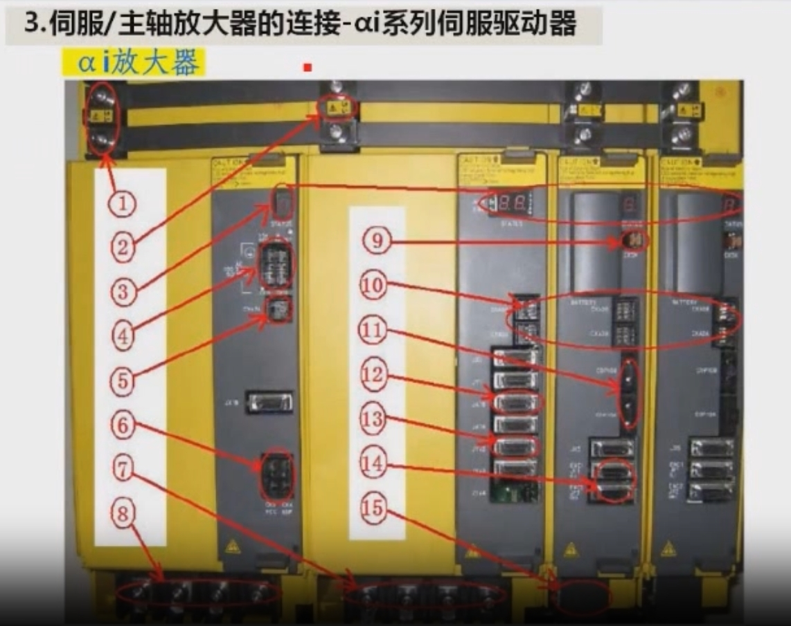

*圖：αi 放大器各接口編號（①～⑮）。*

| 編號 | 接口／部位 | 說明 |
|---|---|---|
| **①** | **DC Link**（直流母線端子） | 正常工作時約 **300V 直流**；若為高壓型電源模塊，輸入 400V 級電壓時，DC Link 為 **DC 600V**。拆卸放大器時，這裡的螺絲一定要擰緊。 |
| **②** | **DC Link 充電指示燈** | 機床關機後，模塊內的電容可能仍帶電，DC Link 還有電壓。**等這個指示燈熄滅，才表示 DC Link 已放電完畢。** |
| **③** | **故障指示燈（狀態顯示）** | 電源模塊、主軸放大器、伺服模塊各有一組。放大器本身或連接的部件有故障時，指示燈會顯示不同的數字／符號，對判斷放大器故障很有幫助。 |
| **④** | **CX1A（左）／CX1B（右）** | CX1A 是電源模塊 **200V 控制電源輸入**。若開機時 CX1A 沒有 200V 輸入，**所有放大器的指示燈都不亮**，且機床會出現 **750 號**和 **5136 號**報警。CX1B 為 200V 輸出，一般不用。 |
| **⑤** | **CXA2A** | 給主軸放大器、伺服放大器提供 **24V 電源**；同時串聯**急停信號（ESP）**，信號傳給後面的主軸、伺服放大器。 |
| **⑥** | **CX3（左）／CX4（右）** | CX3：控制**主電源接觸器（MCC）**的觸點；CX4：**外部急停**輸入。這兩個接口任一個接得不正常，系統會出現 **401 號**報警。 |
| **⑦** | **主軸電機動力線**（主軸放大器 TB2） | 接主軸電機。主軸出現過流或過電壓類報警時，可拆下此動力線，量測三根動力線**對地**電阻；若對地短路，表示電機或動力線損壞。 |
| **⑧** | **電源模塊強電輸入**（TB1） | **低壓**電源模塊：線電壓應為 **AC 200～240V**；**高壓**電源模塊：線與線之間為 **AC 400～480V**。波動範圍均為 **+10% ～ −15%**。電源模塊有報警時，先檢查三相輸入是否正常。 |
| **⑨** | **CX5X** | **伺服放大器電池**插頭，使用**絕對位置編碼器**時用於接電池。 |
| **⑩** | **CXA2A → CXA2B** | 放大器之間傳遞 **24V 電源、急停信號 ESP**，以及**絕對編碼器電池**。伺服放大器的絕對編碼器供電有兩種方式：由此接口供電，或由 ⑨ 的 CX5X 供電。接線順序為 **CXA2A → 下一個模塊的 CXA2B**，不能接反。 |
| **⑪** | **COP10B、COP10A**（FSSB 光纜接口） | 放大器一上電，光纜接口下方的光口就會發光；上電後若**光口不發光，系統會出現 5136 號（FSSB）報警**。連接順序為 **COP10A → 下一級的 COP10B**；光纜從系統的軸卡出來，一級一級依次連接，除伺服放大器外，還包括**分離型檢測器接口單元（SDU）**。 |
| **⑫** | **JA7B**（主軸放大器） | 主軸放大器接系統的**主軸控制指令接口**（接 CNC 的 JA7A）。 |
| **⑬** | **JYA2**（主軸放大器） | 主軸電機**內置傳感器**的反饋插頭。傳感器損壞或斷線時，系統會出現 **9073 號**報警，主軸放大器指示燈顯示 **73**。 |
| **⑭** | **JF1、JF2、JF3**（伺服放大器） | **伺服電機編碼器**的反饋插頭：單軸放大器只有 JF1，兩軸有 JF1、JF2，三軸有 JF1、JF2、JF3。編碼器損壞或反饋線破損時，系統會出現 **368 號**報警。 |
| **⑮** | **伺服電機動力線**（TB2） | 去接伺服電機。 |

> ⚠️ **安全提醒：** 拆卸或接觸放大器前，一定要先**斷電**，並等 **DC Link 充電指示燈熄滅**，否則有觸電危險。
>
> 註：⑩ 接口在講課逐字稿中的語音辨識文字不清楚，上表依 αi 放大器標準接口名稱整理為 CXA2A／CXA2B；⑬、⑭ 的報警號同樣依標準報警編號整理，實際請以 FANUC 報警說明書為準。

---

## 本課重點整理

1. 0i-C 的總體連接：**CNC＋MDI/LCD ← FSSB → αi 放大器 → 主軸電機／伺服電機**；**I/O Link → I/O 卡／操作面板／I/O Link 軸**。硬件連接比 0i-B 簡單。
2. CNC 單元主要接口：**CP1**（24V 電源）、**CA55**（MDI）、**JD36A/B**（RS-232C）、**JA40**（模擬主軸／高速跳轉）、**JD1A**（I/O Link）、**JA7A**（串列主軸／位置編碼器）、**COP10A-1**（FSSB）、**CA69**（伺服檢測，不用）。
3. 風扇、電池、軟鍵、MDI 出廠已接好，不要隨意改動。
4. **I/O Link 必須 JD1A → JD1B 依序串接**；反接會通訊錯誤或檢測不到設備。
5. 串列主軸用 **FANUC 主軸放大器**（JA7A 接放大器 JA7B）；模擬主軸用**變頻器**（JA40 出信號，位置編碼器接 JA7A；FANUC 放大器時編碼器接放大器 JYA3）。
6. 存儲卡可替代 RS-232，用於資料備份與 **DNC 加工**。
7. αi 放大器 = **PSM（A06B-6110）＋SPM（A06B-6111）＋SVM（A06B-6114）**；維修前務必確認 **DC Link 指示燈已熄滅**。
8. 常見報警線索：**CX1A 無 200V → 750／5136**；**CX3／CX4 異常 → 401**；**FSSB 光口不亮 → 5136**；**JF1～JF3 編碼器問題 → 368**。

> 下一課時將繼續學習：模擬主軸、I/O、急停、電源、電機等其餘接口的連接。
