# 第 4 課時　FANUC 0i-C 數控機床電氣連接（四）

## 伺服／主軸放大器的連接 —— αi 系列伺服驅動器

---

## 一、αi 系列驅動器概述

αi 系列驅動器是 FANUC 公司生產的高性能伺服與主軸驅動產品，採用**模塊化結構**，由以下三種模塊組成：

| 模塊 | 英文全稱 | 中文名稱 | 作用 |
|------|----------|----------|------|
| **PSM** | Power Supply Module | 電源模塊 | 為驅動電機提供主電源，並為其他模塊提供控制電源 |
| **SVM** | Servo Amplifier Module | 伺服驅動模塊 | 驅動伺服電機 |
| **SPM** | Spindle Amplifier Module | 主軸驅動模塊 | 驅動主軸電機 |

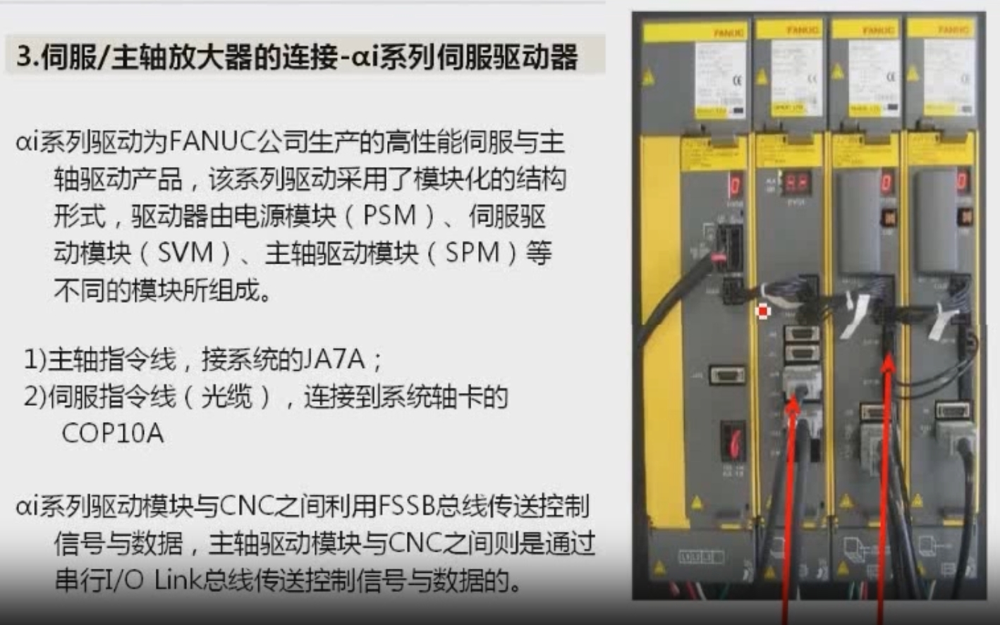

### 與 CNC 的連接

1. **主軸指令線**：連接系統的 **JA7A**（串行 I/O Link 總線）。
2. **伺服指令線（光纜）**：連接到系統軸卡的 **COP10A**（FSSB 總線）。

### 通訊方式

- 伺服驅動模塊與 CNC 之間：通過 **FSSB 總線**傳送控制信號與數據。
- 主軸驅動模塊與 CNC 之間：通過**串行 I/O Link 總線**傳送控制信號與數據。

---

## 二、主電路設計

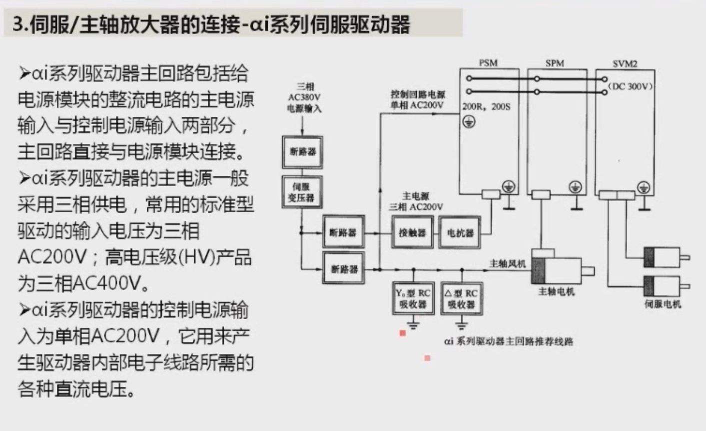

### 1. 主回路組成

αi 系列驅動器主回路包括兩部分，直接與電源模塊連接：

- **主電源輸入**：給電源模塊的整流電路供電。一般採用三相供電，標準型驅動器輸入電壓為三相 AC200V；高電壓級（HV）產品為三相 AC400V。
- **控制電源輸入**：單相 AC200V，用來產生驅動器內部電子線路所需的各種直流電壓。

### 2. 設計注意事項

1. **必須使用伺服變壓器**：主電源輸入一般需要使用伺服變壓器，可使驅動器與電網隔離，並使輸入電壓與驅動器要求匹配；同時應安裝用於變壓器短路保護的**斷路器**。
2. **主電源與控制電源分別保護**：伺服變壓器的輸出通常同時作為驅動器主電源與控制電源的輸入，兩者應安裝**各自獨立的保護斷路器**。
3. **控制電源支路加裝 RC 吸收器**：應安裝 Y₀ 型與△型 RC 浪湧吸收器，抑制線路中的浪湧電壓。由於 RC 吸收器本身屬於易損的保護器件，其連接支路必須有短路保護；該短路保護的同時也可作為伺服驅動輔助部件與風扇電路的電源支路。
4. **主電源輸入端必須加裝接觸器**：主電源支路是驅動器內部整流（逆變）回路的電源輸入，必須在驅動器**完全正常**的情況下才能加入，因此需用接觸器控制通斷。驅動器正常時接觸器接通；驅動器異常時接觸器斷開，切斷主電源。
5. **加裝交流電抗器**：用於抑制整流逆變引起的電網波形畸變，並保證輕載時電流連續。
6. **通電順序**：應**先加控制電源，再加主電源**。
   - 若驅動器內部控制電路無故障，PSM 內部主接觸器線圈控制觸點（**CX3**）接通，外部接觸器隨之吸合，才允許加入主電源。
   - 一旦驅動器內部發生故障，CX3 觸點自動斷開，接觸器線圈失電，應立即斷開主接觸器，切斷主電源。

---

## 三、電源模塊（PSM）

### 1. 型號表示

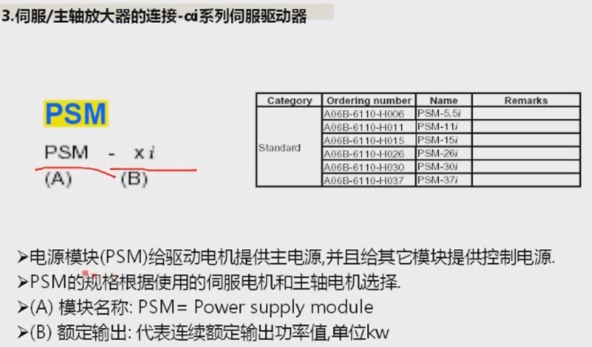

```
PSM - x i
(A)   (B)
```

- (A) 模塊名稱：PSM = Power Supply Module
- (B) 額定輸出：表示**連續額定輸出功率值**，單位 kW

PSM 的規格根據所使用的伺服電機和主軸電機選擇。常用規格如下：

| 訂貨號 | 型號 |
|--------|------|
| A06B-6110-H006 | PSM-5.5i |
| A06B-6110-H011 | PSM-11i |
| A06B-6110-H015 | PSM-15i |
| A06B-6110-H026 | PSM-26i |
| A06B-6110-H030 | PSM-30i |
| A06B-6110-H037 | PSM-37i |

### 2. PSM-5.5i 連接器和接線端子

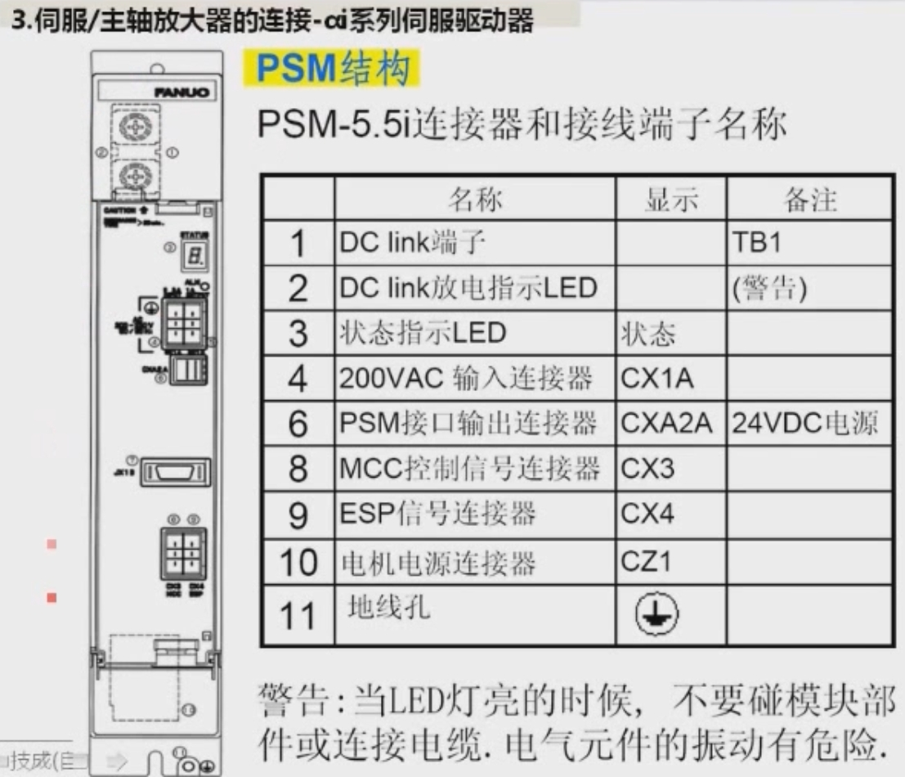

| 序號 | 名稱 | 顯示 | 備註 |
|------|------|------|------|
| 1 | DC link 端子（直流母線） | | TB1 |
| 2 | DC link 放電指示 LED | | （警告） |
| 3 | 狀態指示 LED | 狀態 | |
| 4 | 200VAC 輸入連接器 | CX1A | |
| 6 | PSM 接口輸出連接器 | CXA2A | 24VDC 電源 |
| 8 | MCC 控制信號連接器 | CX3 | |
| 9 | ESP 信號連接器 | CX4 | |
| 10 | 電機電源連接器 | CZ1 | |
| 11 | 地線孔 | ⏚ | |

### 3. PSM-11i、PSM-15i 連接器和接線端子

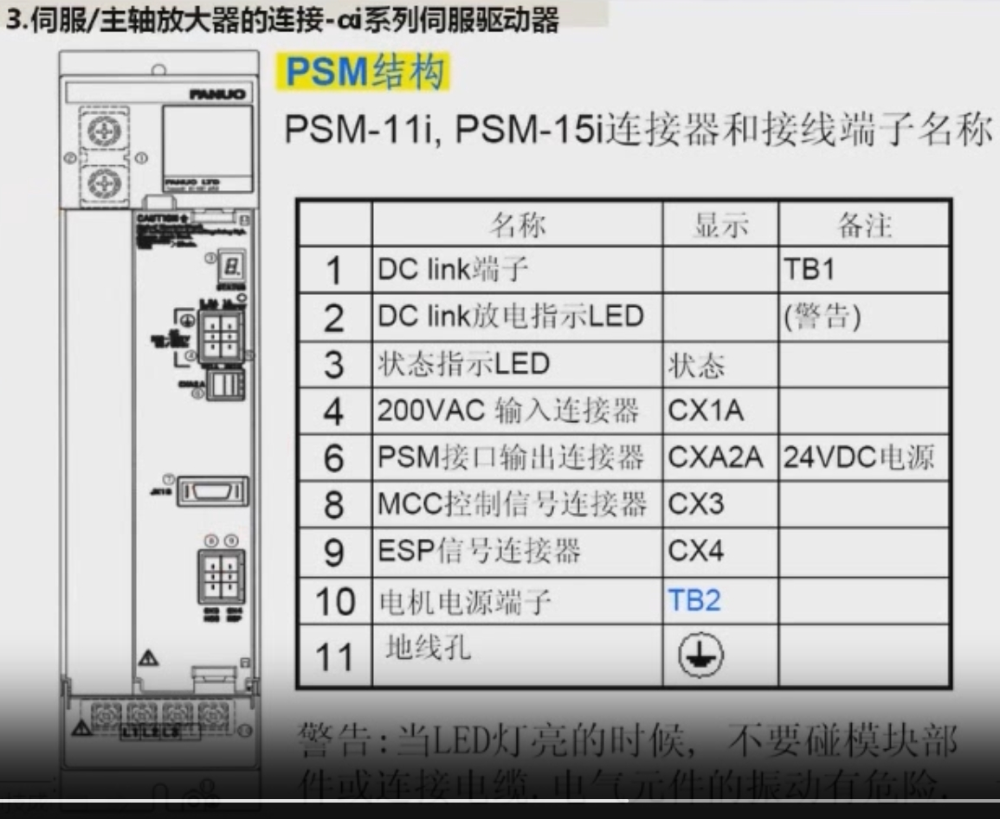

與 PSM-5.5i 相比，功率更大、體積更寬，端子功能基本一致，區別在於**第 10 項電機電源端子為 TB2**（5.5i 為 CZ1 插接件，TB2 為螺釘接線端子，需要接線）。

| 序號 | 名稱 | 顯示 | 備註 |
|------|------|------|------|
| 1 | DC link 端子 | | TB1 |
| 2 | DC link 放電指示 LED | | （警告） |
| 3 | 狀態指示 LED | 狀態 | |
| 4 | 200VAC 輸入連接器 | CX1A | |
| 6 | PSM 接口輸出連接器 | CXA2A | 24VDC 電源 |
| 8 | MCC 控制信號連接器 | CX3 | |
| 9 | ESP 信號連接器 | CX4 | |
| 10 | 電機電源端子 | TB2 | |
| 11 | 地線孔 | ⏚ | |

### 4. PSM-26i、PSM-30i、PSM-37i 連接器和接線端子

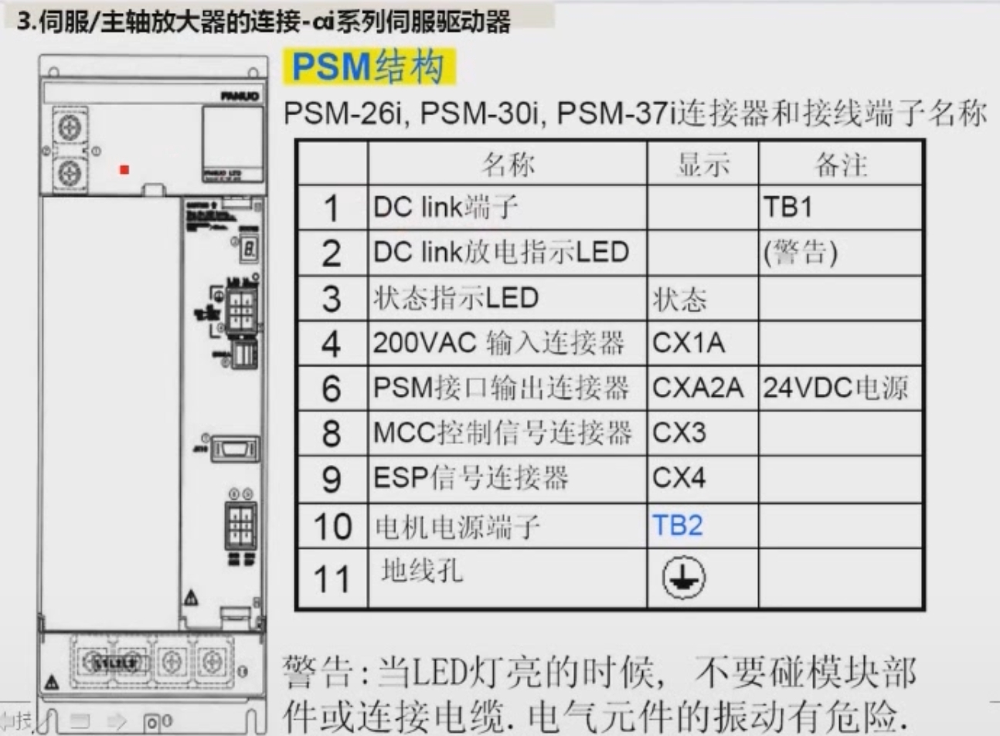

端子名稱及功能與 PSM-11i / 15i 相同，電機電源端子同為 **TB2**。

### 5. PSM 端子功能小結

| 端子 | 功能 |
|------|------|
| TB1 | DC link 直流母線端子 |
| CX1A | 單相 AC200V 控制電源輸入 |
| CXA2A | 24V 電源輸出，接下一個模塊（SPM / SVM）的 CXA2B |
| CX3 | MCC 控制信號，接主電源接觸器的控制觸點 |
| CX4 | ESP（急停）信號 |
| TB2 / CZ1 | 主電源（三相）輸入端子 |

> ⚠️ **警告**：當 DC link 放電指示 LED 亮的時候，**不要觸碰模塊部件或連接電纜**，電氣元件上殘留的高壓有觸電危險。

---

## 四、伺服驅動模塊（SVM）

### 1. 型號表示

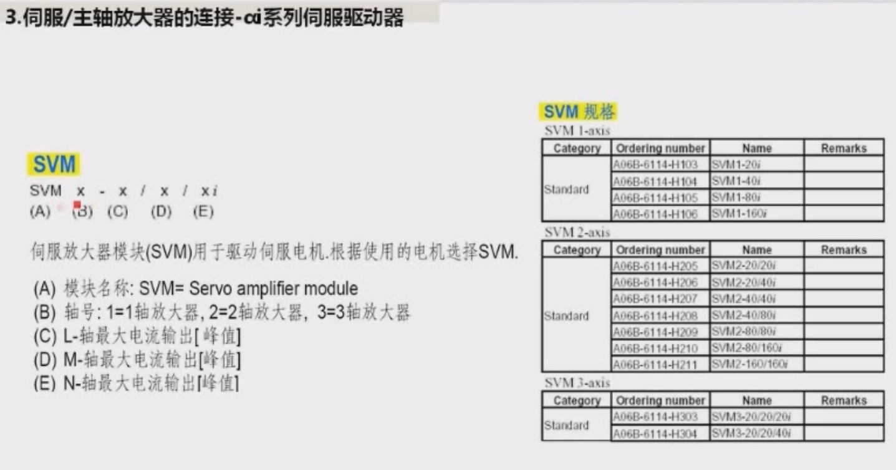

```
SVM x - x / x / x i
(A) (B)(C) (D) (E)
```

SVM 用於驅動伺服電機，根據所使用的電機選擇。

- (A) 模塊名稱：SVM = Servo Amplifier Module
- (B) 軸數：1 = 單軸放大器，2 = 雙軸放大器，3 = 三軸放大器
  （注意：這裡表示該模塊**能驅動幾個軸**，而不是第幾軸）
- (C) L 軸最大電流輸出（峰值）
- (D) M 軸最大電流輸出（峰值）
- (E) N 軸最大電流輸出（峰值）

例如 **SVM1-20i** 表示單軸伺服放大器，最大電流為 20A；**SVM2-20/40i** 表示雙軸放大器，L 軸 20A、M 軸 40A。

**SVM 規格表：**

| 類型 | 訂貨號 | 型號 |
|------|--------|------|
| 單軸 | A06B-6114-H103 | SVM1-20i |
| 單軸 | A06B-6114-H104 | SVM1-40i |
| 單軸 | A06B-6114-H105 | SVM1-80i |
| 單軸 | A06B-6114-H106 | SVM1-160i |
| 雙軸 | A06B-6114-H205 | SVM2-20/20i |
| 雙軸 | A06B-6114-H206 | SVM2-20/40i |
| 雙軸 | A06B-6114-H207 | SVM2-40/40i |
| 雙軸 | A06B-6114-H208 | SVM2-40/80i |
| 雙軸 | A06B-6114-H209 | SVM2-80/80i |
| 雙軸 | A06B-6114-H210 | SVM2-80/160i |
| 雙軸 | A06B-6114-H211 | SVM2-160/160i |
| 三軸 | A06B-6114-H303 | SVM3-20/20/20i |
| 三軸 | A06B-6114-H304 | SVM3-20/20/40i |

### 2. SVM 連接器和接線端子

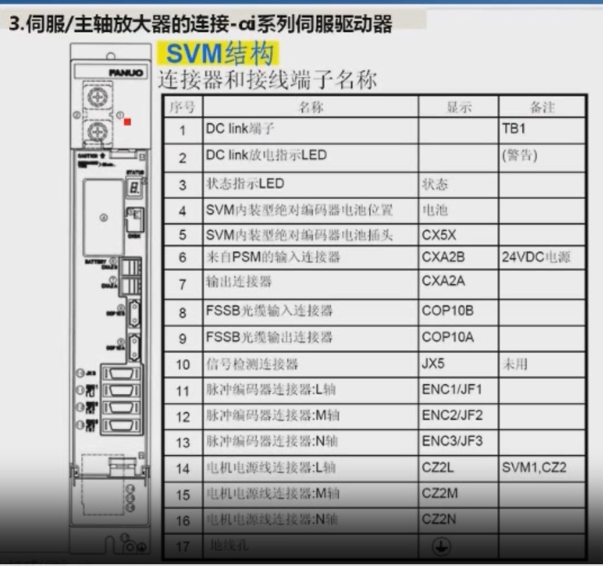

| 序號 | 名稱 | 顯示 | 備註 |
|------|------|------|------|
| 1 | DC link 端子 | | TB1 |
| 2 | DC link 放電指示 LED | | （警告） |
| 3 | 狀態指示 LED | 狀態 | |
| 4 | SVM 內裝型絕對編碼器電池位置 | 電池 | |
| 5 | SVM 內裝型絕對編碼器電池插頭 | CX5X | |
| 6 | 來自 PSM 的輸入連接器 | CXA2B | 24VDC 電源 |
| 7 | 輸出連接器 | CXA2A | |
| 8 | FSSB 光纜輸入連接器 | COP10B | 接來自系統 / 上一級 |
| 9 | FSSB 光纜輸出連接器 | COP10A | 接下一級放大器 |
| 10 | 信號檢測連接器 | JX5 | 未用 |
| 11 | 脈衝編碼器連接器：L 軸 | ENC1/JF1 | |
| 12 | 脈衝編碼器連接器：M 軸 | ENC2/JF2 | |
| 13 | 脈衝編碼器連接器：N 軸 | ENC3/JF3 | |
| 14 | 電機電源線連接器：L 軸 | CZ2L | SVM1，CZ2 |
| 15 | 電機電源線連接器：M 軸 | CZ2M | |
| 16 | 電機電源線連接器：N 軸 | CZ2N | |
| 17 | 地線孔 | ⏚ | |

**要點：**

- FSSB 光纜：**COP10B 為輸入**（來自 CNC 軸卡的 COP10A 或上一個放大器的 COP10A），**COP10A 為輸出**（接下一個放大器）。
- 脈衝編碼器反饋線接 JF1 / JF2 / JF3，電機動力線接 CZ2L / CZ2M / CZ2N。
- 使用絕對編碼器時，電池裝在 SVM 內置電池位置，並插到 CX5X。

---

## 五、主軸驅動模塊（SPM）

### 1. 型號表示

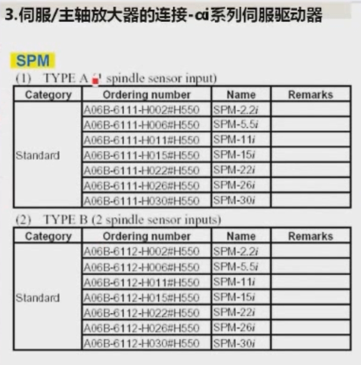

```
SPM - x i
(A)   (B)
```

- (A) 模塊名稱：SPM = Spindle Amplifier Module
- (B) 輸出：表示電機 **30 分鐘額定輸出功率**，單位 kW

SPM 分為兩種類型：

- **TYPE A**：可連接 **1 個**主軸傳感器輸入。
- **TYPE B**：可連接 **2 個**主軸傳感器輸入。

| 規格 | TYPE A 訂貨號 | TYPE B 訂貨號 |
|------|---------------|---------------|
| SPM-2.2i | A06B-6111-H002#H550 | A06B-6112-H002#H550 |
| SPM-5.5i | A06B-6111-H006#H550 | A06B-6112-H006#H550 |
| SPM-11i | A06B-6111-H011#H550 | A06B-6112-H011#H550 |
| SPM-15i | A06B-6111-H015#H550 | A06B-6112-H015#H550 |
| SPM-22i | A06B-6111-H022#H550 | A06B-6112-H022#H550 |
| SPM-26i | A06B-6111-H026#H550 | A06B-6112-H026#H550 |
| SPM-30i | A06B-6111-H030#H550 | A06B-6112-H030#H550 |

### 2. SPM-2.2i、SPM-5.5i（A、B 型）連接器和接線端子

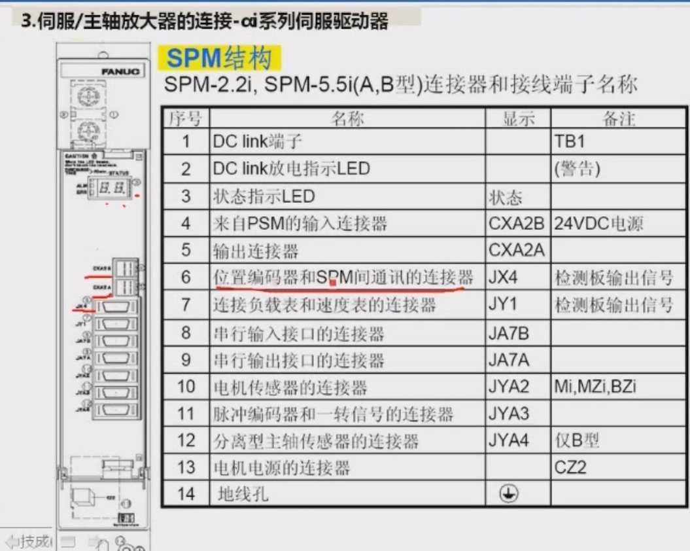

| 序號 | 名稱 | 顯示 | 備註 |
|------|------|------|------|
| 1 | DC link 端子 | | TB1 |
| 2 | DC link 放電指示 LED | | （警告） |
| 3 | 狀態指示 LED | 狀態 | |
| 4 | 來自 PSM 的輸入連接器 | CXA2B | 24VDC 電源 |
| 5 | 輸出連接器 | CXA2A | |
| 6 | 位置編碼器和 SPM 間通訊的連接器 | JX4 | 檢測板輸出信號 |
| 7 | 連接負載表和速度表的連接器 | JY1 | 檢測板輸出信號 |
| 8 | 串行輸入接口的連接器 | JA7B | |
| 9 | 串行輸出接口的連接器 | JA7A | |
| 10 | 電機傳感器的連接器 | JYA2 | Mi, MZi, BZi |
| 11 | 脈衝編碼器和一轉信號的連接器 | JYA3 | |
| 12 | 分離型主軸傳感器的連接器 | JYA4 | 僅 B 型 |
| 13 | 電機電源的連接器 | | CZ2 |
| 14 | 地線孔 | ⏚ | |

### 3. SPM-11i、SPM-15i（A、B 型）連接器和接線端子

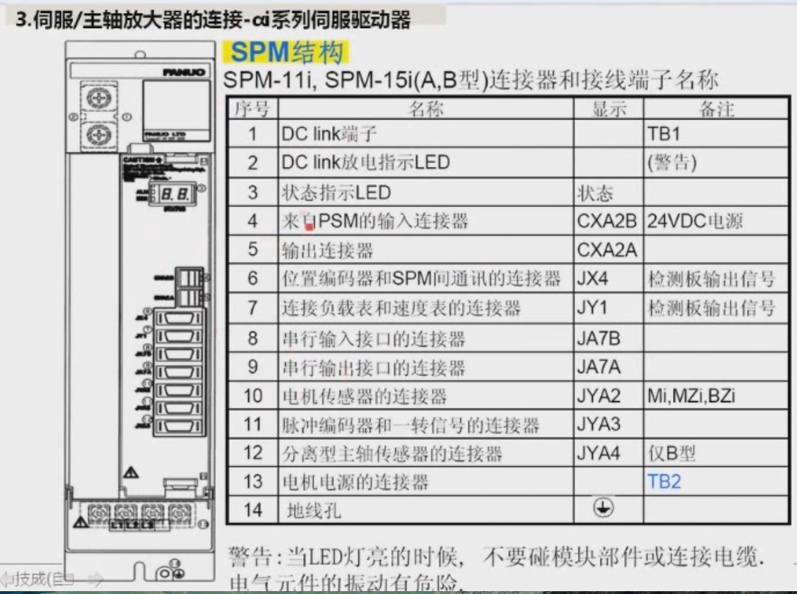

端子功能與 SPM-2.2i / 5.5i 相同，區別在於**第 13 項電機電源連接器為 TB2**（螺釘接線端子，需接線，不是插口）。

### 4. SPM-22i、SPM-26i、SPM-30i（A、B 型）連接器和接線端子

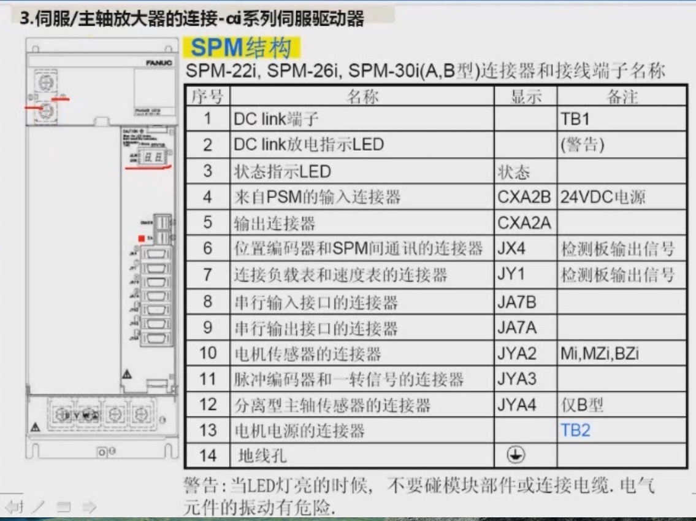

端子名稱及功能與 SPM-11i / 15i 相同，電機電源連接器同為 **TB2**。

### 5. SPM 端子功能小結

| 端子 | 功能 |
|------|------|
| CXA2B / CXA2A | 24V 電源輸入（來自 PSM）/ 輸出（接下一模塊） |
| JA7B / JA7A | 串行主軸接口：**JA7B 輸入**（來自 CNC 的 JA7A 或上一個 SPM），**JA7A 輸出**（接下一個 SPM） |
| JYA2 | 主軸電機內置傳感器（Mi、MZi、BZi） |
| JYA3 | 外接脈衝編碼器（位置編碼器）及一轉信號 |
| JYA4 | 分離型主軸傳感器（僅 B 型） |
| JX4 | 位置編碼器與 SPM 間通訊 |
| JY1 | 負載表、速度表 |
| CZ2 / TB2 | 主軸電機動力線 |

> ⚠️ **警告**：當 LED 亮的時候，不要觸碰模塊部件或連接電纜，電氣元件上有殘餘高壓，十分危險。

---

## 六、本課小結

1. αi 系列驅動器由 **PSM（電源）、SVM（伺服）、SPM（主軸）** 三種模塊組成。
2. SVM 與 CNC 通過 **FSSB 光纜**（COP10A / COP10B）通訊；SPM 與 CNC 通過 **串行 I/O Link**（JA7A / JA7B）通訊。
3. 主電路必須配置**伺服變壓器、斷路器、接觸器、電抗器、RC 吸收器**；上電時**先控制電源、後主電源**，由 PSM 的 **CX3** 控制主接觸器。
4. 各模塊間 24V 電源通過 **CXA2A → CXA2B** 串接傳遞。
5. 接線與維修前，務必確認 **DC link 放電指示 LED 已熄滅**。

> 下一課時將講解實際的接線方法。
