# FANUC 0i-C 數控機床電氣連接(第 5 課時)

## 伺服／主軸放大器的連接 —— αi 系列驅動器

> 本文涵蓋第 5 課時全部圖片(chs05_01 ~ chs05_33)。

---

## 一、αi 系列驅動器的整體構成與連接

αi 系列驅動器由**電源模塊(PSM)、主軸模塊(SPM)、伺服模塊(SVM)**並排組成,各模塊之間透過直流母線與內部通訊線互連。

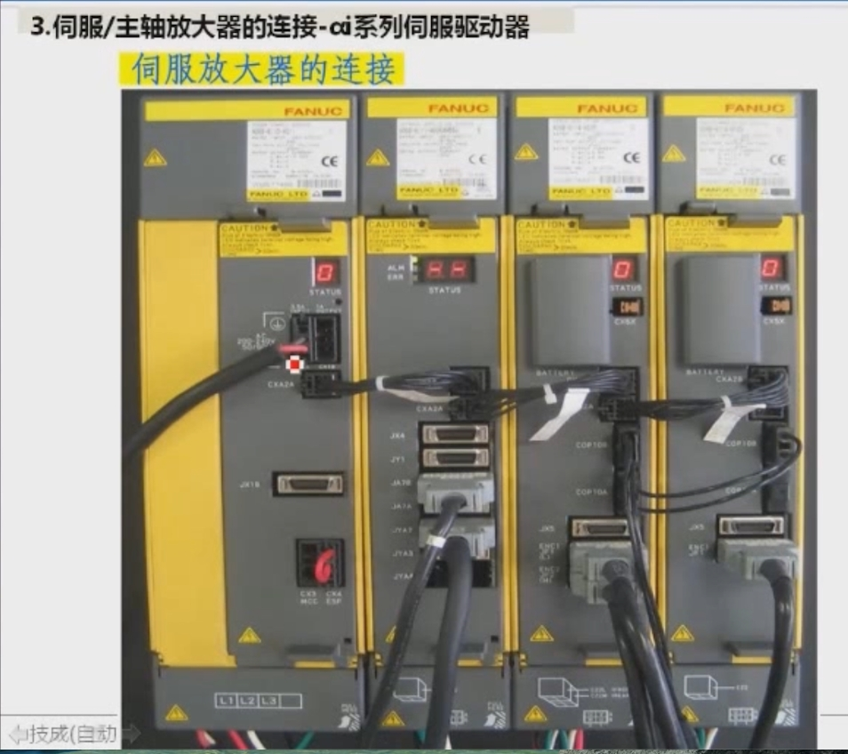

上圖由左至右依序為:電源模塊 PSM、主軸模塊 SPM、雙軸伺服模塊 SVM、單軸伺服模塊 SVM。圖中可以看到各模塊之間的 CXA2A/CXA2B 內部通訊線、來自系統的光纜(COP10A/COP10B),以及電機的動力線與反饋線。

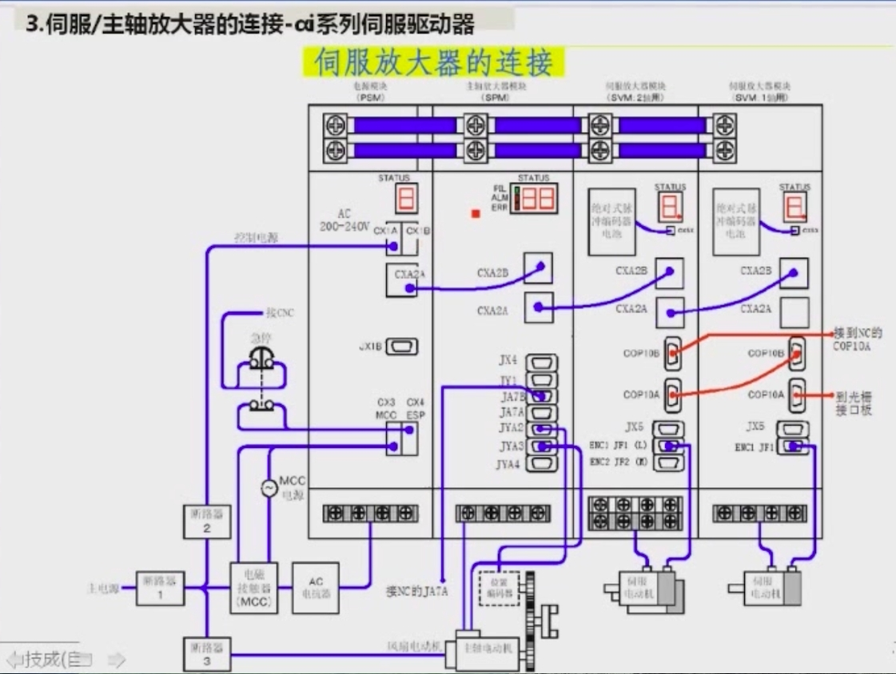

原理圖重點整理:

| 連接 | 說明 |
|---|---|
| CX1A | PSM 的單相 AC200V 控制電源輸入 |
| 主電源 | 三相 AC200V,經斷路器 1 → 電磁接觸器 MCC → 交流電抗器 → PSM 的 L1/L2/L3 |
| CX3(MCC) | 控制 MCC 吸合的觸點輸出 |
| CX4(ESP) | 外部急停信號輸入 |
| CXA2A → CXA2B | PSM → SPM → SVM → SVM 依序串接的內部通訊線 |
| JA7B | 主軸模塊接 NC 的 JA7A(串行主軸 I/O Link) |
| JYA2 / JYA3 | 主軸電機內置編碼器／外置位置編碼器 |
| COP10A / COP10B | 來自 NC 的 FSSB 光纜,依序連接各伺服模塊 |
| JF1、JF2 | 伺服電機編碼器反饋線(雙軸模塊第一軸接 JF1,第二軸接 JF2) |
| CX5X | 絕對編碼器電池 |

> 注意:各模塊共用直流母線。200V 標準輸入時,直流母線電壓為 DC300V;400V 高壓輸入時為 DC600V。PSM、SPM、SVM 之間的短接片(TB1)是連接主回路直流電壓的連接線,**一定要擰緊**,否則輕則報警,重則燒壞電源模塊與主軸模塊。

---

## 二、電源模塊 PSM 的接線

αi 系列電源模塊分為**回饋制動型(PSM)**與**小功率電阻放電型(PSMR)**兩種,外形隨功率而異,但連接端的佈置相同。

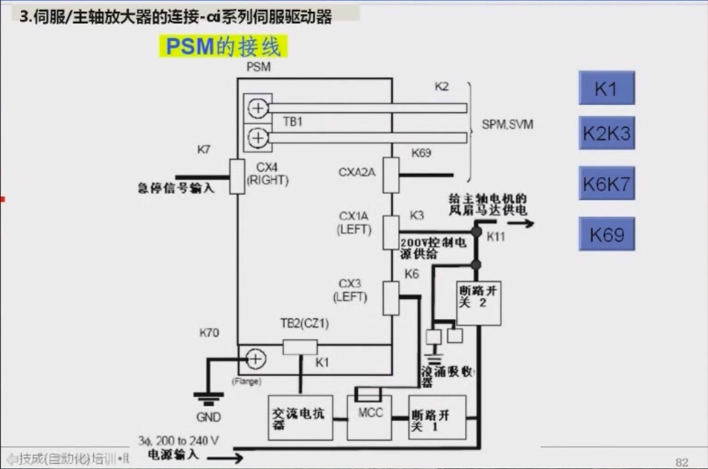

PSM 的接線主要分為以下幾組電纜:

| 電纜 | 連接端 | 作用 |
|---|---|---|
| K1 | CZ1(TB2) | 三相 AC200~240V 主電源輸入 |
| K2 | TB1 | 直流母線 L+/L-(DC300V)連接 |
| K3 | CX1A | 單相 AC200V 控制電源輸入 |
| K6 | CX3 | 控制外部接觸器 MCC 的吸合 |
| K7 | CX4 | 外部急停信號輸入 |
| K69 | CXA2A | 連接 PSM、SPM、SVM 的內部通訊線 |
| K70 | 接地端子 | 接地(GND) |

其他連接端說明:

- **CZ1(TB2)- L1/L2/L3/PE**:驅動器電源進線,標準系列為三相 AC200V~230V。
- **TB1 - L+/L-**:直流連接端,驅動器所有組成模塊都必須透過規定的連接母線連接。
- **CX1A(1/2)**:驅動器 AC200V 控制電源輸入,直接連接外部輸入電源。
- **CXA2A**:提供驅動器內部 DC24V 工作電源與控制信號的連接匯流排,應與下一模塊的 CXA2B 依序互連。
- **CX3**:主接觸器通/斷控制觸點輸出,觸點驅動能力為 AC250V/2A。
- **CX4**:外部急停信號觸點輸入,直接與外部急停按鈕或觸點連接。
- **CZ3**:外部放電電阻單元連接介面,僅用於電阻放電型電源模塊,用來連接放電電阻與電阻單元過熱觸點輸入信號。

### 1. K1 接線:主電源輸入

K1 是外部三相交流 200~240V(50/60Hz)的強電輸入,即 L1、L2、L3。接線順序為:

**主電源 R/S/T → 斷路器 1 → MCC 電磁接觸器 → 交流電抗器 → PSM 的 CZ1(L1/L2/L3)**,另有接地線 G。

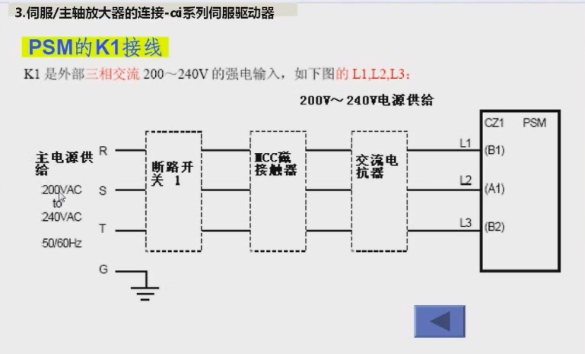

### 2. K3:控制電源輸入

K3 接到 CX1A,為單相 AC200V 控制電源供給(接 CX1A 的 1 腳與 2 腳,3 腳為地線)。控制電源通常取自斷路器 2 之後,並可同時為主軸電機的風扇馬達供電(K11)。

### 3. K6、K7 接線:MCC 控制與急停

**K6** 用於控制裝在外部的接觸器 MCC 的吸合:

- PSM 的 CX3 第 1 腳與第 3 腳之間有一個**內部觸點**。
- 當驅動器無故障、正常工作時,此觸點閉合,使 MCC 線圈得電吸合,從而接通主電源。
- 線圈兩端需並聯火花抑制器;外部電源必須符合用戶設備的線圈電壓。

**K7** 是外部急停信號輸入:在 CX4 的第 2 腳與第 3 腳之間串接急停按鈕的觸點(+24V 回路)。

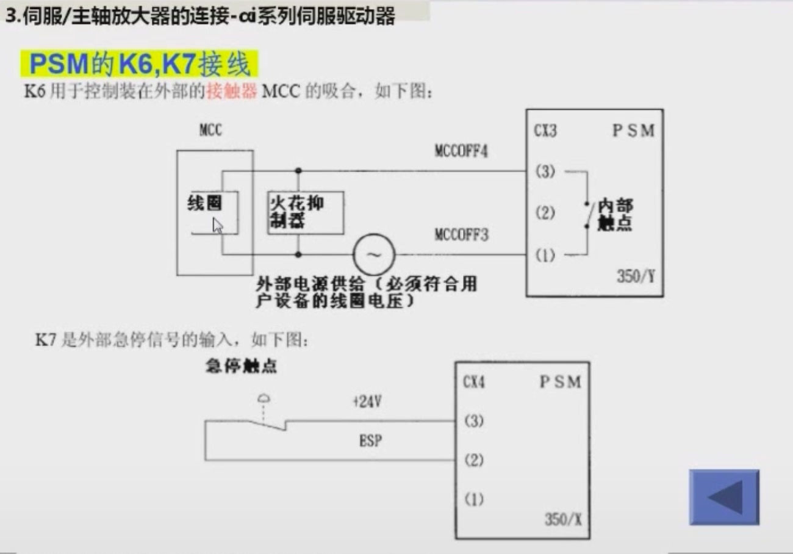

### 4. K69 接線:模塊間的內部通訊線

K69 用來連接 PSM、SPM、SVM,由電源模塊 PSM 向 SPM 和 SVM 提供 24V 電源,同時傳遞放大器內部的急停串聯信號,以及編碼器外部電池的連接。

> 因為只有電源模塊接了急停信號,若發生急停,主軸模塊與伺服模塊無從得知,所以透過 K69 的 \*ESP 信號線傳遞。

CXA2A(PSM/SPM/SVM 側)與 CXA2B(下一個 SPM/SVM 側)的針腳對應如下:

| CXA2A | 信號 | CXA2B |
|---|---|---|
| A1 / B1 | 24V | A1 / B1 |
| A2 / B2 | 0V | A2 / B2 |
| A3 | MIFA | A3 |
| B3 | BATL(電池 6V) | B3 |
| A4 | \*ESP(急停) | A4 |
| B4 | XMIFA | B4 |

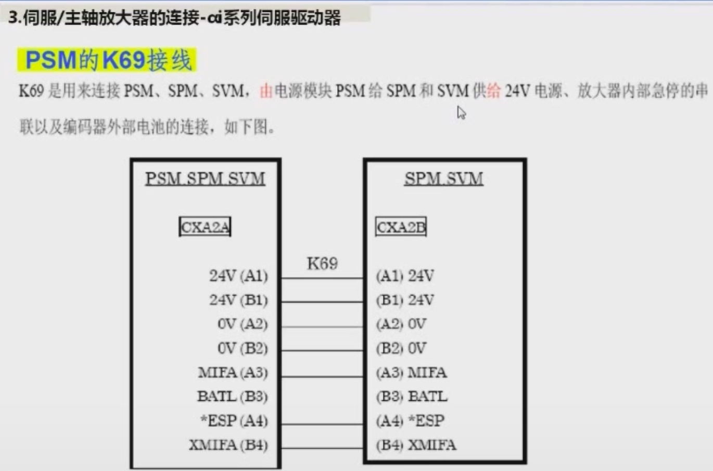

---

## 三、伺服模塊 SVM 的接線

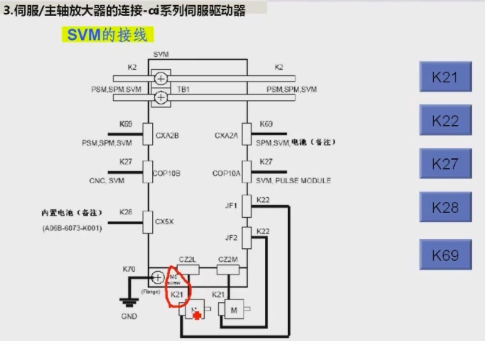

SVM 各電纜的作用:

| 電纜 | 連接端 | 作用 |
|---|---|---|
| K2 | TB1 | 直流母線連接 |
| K69 | CXA2B / CXA2A | 模塊間 24V 電源、急停、電池信號 |
| K27 | COP10B / COP10A | FSSB 光纜 |
| K28 | CX5X | 內置電池(使用絕對編碼器時) |
| K21 | CZ2L / CZ2M / CZ2N | 伺服電機動力線 |
| K22 | JF1 / JF2 | 伺服電機編碼器反饋線 |
| K70 | 接地端子(M5 螺釘) | 接地 |

### 1. 動力接線與 K21

SVM 依軸數不同,動力插座數量也不同:**1 軸模塊為 CZ2,2 軸模塊為 CZ2L、CZ2M,3 軸模塊為 CZ2L、CZ2M、CZ2N**。動力線採用插接件(Connector D-5000),將接線焊好後直接插入即可。

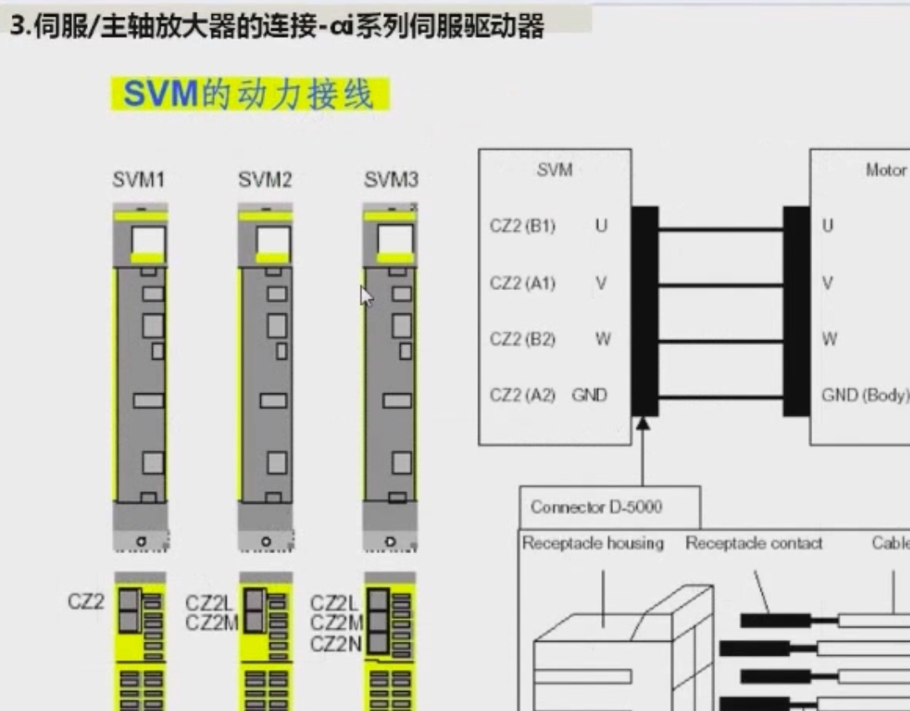

**K21** 是伺服放大器到伺服電機的動力電纜,共 4 根線:

| SVM 端 CZ2 | 信號 | 電機端 |
|---|---|---|
| B1 | U | U |
| A1 | V | V |
| B2 | W | W |
| A2 | GND | GND(機殼) |

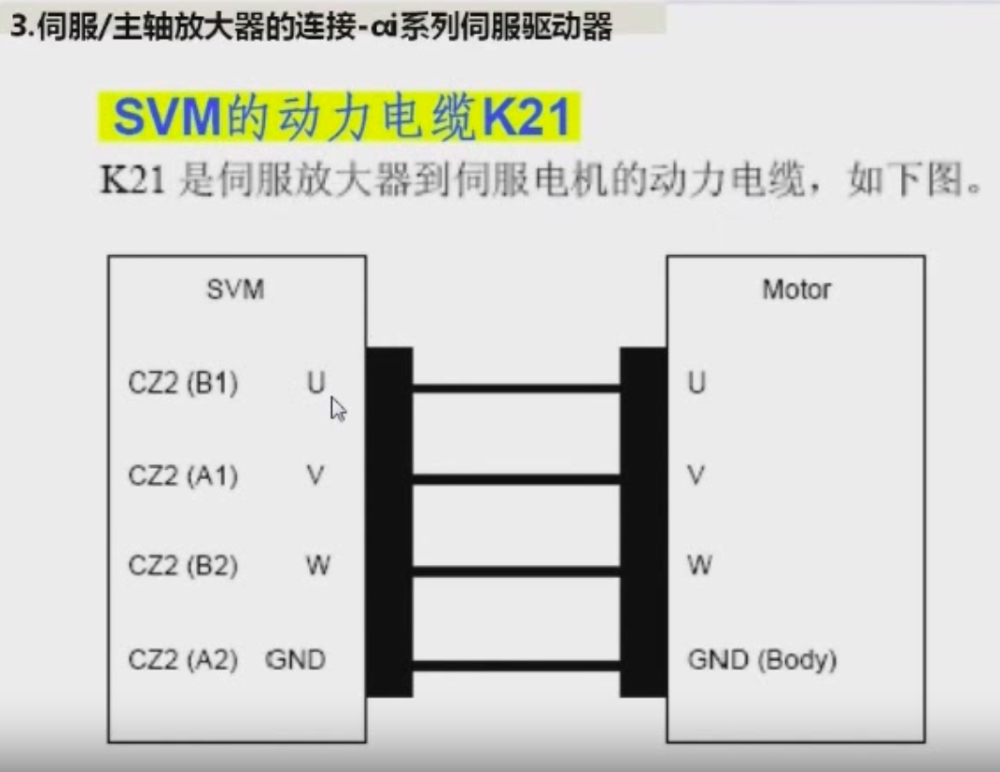

### 2. 反饋接線 K22

K22 是編碼器的反饋電纜(SVM 側為 20 針半間距連接器),針腳對應如下:

| SVM 側針腳 | 信號 | 伺服電機側針腳 |
|---|---|---|
| 5 | RD | 6 |
| 6 | \*RD | 5 |
| 9、20 | 5V | 8、9 |
| 12、14 | 0V | 7、10 |
| 7 | 6V(電池) | 4 |
| 16 | FG(屏蔽) | 3 |

RD 與 \*RD 為一對雙絞線,需使用屏蔽電纜,屏蔽層的 drain wire 要接地(圖中「接地」處)。

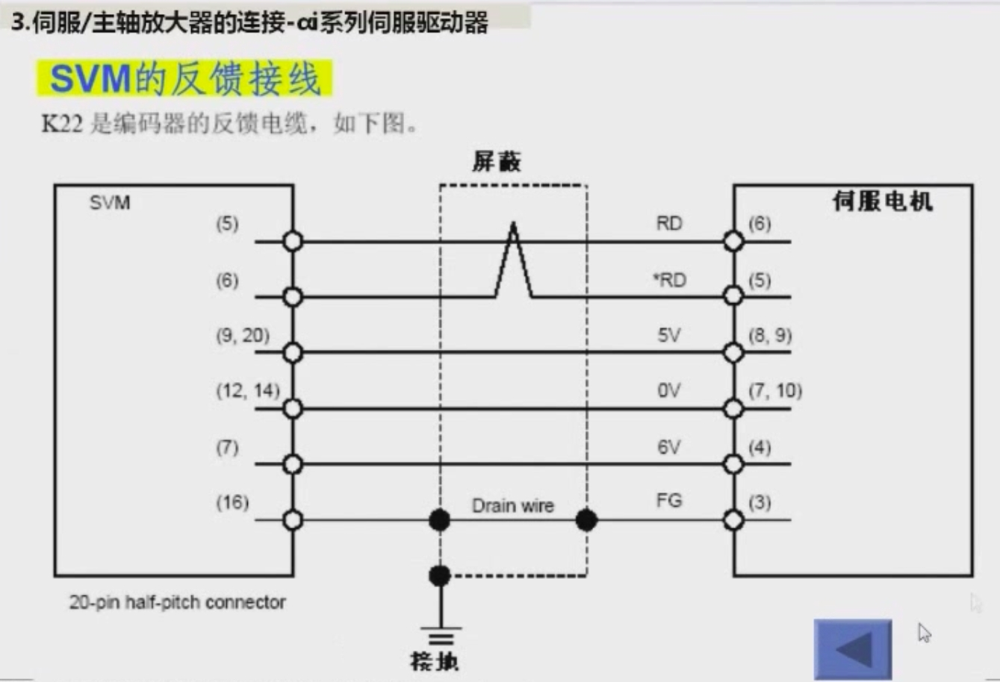

### 3. 光纜接線 K27(FSSB)

K27 是 FSSB 光纜的連接:

**CNC 的 COP10A → 第一個伺服模塊的 COP10B;第一個模塊的 COP10A → 下一個伺服模塊的 COP10B**,依此類推。最後一個模塊的 COP10A 不接線,要蓋上防塵蓋(COVER)。

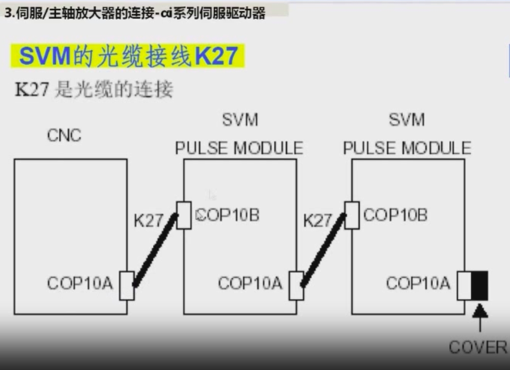

### 4. 內置電池接線 K28

K28 是內置電池的連接,**使用絕對位置編碼器時才需要**。每個 SVM 內可各自裝入電池盒(A06B-6114-K500)與電池(A06B-6073-K001),電池線接到 CX5X。

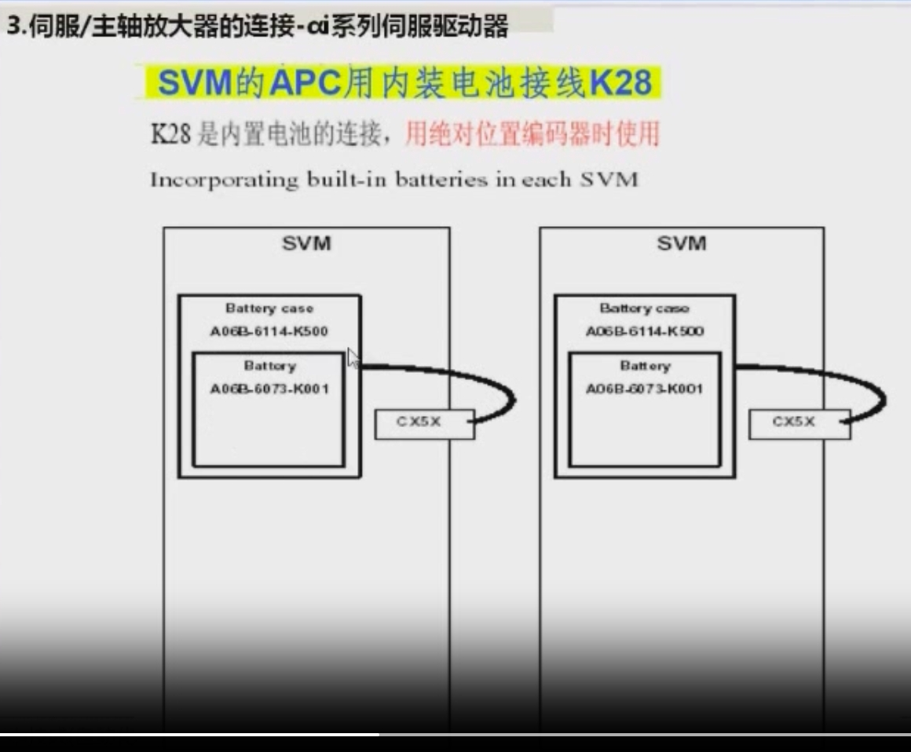

### 5. 一組電池供多個 SVM:BATL(B3)

絕對編碼器的電池除了內置方式,還可以採用**外接電池盒**方式:

- 電池盒:A06B-6050-K060;電池:A06B-6050-K061。
- 電池連接用連接器(選購件):A06B-6110-K211。
- BATL(B3)是由一組絕對脈衝編碼器電池,向多個 SVM 供電的介面;透過 K69 的 CXA2A/CXA2B 逐級傳遞 6V 電池電壓。

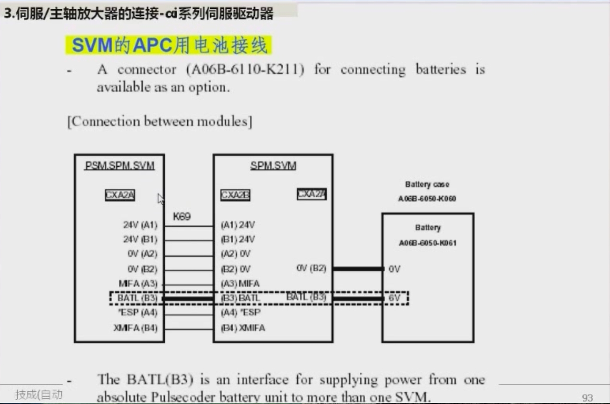

電池與 CXA2A 之間的電纜做法:使用兩條 0.3mm² 電線,BATL(B3,6V)接白色端子(Terminal 1),0V(B2)接黑色端子(Terminal 2),端子規格為壓接端子 1.25-4。

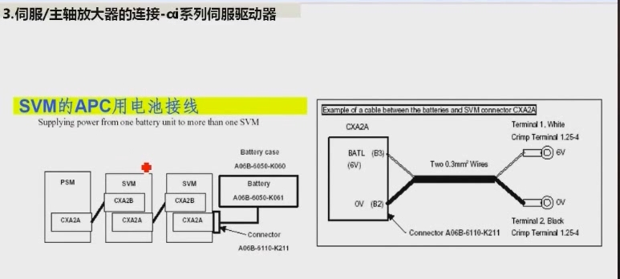

---

## 四、主軸模塊 SPM 的接線

### 1. 主軸模塊的特點

- αi 系列主軸驅動模塊均為**單軸**,外形與功率有關,可分為小功率和大功率兩類,連接端的佈置基本相同。
- 主軸驅動模塊可直接安裝於驅動器上,並與伺服驅動**共用直流母線與內部控制匯流排**,因此直流母線(L+/L-)與內部控制匯流排 CXA2A/CXA2B 的連接與伺服驅動相同。
- SPM 系列有**單傳感器輸入(A 型)**與**雙傳感器輸入(B 型)**兩種規格:
  - A 型只能連接一個主軸位置檢測編碼器;
  - B 型可同時連接兩個位置檢測編碼器,而且主軸內置式編碼器的位置信號也可由驅動模塊輸出到 CNC。
- 從驅動器性能分類:與 αi 系列主電機配套的**高性能型(SPM 型)**,以及與 αCi 系列主電機配套的**普及型(SPMC 型)**。SPMC 型只能連接單傳感器輸入,其連接方式與介面完全與 SPM 的 A 型相同。

### 2. SPM 接線總圖

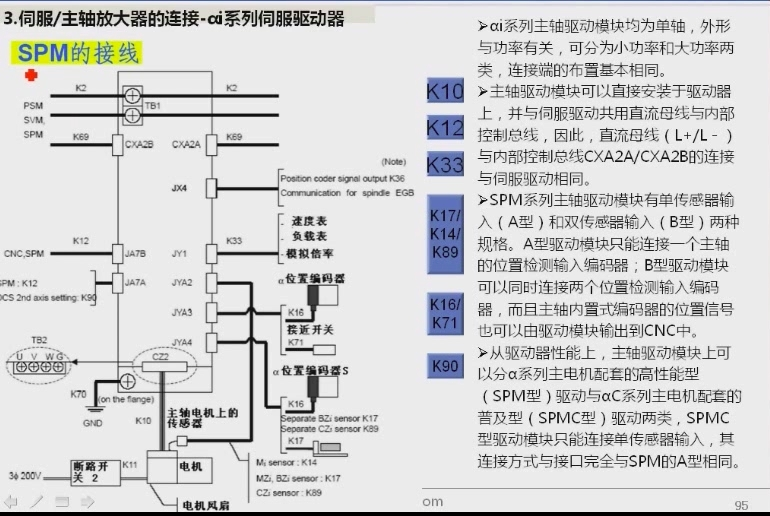

| 電纜 | 連接端 | 作用 |
|---|---|---|
| K10 | CZ2 | 主軸電機動力線 |
| K11 | — | 主軸電機風扇馬達供電(經斷路器 2) |
| K12 | JA7B | 與 CNC 的串行主軸(I/O Link)連接 |
| K33 | JY1 | 操作與顯示信號(速度表、負載表、模擬倍率) |
| K14 / K17 / K89 | JYA2 | 主電機內置編碼器(Mi、MZi/BZi、CZi) |
| K16 / K71 | JYA3 | 外置位置編碼器／接近開關 |
| K17 / K89 | JYA4 | 外置 BZi／CZi 編碼器(僅 B 型) |
| K36 | JX4 | 位置編碼器信號輸出、主軸 EGB 通訊 |
| K90 | JA7A | 多主軸時連接下一個串行主軸(第二軸設定) |
| K69 | CXA2B / CXA2A | 模塊間內部通訊線(與伺服相同) |
| K70 | 接地端子 | 接地 |

### 3. K10:主軸電機動力線

K10 是主軸電機的動力電纜連接,同樣為 U、V、W 與接地共 4 根線,採用插接件(Connector D-5000):

| SPM/SPMC 端 CZ2 | 信號 | 主軸電機 |
|---|---|---|
| B1 | U | U |
| A1 | V | V |
| B2 | W | W |
| A2 | GND | G |

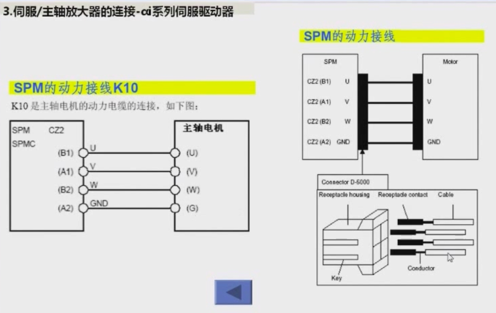

### 4. K12:I/O Link 串行匯流排連接

主軸驅動模塊與 CNC 的匯流排連接不同於伺服,它有**獨立的 I/O Link 串行匯流排**:介面在驅動器側為 **JA7B**,在 CNC 側為 **JA7A**。多主軸控制時,主軸模塊的輸出介面 JA7A 可連接下一個串行主軸驅動模塊。

### 5. K33:操作與顯示信號(JY1)

串行主軸的轉速調整、實際轉速與功率的顯示可透過 CNC 的 MDI/LCD 進行,但這樣的操作與顯示通常不夠直觀,因此主軸驅動模塊上安裝了專用的 **JY1** 連接器,連接外部操作與顯示信號。JY1 是標準連接器,可用於 SPM(A 型或 B 型)與 SPMC 型驅動模塊,連接信號包括:

- 外部主軸**倍率調整電位器**(OVR1、OVR2):OVR1 為內部電壓輸出,OVR2 為調整電壓輸入;兩端電壓相同(電位器調到最上端)時,倍率為 100%。電位器阻值為 0~10kΩ。
- 主軸**實際轉速顯示(SM)**:輸出為直流模擬電壓,在 0 至最高轉速範圍內呈 0~10V 線性變化,精度約 ±3%。
- 主軸**實際功率顯示(LM)**:輸出同為直流模擬電壓,精度約 ±15%。

### 6. K14/K17/K89:電機內置編碼器(JYA2)

主電機內置式編碼器用於電機轉速與位置檢測,接到 **JYA2**。磁性編碼器由**檢測頭**與**磁性環**組成:A、B 相信號可檢測轉角大小,A、B 相位差可判斷正轉或反轉,Z 相為零位信號。

αi 系列主電機內置編碼器共有 4 種類型:

1. **Mi 型**:不帶零位脈衝信號,輸出為 64~256 周期/轉的正弦波,標準內置式磁性編碼器。
2. **MZi 型**:帶零位脈衝信號,輸出為 64~256 周期/轉的正弦波,標準內置式磁性編碼器。
3. **BZi 型**:帶零位脈衝信號,輸出為 128~512 周期/轉的正弦波,無前置放大器的內置/外置通用型磁性編碼器。
4. **CZi 型**:帶零位脈衝信號,輸出為 512~1024 周期/轉的正弦波,帶前置放大器的內置/外置通用型磁性編碼器。

### 7. K16/K71 與 JYA4:外置位置編碼器

**作用與分類**:為了實現主軸的**定向準停、主軸定位、Cs 軸控制**等功能,主軸上必須安裝檢測位置的編碼器或接近開關。

- 主電機與主軸為 **1:1 連接**時,帶零位脈衝輸出的電機內置編碼器即可作為位置檢測編碼器。
- 若兩者之間有**機械變速裝置**,電機轉數與主軸轉數不再一一對應,就必須在主軸上另外安裝帶零位信號的外置編碼器或接近開關。

SPM(SPMC)可連接的外置編碼器有 4 類:

1. 方波輸出、1024 脈衝/轉的光電編碼器(α 型位置編碼器);
2. 輸出為 1024 周期/轉正弦波的外置磁性編碼器(αS 型位置編碼器);
3. BZ 型編碼器(128~512 周期/轉、無前置放大器的通用型磁性編碼器);
4. CZ 型編碼器(512~1024 周期/轉、帶前置放大器的通用型磁性編碼器)。

**連接介面**:

| 介面 | 適用模塊 | 可連接的元件 |
|---|---|---|
| JYA3(標準介面) | SPM(A 型、B 型)、SPMC | 只能接 α 型位置編碼器(方波光電編碼器);僅需主軸定向準停時,也可接**接近開關**信號 |
| JYA4(擴展介面) | 僅 SPM 的 B 型 | α 型、αS 型位置編碼器、BZi 型、CZi 型編碼器;**不可接接近開關** |

---

---

## 五、SPM 外圍連接(續)

### 1. K33:主軸模擬倍率、速度表、負載表的連接(JY1)

K33 連接 SPM/SPMC 的 JY1 連接器,針腳如下:

| JY1 針腳 | 信號 | 連接對象 |
|---|---|---|
| 1 | OVR1 | 模擬倍率可變電阻(固定端) |
| 2 | OVR2 | 模擬倍率可變電阻(滑動端) |
| 20 | 0V | 接屏蔽層 |
| 16 | LM | 負載表(功率顯示) |
| 18 | 0M | 負載表公共端 |
| 17 | SM | 速度表(轉速顯示) |
| 19 | 0M | 速度表公共端 |

在數控機床上,串行主軸的轉速調整、實際轉速與功率的顯示可以透過 CNC 的 MDI/LCD 單元進行,但通常不夠直觀,所以在主軸驅動模塊上安裝了專門的 JY1 連接器,用於連接外部操作與顯示信號。

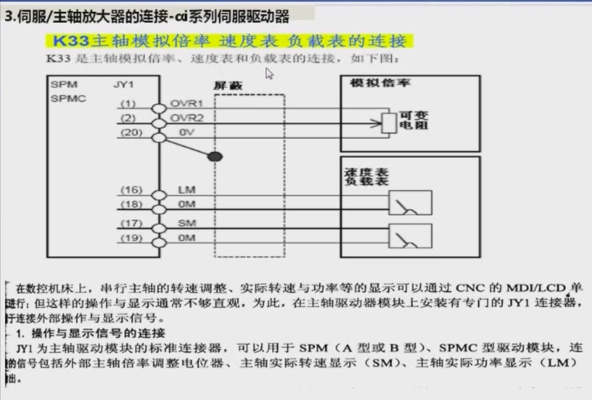

### 2. 電機內置編碼器的原理與分類

磁性編碼器由**檢測頭**與**磁性環**組成:A、B 相磁性環輸出相差 90° 的正弦波(Ua、Ub),可檢測轉角與轉向;Z 相磁性環輸出一個零位脈衝信號(Uz)。

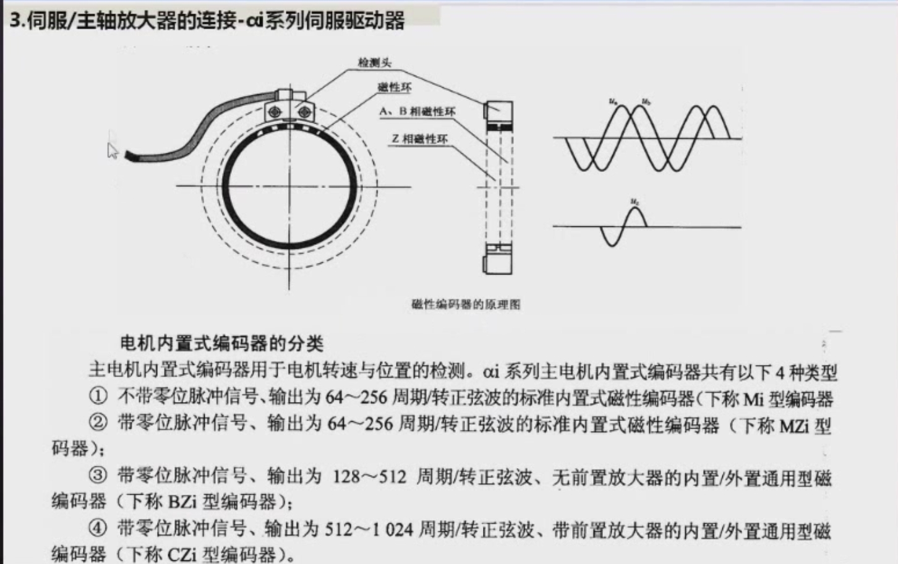

αi 系列主電機內置式編碼器共有 4 種類型:Mi 型、MZi 型、BZi 型、CZi 型(詳見上一部分第四節第 6 點),它們都接到 **JYA2**。

### 3. K17、K14、K89:內置編碼器反饋線(JYA2)

**K14**:主軸電機上 Mi 傳感器的連接(Mi 型沒有零位信號):

| SPM JYA2 | 信號 | 電機 Mi 傳感器 |
|---|---|---|
| 5 | MA | A2(PA) |
| 6 | \*MA | B2(RA) |
| 7 | MB | A3(PB) |
| 8 | \*MB | B3(RB) |
| 20 | 5V(0.5mm²) | A1 |
| 16 | 0V(0.5mm²) | B5 |
| 13 | THR1 | A6 |
| 15 | THR2 | B6 |
| 10 | SS(屏蔽) | A5 |

**K17**:MZi、BZi 傳感器的連接。若 BZi 傳感器是分離型的檢測單元(連接到 JYA4),則 THR1 和 THR2 不用接線。

| SPM JYA2 | 信號 | 電機 MZi/BZi 傳感器 |
|---|---|---|
| 1 / 2 | MZ / \*MZ | A4 / B4(VZ / \*VZ) |
| 5 / 6 | MA / \*MA | A2 / B2(VA / \*VA) |
| 7 / 8 | MB / \*MB | A3 / B3(VB / \*VB) |
| 9、18、20 | 5V(0.5mm²) | A1 |
| 12、14、16 | 0V(0.5mm²) | B5 |
| 13 / 15 | THR1 / THR2 | A6 / B6 |
| 10 | SS(屏蔽) | A5 |

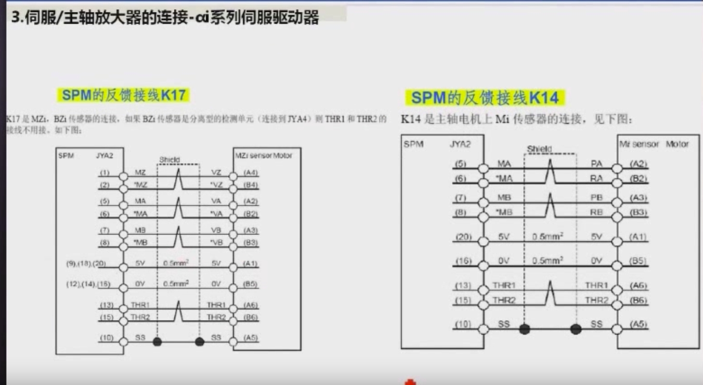

**K89**:CZi 傳感器的連接。若 CZi 傳感器是分離型的檢測單元(連接到 JYA4),則 THR1 和 THR2 不用接線。CZi 傳感器帶前置放大器,連接介面可為 JYA2 或 JYA4,5V/0V 線徑為 0.18mm²。右圖為內置 MZi 傳感器電機的反饋接線,SPM 側為 20 針半間距連接器(Tyco Electronics AMP 製造:外殼 178289-6,端子 1-175217-2)。

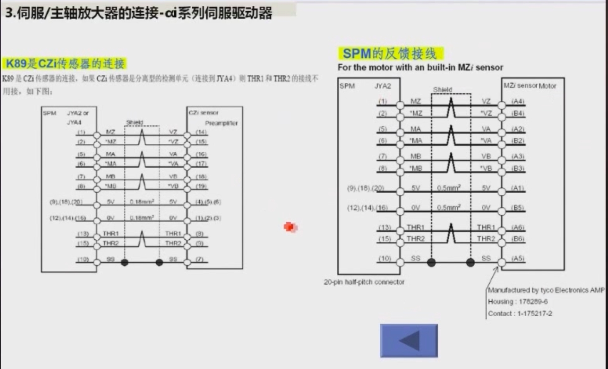

> 接線規律:A、B、Z 三相信號均為差分對(信號與 \* 信號),需使用屏蔽雙絞線,屏蔽層接 SS 針腳。

### 4. K16:位置編碼器接線(JYA3)

K16 是 α 位置編碼器或 αS 位置編碼器的連接:

| SPM/SPMC JYA3 | 信號 | α 位置編碼器 |
|---|---|---|
| 1 / 2 | PZ / \*PZ | B / P |
| 5 / 6 | PA / \*PA | A / N |
| 7 / 8 | PB / \*PB | C / R |
| 9、18、20 | 5V(0.5mm²) | H |
| 12、14、16 | 0V(0.5mm²) | K |

屏蔽層接地(Ground plate)。

JYA3 為標準介面,可用於 SPM(A 型或 B 型)、SPMC 型,連接的編碼器只能是 α 型位置編碼器(方波輸出光電編碼器);僅需主軸定向準停時,JYA3 還可以連接接近開關信號。JYA4 為擴展介面,只能用於 SPM 的 B 型,可連接 α 型、αS 型位置編碼器、BZi 型與 CZi 型編碼器,**不能**連接接近開關信號。

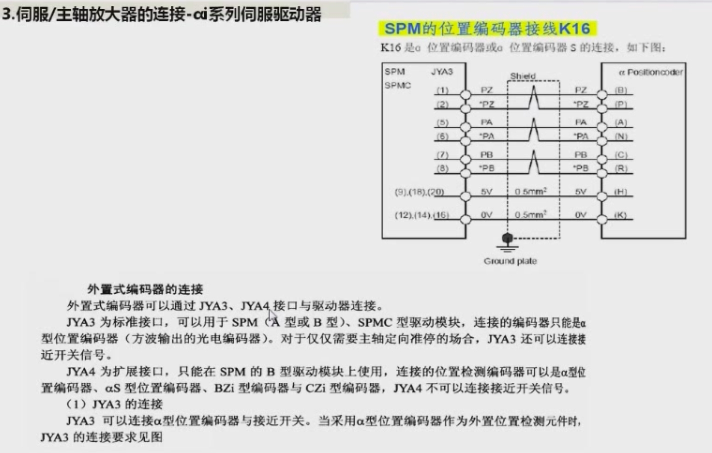

### 5. K71:接近開關連接(JYA3)

接近開關的連接有三種情況:**PNP 型、NPN 型、2 線式**。使用的 JYA3 針腳:11(24V)、13(SCCOM)、15(EXTSC)、14 與 16(0V)、10(SS,屏蔽)。

| 類型 | 接線要點 |
|---|---|
| PNP 型 | 24V 接開關電源,OUT 接 EXTSC(15),0V 接 16;SCCOM(13)與 0V(14)短接 |
| NPN 型 | 24V 接開關電源,OUT 接 EXTSC(15),0V 接 16;SCCOM(13)與 24V(11)短接 |
| 2 線式 | OUT 接 EXTSC(15),0V 接 16;SCCOM(13)與 24V(11)短接 |

三種情況屏蔽層都接 SS(10)。

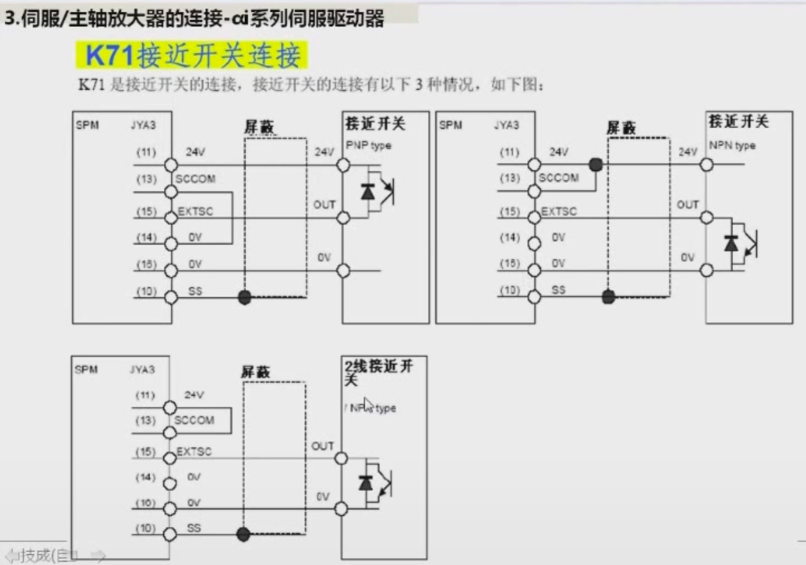

### 6. JYA4 的連接

JYA4 為 B 型驅動器的擴展接口,可連接 α 型位置編碼器、αS 型位置編碼器、BZi 型與 CZi 型編碼器。與 αS 型位置編碼器的連接如下:

| 主軸驅動模塊 JYA4 | 信號 | αS 編碼器 |
|---|---|---|
| 1 / 2 | PSE / \*PSE | B / P |
| 5 / 6 | AP / XAP | A / N |
| 7 / 8 | BP / XBP | C / R |
| 9、18、20 | 5V(0.5mm²) | H |
| 12、14、16 | 0V(0.5mm²) | K |
| 10 | SS(屏蔽) | — |

AP、BP 為以 2.5V 為中心的正弦波(兩相相差 90°),PSE 為每轉一次的零位脈衝(\*PSE 為其反相信號)。

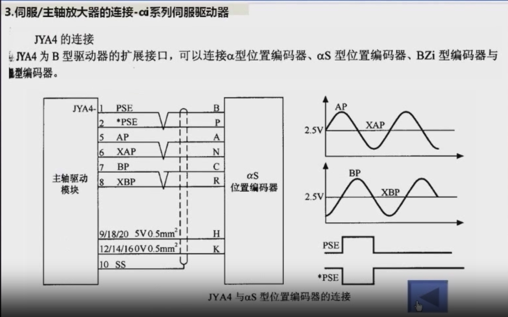

### 7. K90:雙安檢功能使用

K90 **僅在使用雙安檢(Dual Check Safety)功能時才用**,必須接到**第二主軸的 JA7A** 上(圖中為 JA7A 的 11 腳與 15 腳短接的連接器)。主軸之間的串行連接仍為 K12:CNC 的 JA7A → 第一主軸 JA7B;第一主軸 JA7A → 第二主軸 JA7B。

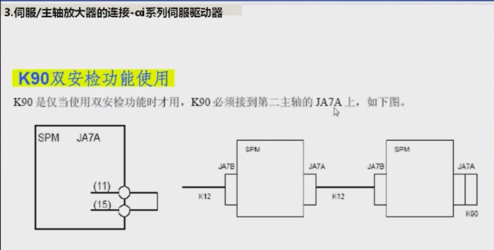

---

## 六、伺服電機型號與規格

電機型號格式為 `A06B-XXXX-BXXX` 或 β、α XXX/XXX(X 代表數字或字母),可在**電機標牌**上查看。伺服電機規格 `A06B-02xx-By0z` 規定了電機的型號、軸類型與檢測器:

| xx | 電機型號 | y | 軸類型 | z | 檢測器 |
|---|---|---|---|---|---|
| 02 | α1/5000i | 0 | 錐軸 | 0 | αA1000i 脈衝編碼器 |
| 05 | α2/5000i | 1 | 直軸 | 1 | αI1000i 脈衝編碼器 |
| 23 | α4/4000i | 3 | 錐軸,帶 24VDC 制動器 | 2 | αA16000i 脈衝編碼器 |
| 27 | α8/3000i | 4 | 直軸,帶 24VDC 制動器 | | |
| 43 | α12/3000i | | | | |
| 47 | α22/3000i | | | | |
| 53 | α30/3000i | | | | |
| 57 | α40/3000i | | | | |

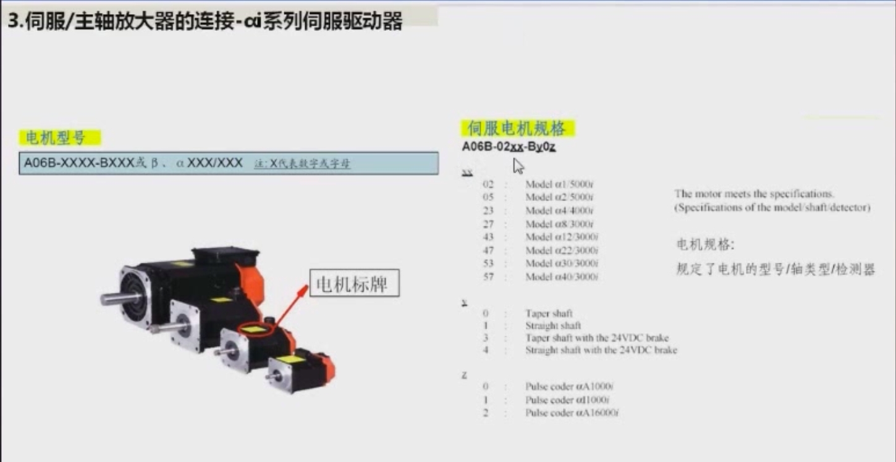

---

## 七、總結:模塊間連線與注意事項

### 1. 模塊間通訊線 CXA2A → CXA2B

各放大器之間的通訊線為 CXA2A 接 CXA2B:從電源模塊到主軸模塊的連接是**水平連接(沒有交叉)**,而從主軸到伺服放大器,再到後面的伺服放大器則都是**交叉連接**。如果連接錯誤,會出現電源模塊和主軸模塊異常報警。

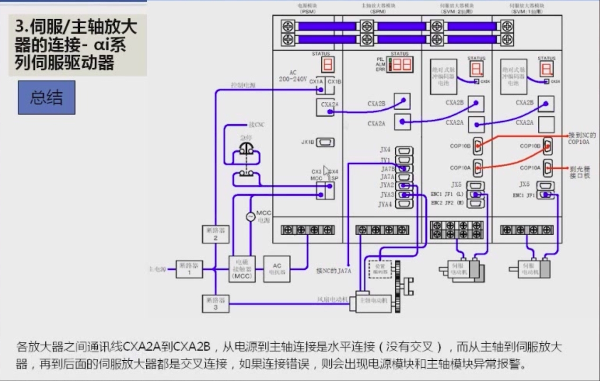

### 2. 注意事項

1. 驅動器中各模塊共用直流母線:200V 標準輸入時為 DC300V,400V 高壓輸入時為 DC600V。PSM、SPM、SVM 之間的短接片(TB1)是連接主回路直流電壓的連接線,**一定要擰緊**,否則輕則產生報警,重則燒壞電源模塊(PSMi)和主軸模塊(SPMi)。
2. AC200V 控制電源由上面的 **CX1A** 引入,和下面的 MCC/ESP(**CX3/CX4**)注意**一定不要接錯接反**,否則會燒壞電源板。

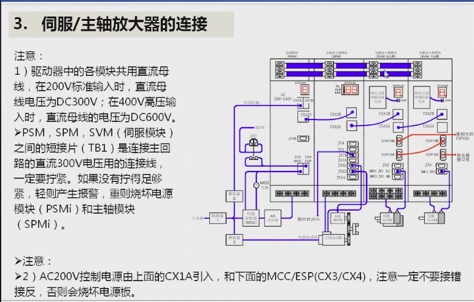

### 3. PSM 連接端說明

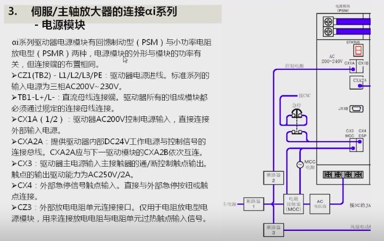

(各連接端 CZ1、TB1、CX1A、CXA2A、CX3、CX4、CZ3 的作用已於第二節說明。)

### 4. CX1A、CX3(MCC)、CX4(ESP)的接法

- **CX1A**:PSM 控制電源輸入,1、2 腳接 AC200V 輸入(下面的為 1),3 腳為地線。
- **CX3(MCC)**:1、3 腳為內部繼電器觸點,接 MCC 線圈迴路(MCCOFF3/MCCOFF4),線圈兩端並聯浪湧吸收器,外部電源須符合線圈電壓。**一定不要接錯**。
- **CX4(ESP)**:在 2、3 腳之間串接急停按鈕的**常閉觸點**(+24V 回路)。

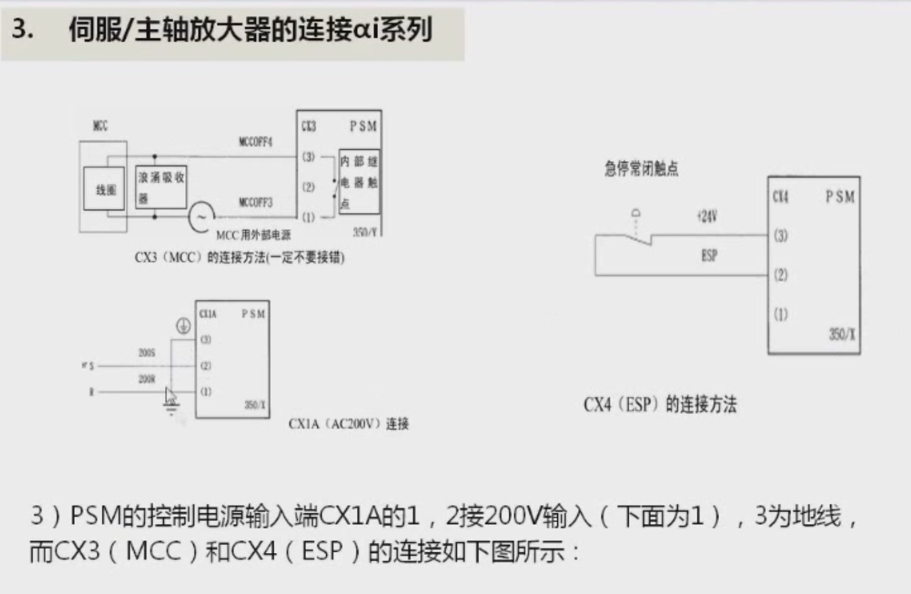

---

## 八、伺服驅動模塊的連接端說明

**第一部分:**

- **CZ2L/2M/2N 或 TB2 - U/V/W/PE**:伺服電機電樞連接端。
- **CXA2B/CXA2A**:提供驅動器內部 DC24V 工作電源與控制信號的連接匯流排;CXA2A 應與下一驅動模塊的 CXA2B 依序互連。
- **COP10A/COP10B**:驅動器 FSSB 匯流排。COP10B 與上一單元的 COP10A 互連,COP10A 與下一驅動模塊的 COP10B 互連。
- **JX5**:驅動器檢測板連接器,供維修使用。
- **CX5**:絕對編碼器電池連接端。使用絕對編碼器時,需要連接用於保持位置數據的後備電池。

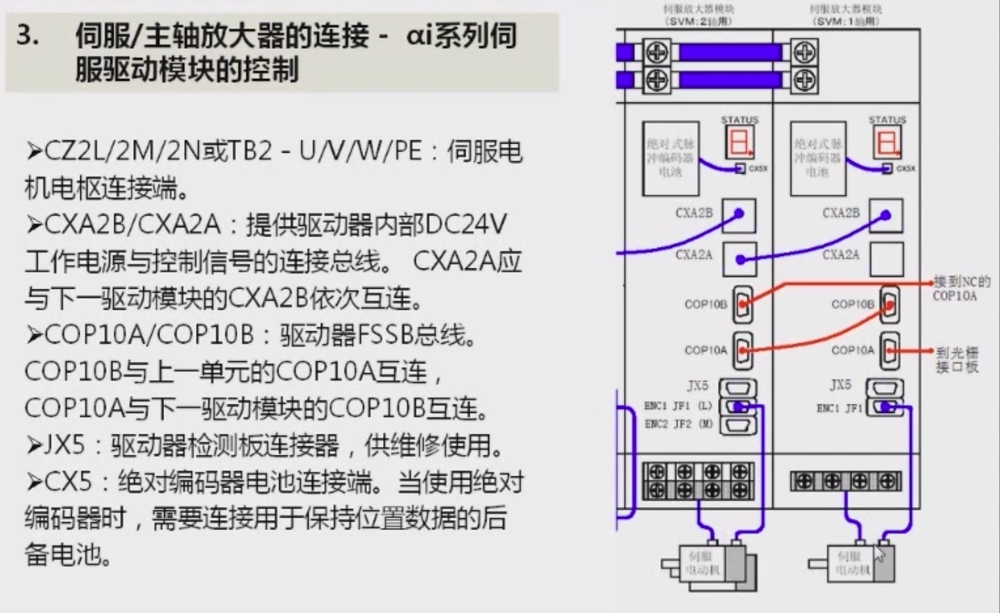

**第二部分:**

- **JF1/JF2/JF3**:伺服電機的位置編碼器反饋連接端,連接要求與電機型號有關。
- **CX1A/CX1B(大功率驅動器才有)**:獨立的 200V 控制電源輸入。CX1A 為電源輸入端,可連接上一模塊的 CX1B 或直接與外部電源連接;CX1B 為電源輸出端,可連接下一模塊的輸入 CX1A。
- **CX8/CX9(大功率驅動器才有)**:動態制動模塊連接端。動態制動器模塊實質上是一種能耗制動電阻模塊,可為大功率電機的制動提供制動力矩。

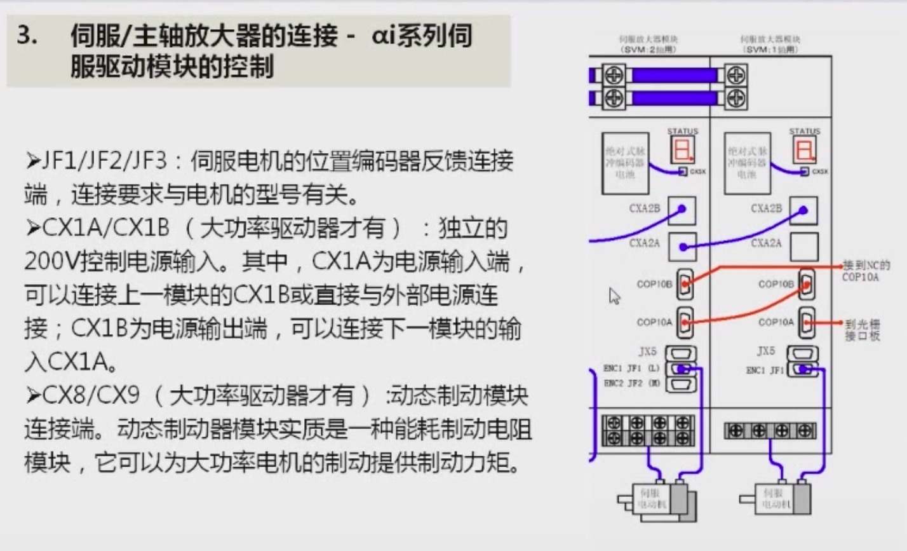

---

## 九、αi 系列伺服驅動器綜合連接圖

下圖為 PSM + 雙軸 SVM2 + 單軸 SVM1 的綜合連接圖,整理了全章內容:

- **PSM**:CX1A(200R/200S/PE 控制電源)、CX4(ESP 急停、+24V)、CX3(MCC 觸點)、TB2(L1/L2/L3/PE 主電源,經 MCC 與交流電抗器)、CZ3(RE1/RE2 放電電阻,TH1/TH2 過熱觸點,虛線表示僅電阻放電型使用)。
- **直流母線**:TB1 的 L+/L- 貫穿各模塊。
- **內部通訊 CXA2A → CXA2B**:傳遞 24V、0V、MIFA、BATL、ESP、XMIFA。
- **FSSB 光纜**:來自 CNC 的 COP10B,各模塊 COP10A → 下一模塊 COP10B。
- **SVM2(雙軸)**:JF1 與 TB2 的 UL/VL/WL/PE 為第一軸,JF2 與 UM/VM/WM/MPE 為第二軸。
- **SVM1(單軸)**:JF1 與 TB2 的 U/V/W/PE。
- **CX5X**:各 SVM 的絕對編碼器電池。

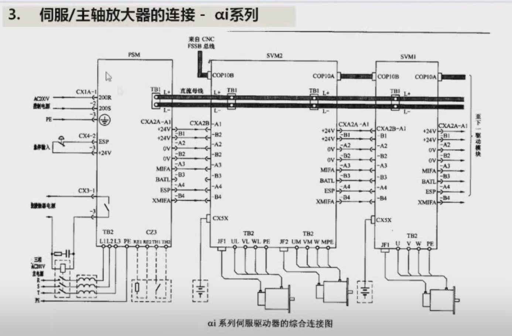
