# 第6課時　FANUC 0i-C 數控機床電氣連接（六）

## 伺服／主軸放大器的連接——βi 系列

> 本課時接續前面的 αi 系列，講解 FANUC 0i-C 系統接口的第三部分：**βi 系列伺服／主軸放大器的連接**，之後依序介紹模擬主軸、I/O、急停、電源、電機、分離型檢測器、其他設備（RS-232／記憶卡）以及 I/O Link 軸。
>
> **本檔為完整版：已含第一、二、三部分（對應圖檔 chs06_01 ～ chs06_44）。**

### 本課時內容總覽

| 序號 | 主題 | 狀態 |
|---|---|---|
| 3 | 伺服／主軸放大器的連接——βi 系列 | 已完成 |
| 4 | 模擬主軸的連接 | 已完成 |
| 5 | I/O 的連接 | 已完成 |
| 6 | 急停的連接 | 已完成 |
| 7 | 電源的連接 | 已完成 |
| 8 | 電機的連接 | 已完成 |
| 9 | 分離型檢測器的連接 | 已完成 |
| 10 | 其他設備（電腦、記憶卡、DNC） | 已完成 |
| 12 | I/O Link 軸的連接 | 已完成 |

---

## 3.1　βi 系列放大器的種類與系統規格

前面講過 αi 系列伺服／主軸放大器的連接，這一節先看 βi 系列有哪幾種，以及各自可以搭配哪些 CNC 系統。

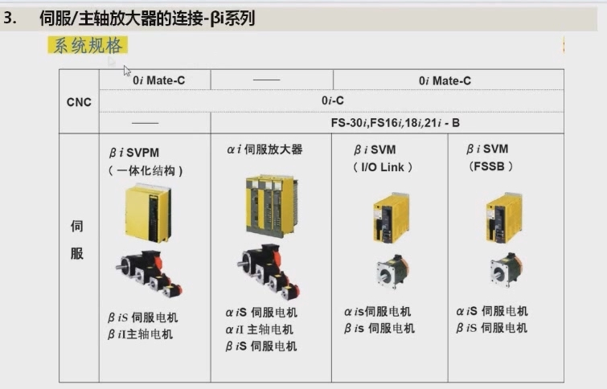

### 重點整理

- **0i-C** 系統：圖中四種伺服放大器（βi SVPM、αi 伺服放大器、βi SVM〔I/O Link〕、βi SVM〔FSSB〕）**都可以使用**。
- **0i Mate-C** 系統：**不能使用 αi 伺服放大器**（對照圖中表格，αi 放大器一欄在 0i Mate-C 處為空白）。
- βi 系列在結構上分為兩大類：
  - **一體化結構**：βi SVPM，伺服與主軸放大器合為一體，搭配 βiS 伺服電機、βiI 主軸電機。
  - **單軸（獨立）型**：βi SVM，依與 CNC 的通訊方式又分為 **I/O Link** 與 **FSSB** 兩種。

### 各類型搭配的電機

| 放大器 | 可搭配的電機 |
|---|---|
| βi SVPM（一體化結構） | βiS 伺服電機、βiI 主軸電機 |
| αi 伺服放大器 | αiS 伺服電機、αiI 主軸電機、βiS 伺服電機 |
| βi SVM（I/O Link） | αiS、βiS 伺服電機 |
| βi SVM（FSSB） | αiS、βiS 伺服電機 |

---

## 3.2　βi 系列一體型放大器 SVSP／SVPM

### 3.2.1　外觀

下圖為 βi 一體型放大器的外觀。最下方三組連接位置由左至右為：

- **主軸電機動力線**（Spindle axis，螺絲端子 M5）
- **伺服電機動力線**（Servo axis，插頭）
- **電源輸入**（Power input，螺絲端子 M5）

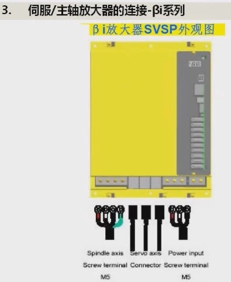

### 3.2.2　接口說明

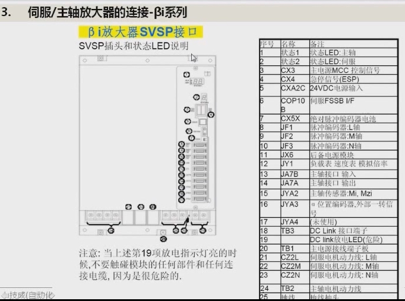

| 序號 | 名稱 | 說明 |
|---|---|---|
| 1 | 狀態 1 | 狀態 LED：主軸 |
| 2 | 狀態 2 | 狀態 LED：伺服 |
| 3 | **CX3** | 主電源 MCC 控制信號（內部有一組觸點輸出，與 αi 系列類似） |
| 4 | **CX4** | 急停信號（\*ESP） |
| 5 | **CXA2C** | **DC 24V** 電源輸入 |
| 6 | **COP10B** | 伺服 FSSB 接口 |
| 7 | **CX5X** | 絕對脈衝編碼器電池 |
| 8 | JF1 | 脈衝編碼器：L 軸（第 1 軸） |
| 9 | JF2 | 脈衝編碼器：M 軸（第 2 軸） |
| 10 | JF3 | 脈衝編碼器：N 軸（第 3 軸） |
| 11 | JX6 | 後備電源模塊 |
| 12 | JY1 | 負載表、速度表、模擬倍率 |
| 13 | JA7B | 主軸接口：輸入 |
| 14 | JA7A | 主軸接口：輸出 |
| 15 | JYA2 | 主軸傳感器：Mi、Mzi |
| 16 | JYA3 | α 位置編碼器、外部一轉信號 |
| 17 | JYA4 | （未使用） |
| 18 | TB3 | DC Link 接口端子（直流母線端子） |
| 19 | — | DC Link 放電 LED（**危險**） |
| 20 | TB1 | 主電源接線端子板 |
| 21 | CZ2L | 伺服電機動力線：L 軸 |
| 22 | CZ2M | 伺服電機動力線：M 軸 |
| 23 | CZ2N | 伺服電機動力線：N 軸 |
| 24 | TB2 | 主軸電機動力線 |
| 25 | — | 地線接頭 |

> ⚠️ **注意**：當上述第 19 項放電指示燈亮著時，**不要觸碰模塊的任何部件和任何連接電纜**，因為非常危險。

> 💡 **與 αi 系列的重要差別**：αi 系列的控制電源是 **單相交流 200 V**，而 βi 系列的控制電源是 **直流 24 V**（由 CXA2C 輸入）。

---

## 3.3　βi 系列 SVPM 驅動主迴路

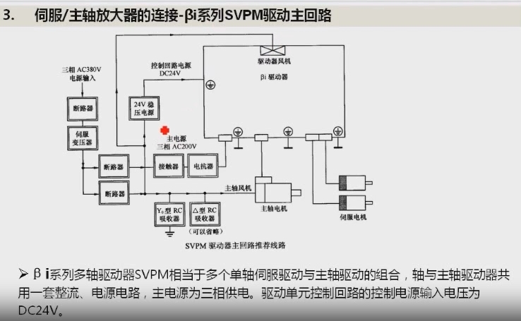

### 重點整理

- βi 系列多軸驅動器 **SVPM 相當於「多個單軸伺服驅動」加「主軸驅動」的組合**，各軸與主軸驅動器**共用一套整流、電源電路**。
- 主電源為 **三相供電**（這點與 αi 相同）。
- 驅動單元控制迴路的控制電源為 **DC 24 V**（這點與 αi 不同）。

### 主迴路推薦接線（由電源側往負載側）

1. 三相 AC 380 V 電源輸入 → 斷路器 → 伺服變壓器 → 降為三相 AC 200 V 主電源
2. 主電源經 **斷路器 → 接觸器 → 電抗器** 送入驅動器
3. 另有一路經斷路器供應**主軸風機**等風扇電源，並接 **Y₀ 型 RC 吸收器**、**Δ 型 RC 吸收器**（Δ 型可以省略）
4. **24 V 穩壓電源** 提供控制迴路電源 DC 24 V
5. 驅動器風扇需另行供電；驅動器、電機外殼均需接地

---

## 3.4　βi 系列一體型的連接要點

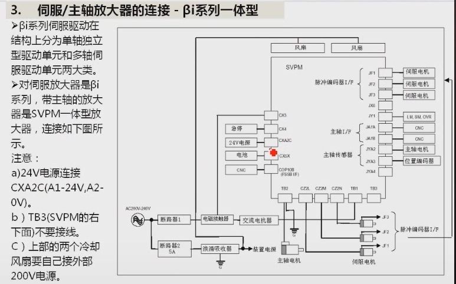

βi 系列伺服驅動在結構上分為「**單軸獨立型驅動單元**」與「**多軸伺服驅動單元**」兩大類。伺服放大器是 βi 系列、且帶主軸的放大器就是 **SVPM 一體型放大器**，連接如圖所示。

### 注意事項

- **a）** 24 V 電源連接 **CXA2C**（**A1 接 24 V，A2 接 0 V**）。
- **b）** **TB3**（SVPM 右下面）**不要接線**。
- **c）** 上部的**兩個冷卻風扇要自己接外部 200 V 電源**。

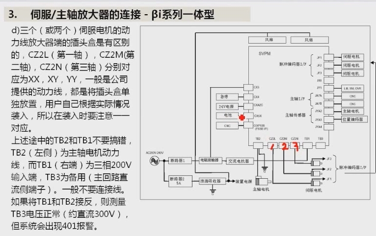

- **d）** 三個（或兩個）伺服電機的動力線，在放大器端的插頭盒是有區別的：
  - **CZ2L**（第一軸）、**CZ2M**（第二軸）、**CZ2N**（第三軸），分別對應為 **XX、XY、YY**。
  - 一般是公司提供的動力線，都是把插頭盒單獨放置，由用戶根據實際情況裝入，所以裝入時要注意**一一對應**。

- **TB1 與 TB2 不要搞錯**：

  | 端子 | 位置 | 用途 |
  |---|---|---|
  | **TB2** | 左側 | **主軸電機動力線** |
  | **TB1** | 右端 | **三相 200 V 主電源輸入** |
  | **TB3** | — | 備用（主迴路直流側端子），一般**不要接線** |

> ⚠️ 若將 TB1 與 TB2 接反，量測 TB3 電壓仍正常（約直流 300 V），但系統會出現 **401 報警**。

---

## 3.5　SVSP 各部分的接線

### 3.5.1　24 V 電源接線（CXA2C）

24 V 電源單元的 **24 V** 接 CXA2C 的 **(A1) 24 V**，**0 V** 接 **(A2) 0 V**，且 0 V 端需接地。圖中電纜編號為 K69。

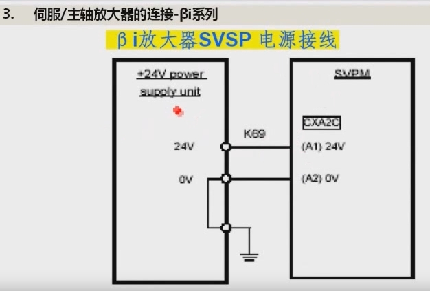

### 3.5.2　MCC 接線（CX3）

SVPM 內部有一組觸點，從 **CX3-1、CX3-3** 引出，接到**主接觸器（MCC）的線圈**，用來控制三相主電源的接通與斷開。

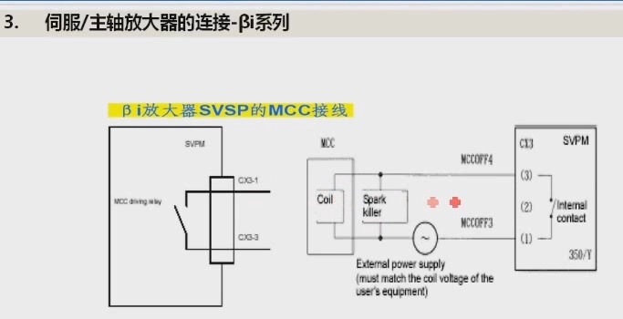

- MCC 線圈兩端需並聯 **滅弧器（Spark killer）**。
- 線圈所用的**外部電源電壓必須與線圈電壓相符**（依用戶設備而定）。
- 圖中以 MCCOFF3、MCCOFF4 標示兩端連接。

### 3.5.3　急停接線（CX4）

**CX4 的 (2) 號與 (3) 號端子之間，接一個急停觸點**（+24 V 經急停觸點接到 \*ESP）。

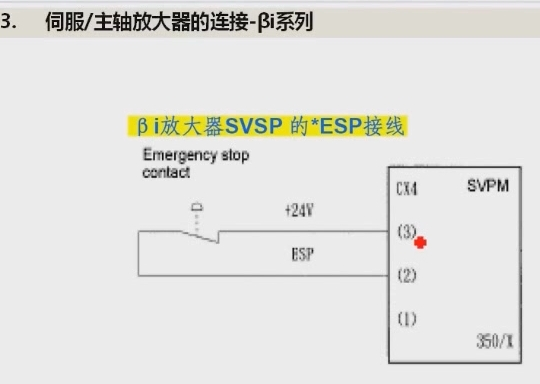

### 3.5.4　內裝電池（CX5X）

使用內裝電池時，電池接到 **CX5X**：**(2) 腳接 +6 V，(1) 腳接 0 V**。

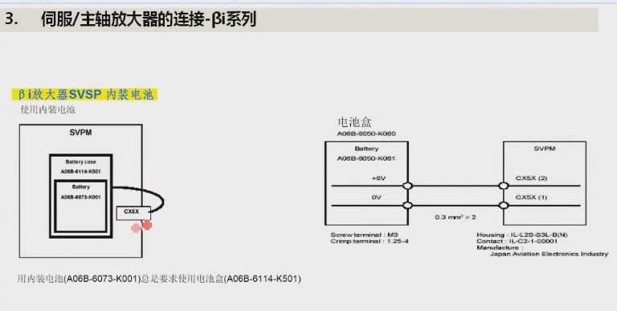

| 項目 | 規格 |
|---|---|
| 電池盒 | A06B-6050-K060 |
| 電池 | A06B-6050-K061 |
| 連接線 | 0.3 mm² × 2 |
| 螺絲端子 | M3 |
| 壓接端子 | 1.25-4 |
| 插頭殼（Housing） | IL-L2S-S3L-B(N) |
| 接點（Contact） | IL-C2-1-00001 |
| 製造商 | Japan Aviation Electronics Industry |

> 使用內裝電池（A06B-6073-K001）時，總是要搭配電池盒（A06B-6114-K501）。

---

## 3.6　βi 系列 SVPM 驅動單元綜合連接圖

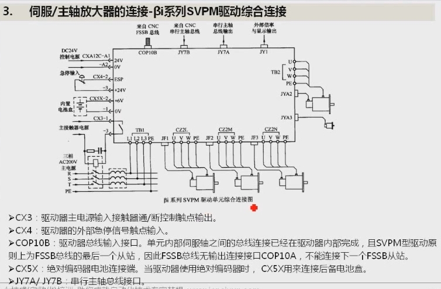

### 各接口作用

| 接口 | 作用 |
|---|---|
| **CX3** | 驅動器主電源輸入**接觸器通／斷控制觸點輸出** |
| **CX4** | 驅動器的**外部急停信號觸點輸入** |
| **COP10B** | 驅動器**總線輸入接口**，另一端接 CNC 的 FSSB 總線 |
| **CX5X** | 絕對編碼器電池連接端；使用絕對編碼器時，用來連接後備電池盒 |
| **JY7A／JY7B** | 串行主軸總線接口 |

### 關於 COP10B

單元內部各伺服軸之間的總線連接，已在驅動器內部完成。SVPM 型驅動器原則上是 **FSSB 總線的最後一個從站**，因此**沒有輸出接口 COP10A，不能再連接下一個 FSSB 從站**。

### 主接觸器的動作過程（CX3）

1. CX3 內部觸點閉合 → 接觸器**線圈得電**。
2. 線圈得電 → 三對**主觸點閉合** → TB1 得到三相 AC 200 V 主電源。
3. CX3 觸點斷開 → 線圈失電 → 三對主觸點斷開 → TB1 主電源切斷。

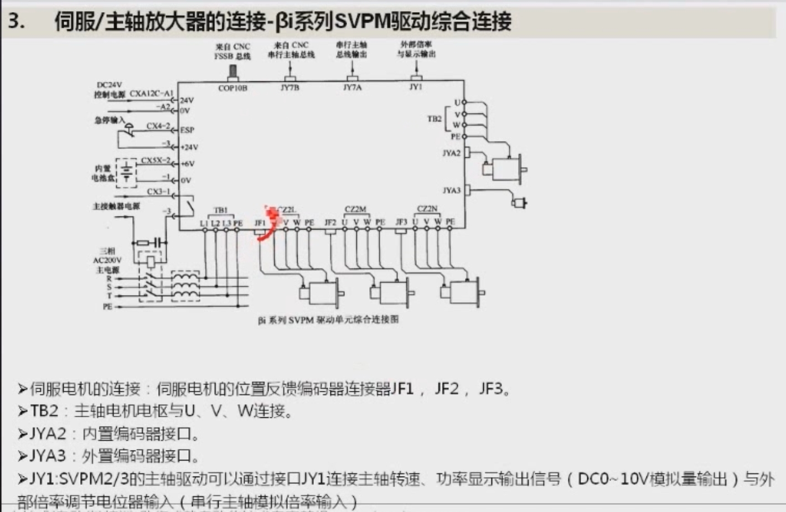

### 電機與其他接口

| 接口 | 作用 |
|---|---|
| **JF1、JF2、JF3** | 伺服電機的**位置反饋編碼器**連接器（對應三個伺服電機） |
| **TB2** | 主軸電機電樞與 U、V、W 連接（並接地線） |
| **JYA2** | **內置編碼器**接口 |
| **JYA3** | **外置編碼器**接口 |
| **JY1** | SVPM2／3 的主軸驅動可經 JY1 連接**主軸轉速、功率顯示輸出信號**（DC 0～10 V 模擬量輸出），也可輸入**外部倍率調節電位器**信號（串行主軸模擬倍率輸入） |

> 註：圖中 24 V 控制電源端標示為「CXA12C」，依前文接口說明應為 **CXA2C**。

---

## 3.7　βi 系列單軸伺服驅動器（SVM）

前面講完 βi 系列一體型，接著看**不帶主軸**的 βi 單軸伺服放大器。

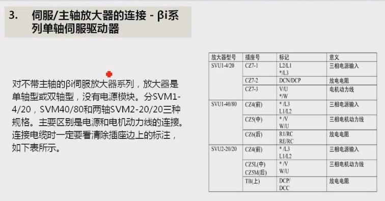

這類放大器為**單軸型或雙軸型，沒有電源模塊**，分為三種規格：

- **SVM1-4／20**
- **SVM1-40／80**
- **SVM2-20／20**（兩軸）

三種規格**主要區別在於電源和電機動力線的連接**。連接電纜時，**一定要看清楚插座旁邊的標註**，如下表所示：

| 放大器型號 | 插座號 | 意義 |
|---|---|---|
| **SVM1-4／20** | CZ7-1 | 三相電源輸入（L1、L2、L3） |
| | CZ7-2 | 放電電阻（DCN／DCP） |
| | CZ7-3 | 電機動力線（U、V、W） |
| **SVM1-40／80** | CZ4（前） | 三相電源輸入 |
| | CZ5（中） | 三相電機動力線 |
| | CZ6（後） | 放電電阻（R1／RC、RE／RC） |
| **SVM2-20／20** | CZ4（前） | 三相電源輸入 |
| | CZ5L（中）、CZ5M（後） | 三相電機動力線 |
| | TB（上） | 放電電阻（DCP／DCC） |

> 原圖表中型號欄標示為 SVU，意指同一系列 SVM 放大器；端子標記請以實物插座旁的標註為準。

### 外型與電源規格

左圖為 SVM1-20i，右圖為 SVM1-80i；主電源都是三相 200 V，控制電源是 24 V 直流。

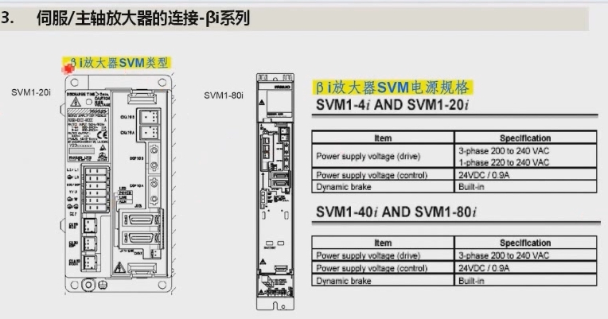

| 型號 | 驅動電源電壓 | 控制電源電壓 | 動態制動 |
|---|---|---|---|
| SVM1-4i、SVM1-20i | 三相 AC 200～240 V，或單相 AC 220～240 V | DC 24 V／0.9 A | 內建 |
| SVM1-40i、SVM1-80i | 三相 AC 200～240 V | DC 24 V／0.9 A | 內建 |

---

## 3.8　SVM1 單軸驅動器的主迴路

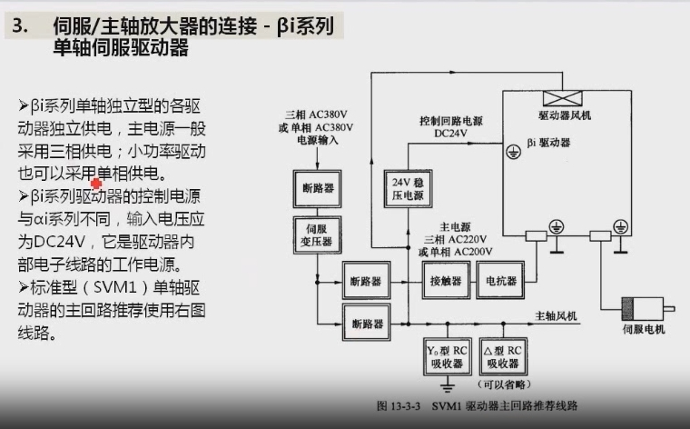

### 重點整理

- βi 系列**單軸獨立型**的各驅動器**各自獨立供電**，主電源一般採用**三相供電**；**小功率驅動也可以採用單相供電**。
- βi 系列驅動器的控制電源與 αi 系列不同，輸入電壓應為 **DC 24 V**，它是驅動器內部電子線路的工作電源。
- 標準型（SVM1）單軸驅動器的主迴路，推薦使用圖 13-3-3 的線路：
  **斷路器 → 伺服變壓器 → 斷路器 → 接觸器 → 電抗器 → 驅動器**，並搭配 Y₀ 型 RC 吸收器、Δ 型 RC 吸收器（可省略）。這與 αi 系列類似。

---

## 3.9　βi 系列單軸獨立驅動綜合連接

下圖以兩個驅動單元（左：SVM1-40i／20i，右：SVM1-40i／80i）說明單軸獨立型的整體接線。

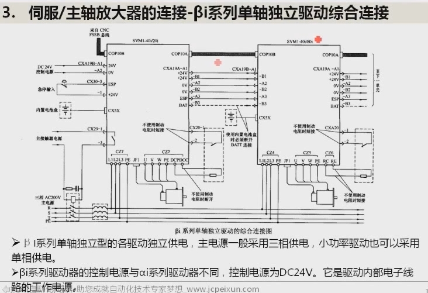

- 各驅動單元**獨立供電**，一般採用三相供電。
- 控制電源為 **DC 24 V**。
- 驅動單元之間，通過內部連接總線傳遞信號：包含 **24 V 電源、\*ESP 急停信號（串聯）、絕對編碼器的 6 V 電池（串聯）** 等。
- 與 αi 相比，接口名稱有變：主接觸器通斷控制由原來的 CX3 變為 **CX29**。
- **CX20** 連接**動態制動電阻**（含過熱保護信號）；**不使用制動電阻時**，圖中標示的相應端子需**短接／斷開**。
- 使用**內置電池盒**時，**必須斷開 BATT（B3）連接**，不可再接該條線。
- 最右側 CXA19A 接下一個驅動單元。

### CXA19A／CXA19B：驅動器內部連接總線

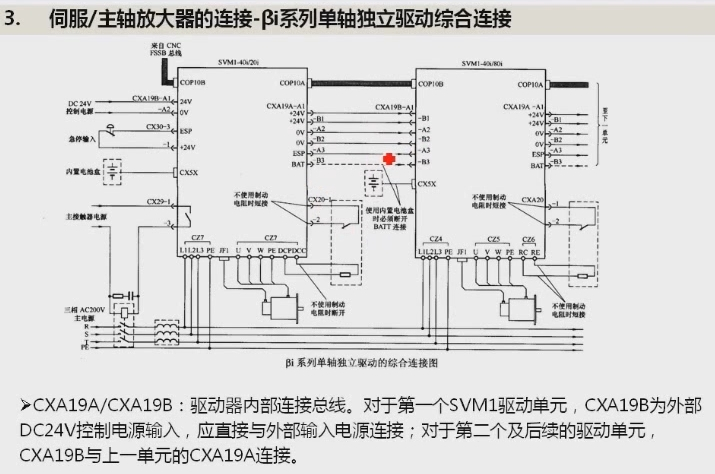

- 對於**第一個** SVM1 驅動單元，**CXA19B 為外部 DC 24 V 控制電源輸入**，應直接與外部輸入電源連接。
- 對於**第二個及後續**的驅動單元，**CXA19B 與上一單元的 CXA19A 連接**。

### CX29、CX30、COP10A／COP10B

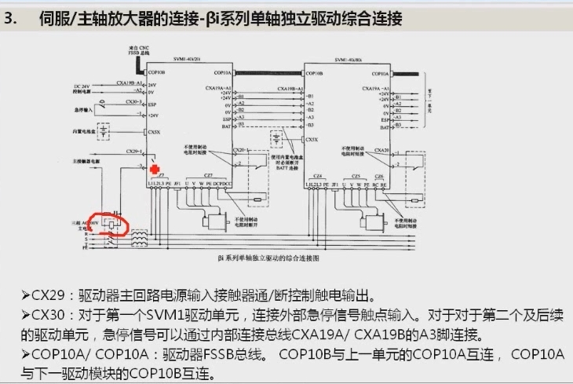

| 接口 | 作用 |
|---|---|
| **CX29** | 驅動器**主迴路電源輸入接觸器通／斷控制觸點輸出**（圖中紅圈處為接觸器線圈） |
| **CX30** | **第一個** SVM1 驅動單元：連接**外部急停信號觸點輸入**。**第二個及後續**驅動單元：急停信號通過內部連接總線 **CXA19A／CXA19B 的 A3 腳**（即 ESP 腳）串聯 |
| **COP10B** | FSSB 總線輸入，與**上一單元的 COP10A** 互連 |
| **COP10A** | FSSB 總線輸出，與**下一個驅動模塊的 COP10B** 互連 |

---

## 第 3 點小結（βi 系列放大器）

1. **0i-C** 可用四種伺服放大器；**0i Mate-C 不能用 αi 伺服放大器**。
2. βi 與 αi 最大差別：**控制電源為 DC 24 V**（αi 為單相 AC 200 V），由 **CXA2C**（A1＝24 V、A2＝0 V）輸入。
3. **SVPM 一體型**：TB1＝三相 200 V 輸入、TB2＝主軸電機、TB3＝備用不接線；TB1／TB2 接反會出現 **401 報警**；上方兩個風扇需自備外部 200 V。
4. 主要接口：**CX3**（MCC 控制）、**CX4**（急停）、**CX5X**（電池 +6 V／0 V）、**COP10B**（FSSB 輸入，SVPM 為最後一個從站）、**JF1～JF3**（編碼器）、**CZ2L／M／N**（伺服動力線）。
5. **SVM 單軸型**：沒有電源模塊，插座標記因型號而異，接線前必須對照座旁標註；多單元串接時，**CXA19B←上一單元 CXA19A**，**COP10B←上一單元 COP10A**，急停經 **A3 腳**串聯。

---

---

## 4　模擬主軸的連接

機床廠家若選擇**變頻器**作為主軸控制，而不使用 FANUC 的主軸放大器，可以選擇**模擬主軸接口**（系統需要裝模擬主軸接口板）。系統向外部提供 **0～10 V 模擬電壓**，接線比較簡單，但**注意極性不要接錯**，否則變頻器不能調速。

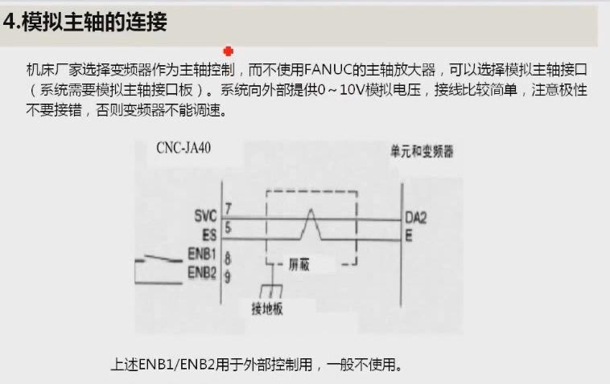

| CNC 側（JA40） | 腳位 | 變頻器側 | 說明 |
|---|---|---|---|
| SVC | 7 | DA2 | 0～10 V 速度指令 |
| ES | 5 | E | 信號地 |
| ENB1 | 8 | — | 外部控制用，一般不使用 |
| ENB2 | 9 | — | 外部控制用，一般不使用 |

- 信號線使用**屏蔽線**，屏蔽層接到接地板。
- ENB1／ENB2 用於外部控制，一般不使用。

---

## 5　I/O 的連接

### 5.1　I/O 的組成

I/O 分為**內置 I/O 板**，以及**通過 I/O Link 連接**的 I/O 卡或單元，包括：機床控制面板用的 I/O 卡、分佈式 I/O 單元、手脈、PMM 等。

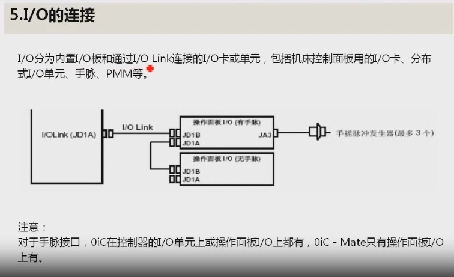

- I/O 的連接都是通過 **I/O Link** 進行：**上一單元的 JD1A 接下一單元的 JD1B**，依序串接。
- 控制器的 I/O Link 接口為 **JD1A**。
- **手脈（手搖脈衝發生器）接口 JA3**（最多接 3 個）：
  - **0i-C**：控制器的 I/O 單元上或操作面板 I/O 上**都有**。
  - **0i-C Mate**：**只有操作面板 I/O 上有**。

### 5.2　0i 用 I/O 單元的連接

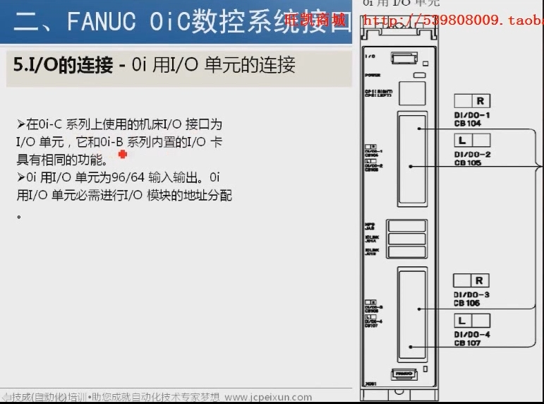

- 0i-C 系列上使用的機床 I/O 接口為 **I/O 單元**，與 0i-B 系列內置的 I/O 卡**功能相同**。
- 0i 用 I/O 單元為 **96 點輸入／64 點輸出**。
- 0i 用 I/O 單元**必須進行 I/O 模塊的地址分配**。

| 接口 | 位置 | 內容 |
|---|---|---|
| CB104 | 上（R） | DI／DO-1 |
| CB105 | 上（L） | DI／DO-2 |
| CB106 | 下（R） | DI／DO-3 |
| CB107 | 下（L） | DI／DO-4 |

### 5.3　輸入信號：漏型與源型

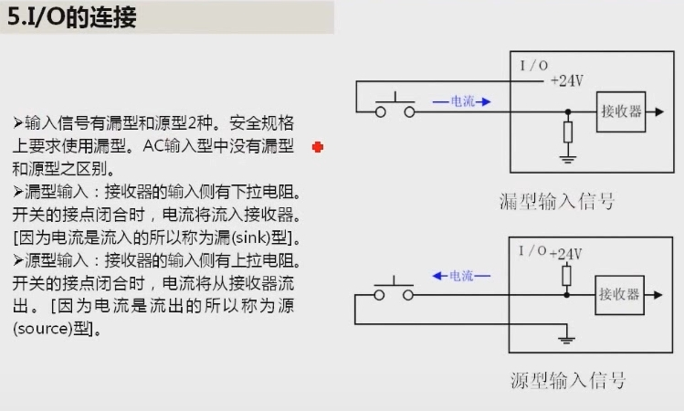

- 輸入信號有**漏型（sink）**和**源型（source）**兩種。**安全規格上要求使用漏型**。
- **AC 輸入型**中沒有漏型和源型之分（此區分只用於直流輸入）。

| 類型 | 接收器輸入側 | 開關閉合時電流方向 | 命名原因 |
|---|---|---|---|
| **漏型輸入** | 有**下拉電阻** | 電流**流入**接收器 | 電流流入，稱為漏（sink）型 |
| **源型輸入** | 有**上拉電阻** | 電流從接收器**流出** | 電流流出，稱為源（source）型 |

### 5.4　輸出信號：源型與漏型

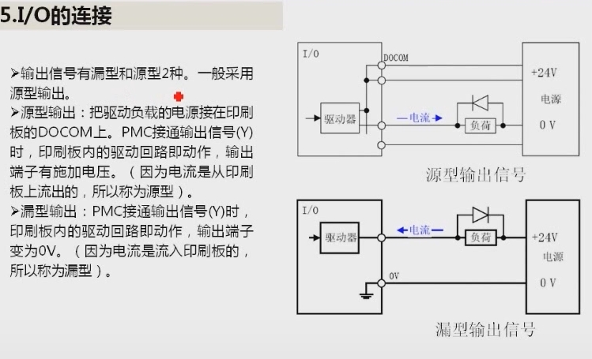

- 輸出信號也有**源型**和**漏型**兩種，**一般採用源型輸出**。
- **源型輸出**：把驅動負載的電源接在印刷板的 **DOCOM** 上。PMC 接通輸出信號（Y）時，板內驅動迴路動作，輸出端子有施加電壓（電流從印刷板流出，故稱源型）。
- **漏型輸出**：PMC 接通輸出信號（Y）時，板內驅動迴路動作，輸出端子變為 0 V（電流流入印刷板，故稱漏型）。
- 負載（繼電器等）兩端需並聯**續流二極管**。

### 5.5　輸入點的公共端

0i-C 用 I/O 單元的輸入點，按公共端分為兩種：

1. **0 V 公共型**
2. **公共端可選擇型**（可選 0 V 或 24 V）

DI 信號基本上屬於漏型（拉電流）；有些 DI 信號既可設為漏型，也可設為源型（灌電流）。I/O 板為可選接收器提供了一個公共信號，**公共信號接到 0 V 還是 24 V，取決於 DI 信號是漏型還是源型**。

#### （1）0 V 公共型

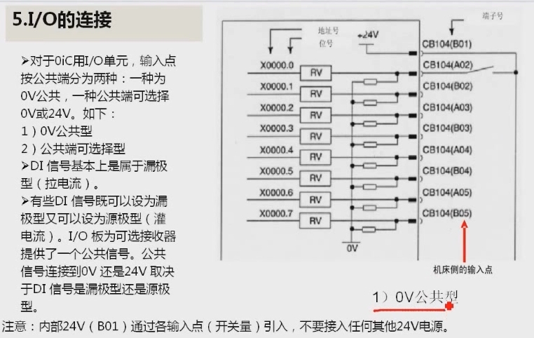

- 圖例為 CB104：X0000.0～X0000.7 共 8 點，內部 24 V 由 **CB104（B01）** 引出，經各輸入點（開關）送入接收器。
- ⚠️ **內部 24 V（B01）通過各輸入點（開關量）引入，不要接入任何其他 24 V 電源。**

#### （2）公共端可選擇型

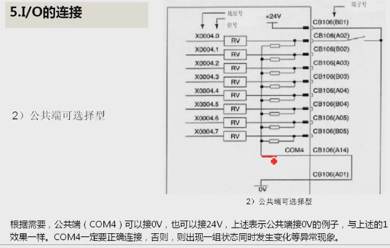

- 圖例為 CB106：X0004.0～X0004.7，公共端為 **COM4（CB106 A14）**。
- 根據需要，公共端 COM4 **可接 0 V，也可接 24 V**。圖中是接 0 V 的例子，效果與前述 0 V 公共型相同（漏型）；改接 24 V 則為源型。
- ⚠️ **COM4 一定要正確連接**，否則會出現**一組輸入狀態同時變化**等異常現象。

#### （3）輸出信號接法

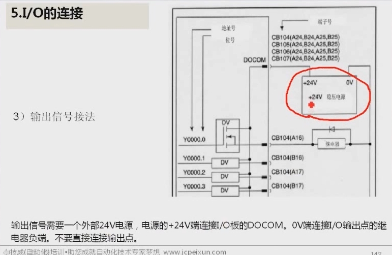

- 輸出信號需要一個**外部 24 V 電源**。
- 電源的 **+24 V** 端接 I/O 板的 **DOCOM**（CB104～CB107 的 A24、B24、A25、B25）。
- **0 V** 端接 I/O 輸出點所驅動**繼電器的負端**。**不要直接連接輸出點。**
- 圖例：Y0000.0 → CB104（A16）、Y0000.1 → CB104（B16）、Y0000.2 → CB104（A17）、Y0000.3 → CB104（B17）。

---

## 6　急停的連接

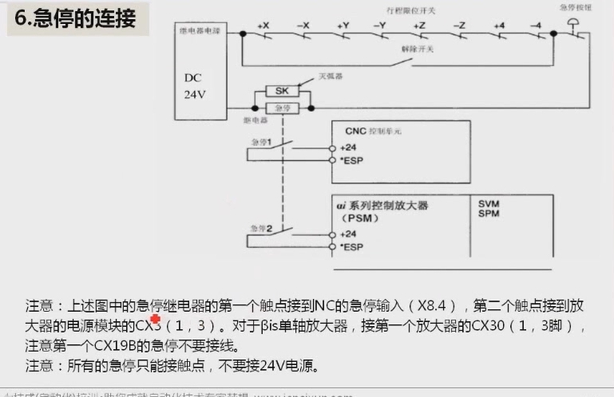

接線方式：

1. 急停按鈕、各軸行程限位開關（+X、−X、+Y、−Y、+Z、−Z、+4、−4，另有「解除開關」）**串聯**後，接到**急停繼電器**線圈，線圈兩端並聯**滅弧器（SK）**，電源為 DC 24 V。
2. 急停繼電器的 **第一個觸點** 接到 **NC 的急停輸入（X8.4）**。X8.4 是 CNC 直接監控的信號，信號一變化，系統就會直接收到。
3. 急停繼電器的 **第二個觸點** 接到**放大器的電源模塊**（見下方註記）。
4. 對於 **βi 單軸放大器**，接**第一個放大器的 CX30（1、3 腳）**；**第一個 CX19B 的急停不要接線**。

> ⚠️ **所有的急停只能接「觸點」，不要接 24 V 電源。**

> 📝 **註記**：投影片文字寫「電源模塊的 CX3（1、3）」。依前面 3.5 節 αi／βi 的說明，**CX3 是主接觸器（MCC）控制，急停輸入為 CX4**，此處疑為投影片筆誤；實際接線請以放大器手冊確認。

---

## 7　電源的連接

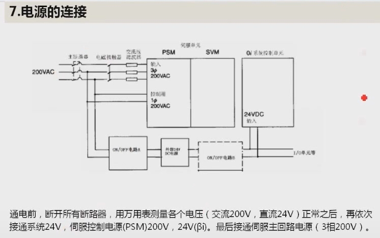

**通電順序：**

1. 通電前，**先斷開所有斷路器**。
2. 用**萬用表**量測各個電壓（交流 200 V、直流 24 V）是否正常。
3. 依序接通：**系統 24 V** → **伺服控制電源**（αi：PSM 的 200 V；βi：24 V）。
4. **最後**才接通**伺服主迴路電源（三相 200 V）**。

圖中供電路徑：200 VAC → 主斷路器 → 電磁接觸器 → 交流濾波器 → PSM（三相 200 V 輸入；控制用單相 200 V）→ SVM；另有 ON／OFF 電路 A、外部 24 V DC 電源、ON／OFF 電路 B，供 0i 系統控制單元（24 VDC 輸入）及 I/O 單元等使用。

---

## 8　電機的連接

### 8.1　放大器外形

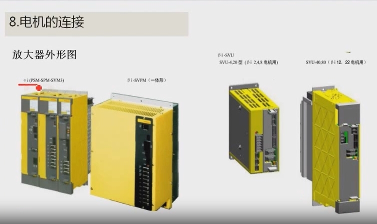

| 系列 | 型式 |
|---|---|
| αi | PSM–SPM–SVM3（分離式模塊） |
| βi | SVPM（一體形） |
| βi | SVU-4／20 型（βi 2、4、8 電機用） |
| βi | SVU-40／80 型（βi 12、22 電機用） |

### 8.2　伺服電機動力線

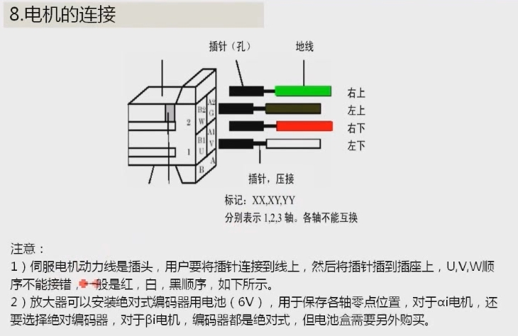

- 插頭標記 **XX、XY、YY** 分別表示第 **1、2、3 軸**，**各軸不能互換**。
- 動力線是**插頭**形式：用戶要先將**插針（壓接）**連接到線上，再將插針插到插座中。
- **U、V、W 順序不能接錯**，一般為**紅、白、黑**的順序；地線為綠色。

**絕對式編碼器電池：**

- 放大器可安裝**絕對式編碼器用電池（6 V）**，用於保存各軸零點位置。
- **αi 電機**：還要另外選擇絕對編碼器。
- **βi 電機**：編碼器**都是絕對式**，但**電池盒需另外購買**。

---

## 9　分離型檢測器的連接

對於**全閉環系統**，需要連接**分離型檢測器接口單元**。

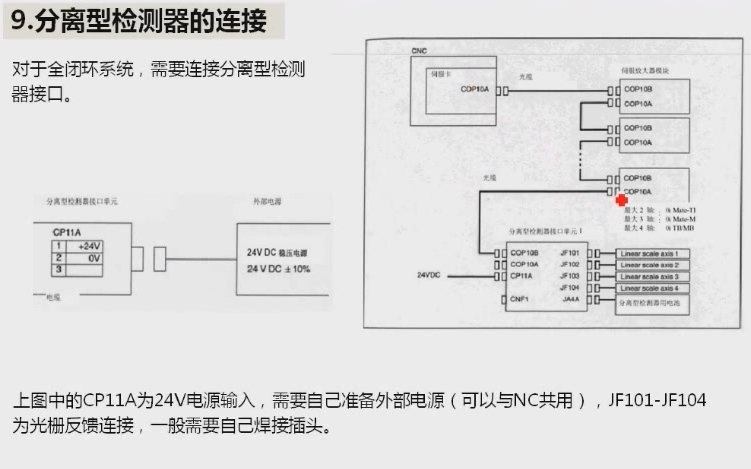

- 連接也是通過**光纜**、經 **FSSB 總線**：由 CNC 的 COP10A 起，依序經各伺服放大器模塊（COP10B→COP10A），**最後一塊放大器的 COP10A 接到分離型檢測器接口單元的 COP10B**。（圖右側另標示各系統可連接的最大軸數，圖面較小，請以原圖為準。）
- **CP11A**：**24 V 電源輸入**（1 腳 +24 V、2 腳 0 V），需自己準備**外部 24 V DC 穩壓電源**（24 V DC ±10 %），可與 NC 共用。
- **JF101～JF104**：光柵尺（Linear scale）反饋連接，依序對應軸 1～4，一般需要自己焊接插頭。
- **JA4A**：分離型檢測器用電池。

---

## 10　其他設備的安裝和連接

### 10.1　與電腦的連接（RS-232）

0i-C／0i Mate-C 可通過 **RS-232 口**與電腦相連，進行資料傳輸，並實現 **DNC 加工**。

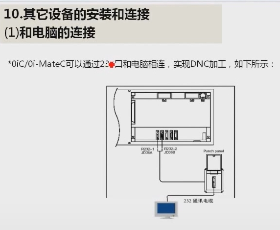

- 控制器上有兩個 RS-232 接口：**JD36A（RS232-1）**與 **JD36B（RS232-2）**，兩個都可以用，一般使用 **JD36A**，JD36B 備用。
- 圖中另有 Punch panel（穿孔面板，即記憶卡插槽所在處）與 232 通訊電纜。

### 10.2　232 通訊電纜與記憶卡

**注 1**：232 通訊電纜需**自己焊接**，CNC 與 I/O 設備端的推薦接線如下。

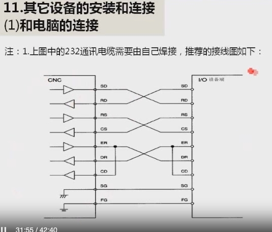

| CNC 側 | I/O 設備端 | 接法 |
|---|---|---|
| SD | RD | 交叉連接 |
| RD | SD | 交叉連接 |
| RS | CS | 交叉連接 |
| CS | RS | 交叉連接 |
| ER、DR、CD | DR、CD、ER | 依圖示接法連接 |
| SG | SG | 信號地 |
| FG | FG | 框架地 |

（ER／DR／CD 的細部接法請以原圖為準。）

**注 2**：為防止電腦的串口漏電而**燒壞 NC 的接口**，應在接口上加**光電隔離器**。

- **盡量不要**用 232 接口進行資料傳輸和 DNC 加工。
- 應改用**記憶卡接口**：更方便、**傳輸速度快**、**不需要另外的傳輸軟體**，也**不會燒壞接口**。

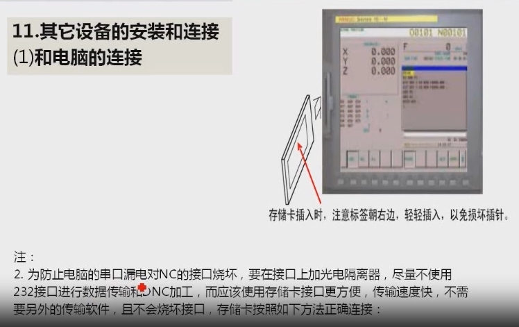

> ⚠️ 記憶卡插入時，**注意標籤朝右邊，輕輕插入**，以免損壞插針。

### 10.3　使用 M-CARD 備份參數／加工程式

使用記憶卡（PCMCIA CARD）可方便地備份**參數、加工程式、梯形圖、螺補、巨集變量**等資料。這些資料可分別備份，也可以在電腦上直接編輯（**梯形圖除外**，需經 FANUC 的編程軟體轉換）。

#### 步驟 1：設定 20 號參數

將**參數 No.20（I/O CHANNEL）設為 4**，表示用 **M-CARD** 進行資料交換。

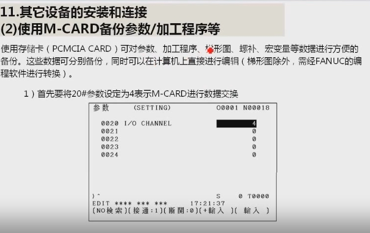

> 若改用 RS-232 口與電腦交換資料，講解中說明 20 號參數應設為 **0 或 1**（對應 JD36A 口）。

#### 步驟 2：備份參數（以參數為例）

在 **EDIT（編輯）** 方式下，選擇要傳輸的資料畫面，按軟鍵右側的 **[操作]（OPR）**，再依下列順序操作：

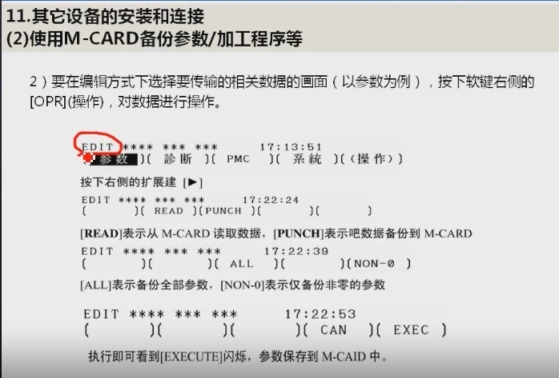

1. 切到 **EDIT** 方式，進入 [參數] 畫面，按 **[(操作)]**。
2. 按右側的**擴展鍵 [▶]**。
3. 選擇 **[READ]** 或 **[PUNCH]**：
   - **READ**：從 M-CARD **讀取**資料到 CNC。
   - **PUNCH**：把資料**備份到** M-CARD。
4. 再選擇範圍：
   - **[ALL]**：備份**全部**參數。
   - **[NON-0]**：僅備份**非零**的參數。
5. 按 **[EXEC]** 執行。畫面上 **[EXECUTE] 閃爍**，參數就保存到 M-CARD 中；要從記憶卡輸入參數時，選 **READ**。

#### 步驟 3：備份／輸入梯形圖（PMC 程式）

從 M-CARD **輸入參數**時，選 **[READ]**（見步驟 2）。要用 M-CARD **備份梯形圖**，操作如下：

1. 按 MDI 面板上的 **[SYSTEM]**。
2. 依序按軟鍵 **[PMC]** → **[▶]** → **[I/O]**。
3. 在 **DEVICE** 一欄選擇 **[M-CARD]**。

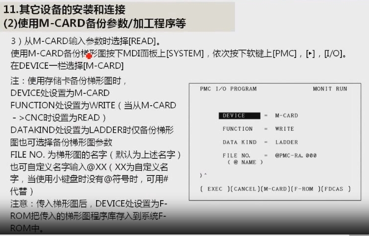

PMC I/O PROGRAM 畫面中各欄位設定：

| 欄位 | 設定 | 說明 |
|---|---|---|
| **DEVICE** | M-CARD | 傳輸裝置為記憶卡 |
| **FUNCTION** | **WRITE** | CNC → 記憶卡（備份）；若從 M-CARD → CNC，設為 **READ** |
| **DATA KIND** | **LADDER** | 僅備份梯形圖；也可選擇備份梯形圖參數 |
| **FILE NO.** | 例：@PMC-RA.000 | 梯形圖檔名，預設為此名稱；也可自訂，輸入 **@XX**（XX 為自訂名稱）。若小鍵盤沒有「@」符號，可用 **#** 代替 |

設定好後按軟鍵 **[EXEC]** 執行（畫面另有 [CANCEL]、[M-CARD]、[F-ROM]、[FDCAS] 等軟鍵）。

> ⚠️ **注意**：把梯形圖**傳入 CNC 後**，**DEVICE 要改設為 F-ROM**，才能把傳入的梯形圖程式庫存入系統的 **F-ROM** 中；否則斷電後不會保留。

### 10.4　用記憶卡進行 DNC 加工

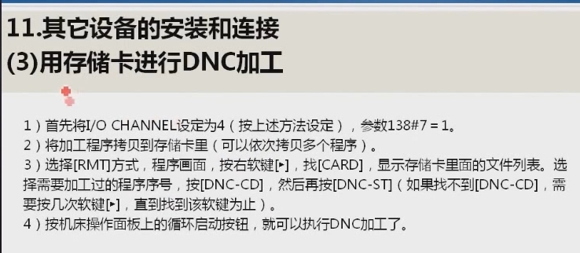

1. 先將 **I/O CHANNEL 設定為 4**（設定方法同前），並設 **參數 No.138 的 #7 = 1**。
2. 把加工程式**拷貝到記憶卡**裡（可以依次拷貝多個程式）。
3. 選擇 **[RMT]** 方式，進入程式畫面，按右側軟鍵 **[▶]**，找到 **[CARD]**，顯示記憶卡裡的檔案列表。選擇要加工的程式序號，先按 **[DNC-CD]**，再按 **[DNC-ST]**。（若找不到 [DNC-CD]，需多按幾次 [▶]，直到找到該軟鍵為止。）
4. 按機床操作面板上的**循環啟動**按鈕，就可以執行 DNC 加工了。

---

## 12　I/O Link 軸的連接

### 12.1　I/O Link 軸與 PMC 軸的差別

**I/O Link 軸和 PMC 軸是不同的**：

| 項目 | PMC 軸 | I/O Link 軸 |
|---|---|---|
| 是否占用 NC 軸 | **占用** NC 軸 | **不占用** NC 軸 |
| 例子 | 0i Mate-C 最多 4 個軸，可在這 4 個軸中選一個軸改作 PMC 軸處理 | 要**增加一個定位軸（第五軸）**時，就可用 I/O Link 軸實現 |

- 一般使用**帶 I/O Link 選項的 βi 放大器**作為 I/O Link 軸。
- **最多可以帶兩個**。

### 12.2　與 NC 的連接

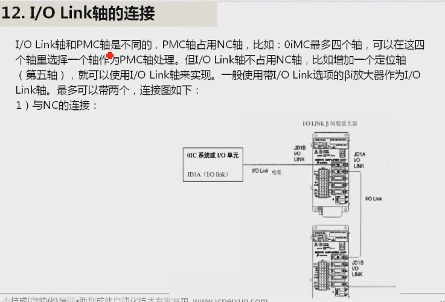

- 0i-C 系統（或 I/O 單元）的 **JD1A（I/O Link）** → I/O Link 電纜 → βi 放大器的 **JD1B**。
- 第一個放大器的 **JD1A** → 第二個放大器的 **JD1B**，依序串接，和一般 I/O Link 設備相同。

### 12.3　放大器的 MCC、ESP、DCOH 與 JA72

放大器的 **MCC（CX29）**、**ESP（CX30）**、**DCOH（CXA20）** 的連接方法，**與前面普通 βi 放大器相同**。**JA72** 的連接如下：

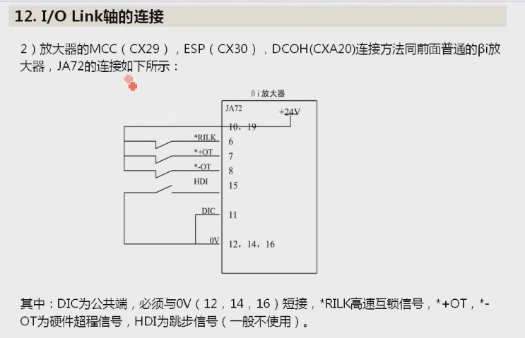

| JA72 腳位 | 信號 | 接法 |
|---|---|---|
| 10、19 | +24 V | 接 +24 V |
| 6 | \*RILK | 高速互鎖信號（經開關接 +24 V） |
| 7 | \*+OT | 正向硬體超程信號 |
| 8 | \*−OT | 負向硬體超程信號 |
| 15 | HDI | 跳步信號（一般不使用） |
| 11 | **DIC** | 公共端 |
| 12、14、16 | 0 V | 接 0 V |

> ⚠️ **DIC 為公共端，必須與 0 V（12、14、16）短接**。

### 12.4　綜合連接圖

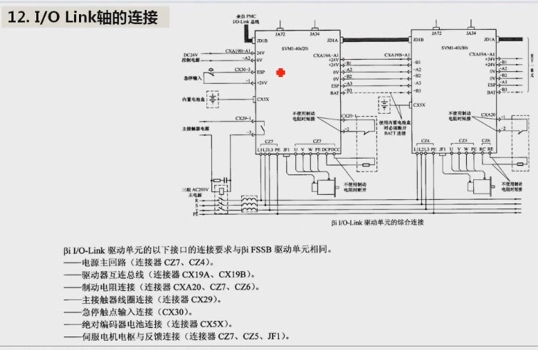

圖中以兩個驅動單元為例：來自 PMC 的 **I/O Link 總線接 JD1B**，**JD1A 接下一單元**；另有 **JA72**（輸入信號）與 **JA34**（手輪）接口。

**βi I/O-Link 驅動單元**的下列接口，連接要求與 **βi FSSB 驅動單元相同**：

| 項目 | 連接器 |
|---|---|
| 電源主迴路 | CZ7、CZ4 |
| 驅動器互連總線 | CXA19A、CXA19B |
| 制動電阻連接 | CXA20、CZ7、CZ6 |
| 主接觸器線圈連接 | CX29 |
| 急停觸點輸入連接 | CX30 |
| 絕對編碼器電池連接 | CX5X |
| 伺服電機電樞與反饋連接 | CZ7、CZ5、JF1 |

### 12.5　手輪的連接（選擇功能）

**I/O Link 手輪**和 **CNC 的手輪信號不同**，所以**不能和 CNC 共用一個手輪**，但可以通過**轉接板**（自己做或購買）進行連接。

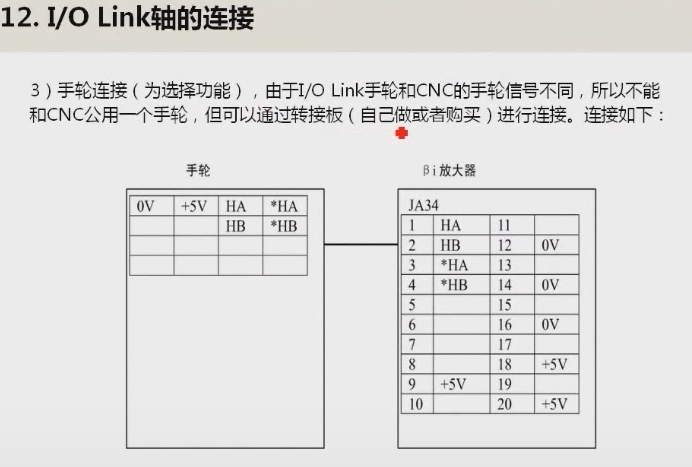

| 手輪端 | βi 放大器 JA34 腳位 |
|---|---|
| HA | 1 |
| HB | 2 |
| \*HA | 3 |
| \*HB | 4 |
| +5 V | 9、18、20 |
| 0 V | 12、14、16 |

---

## 本課時總結

1. **模擬主軸**：JA40 的 SVC（7 腳）／ES（5 腳）送 0～10 V 給變頻器，注意極性，ENB1／ENB2 一般不用。
2. **I/O**：經 I/O Link 串接（上一單元 JD1A → 下一單元 JD1B）；0i 用 I/O 單元為 96 入／64 出，必須做地址分配。
3. **輸入**：安全規格要求**漏型（sink）**；**輸出**一般採用**源型**，DOCOM 接外部 24 V；COM4 要接對，否則一組輸入同時變化。
4. **急停**：只接**觸點**，不接 24 V；第一觸點接 NC（X8.4），第二觸點接放大器；βi 單軸型接第一個放大器的 CX30（1、3 腳）。
5. **上電順序**：先斷開斷路器並量電壓 → 系統 24 V → 伺服控制電源 → **最後**才送三相 200 V 主電源。
6. **電機動力線**：XX／XY／YY 對應 1／2／3 軸不可互換，U-V-W 一般為紅-白-黑；βi 電機都是絕對編碼器，電池盒需另購。
7. **分離型檢測器**：由最後一塊放大器的 COP10A 接檢測器單元的 COP10B，另備 24 V 電源。
8. **資料交換**：盡量用記憶卡而非 RS-232；20 號參數設 4；參數備份：EDIT → [操作] → ▶ → READ／PUNCH → ALL／NON-0 → EXEC。
9. **梯形圖備份**：[SYSTEM] → [PMC] → ▶ → [I/O]；DEVICE＝M-CARD、FUNCTION＝WRITE（讀入用 READ）、DATA KIND＝LADDER；**傳入後要把 DEVICE 改為 F-ROM 存入 F-ROM**。
10. **記憶卡 DNC**：I/O CHANNEL＝4、No.138#7＝1，RMT 方式 → [CARD] → [DNC-CD] → [DNC-ST] → 循環啟動。
11. **I/O Link 軸**：不占用 NC 軸，可增加第五軸，最多 2 個；**JA72 的 DIC 必須與 0 V 短接**；手輪需轉接板接 JA34。

---

> **備註**
> - 圖檔 `chs06_34.jpg`（已確認不存在）；`chs06_14.jpg` 也未提供，本檔均依現有圖檔依序排版，共 42 張。
> - 投影片章節編號有重複（10 與 11 均標為「其他設備的安裝和連接」），本檔統一整理為第 10 點；I/O Link 軸沿用投影片的第 12 點。
> - 投影片及語音逐字稿的疑點（例如急停的 CX3／CX4）已在對應段落加註。
