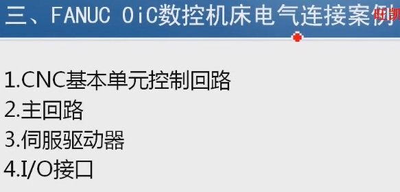
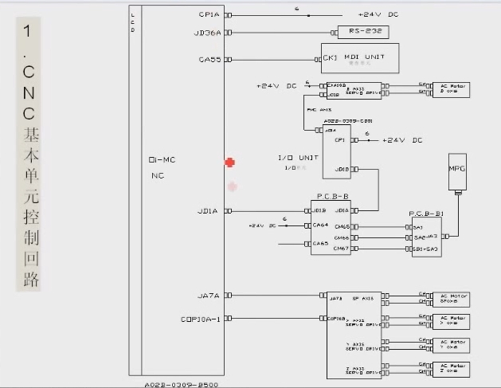
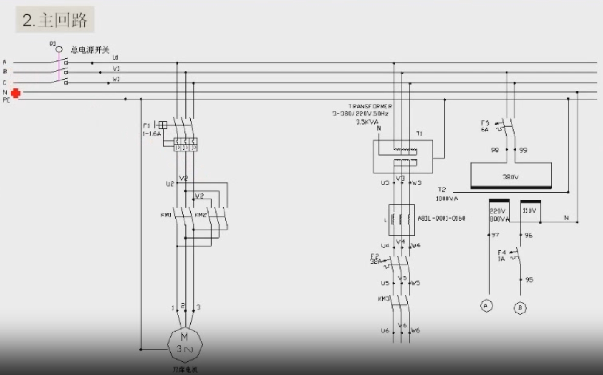
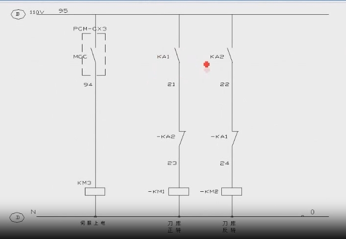
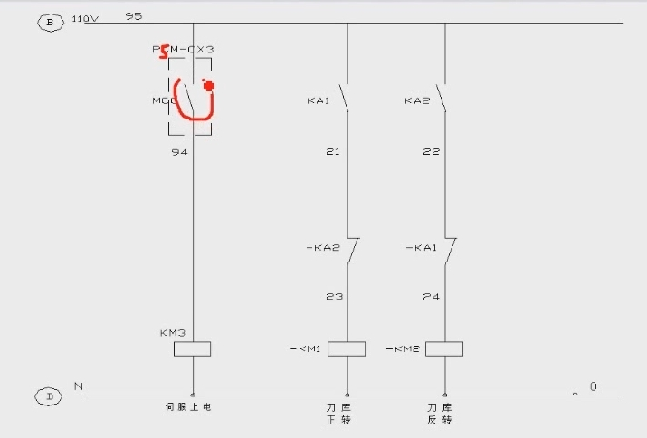
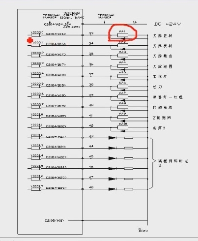
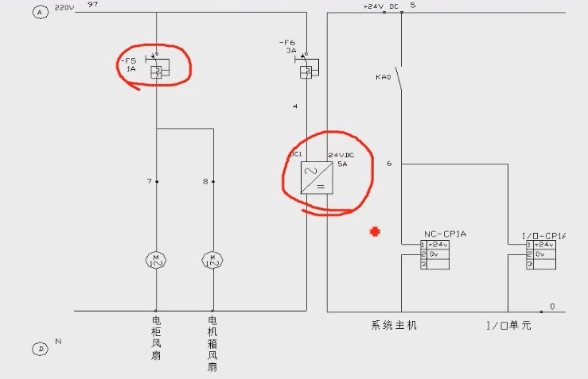
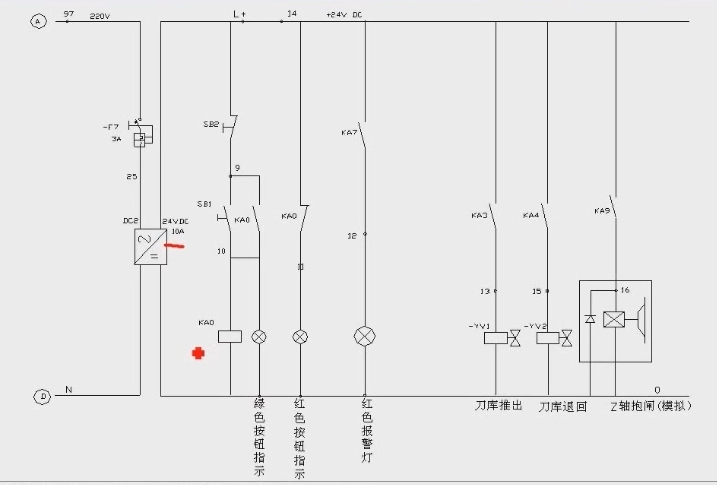
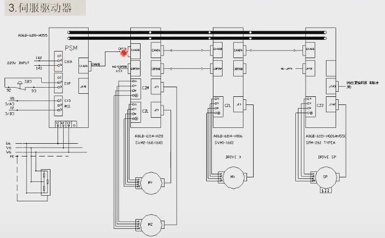
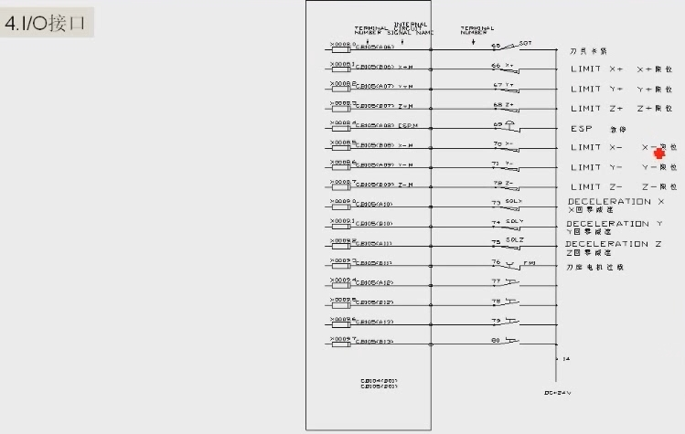

# 第 7 課時　FANUC 0i-C 數控機床電氣連接案例

> 本節是 FANUC 數控機床 PMC 編程課程第 1 講的第 3 部分：**FANUC 0i-C 數控機床電氣連接案例**。
> 透過一個實際案例，把前面所學的 0i-C 數控系統連接方式綜合起來。圖中 CNC 單元標示為 0i-MC，被控機床為一台銑床（加工中心類），附有刀庫。

---

## 0. 本節內容總覽

案例分成四個部分：

1. CNC 基本單元控制回路
2. 主回路
3. 伺服驅動器
4. I/O 接口



> 配套的互動電路圖網頁：`FANUC-0iC電路圖互動頁.html`（刀庫正反轉互鎖、系統上電、I/O 點位，可自行操作）。

---

## 1. CNC 基本單元控制回路



此圖是整台機床的「神經系統」，CNC 本體（圖左側為 LCD 顯示器一體的主機）向外連出各種介面：

| 接口 | 連接對象 | 說明 |
|------|----------|------|
| **CP1A** | DC 24V 電源 | 給 CNC 系統供電 |
| **JD36A** | RS-232 | 接電腦，用於程序、參數及 PMC 梯形圖的傳輸 |
| **CA55** | MDI 單元 | CNC 與 MDI 之間的內部連接線 |
| **JD1A / JD1B** | I/O Link 總線 | 串接 I/O Link 從站設備 |
| **COP10A-1** | FSSB 光纜 | CNC 到伺服放大器的高速伺服總線 |
| **JA7A** | 串列主軸 | 接到主軸放大器 JA7B，傳遞主軸指令 |

### 1.1 I/O Link 串接順序

CNC 的 JD1A 出發，依序串接：

1. **標準操作面板**（P.C.B-B 主面板、P.C.B-B1 副面板）：副面板上接一個 **手輪（MPG）**。
2. **I/O 單元**：本身也需要 DC 24V 供電。
3. **β i 伺服放大器**：這是一個帶有 I/O Link 接口的 I/O Link 從站。

### 1.2 伺服與主軸

* **CNC ⇄ 伺服放大器**：透過 **FSSB 光纜**（COP10A-1 → COP10B）連接。
* 圖中是一體型伺服放大器，後面接 **主軸電機、X 軸、Y 軸、Z 軸** 伺服電機。每個電機各有一條**動力線**與一條**回饋（編碼器）線**。
* **JA7A → JA7B**：系統到放大器之間的串列主軸指令線。

---

## 2. 主回路



圖中 A、B、C 為三相交流電，N 為零線，PE 為地線。**Q1** 是機床總電源開關。主回路可拆成三條支路：

### 2.1 刀庫電機（正反轉）

* 刀庫是一個小型三相電機，由 **F1（斷路器，具過載、短路保護，整定約 1～1.6 A）** 保護。
* 由兩個接觸器 **KM1、KM2** 控制轉向：
  * **KM1 吸合 → 刀庫電機正轉**
  * **KM2 吸合 → 刀庫電機反轉**
* 為何能反轉？看接線：KM1 的三相直通；KM2 則是**第 1 根與第 3 根互換、中間一根不變**。三相電交換任意兩相，電機轉向即相反。

> 記憶要點：**交換任意兩相 = 反轉**。

### 2.2 伺服放大器電源（變壓器 T1 與 KM3）

三相 380 V 先經過 **變壓器 T1**（圖面標示 3.5 kVA，380 V → 220 V）降壓，再經 **電抗器**（型號 A81L-0001-0160）、**斷路器 F2（32 A）**，最後經過 **KM3** 的主觸點，輸出 **U6、V6、W6**，供給伺服放大器（PSM 電源模塊）的三相交流輸入。

* **KM3 就是伺服上電接觸器**：KM3 主觸點閉合，U6/V6/W6 有電，伺服驅動器才能上主電。
* 老師口述為「三相 200 V」，圖面標示為 380/220 V，實務上依變壓器規格為準。

### 2.3 控制變壓器 T2

**T2（1000 VA）** 把 380 V 變為兩組電壓：

| 輸出 | 代號 | 用途 |
|------|------|------|
| **110 V**（B） | 圖面端子 95 | 供三個接觸器線圈：KM3、KM1、KM2 |
| **220 V**（A，800 VA） | 圖面端子 97 | 供風扇、24 V 直流穩壓電源 |

---

### 2.4 110 V 接觸器控制回路



這一張圖 B（110 V）供電的三個接觸器線圈：

**① 伺服上電：KM3**

* KM3 線圈受 **PSM 模塊 CX3 接口的 MCC 觸點** 控制。
* 驅動器**正常**時，MCC 觸點閉合 → 允許 KM3 線圈得電 → KM3 主觸點（2.2 節）閉合 → 伺服主電源上電。
* 反之驅動器有異常，MCC 斷開，KM3 就無法吸合，這是一個安全聯鎖。



**② 刀庫正轉 KM1／反轉 KM2，含互鎖**

* **KA1 觸點 → KA2 常閉觸點 → KM1 線圈**
* **KA2 觸點 → KA1 常閉觸點 → KM2 線圈**

當 KA1 吸合（要求正轉），它串在 KM2 回路中的**常閉觸點會斷開**，所以刀庫正轉時不可能同時反轉；反之亦然。這就是**電氣互鎖**。

> 若沒有互鎖，KM1 與 KM2 同時吸合，兩組主觸點會把不同相的火線短接，造成**相間短路**。

### 2.5 PMC 如何驅動刀庫正轉（完整訊號鏈）



```
PMC 程序 → Y0.0 = 1 → KA1 線圈得電 → KA1 常開觸點閉合
        → KM1 線圈得電 → KM1 三對主觸點閉合 → 刀庫電機正轉
```

反轉同理：Y0.1 → KA2 → KM2。

**重點：PMC 的輸出點（DC 24V）不直接帶接觸器，而是先驅動小型中間繼電器 KA，再由 KA 的觸點去控制 110 V 的接觸器。**

### 2.6 220 V 交流部分：風扇與 24 V 電源



220 V 交流經 **F5（1 A）** 空氣開關保護，供給 **電櫃風扇** 與 **電機箱風扇**。

同時經 **F6（3 A）** 供給 **DC1 穩壓電源（24 V DC / 5 A）**：

* 這組 24 V 專供 **CNC 系統（NC-CP1A）** 與 **I/O 單元（I/O-CP1A）**。
* 中間串有 **KA0 常開觸點**，KA0 閉合才有 24 V，也就是 **KA0 就是「系統上電」繼電器**。

另有 **DC2 穩壓電源（24 V DC / 10 A，經 F7 3 A 保護）**，專供各中間繼電器線圈、指示燈、電磁閥使用。

### 2.7 系統上電／斷電電路（KA0）



這是一個最常見的「**啟動—停止—自鎖**」基本電路：

* **SB1（啟動按鈕，常開）**：按下後 KA0 線圈得電，同時 KA0 的常開觸點閉合，與 SB1 並聯形成**自鎖**，即使鬆開 SB1，KA0 仍保持通電。
* **SB2（停止按鈕，常閉）**：按下後回路斷開，KA0 失電，自鎖解除。

KA0 得電後的連動：

| 項目 | 狀態 |
|------|------|
| KA0 常開觸點（圖 chs07_06） | 閉合 → CNC 與 I/O 單元得到 24 V，**系統上電** |
| 綠色按鈕指示燈 | 亮（表示系統已上電） |
| KA0 常閉觸點 → 紅色按鈕指示燈 | 斷開 → 紅燈滅 |

當 KA0 失電（系統斷電）：常開觸點斷開，系統 24 V 消失；常閉觸點恢復閉合，**紅色按鈕指示燈亮**，表示目前處於斷電狀態。

**其他由 PMC 輸出控制的負載**：

| 繼電器觸點 | 控制對象 | 說明 |
|-----------|----------|------|
| **KA7** | 紅色報警燈 | 由 **Y0.6** → KA7 線圈 → KA7 常開觸點 → 燈亮 |
| **KA3** | 電磁閥 YV1 | 刀庫推出 |
| **KA4** | 電磁閥 YV2 | 刀庫退回 |
| **KA9** | Z 軸抱閘（模擬） | 並聯續流二極體 |

---

## 3. 伺服驅動器



伺服驅動器由三種模塊組成：**電源模塊（PSM）**、**主軸模塊（SPM）**、**伺服軸模塊（SVM）**。

| 模塊 | 型號（圖面） | 作用 |
|------|--------------|------|
| PSM 電源模塊 | A06B-6110-H055 | 提供整個驅動器的直流母線 |
| SVM2 雙軸伺服模塊 | A06B-6114-H211 | 驅動 **MY、MZ** 兩個電機 |
| SVM1 單軸伺服模塊 | A06B-6114-H106 | 驅動 **MX** 一個電機 |
| SPM 主軸模塊 | A06B-6111-H026#H550 | 驅動主軸電機 SP |

### 3.1 電源模塊 PSM 的接口

| 接口 | 接線 | 說明 |
|------|------|------|
| **CX1A** | 220 V 單相交流輸入 | 供模塊控制電源 |
| **CX4（ESP）** | 接急停按鈕 SB3 | 急停信號輸入 |
| **CX3（MCC）** | 輸出到 KM3 線圈回路 | 即 2.4 節的 MCC 觸點 |
| **L1/L2/L3** | U6、V6、W6 | 三相主電源輸入（經 KM3 控制） |

### 3.2 模塊間的連接

* **CXA2A / CXA2B**：電源模塊與各放大器之間，以及放大器與放大器之間，以此接口傳遞 24 V 及急停信號（菊花鏈串接）。
* **COP10A / COP10B**：**FSSB 光纜**。第一個伺服模塊從系統（COP10A-1）接入，之後在模塊之間依次串接。
* **電機連接**：雙軸模塊有兩組 CZ2L／CZ2M（各接一個電機）；單軸模塊接一組 CZ2L。每個電機都有**動力線**（U、V、W、PE）與**回饋線**（JF1／JF2 接編碼器）。
* **主軸模塊**：動力線接主軸電機；**JA7B** 接系統的 JA7A，是系統給主軸的串列指令線；**JYA3** 為位置編碼器接口（圖中註記本案未使用）。

---

## 4. I/O 接口

I/O 單元上有兩個連接器：**CB104 為輸出（Y）**，**CB105 為輸入（X）**。

### 4.1 輸入信號 X



| 地址 | 端子號 | 信號 | 說明 |
|------|--------|------|------|
| X8.0 | 65 | 刀具夾緊 | 常開，夾緊時接通 → 1 |
| X8.1 | 66 | X+ 限位 | |
| X8.2 | 67 | Y+ 限位 | |
| X8.3 | 68 | Z+ 限位 | |
| **X8.4** | 69 | **ESP 急停** | 常閉接點 |
| X8.5 | 70 | X− 限位 | |
| X8.6 | 71 | Y− 限位 | |
| X8.7 | 72 | Z− 限位 | |
| X9.0 | 73 | X 回零減速 | DECELERATION X |
| X9.1 | 74 | Y 回零減速 | DECELERATION Y |
| X9.2 | 75 | Z 回零減速 | DECELERATION Z |
| X9.3 | 76 | 刀座電機過載 | |
| X9.4～X9.7 | 77～80 | 備用 | |

**舉例一：急停（X8.4）**

急停按鈕使用**常閉接點**：

* 平時：接點閉合，X8.4 = **1**，正常。
* 按下急停：接點斷開，X8.4 = **0**，系統判定為急停。
* 鬆開急停：X8.4 回到 1，急停解除。

> 這樣設計的好處是「**斷線也等於急停**」，屬於故障安全（fail-safe）。

**舉例二：刀具夾緊（X8.0）**

使用**常開接點**：刀具夾緊時開關被壓合，X8.0 = **1**，系統知道刀具已夾緊；刀具鬆開時 X8.0 = **0**。

### 4.2 輸出信號 Y

輸出點（參見 2.5 節的圖 chs07_05）主要接**指示燈**或**中間繼電器線圈**。Y 點輸出 24 V，驅動 KA 線圈；KA 觸點再去控制接觸器、電磁閥、燈等負載。各 KA 線圈並聯續流二極體，保護 I/O 輸出點。

| 地址 | 端子號 | 繼電器 | 負載 |
|------|--------|--------|------|
| Y0.0 | 33 | KA1 | 刀庫正轉 |
| Y0.1 | 34 | KA2 | 刀庫反轉 |
| Y0.2 | 35 | KA3 | 刀庫推出 |
| Y0.3 | 36 | KA4 | 刀庫退回 |
| Y0.4 | 37 | KA5 | 工作燈 |
| Y0.5 | 38 | KA6 | 鬆刀 |
| Y0.6 | 39 | KA7 | 報警燈（紅色） |
| Y0.7 | 40 | KA8 | 冷卻電機 |
| Y1.0 | 41 | KA9 | Z 軸抱閘 |
| Y1.1 | 42 | KA10 | 備用 3 |
| Y1.2～Y1.7 | 43～48 | — | 編程訓練時自行定義 |

---

## 5. 重點回顧

1. **CNC 基本單元**：CP1A 供電、JD36A 通信、CA55 接 MDI、**JD1A 走 I/O Link**、**COP10A-1 走 FSSB 光纜**、**JA7A 走串列主軸**。
2. **主回路**：刀庫正反轉靠 KM1／KM2 **換兩相**；KM3 控制伺服主電源，受 PSM 的 **MCC** 觸點控制；T2 降出 110 V 與 220 V。
3. **控制回路三要點**：
   * 啟停自鎖：KA0 = 系統上電；
   * 電氣互鎖：KA1／KA2 常閉觸點互串，防止 KM1／KM2 同時吸合；
   * PMC 輸出 → 中間繼電器 KA → 接觸器／電磁閥。
4. **伺服驅動器**：PSM + SVM + SPM；CXA2 傳 24 V／急停，COP10 傳 FSSB，CZ2 接電機，JA7B 接主軸指令。
5. **I/O**：X 為輸入（急停用常閉，夾緊用常開），Y 為輸出（Y0.0 刀庫正轉、Y0.1 反轉、Y0.6 報警燈）。

### 思考題

1. 為什麼刀庫的 KM1、KM2 需要互鎖？只靠 PMC 程序不同時輸出 Y0.0 與 Y0.1 夠不夠？
2. 若 PSM 的 MCC 觸點一直不閉合，伺服主電源會怎樣？應往哪個方向檢查？
3. 急停為什麼採用常閉接點，而不是常開？

---

> 下一講：FANUC 0i-C 數控機床 PMC 編程基本知識。
