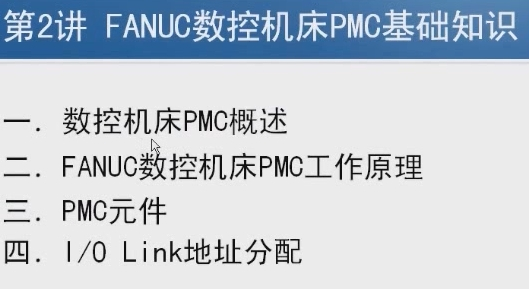
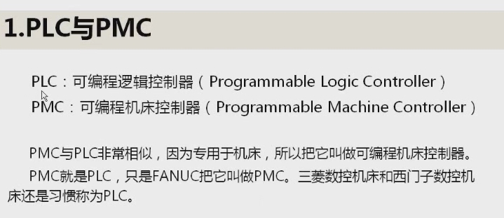
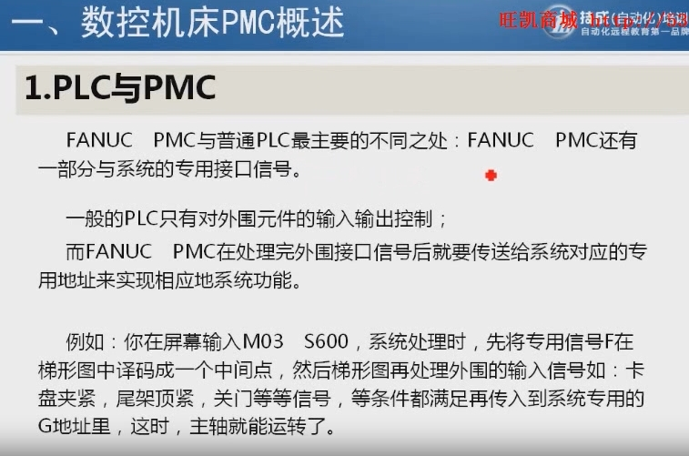
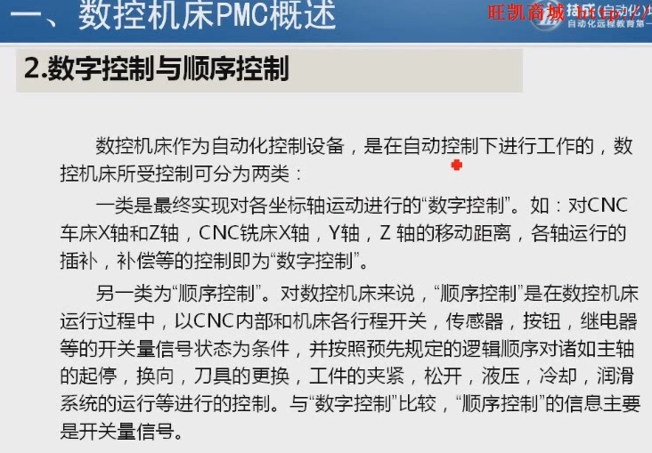
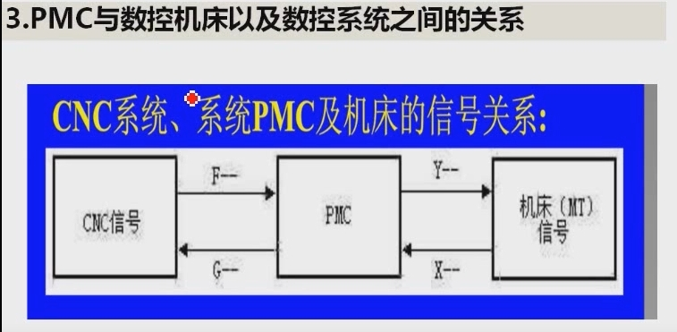
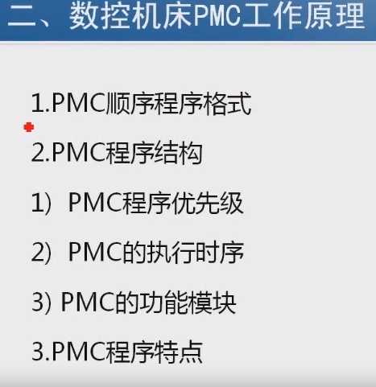
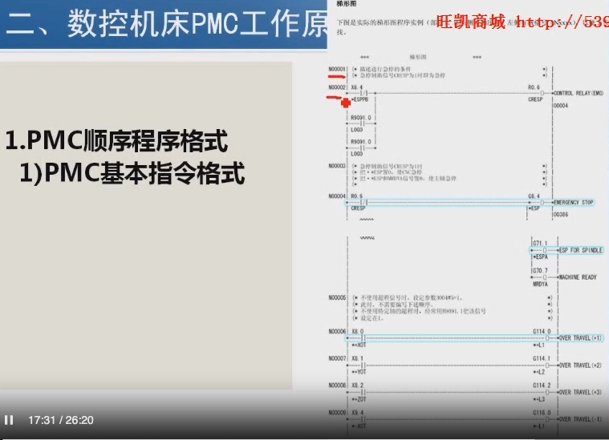
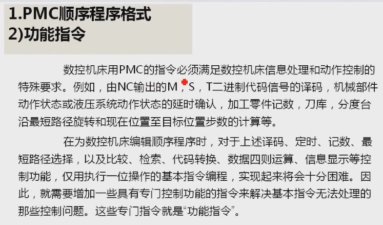
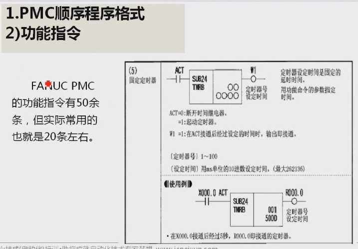

# 第8課時　FANUC 數控機床 PMC 基礎知識（01）

> FANUC 數控機床 PLC 程式設計・第二講



## 本講內容

本講分四個部分：

1. 數控機床 PMC 概述
2. FANUC 數控機床 PMC 工作原理
3. PMC 元件
4. I/O Link 位址分配

---

## 一、數控機床 PMC 概述

本部分依序說明：

- PLC 與 PMC 之間的關係
- 數字控制與順序控制的概念
- PMC 與數控機床、數控系統之間的關係

### 1. PLC 與 PMC



| 簡稱 | 英文全名 | 中文 |
|------|----------|------|
| PLC | Programmable Logic Controller | 可程式邏輯控制器 |
| PMC | Programmable Machine Controller | 可程式機床控制器 |

名稱中各字母的意思：

- **P**：Programmable（可程式化的）
- **L**：Logic（邏輯）
- **C**：Controller（控制器）
- **M**：Machine（機床、機器）

**PMC 就是 PLC**，只是專用於機床，所以稱為「可程式機床控制器」；FANUC 把它叫做 PMC，而三菱數控機床和西門子數控機床仍習慣稱為 PLC。

> **補充：為什麼不簡稱 PC？**
> 早期 PLC 主要做邏輯運算；隨著技術發展，它的功能已不限於邏輯運算，還能進行數值控制與運算，因此有時去掉「Logic」而稱為 PC。但 PC 同時也是 Personal Computer（個人電腦）的縮寫，容易混淆，所以通常仍稱為 PLC。要注意的是，PLC 的功能早已不僅限於邏輯控制。

#### FANUC PMC 與一般 PLC 的差異



兩者作用大致相同，最主要的不同在於：**FANUC PMC 還有一部分與系統的專用介面訊號**。

- 一般的 PLC 只有對外圍元件的輸入、輸出控制（只有 X、Y、R 位址）。
- FANUC PMC 在處理完外圍介面訊號後，還要傳送到系統對應的專用位址（G 位址），以實現相應的系統功能。

**舉例**：在螢幕上輸入 `M03 S600`。

1. 系統處理時，先將專用訊號 **F** 在梯形圖中譯碼成一個中間點。
2. 梯形圖再處理外圍的輸入訊號，例如：卡盤夾緊、尾架頂緊、關門等。
3. 當這些條件都滿足後，再傳入系統專用的 **G** 位址。
4. 這時，主軸才能運轉。

可見執行一條簡單的程式，就會用到 F、G 這類專用位址，這是一般 PLC 所沒有的。

### 2. 數字控制與順序控制



數控機床作為自動化控制設備，是在自動控制下進行工作的。機床所受的控制可分為兩類：

**（1）數字控制**

最終實現對各座標軸運動的控制，例如：

- CNC 車床的 X 軸、Z 軸
- CNC 銑床的 X、Y、Z 軸

對這些軸的**移動距離、運行速度、各軸之間的插補、補償**等進行控制，稱為「數字控制」。

**（2）順序控制**

在機床運行過程中，以 CNC 內部和機床各行程開關、感測器、按鈕、繼電器等**開關量訊號的狀態為條件**，並按照預先規定的邏輯順序，對下列動作進行控制：

- 主軸的起停、換向
- 刀具的更換
- 工件的夾緊、鬆開
- 液壓、冷卻
- 潤滑系統的運行

例如主軸啟動，必須先按下按鈕，還要檢查卡盤是否夾緊、門是否關好，條件都滿足後主軸才能轉動，這就是順序控制。

與「數字控制」相比，「順序控制」的資訊**主要是開關量訊號**。

> **重點**：數控機床的控制分成兩部分——**數字控制由 NC 處理，順序控制由 PMC 處理**。本課程的 PMC 程式設計，主要講的就是順序控制。

### 3. PMC 與數控機床以及數控系統之間的關係



圖中三個方塊：

- **CNC**：Computer Numerical Control，電腦數字控制，即數控系統。
- **MT**：Machine Tool，機床本體，包括機械部分、工作台、立柱等。
- **PMC**：位於 CNC 與 MT 之間，是兩者之間的**訊號橋梁**。

機床要把訊號傳給 CNC，必須經過 PMC 處理。各位址的方向如下：

| 位址 | 方向 | 說明 |
|------|------|------|
| **X** | 機床 → PMC | 機床輸入訊號（如按鈕、開關） |
| **Y** | PMC → 機床 | PMC 輸出訊號（如驅動指示燈、繼電器線圈） |
| **F** | CNC → PMC | CNC 送給 PMC 的訊號（如報警、系統狀態） |
| **G** | PMC → CNC | PMC 送給 CNC 的訊號，不同的 G 位址有不同的特定含義 |

**訊號流程範例**：

1. 按下機床上的按鈕，經介面變成 **X** 訊號，輸入 PMC。
2. PMC 經過一系列處理後，產生 **G** 訊號給 CNC。
3. CNC 依 G 位址的含義做出相應處理，再把結果（如報警、狀態正常）以 **F** 訊號回傳 PMC。
4. PMC 再處理後，輸出 **Y** 訊號給機床，去驅動指示燈或繼電器線圈等。

> **記憶方式**：X 進、Y 出（相對於 PMC）；F 是 CNC 給 PMC，G 是 PMC 給 CNC。

---

## 二、FANUC 數控機床 PMC 工作原理



本部分包含：

1. PMC 順序程式格式
2. PMC 程式結構
   1. PMC 程式優先級
   2. PMC 的執行時序
   3. PMC 的功能模組
3. PMC 程式特點

### 1. PMC 順序程式格式

PMC 程式又稱為**梯形圖**或**順序程式**，三者是同一回事。

#### 1）PMC 基本指令格式



從上圖的梯形圖實例，可以認識梯形圖的組成元素：

| 元素 | 說明 |
|------|------|
| **N0001、N0002…** | **網格號**（行號），主要用於查找。程式很長時，可依網格號快速定位到某一行。 |
| **左右兩條豎線** | **母線**。左右各一條，中間是橫向的邏輯連線，整體形狀像梯子，所以稱為「梯形圖」。 |
| **`(* … *)`** | **註釋**，以括號加星號包住文字說明，對程式執行沒有影響。 |
| **兩豎線（┤├）** | **常開觸點**：位址訊號為 0 時斷開，為 1 時閉合，電流可通過。 |
| **兩豎線中間加斜槓（┤/├）** | **常閉觸點**：與常開相反，訊號為 0 時接通，為 1 時反而斷開。 |
| **小圓圈（○）** | **內部繼電器**（線圈輸出）。 |
| **觸點上方的位址** | 該元件的位址，例如圖中的 `R0.6`。 |
| **位址下方的文字** | 該訊號的**符號註釋**，幫助理解此訊號的用途。 |
| **符號前加「＊」** | 表示**低電位有效**。 |

**關於符號註釋**：若沒有註釋，就不知道這個訊號的用途。例如：

- `CRESP`：表示這是急停控制的一個繼電器。
- `G70.7`（`MRDYA`）：表示「機床準備好」訊號。

**關於低電位有效**：以 `*+L1`（對應位址 `G114.0`）為例，它的含義是「X 軸正方向超程」：

- 當 `G114.0 = 0`（低電位）時，**超程有效**，即發生超程；
- 當 `G114.0 = 1` 時，表示**沒有超程**。

這種「為 0 時才有效」的訊號，就稱為低電位有效。

**圖中各網格說明**（對照上圖）：

| 網格 | 內容 |
|------|------|
| N0001 | 註釋：描述進行急停的條件 |
| N0002 | `X8.4`（`*ESPPB`）急停按鈕輸入，驅動 `R0.6`（`CRESP`，控制繼電器 EMG） |
| N0004 | `R0.6`（`CRESP`）→ `G8.4`（`*ESP`，EMERGENCY STOP 急停） |
| — | `G71.1`（`*ESPA`）：主軸急停（ESP FOR SPINDLE）；`G70.7`（`MRDYA`）：機床準備好（MACHINE READY） |
| N0006 | `X8.0`（`*+XOT`）→ `G114.0`（`*+L1`）：超程 OVER TRAVEL（+1） |
| N0007 | `X8.1`（`*+YOT`）→ `G114.1`（`*+L2`）：超程（+2） |
| N0008 | `X8.2`（`*+ZOT`）→ `G114.2`（`*+L3`）：超程（+3） |
| N0009 | `X9.4`（`*-XOT`）→ `G116.0`（`*-L1`）：超程（-1） |

#### 2）功能指令



PMC 除了基本邏輯指令之外，還有**功能指令**。

數控機床使用的 PMC 指令，必須滿足機床資訊處理和動作控制的特殊要求，例如：

- 對 NC 輸出的 M、S、T 二進位代碼訊號進行**譯碼**
- 機械部件或液壓系統動作狀態的**延時確認**（需要用到計時器）
- **加工零件計數**（例如記錄加工了多少個零件）
- **刀庫**控制（自動換刀系統）
- **分度台**沿最短路徑旋轉，以及現在位置至目標位置步數的計算（正轉近還是反轉近，需要運算）

對於上述譯碼、定時、計數、最短路徑選擇，以及比較、檢索、代碼轉換、數據四則運算、資訊顯示等控制功能，如果只用基本指令（每次只能執行一位元操作）來編程，雖然也能實現，但程式會非常冗長，實現起來十分困難。

因此需要增加一些具有專門控制功能的指令，來解決基本指令無法處理的控制問題，這些專門指令就是「**功能指令**」。

#### 功能指令的格式與範例



FANUC PMC 的功能指令有 50 多條，但實際常用的約 20 條左右。

功能指令一般以「方框」表示，其格式如下：

| 組成 | 說明 |
|------|------|
| 執行條件 | 方框前面的接點（如 `ACT`） |
| 指令符記 | 助記符（如 `TMRB`） |
| 功能指令號 | 如 `SUB24` |
| 參數 | 如計時器號、設定時間 |
| 輸出 | 執行結果輸出的繼電器（如 `W1`） |

**範例：固定計時器（SUB24 TMRB）**

- `ACT = 0`：斷開計時繼電器；`ACT = 1`：啟動計時器。
- `W1 = 1`：ACT 接通後，經過設定的時間，輸出即接通。
- **計時器號**：1～100。
- **設定時間**：以 ms 為單位的十進位數（最大 262136）。
- 固定計時器的設定時間是固定的延時時間，用功能指令的**參數**來指定時間。

**使用例**：

```
X000.0 ──┤ ├── ACT ──┤ SUB24 TMRB │──( R000.0 )
                      │ 001  5000   │
```

在 `X000.0` 接通後經過 5 秒，`R000.0` 即被接通（計時器號 001，設定時間 5000 ms）。

> 各功能指令的具體用法，後續課程會再逐一講解。

---

## 本講小結

- PMC 即 PLC，是 FANUC 對「可程式機床控制器」的稱呼。
- FANUC PMC 比一般 PLC 多了與系統的專用介面訊號（F、G 位址）。
- 數控機床的控制分為數字控制（NC 處理）與順序控制（PMC 處理）。
- PMC 是 CNC 與機床之間的訊號橋梁：X、Y 對機床，F、G 對 CNC。
- 梯形圖由網格號、母線、觸點、線圈、註釋組成；複雜功能（譯碼、計時、計數、最短路徑等）使用功能指令。
