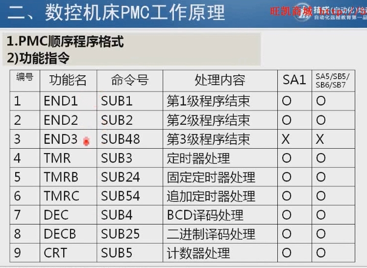
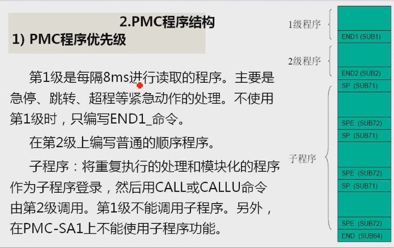
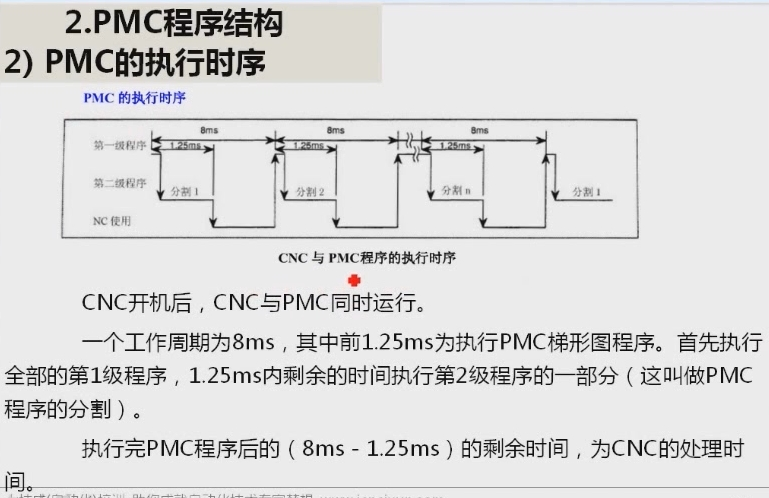
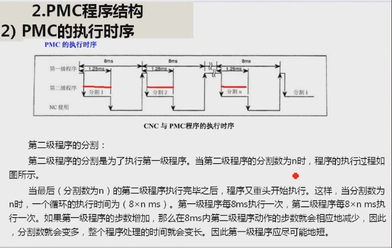
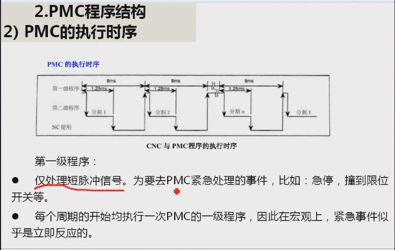
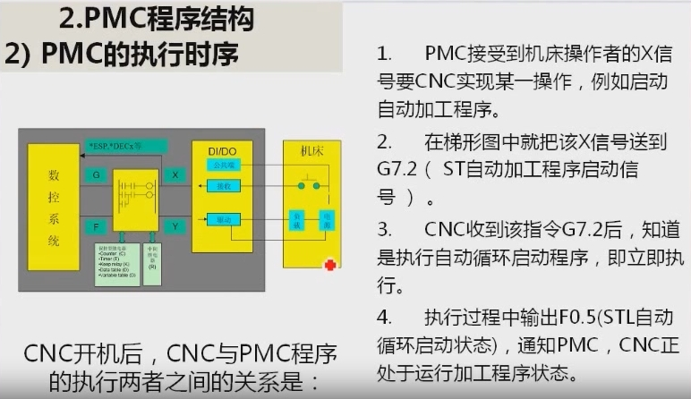
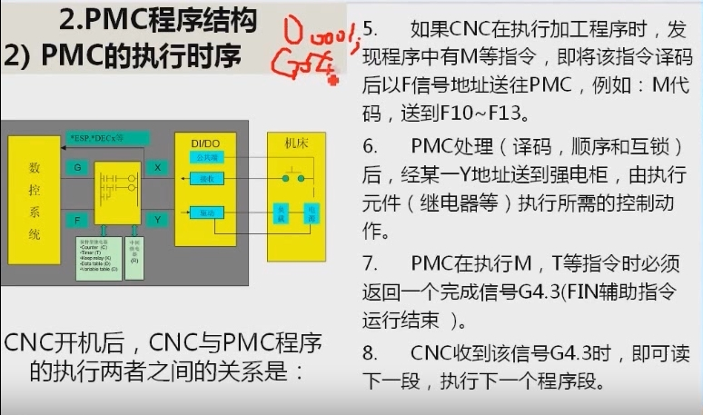
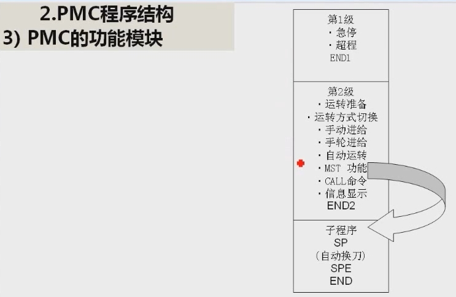
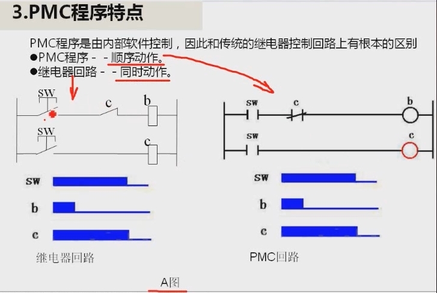
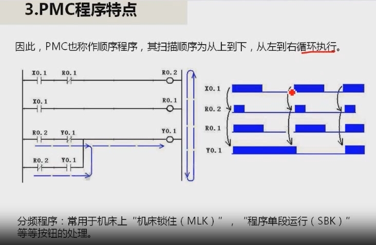

# 第9課時　FANUC 數控機床 PMC 基礎知識（02）

> 接續第8課時：PMC 順序程式格式（功能指令）、PMC 程式結構、PMC 程式特點

---

## 二、數控機床 PMC 工作原理（續）

### 1. PMC 順序程式格式

#### 2）功能指令（續）

FANUC PMC 的功能指令共有 50 多條。上表列出前 9 條，各欄含義如下：

| 欄位 | 說明 |
|------|------|
| **功能名** | 相當於助記符，用英文縮寫表示，便於記憶。例如 `TMR` 是 Timer（計時器）、`DEC` 是 Decode（譯碼）、`CRT` 是 Counter（計數器）。 |
| **命令號** | 功能指令的編號（`SUBxx`）。查找或輸入功能指令時，只要輸入 SUB 後面的號碼即可。例如計時器是 SUB3、譯碼是 SUB4、計數器是 SUB5。 |
| **處理內容** | 該功能指令的簡要介紹。 |
| **SA1、SA5/SB5/SB6/SB7** | 這是 PMC 的型號。不同型號支援的功能指令略有差異：**○ 表示有，× 表示沒有**。 |

| 編號 | 功能名 | 命令號 | 處理內容 | SA1 | SA5/SB5/SB6/SB7 |
|:---:|--------|--------|----------|:---:|:---:|
| 1 | END1 | SUB1 | 第 1 級程式結束 | ○ | ○ |
| 2 | END2 | SUB2 | 第 2 級程式結束 | ○ | ○ |
| 3 | END3 | SUB48 | 第 3 級程式結束 | × | × |
| 4 | TMR | SUB3 | 計時器處理 | ○ | ○ |
| 5 | TMRB | SUB24 | 固定計時器處理 | ○ | ○ |
| 6 | TMRC | SUB54 | 追加計時器處理 | ○ | ○ |
| 7 | DEC | SUB4 | BCD 譯碼處理 | ○ | ○ |
| 8 | DECB | SUB25 | 二進位譯碼處理 | ○ | ○ |
| 9 | CRT | SUB5 | 計數器處理 | ○ | ○ |

> 其餘功能指令將在第三講詳細講解。

---

### 2. PMC 程式結構

#### 1）PMC 程式優先級

整個 PMC 程式由三個部分組成，之間以特定的功能指令作為分界：

| 部分 | 範圍 | 分界指令 |
|------|------|----------|
| **第 1 級程式** | 程式開頭到 `END1`（SUB1）之前 | `END1` |
| **第 2 級程式** | `END1` 到 `END2`（SUB2）之間 | `END2` |
| **子程式** | `END2` 到 `END`（SUB64）之間，可有多個 | 每個子程式以 `SP`（SUB71）開頭、`SPE`（SUB72）結束；整個程式以 `END`（SUB64）結尾 |

**第 1 級程式**

- **每隔 8 ms 讀取一次**，是優先級最高的程式。
- 主要處理**急停、跳轉、超程**等緊急動作。
- 若不使用第 1 級，只需編寫一條 `END1` 命令，中間可以是空的。
- 第 1 級不能呼叫子程式（緊急動作一般也不需要）。

**第 2 級程式**

- 編寫普通的順序程式，也就是優先級要求不高、不需要緊急處理的程式。

**子程式**

- 將重複執行、模組化的處理登錄為子程式，需要時由**第 2 級**用 `CALL` 或 `CALLU` 指令呼叫。
- 子程式只有在被呼叫時才會運行。
- 注意：**PMC-SA1 型號不能使用子程式功能**。

#### 2）PMC 的執行時序

##### 工作週期與分割

- CNC 開機後，**CNC 與 PMC 同時運行**。
- 時間軸被分成許多**工作週期，每個週期 8 ms**。
- 每個週期的**前 1.25 ms 用來執行 PMC 梯形圖程式**：先執行全部的第 1 級程式，1.25 ms 內剩餘的時間再執行第 2 級程式的一部分（這就叫做 **PMC 程式的分割**）。
- PMC 程式執行完後，週期中剩下的 **8 ms − 1.25 ms = 6.75 ms**，歸 CNC 處理使用。

##### 第 2 級程式的分割

第 1 級程式很短，但剩下的那一點時間往往不夠把第 2 級程式一次執行完，因此必須把第 2 級程式**分割**，每個週期只執行其中一段，下個週期接著執行後面一段。

- 設第 2 級程式的**分割數為 n**，則最後一段（分割 n）執行完後，程式又從頭（分割 1）開始。
- 因此，PMC 完整執行一輪（第 2 級程式跑完一遍）需要 **8 × n（ms）**。
- 第 1 級程式：**每 8 ms 執行一次**；第 2 級程式：**每 8 × n ms 執行一次**。
- 如果第 1 級程式的步數增加，每個週期留給第 2 級的時間就減少，分割數 n 變大，整個程式的處理時間變長。

> **結論：第 1 級程式應盡可能短。**

##### 第 1 級程式應處理什麼

- **只處理短脈衝訊號**，也就是需要 PMC 緊急處理的事件，例如：
  - **急停**：優先級最高，急停按鈕通常是醒目的紅色大按鈕，其處理一定放在第 1 級。
  - **撞到限位開關（硬體超程）**：必須讓系統立即停下，否則工作台可能衝出去，涉及安全。這一類可以放第 1 級，**也可以放第 2 級**。
  - 其他程式不建議放在第 1 級。
- 每個週期開始時都會執行一次第 1 級程式，因此從宏觀上看，緊急事件似乎是**立即反應**的，不會有明顯延遲。

##### CNC 與 PMC 程式執行的關係（範例）

下圖是前面講過的「CNC、PMC、機床」三者關係圖的細化：左邊是數控系統（CNC），中間是 PMC 程式，右邊經 I/O 介面連到機床本體。

**範例一：按下「循環啟動」按鈕**

1. 操作者在機床上按下按鈕（例如啟動自動加工程式），經 I/O 介面變成 **X 訊號**，PMC 接收到。
2. 在梯形圖中，把該 X 訊號送到 **G7.2**（ST，自動加工程式啟動訊號）。
3. CNC 收到 G7.2，知道要執行自動循環啟動程式，立即開始執行。
4. 執行過程中，CNC 輸出 **F0.5**（STL，自動循環啟動狀態），通知 PMC：CNC 正處於運行加工程式的狀態。

> G 位址有特定含義，所以 CNC 看到 G7.2 就知道要做什麼；位址的符號註釋（如 STL）則方便我們看懂 F0.5 的用途。

**範例二：加工程式中執行 M 代碼（例如 M03）**

5. CNC 執行加工程式時，若發現 M 等指令（如 `M03`），就把該指令**譯碼後以 F 訊號位址送到 PMC**。例如 M 代碼送到 **F10～F13**。（程式中的 `G54`、`G90` 等指令不需要 PMC 配合，所以沒有反應。）
6. PMC 經過**譯碼、順序、互鎖**處理後，由某個 **Y 位址**送到強電櫃，由執行元件（繼電器等）完成所需動作。例如 M03 → 啟動變頻器正轉的繼電器線圈 → 主軸正轉。
7. PMC 執行 M、T 等指令後，**必須回傳一個完成訊號 G4.3**（FIN，輔助指令運行結束）。
8. CNC 收到 G4.3，才會讀取下一段、執行下一個程式段。

> **重點**：如果執行 M03 時一直沒有收到 G4.3，程式游標就不會往下走。

#### 3）PMC 的功能模組

依經驗，通常把特定功能的 PMC 程式放在特定的程式區塊或子程式裡：

| 區塊 | 內容 |
|------|------|
| **第 1 級** | 急停、超程（`END1` 結束；超程也可放第 2 級） |
| **第 2 級** | 運轉準備、運轉方式切換、手動進給、手輪進給、自動運轉、MST 功能、`CALL` 命令（呼叫子程式）、資訊顯示（`END2` 結束） |
| **子程式** | 例如自動換刀（`SP` … `SPE`，最後 `END`） |

說明：

- **運轉方式切換**就是操作模式的選擇，不論做什麼操作都要先選擇對應模式：加工程式要選**自動**模式；手動移動軸（按 +X 等）要選**手動**模式；搖手輪要選**手輪**模式；傳輸參數要選 **EDIT** 模式；手動輸入要選 **MDI** 模式。
- 自動換刀等較複雜的功能放在子程式中，由第 2 級的 `CALL` 呼叫。

---

## 三、PMC 程式特點

PMC 程式由**內部軟體**控制，因此與傳統的繼電器控制回路有根本的區別：

- **PMC 程式 —— 順序動作**
- **繼電器回路 —— 同時動作（並行動作）**

### 範例 A 圖：兩者結果相同

左邊是繼電器回路，右邊是 PMC 回路，兩者看起來都像梯子，但按鈕與觸點的畫法不同。

電路結構：

- 兩個 `SW` 是同一個按鈕。
- 第一條：`SW` → 繼電器 `c` 的**常閉觸點** → 線圈 `b`。
- 第二條：`SW` → 線圈 `c`。

**繼電器回路**（兩條電路同時動作）：

1. `SW` 按下，`b` 與 `c` 線圈同時接通。
2. `c` 線圈一通電，它的常閉觸點隨即斷開，`b` 跟著斷開。
3. 結果：`b` 只短暫接通一下，`c` 在 `SW` 按住期間一直接通。

**PMC 回路**（由上往下依序執行）：

1. 第一個掃描週期：`SW` 接通，此時 `c` 還是斷開，常閉觸點閉合，所以 `b` 接通；接著執行第二條，`c` 接通。
2. 第二個掃描週期：`c` 在上一週期已經接通，常閉觸點斷開，所以 `b` 斷開；`c` 保持接通。
3. 結果：`b` 接通一個掃描週期，`c` 一直接通。

**結論**：A 圖這樣的編排，繼電器回路與 PMC 程式的時序結果**沒有區別**。

### 範例 B 圖：把兩條程式上下對調

把第一條（`SW` → `c` 常閉 → `b`）與第二條（`SW` → `c`）**對調位置**，結果如下：

| 回路 | 結果 |
|------|------|
| **繼電器回路** | 兩條電路是並行的，上下順序不影響結果，`b` 仍然接通一小段，與 A 圖一樣。 |
| **PMC 程式** | 先執行 `SW` → `c`，`c` 先接通；再執行下一條時，`c` 的常閉觸點已經斷開，`b` 永遠沒有接通的機會。 |

這就體現了：**PMC 程式是從上往下、依序動作的**；繼電器回路則不論上下順序，都是同時動作。

> **所以 PMC 程式也叫做「順序程式」**，其掃描順序為**從上到下、從左到右，循環執行**。

---

### 分頻程式

正因為 PMC 程式有「順序掃描」的特點，我們才能利用它編出許多很有用的功能。數控機床中經常用到的**分頻程式**就是一例。

**時序圖的含義**（藍色＝接通，白色＝斷開）：

- `X0.1` 是一個按鈕，按一下、鬆開，再按一下、鬆開。
- 輸出 `Y0.1`：**按一下接通、鬆開後仍保持接通；再按一下才斷開**。
- 也就是把一個**不自鎖的按鈕（按著才有效）變成自鎖的按鈕**。
- 在同樣的時間內，`X0.1` 有兩次動作，`Y0.1` 只有一次，頻率降低（二分之一），所以稱為「**分頻**」。

**應用**：機床上的「機床鎖住（MLK）」、「程式單段運行（SBK）」等按鈕。

- 按一下 → 功能有效；再按一下 → 功能取消。
- 若不做這樣的處理，就會變成「按著時有效，鬆開就無效」，這不是我們想要的。

FANUC PMC 數控機床編程中經常用到分頻程式，後續會專門分析這個梯形圖為什麼能實現分頻。

---

## 本講小結

- 功能指令有 50 多條，每條有**功能名**（助記符）和**命令號**（SUBxx），不同 PMC 型號支援情況略有差異。
- PMC 程式分**第 1 級、第 2 級、子程式**。第 1 級每 8 ms 執行一次、優先級最高，只放急停等緊急、短脈衝處理，並應盡量短；第 2 級放一般順序程式，會被分割執行；子程式由第 2 級呼叫，SA1 型不支援。
- 一個 8 ms 週期中，前 1.25 ms 執行 PMC，其餘約 6.75 ms 給 CNC。第 2 級分割數為 n 時，一輪需 8 × n ms。
- CNC 與 PMC 的配合：X → PMC → G → CNC；CNC → F → PMC → Y → 機床。M、T 等指令執行完，PMC 要回傳 **G4.3（FIN）**，CNC 才會往下執行。
- PMC 程式是**順序（由上往下）動作**，繼電器回路是**並行動作**，兩者的根本區別決定了梯形圖的編排順序會影響結果。
- 利用順序掃描的特點可以編出**分頻程式**，把不自鎖的按鈕變成自鎖按鈕。
