# 第10課時　FANUC 數控機床 PMC 基礎知識（03）

> 接續第9課時：分頻電路分析、PMC 元件（PMC 分類、軟元件位址號分配、內部暫存器）
>
> 本文為第一批內容（chs10_01 ～ chs10_19），講到內部暫存器 T（計時器）；C（計數器）及其後內容將於第二批補上。

---

## 二、數控機床 PMC 工作原理（續）

### 3. PMC 程式特點（續）：分頻電路分析

上一課時介紹了分頻程式（把不自鎖的按鈕變成自鎖按鈕），本節利用 PMC「**由上往下、依序掃描**」的原理，逐個掃描週期分析它為什麼能實現分頻。

梯形圖共三條電路：

| 網格 | 電路 |
|------|------|
| 1 | `X0.1`（常開）串 `R0.1`（常閉）→ 輸出 `R0.2` |
| 2 | `X0.1`（常開）→ 輸出 `R0.1` |
| 3 | 上支路：`R0.2`（常開）串 `Y0.1`（常閉）；下支路：`R0.2`（常閉）串 `Y0.1`（常開）；兩支路並聯 → 輸出 `Y0.1` |

> 分析原則：每個掃描週期從上到下執行，`R0.1`、`Y0.1` 在被執行之前，用的是**上一個週期的結果**。開始前 `R0.1`、`Y0.1` 都是斷開的。

#### 第 1 個週期：按下 X0.1

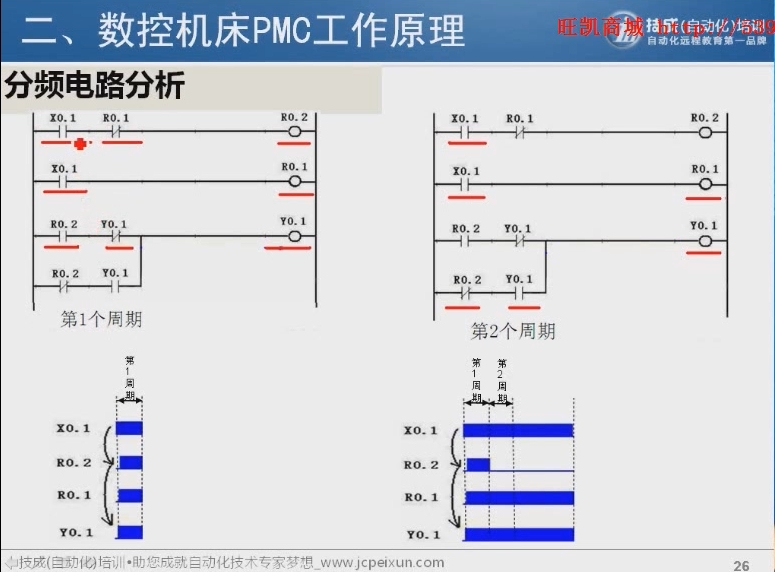

1. `X0.1` 接通；`R0.1` 此時還是斷開，其常閉觸點閉合 → **`R0.2` 接通**。
2. 第 2 條：`X0.1` 接通 → **`R0.1` 接通**。
3. 第 3 條：`R0.2` 接通，`Y0.1` 尚未接通（其常閉觸點閉合）→ 上支路導通 → **`Y0.1` 接通**（下支路是否導通已不影響）。

結果：`R0.2`、`R0.1`、`Y0.1` 都接通。

#### 第 2 個週期：X0.1 繼續按著

1. `X0.1` 仍接通，但 `R0.1` 沿用上一週期的結果（接通），所以它的常閉觸點斷開 → **`R0.2` 斷開**（`R0.2` 只接通一個掃描週期，相當於一個單脈衝）。
2. 第 2 條：`X0.1` 接通 → `R0.1` 保持接通。
3. 第 3 條：`R0.2` 斷開，上支路不通；`R0.2` 常閉觸點閉合，`Y0.1`（上一週期接通）常開觸點閉合，下支路導通 → **`Y0.1` 保持接通**。

#### 第 n 個週期：X0.1 鬆開

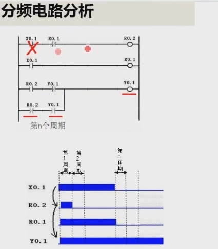

1. `X0.1` 斷開 → `R0.2`、`R0.1` 都斷開。
2. 第 3 條：上支路不通；下支路中 `R0.2` 常閉觸點閉合，`Y0.1` 在上一週期是接通的 → 下支路導通 → **`Y0.1` 仍然接通**。

也就是說：**`X0.1` 鬆開後，`Y0.1` 保持接通**，這個狀態會一直持續到 `X0.1` 再有變化。

#### 第 k 個週期：再次按下 X0.1

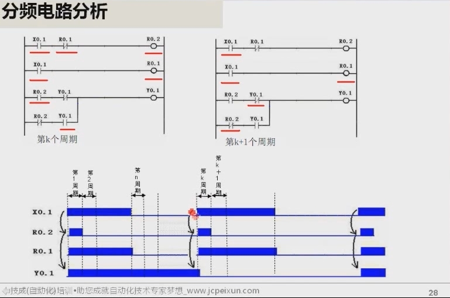

1. `R0.1` 取前一週期的狀態（斷開），常閉觸點閉合，`X0.1` 接通 → **`R0.2` 接通**；第 2 條 → `R0.1` 接通。
2. 第 3 條：
   - 上支路：`R0.2` 接通，但 `Y0.1`（上一週期接通）的常閉觸點斷開 → 不通；
   - 下支路：`R0.2` 的常閉觸點斷開 → 不通。
3. 兩條支路都不通 → **`Y0.1` 斷開**。

#### 第 k+1 個週期：X0.1 繼續按著

1. `R0.1` 上一週期接通，常閉觸點斷開 → `R0.2` 斷開。
2. 第 3 條：上支路因 `R0.2` 斷開而不通；下支路中 `Y0.1`（上一週期已斷開）的常開觸點不通 → **`Y0.1` 繼續斷開**。

#### 結論

| 操作 | Y0.1 |
|------|------|
| 第 1 次按下 `X0.1` | 接通 |
| 鬆開 | 保持接通 |
| 第 2 次按下 | 斷開 |
| 鬆開 | 保持斷開 |
| 第 3 次按下 | 又接通 |

**按一下接通，再按一下斷開，再按一下又接通……`Y0.1` 交替變化**，這就是分頻電路。

---

## 三、PMC 元件

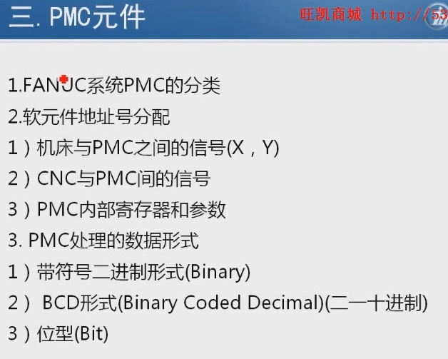

本部分內容：

1. FANUC 系統 PMC 的分類
2. 軟元件位址號分配
   1. 機床與 PMC 之間的訊號（X、Y）
   2. CNC 與 PMC 之間的訊號（F、G）
   3. PMC 內部暫存器和參數
3. PMC 處理的資料形式
   1. 帶符號二進位形式（Binary）
   2. BCD 形式（Binary Coded Decimal，二－十進位）
   3. 位元型（Bit）

### 1. FANUC 系統 PMC 的分類

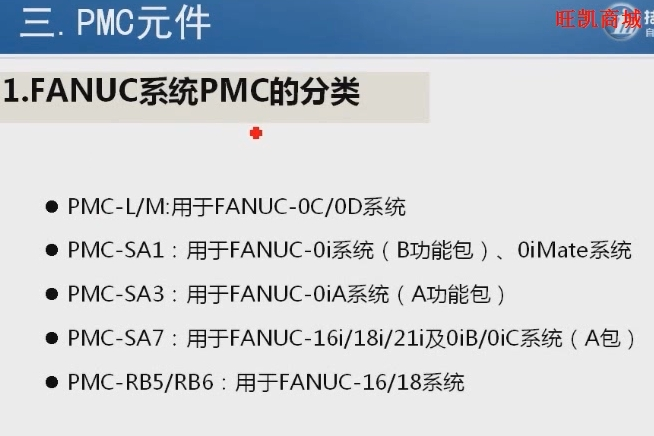

| PMC 型號 | 適用系統 |
|----------|----------|
| PMC-L/M | FANUC-0C/0D 系統 |
| PMC-SA1 | FANUC-0i 系統（B 功能包）、0i Mate 系統 |
| PMC-SA3 | FANUC-0iA 系統（A 功能包） |
| PMC-SA7 | FANUC-16i/18i/21i 及 0iB/0iC 系統（A 包） |
| PMC-RB5/RB6 | FANUC-16/18 系統 |

> 說明：0i Mate 是 0i 的精簡型，使用 SA1 型 PMC。A 包的功能比 B 包多一些。
>
> **編寫 PMC 程式時，必須選擇與系統對應的 PMC 型號。**

### 2. 軟元件位址號分配

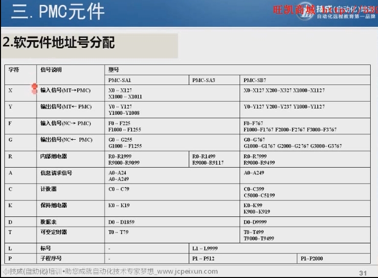

FANUC PMC 的軟元件有以下幾類，每類以一個字元表示，後面接位址號：

| 字元 | 訊號說明 | PMC-SA1 | PMC-SA3 | PMC-SB7 |
|:---:|----------|---------|---------|---------|
| **X** | 輸入訊號（MT → PMC） | X0～X127、X1000～X1011 | 同 SA1 | X0～X127、X200～X327、X1000～X1127 |
| **Y** | 輸出訊號（MT ← PMC） | Y0～Y127、Y1000～Y1008 | 同 SA1 | Y0～Y127、Y200～Y237、Y1000～Y1127 |
| **F** | 輸入訊號（NC → PMC） | F0～F225、F1000～F1255 | 同 SA1 | F0～F767、F1000～F1767、F2000～F2767、F3000～F3767 |
| **G** | 輸出訊號（NC ← PMC） | G0～G255、G1000～G1255 | 同 SA1 | G0～G767、G1000～G1767、G2000～G2767、G3000～G3767 |
| **R** | 內部繼電器 | R0～R1999、R9000～R9099 | R0～R1499、R9000～R9117 | R0～R7999、R9000～R9499 |
| **A** | 資訊請求訊號 | A0～A24、A0～A249 | （見表） | A0～A249 |
| **C** | 計數器 | C0～C79 | 同 SA1 | C0～C399、C5000～C5199 |
| **K** | 保持繼電器 | K0～K19 | 同 SA1 | K0～K99、K900～K919 |
| **D** | 資料表 | D0～D1859 | 同 SA1 | D0～D9999 |
| **T** | 可變定時器 | T0～T79 | 同 SA1 | T0～T499、T9000～T9499 |
| **L** | 標號 | － | L1～L9999 | L1～L9999 |
| **P** | 子程式號 | － | P1～P512 | P1～P2000 |

> 位址號依 PMC 型號略有差異，差別不大。上表中 SA1/SA3 合併欄位的部分，請以 `chs10_06.jpg` 原圖為準。

接下來分別說明各類位址。

#### 1）機床與 PMC 之間的訊號（X、Y）

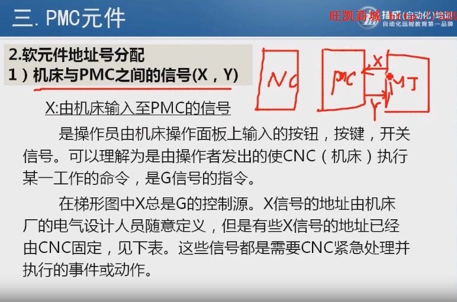

##### X：由機床輸入至 PMC 的訊號

- 是操作員在機床操作面板上輸入的按鈕、按鍵、開關訊號，可以理解為操作者發出的、使 CNC（機床）執行某一工作的命令，是 **G 訊號的指令來源**。
- 在梯形圖中，**X 總是 G 的控制源**。
- X 訊號的位址由**機床廠的電氣設計人員隨意定義**（例如某按鈕可以叫 X0.0，也可以叫 X0.1），但**有些 X 訊號的位址已經由 CNC 固定**，不能隨意更改。這些訊號都是需要 CNC 緊急處理並執行的事件或動作。

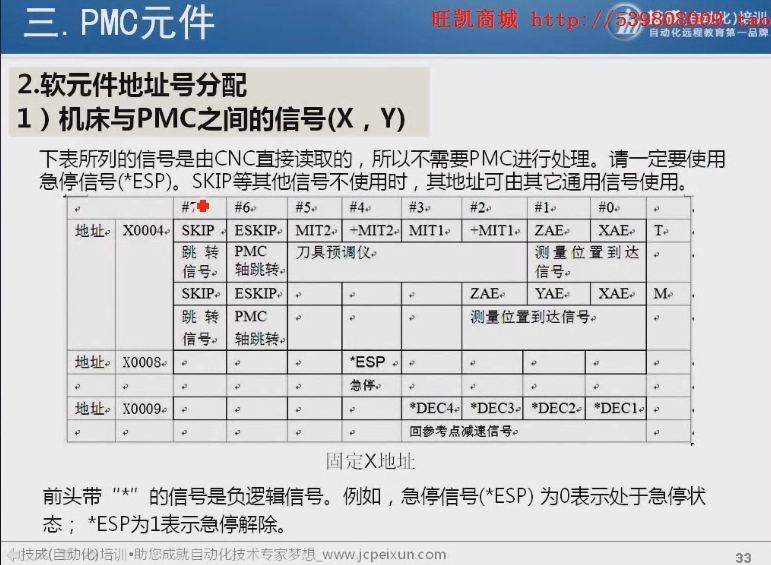

下表中的訊號是**由 CNC 直接讀取**的，不需要 PMC 處理（即跳過 PMC，直接送到 CNC）：

| 位址 | #7 | #6 | #5 | #4 | #3 | #2 | #1 | #0 |
|------|----|----|----|----|----|----|----|----|
| X0004（T 系列） | SKIP 跳轉訊號 | ESKIP PMC 軸跳轉 | MIT2 | +MIT2 | MIT1 | +MIT1 | ZAE | XAE |
| X0004（M 系列） | SKIP 跳轉訊號 | ESKIP PMC 軸跳轉 | － | － | － | ZAE | YAE | XAE |
| X0008 | | | | **\*ESP 急停** | | | | |
| X0009 | | | | \*DEC4 | \*DEC3 | \*DEC2 | \*DEC1 | |

- `MIT1、MIT2`：刀具預調儀訊號；`ZAE、YAE、XAE`：測量位置到達訊號；`*DEC1～*DEC4`：回參考點減速訊號。
- 其中**急停訊號 `*ESP`（X0008.4）一定要使用**；`SKIP` 等其他訊號不用時，位址可由其他通用訊號使用。回參考點減速訊號通常也會用到。
- **前面帶「\*」的訊號是負邏輯訊號**。例如急停訊號 `*ESP` 為 **0** 表示處於急停狀態，為 **1** 表示急停解除。

##### Y：由 PMC 輸出至機床的、使機床強電動作的訊號

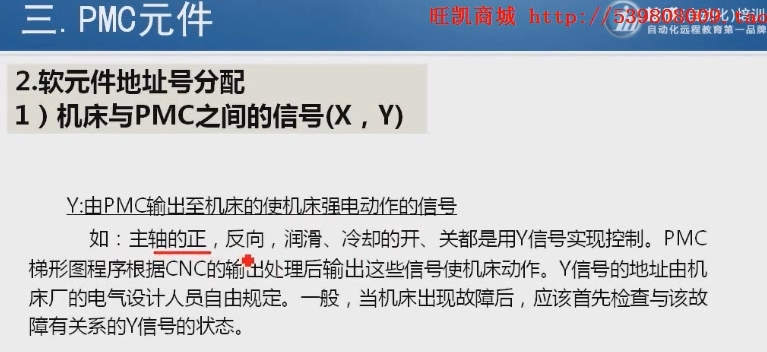

- 例如：主軸的正轉、反轉、潤滑、冷卻的開、關，都是用 Y 訊號來實現控制。
  - 以類比主軸為例：變頻器的 FWD、REV 接點要由繼電器觸點控制，這兩個繼電器的線圈就由 PMC 的 Y 位址輸出驅動。
- PMC 梯形圖程式根據 CNC 的輸出，處理後輸出這些訊號，使機床動作。
- **Y 訊號的位址由機床廠的電氣設計人員自由規定**，沒有被 CNC 直接占用的 Y 位址。
- **故障診斷**：一般機床出現故障後，應該**首先檢查與該故障有關係的 Y 訊號的狀態**。例如按了主軸正轉但主軸沒轉，先檢查主軸正轉的 Y 訊號有沒有輸出。

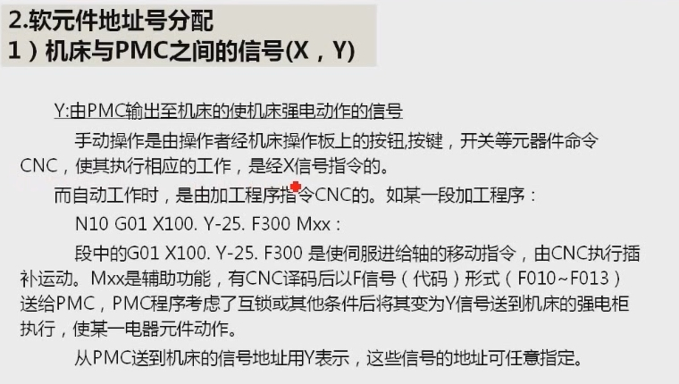

- **手動操作**：操作者經機床操作板上的按鈕、按鍵、開關等元件命令 CNC 執行相應工作，是經 **X 訊號**指令的。
- **自動工作**：由加工程式指令 CNC。例如某一段加工程式：

  `N10 G01 X100. Y-25. F300 Mxx;`

  - `G01 X100. Y-25. F300` 是伺服進給軸的移動指令，由 **CNC 執行插補運動**（數字控制），**不需要 PMC 處理**。
  - `Mxx` 是**輔助功能**，由 CNC 譯碼後以 **F 訊號（代碼）**形式（F10～F13）送給 PMC；PMC 程式考慮了互鎖或其他條件後，把它變成 **Y 訊號**送到機床的強電櫃執行，使某一電器元件動作。
- 從 PMC 送到機床的訊號位址用 Y 表示，這些位址可任意指定。

#### 2）CNC 與 PMC 之間的訊號（G、F）

##### G：PMC 輸出至 CNC 的訊號（CNC 輸入）

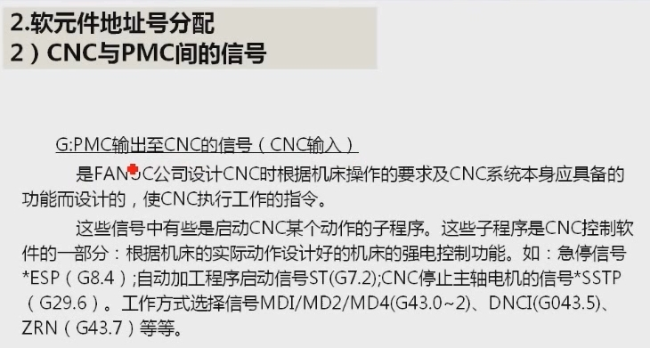

- G 訊號是 FANUC 公司設計 CNC 時，根據機床操作的要求及 CNC 系統本身具備的功能而設計的，用來使 CNC 執行工作的指令。
- 這些訊號中有些是**啟動 CNC 某個動作的子程式**。這些子程式是 CNC 控制軟體的一部分，是根據機床的實際動作設計好的機床強電控制功能。系統一接收到某個 G 訊號，就知道現在要做什麼。這是一般 PLC 所沒有的，也體現了**機床專用 PMC 的特點**。

常見例子：

| 訊號 | 位址 | 含義 |
|------|------|------|
| `*ESP` | G8.4 | 急停訊號（CNC 一收到就知道急停了，並發出相應的處理） |
| `ST` | G7.2 | 自動加工程式啟動訊號（CNC 一收到就立即啟動加工程式） |
| `*SSTP` | G29.6 | CNC 停止主軸電機的訊號 |
| `MD1/MD2/MD4` | G43.0～G43.2 | 工作方式選擇訊號 |
| `DNCI` | G43.5 | DNC 運行選擇 |
| `ZRN` | G43.7 | 手動返回參考點選擇 |

**工作方式選擇訊號**

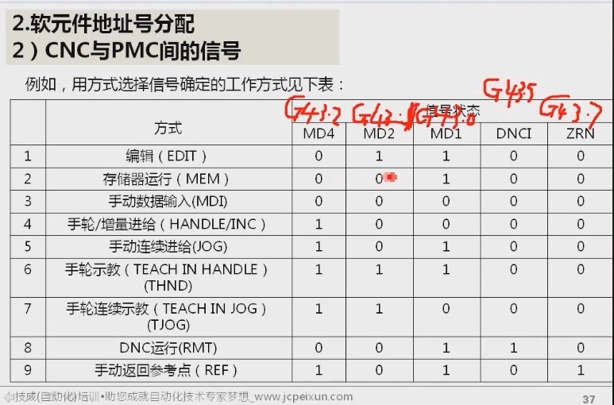

由 `MD4`（G43.2）、`MD2`（G43.1）、`MD1`（G43.0）、`DNCI`（G43.5）、`ZRN`（G43.7）這五個訊號的**組合**，決定 CNC 的工作方式：

| 方式 | MD4 | MD2 | MD1 | DNCI | ZRN |
|------|:---:|:---:|:---:|:----:|:---:|
| 編輯（EDIT） | 0 | 1 | 1 | 0 | 0 |
| 存儲器運行（MEM） | 0 | 0 | 1 | 0 | 0 |
| 手動資料輸入（MDI） | 0 | 0 | 0 | 0 | 0 |
| 手輪/增量進給（HANDLE/INC） | 1 | 0 | 0 | 0 | 0 |
| 手動連續進給（JOG） | 1 | 0 | 1 | 0 | 0 |
| 手輪示教（TEACH IN HANDLE） | 1 | 1 | 1 | 0 | 0 |
| 手動連續示教（TEACH IN JOG） | 1 | 1 | 0 | 0 | 0 |
| DNC 運行（RMT） | 0 | 0 | 1 | 1 | 0 |
| 手動返回參考點（REF） | 1 | 0 | 1 | 0 | 1 |

例如：

- PMC 程式讓這五個訊號都為 0 → CNC 檢測到後，進入 **MDI** 模式。
- 要讓系統進入 **JOG** 模式，PMC 程式就要使 `MD4`（G43.2）、`MD1`（G43.0）為 1，其餘三個為 0。

**通知 CNC 的訊號**

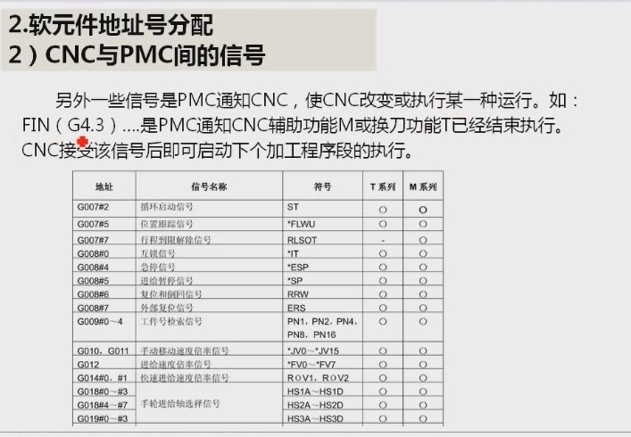

另外一些信號是 PMC 通知 CNC，使 CNC 改變或執行某種運行。例如 **FIN（G4.3）**：PMC 通知 CNC 輔助功能 M 或換刀功能 T 已經結束執行，CNC 接收到該訊號後，才會啟動下一個加工程式段的執行。

常用的 G 訊號：

| 位址 | 訊號名稱 | 符號 | T 系列 | M 系列 |
|------|----------|------|:---:|:---:|
| G007#2 | 循環啟動訊號 | ST | ○ | ○ |
| G007#5 | 位置跟蹤訊號 | \*FLWU | ○ | ○ |
| G007#7 | 行程到限位解除訊號 | RLSOT | － | ○ |
| G008#0 | 互鎖訊號 | \*IT | ○ | ○ |
| G008#4 | 急停訊號 | \*ESP | ○ | ○ |
| G008#5 | 進給暫停訊號 | \*SP | ○ | ○ |
| G008#6 | 復位和倒回訊號 | RRW | ○ | ○ |
| G008#7 | 外部復位訊號 | ERS | ○ | ○ |
| G009#0～4 | 工件號檢索訊號 | PN1、PN2、PN4、PN8、PN16 | ○ | ○ |
| G010、G011 | 手動移動速度倍率訊號 | \*JV0～\*JV15 | ○ | ○ |
| G012 | 進給速度倍率訊號 | \*FV0～\*FV7 | ○ | ○ |
| G014#0、#1 | 快速進給速度倍率訊號 | ROV1、ROV2 | ○ | ○ |
| G018#0～#3 | 手輪進給軸選擇訊號 | HS1A～HS1D | ○ | ○ |
| G018#4～#7 | 手輪進給軸選擇訊號 | HS2A～HS2D | ○ | ○ |
| G019#0～#3 | 手輪進給軸選擇訊號 | HS3A～HS3D | ○ | ○ |

##### F：CNC 輸出至 PMC 的訊號

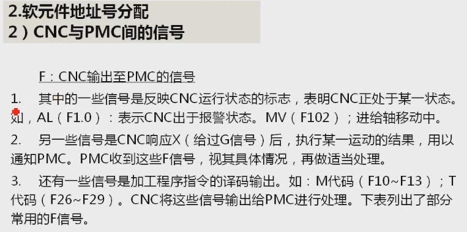

F 訊號可分為三類：

1. **反映 CNC 運行狀態的標誌**，表明 CNC 正處於某一狀態。
   例如：`AL`（F1.0）表示 CNC 處於報警狀態；`MV`（F102）表示進給軸移動中。
2. **CNC 響應 X（經過 G 訊號）後，執行某一運動的結果**，用以通知 PMC。PMC 收到這些 F 訊號後，視具體情況再做適當處理。
   例如：按下循環啟動按鈕，PMC 處理後給 CNC 一個 G 訊號（`ST`）；CNC 執行後回饋 `STL` 訊號，告訴 PMC「你給我的指令我已經在做了」。
3. **加工程式指令的譯碼輸出**。
   - M 代碼：**F10～F13**；
   - T 代碼：**F26～F29**（可由此知道要換哪一把刀）。

   CNC 將這些訊號輸出給 PMC 進行處理。

常用的 F 訊號：

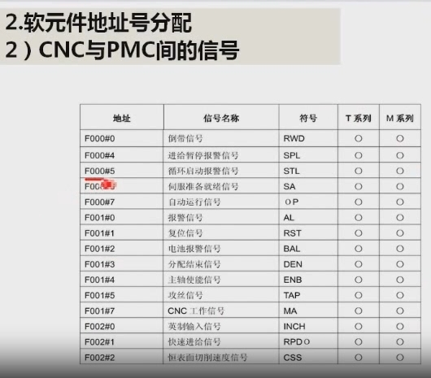

| 位址 | 訊號名稱 | 符號 | T 系列 | M 系列 |
|------|----------|------|:---:|:---:|
| F000#0 | 倒帶訊號 | RWD | ○ | ○ |
| F000#4 | 進給暫停報警訊號 | SPL | ○ | ○ |
| F000#5 | 循環啟動報警訊號（循環啟動燈） | STL | ○ | ○ |
| F000#6 | 伺服準備就緒訊號 | SA | ○ | ○ |
| F000#7 | 自動運行訊號 | OP | ○ | ○ |
| F001#0 | 報警訊號 | AL | ○ | ○ |
| F001#1 | 復位訊號 | RST | ○ | ○ |
| F001#2 | 電池報警訊號 | BAL | ○ | ○ |
| F001#3 | 分配結束訊號 | DEN | ○ | ○ |
| F001#4 | 主軸使能訊號 | ENB | ○ | ○ |
| F001#5 | 攻絲訊號 | TAP | ○ | ○ |
| F001#7 | CNC 工作訊號 | MA | ○ | ○ |
| F002#0 | 英制輸入訊號 | INCH | ○ | ○ |
| F002#1 | 快速進給訊號 | RPDO | ○ | ○ |
| F002#2 | 恆表面切削速度訊號 | CSS | ○ | ○ |

> 註：老師口述的個別位址（如 STL、SA）與投影片表格略有出入，此處一律以投影片表格為準。

#### 3）PMC 內部暫存器和參數

編寫 PMC 程式時，為了保存資料或訊號，PMC 要用到一些內部暫存器：**R、K、D、T、C 和 A**。

##### R：中間暫存器

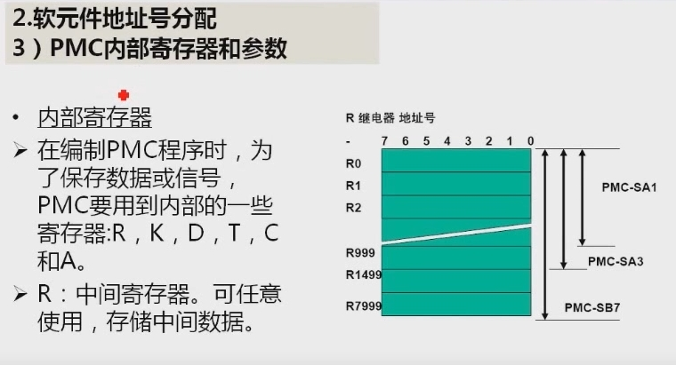

- 可任意使用，用來**存儲中間資料**。
- 位址範圍依型號而不同：SA1：`R0～R1999`；SA3：`R0～R1499`；SB7：`R0～R7999`。
- 每個 R 位址有 8 位元（#0～#7），用法大致相同。

##### K：保持型暫存器

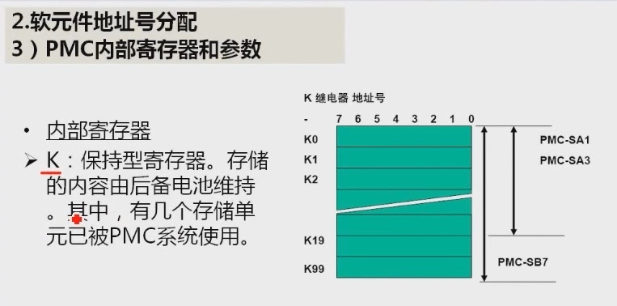

- K 取自 Keep（保持），存儲的內容**由後備電池維持**，斷電後不會丟失。
- SA1、SA3：`K0～K19`；SB7：`K0～K99`。
- 其中有幾個存儲單元已被 PMC 系統使用（後面會提到）。

##### D：資料存儲器

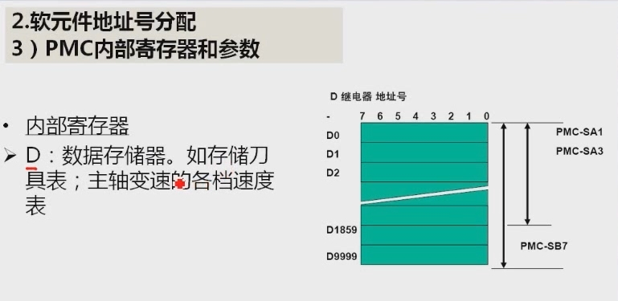

- D 取自 Data，用來存放**資料表**。例如：
  - 自動換刀（尤其是隨機換刀）的**刀庫表**：第 1 把刀放在哪個位置、第 2 把刀放在哪個位置……
  - 主軸變速的各檔速度表（例如 8 個檔位的資料）。
- SA1、SA3：`D0～D1859`；SB7：`D0～D9999`。

##### T：計時器

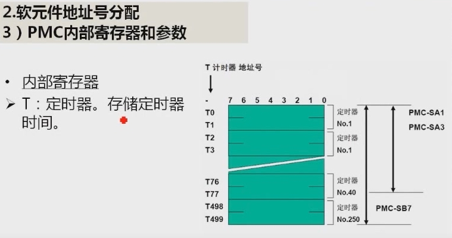

- 存儲計時器的時間。
- **每個計時器要用到 2 個位元組**：例如計時器 No.1 用 `T0` 和 `T1`，No.2 用 `T2` 和 `T3`。
- SA1、SA3：`T0～T79`（計時器 No.1～No.40）；SB7：`T0～T499`（計時器 No.1～No.250）。

---

## 本批小結

- 分頻電路利用 PMC 的順序掃描，並以 `R0.2` 產生單脈衝，`Y0.1` 用「自鎖＋反向」的方式在每次按下時翻轉狀態，使 `Y0.1` 隨 `X0.1` 交替接通、斷開。
- PMC 有多種型號（L/M、SA1、SA3、SA7、RB5/RB6），編程時要選與系統相符的型號。
- **X、Y**：機床 ↔ PMC，位址由機床廠自行定義（少數 X 位址由 CNC 固定，如 `*ESP`）。
- **G、F**：PMC ↔ CNC，位址和含義由 FANUC 固定：G 是 PMC 對 CNC 的指令（如 `ST`、`*ESP`、`FIN`、模式選擇 `MD1/MD2/MD4`），F 是 CNC 回饋給 PMC 的狀態、結果及 M/T 譯碼（F10～F13、F26～F29）。
- 內部暫存器：R（中間）、K（保持，電池備份）、D（資料表）、T（計時器），其餘 C（計數器）、A 等見下一批內容。
