# 第11課時 FANUC 數控機床 PMC 基礎知識（四）

> 本課時接續上一課，完成「三、PMC 元件」中軟元件位址號分配的最後一部分（內部寄存器與參數），再講解 PMC 處理的三種資料形式，最後進入「四、I/O Link 位址分配」。
>
> 圖片請放在與本檔同層的 `images/` 資料夾中。

## 本課時目錄

1. PMC 內部寄存器與參數（C 計數器、A 顯示信息、K 參數、R 系統保留區）
2. PMC 處理的資料形式（二進制、BCD、位元型）
3. I/O Link 位址分配
   - 3.1 FANUC 常用的 I/O 裝置
   - 3.2 硬體連接（組、基座、槽）
   - 3.3 名稱的設定
   - 3.4 I/O Link 的軟體設定

---

## 一、PMC 內部寄存器與參數（軟元件位址號分配 之 3）

### 1.1 內部寄存器 C：計數器

C 用來儲存計數器的**預置值**與**計數值**。**每個計數器佔用 4 個位元組**：

- 前 2 個位元組：預置值（設定值）。
- 後 2 個位元組：當前值，會隨計數而變化。

| 計數器 | 位址範圍 | 說明 |
| --- | --- | --- |
| No.1 | C0 ~ C3 | C0、C1 為設定值；C2、C3 為當前值 |
| No.20 | C76 ~ C79 | PMC-SA1 / SA3 的計數器到 No.20 為止 |
| No.100 | C396 ~ C399 | PMC-SB7 的計數器到 No.100 為止 |

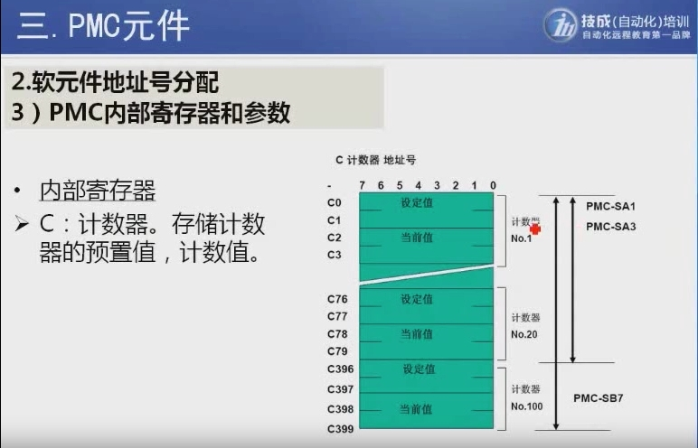

### 1.2 內部寄存器 A：顯示信息

A 用來儲存**顯示資訊的字元**，例如機床報警、操作資訊等。舉例來說：

- 潤滑油是不是過低了？
- 冷卻液是不是過載了？
- 主軸是不是報警了？

這些資訊字元可以搭配顯示類的功能指令，顯示到機床的顯示器上。

| 機型 | A 位址範圍 |
| --- | --- |
| PMC-SA1 / SA3 | A0 ~ A24 |
| PMC-SB7 | A0 ~ A249 |

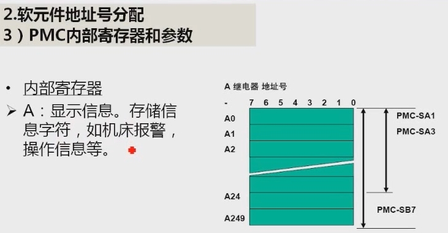

### 1.3 參數：K 參數

除了 PMC 程式中使用的內部存儲器外，為了運行或編輯梯形圖，還需要設定一些參數，主要是 **K 參數**。

- PMC 程式中可用到 K 信號（參數），其意義由機床廠家在編寫 PMC 時自行定義。
- 但有一些 K 位址已被定義為 **PMC 控制軟體的管理參數**，決定 PMC 編輯過程中的一些功能，這些是固定的，不能自行定義。
- PMC-SA1 與 PMC-SB7 的參數號不同，但功能大致相同。

常用的管理參數如下：

| SA1 | SB7 | 含義 | 設定值 |
| --- | --- | --- | --- |
| K17.0 | K900.0 | 是否顯示順序程式（梯形圖） | 0：顯示；1：禁止顯示 |
| K17.1 | K900.1 | 內置編程器功能 | 0：禁止；1：允許 |
| K17.2 | K900.2 | 系統上電後是否自動運行 PMC | 0：自動；1：手動 |
| K17.4 | K900.4 | 是否允許強制功能 | 0：禁止；1：允許 |
| K17.5 | K906.5 | 追蹤功能的使用 | 0：按下 [EXEC] 執行；1：上電後自動執行 |
| K17.7 | K900.7 | 是否顯示資料表管理畫面 | 0：顯示；1：禁止顯示 |
| K18.6 | K901.6 | 是否允許編輯順序程式 | 0：禁止；1：允許 |
| K19.0 | K902.0 | 編輯順序程式後，是否提示自動寫入 F-ROM | 0：不提示；1：提示 |
| K19.2 | K902.2 | 是否允許對順序程式進行 run/stop 操作 | 0：禁止；1：允許 |

> 註：投影片上 K19.2 / K902.2 的標題寫作「是否禁止……」，但設定值欄寫的是「0：禁止；1：允許」，講解時也是以「允不允許 run/stop」來說明，因此這裡統一寫成「是否允許」。

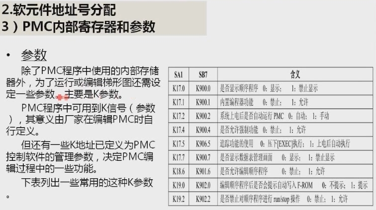

以 PMC-SB7 為例，逐項說明：

- **K900.0**：設為 0 表示顯示順序程式（即梯形圖），能看到梯形圖。有些加工企業的機床只用於加工，梯形圖對操作者沒有用處，就會禁止顯示，此時把 K900.0 設為 1。
- **K900.1**：內置編程器功能。設為 0 不能用，設為 1 才可以使用。
- **K900.2**：系統上電後要不要自動運行 PMC 程式。一般都是自動運行；但在調試梯形圖、不確定程式是否正確時，不能貿然自動運行，就選擇手動，開機後再手動按 [RUN] 軟鍵來運行 PMC 程式，主要用於調試。
- **K900.4**：強制功能，也是調試時使用。
- **K906.5**：追蹤功能，設定是自動執行，還是手動按 [EXEC] 時才執行。
- **K900.7**：資料表（DATA TABLE）管理畫面是否顯示。管理畫面可以設定資料表每個資料的位元組數（1、2 或 4 位元組）與顯示格式（二進制、BCD、十六進制等）。
- **K901.6**：是否允許編輯梯形圖。為了保護梯形圖，可以禁止編輯。
- **K902.0**：編輯梯形圖之後，是否提示寫入 F-ROM。編輯後必須寫入 F-ROM，修改才會真正存進系統；若不寫入，下次重新啟動後，系統仍會回到修改之前的梯形圖。這個參數就是控制是否會出現提示。
- **K902.2**：是否允許對梯形圖進行 run / stop 操作。若上電後不自動運行，就必須手動運行，這時就必須允許 run / stop。

### 1.4 R 的系統保留區域

以下 R 位址由**系統使用**：梯形圖中**可以讀取，但不能寫入**。

#### （1）運算結果寄存器 R9000

執行完二進制加法運算（ADDB）和二進制大小比較（COMPB）等指令後，讀取該寄存器，就可以知道加法運算時的溢出情況和大小比較的結果。

| 位址 | #7 | #6 | #5 | #4 | #3 | #2 | #1 | #0 |
| --- | --- | --- | --- | --- | --- | --- | --- | --- |
| R9000 |  |  | V |  |  |  | N | Z |

- **V（#5）**：溢出，表示資料超過了所能表示的大小。
- **N（#1）**：符號為負（小）。運算時看結果是否為負；比較時看是否「小於」。
- **Z（#0）**：零（相等）。運算時看結果是否為 0；比較時看兩數是否相等。

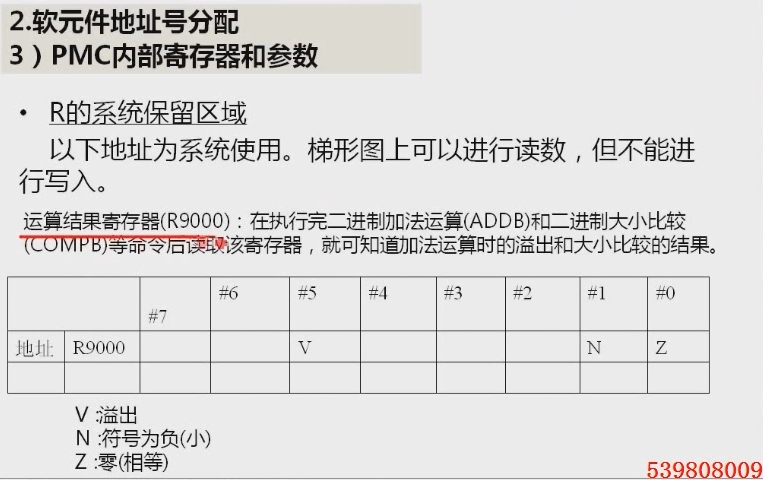

#### （2）餘數寄存器 R9002 ~ R9005

可寫入除法運算指令（DIVB）的**餘數**。

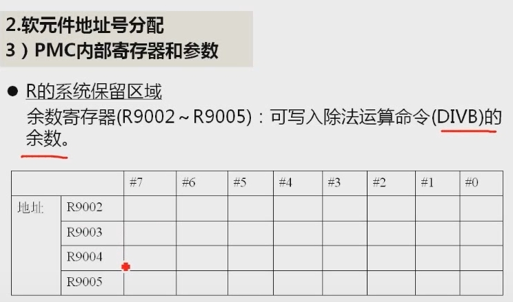

#### （3）系統計時器 R9091

| 位址 | #7 | #6 | #5 | #4 | #3 | #2 | #1 | #0 |
| --- | --- | --- | --- | --- | --- | --- | --- | --- |
| R9091 |  | T1 | T2 |  |  |  | ON | OFF |

- **T1（#6）**：1 秒週期閃爍（開 / 關比 1:1，即開 0.5 秒、關 0.5 秒）。
- **T2（#5）**：0.2 秒週期閃爍（開 / 關比 1:1，即開 0.1 秒、關 0.1 秒）。
- **ON（#1）**：常開信號，也就是恆為 1 的信號。
- **OFF（#0）**：常閉信號，也就是恆為 0 的信號。

編寫程式時，功能指令常常需要一個恆為 0 或恆為 1 的信號，這時就可以用 R9091.0 與 R9091.1；需要閃爍信號時，則使用 R9091.6 或 R9091.5。

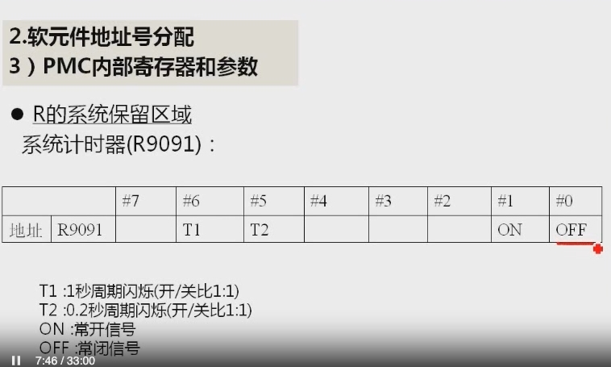

至此，「軟元件位址號分配」講解完畢。

---

## 二、PMC 處理的資料形式

PMC 處理的資料有三種形式：帶符號二進制、BCD、位元型。

### 2.1 帶符號二進制形式（Binary）

可進行 1 位元組、2 位元組、4 位元組長度的二進制處理，可使用的數值範圍如下（以 2 的補碼表示）：

| 資料長度 | 資料範圍（10 進制換算） | 備註 |
| --- | --- | --- |
| 1 位元組資料 | -128 ~ +127 | 2 的補碼表示 |
| 2 位元組資料 | -32768 ~ +32767 | 2 的補碼表示 |
| 4 位元組資料 | -2147483648 ~ +2147483647 | 2 的補碼表示 |

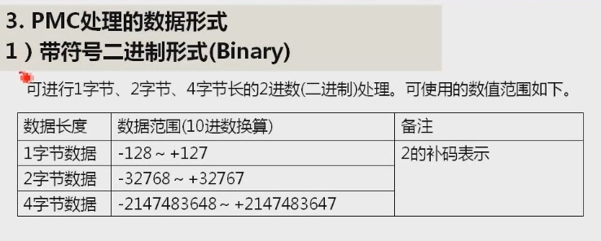

#### 資料表示

- 梯形圖中，一般只需指定資料的**起始位址**和**資料長度**（1、2 或 4 位元組），不必把每個位元組的位址都寫出來。
- 在診斷畫面（PMCDGN）確認 2 位元組、4 位元組資料時，**位址號大的為高位位址**。

例如，由 R100 指定的 4 位元組資料，是 R100、R101、R102、R103 四個位元組（不是往前的 R99）：

| 位址 | #7 | #6 | #5 | #4 | #3 | #2 | #1 | #0 |
| --- | --- | --- | --- | --- | --- | --- | --- | --- |
| R0100 | 2⁷ | 2⁶ | 2⁵ | 2⁴ | 2³ | 2² | 2¹ | 2⁰ |
| R0101 | 2¹⁵ | 2¹⁴ | 2¹³ | 2¹² | 2¹¹ | 2¹⁰ | 2⁹ | 2⁸ |
| R0102 | 2²³ | 2²² | 2²¹ | 2²⁰ | 2¹⁹ | 2¹⁸ | 2¹⁷ | 2¹⁶ |
| R0103 | ± | 2³⁰ | 2²⁹ | 2²⁸ | 2²⁷ | 2²⁶ | 2²⁵ | 2²⁴ |

R103 位址最大，是最高位元組，其最高位（#7）為**符號位**，其餘各位表示數值大小。

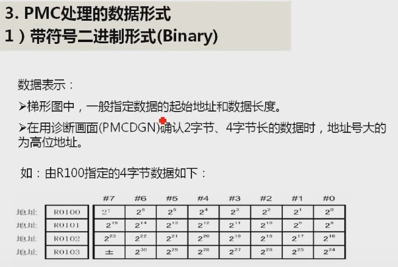

#### 例：用 2 位元組表示 100 和 -100

| 10 進數 | 100 | -100 |
| --- | --- | --- |
| 2 進數 +0（低位元組） | 01100100 | 10011100 |
| 2 進數 +1（高位元組） | 00000000 | 11111111 |

最高位是 1 時為負。

**100 的表示**：低位元組 `01100100` = 64 + 32 + 4 = 100；高位元組為 8 個 0，最高位 0 表示正數。

**-100 的表示（補碼）**：

- 正數的補碼與原碼相同。
- 負數的補碼是對其原碼逐位取反（符號位除外），然後整個數加 1。

以 -100 為例：將 100 的低位元組 `01100100` 逐位取反得 `10011011`，再加 1 得 `10011100`；高位元組為 8 個 1（含符號位 1），所以 -100 即為 `11111111 10011100`。

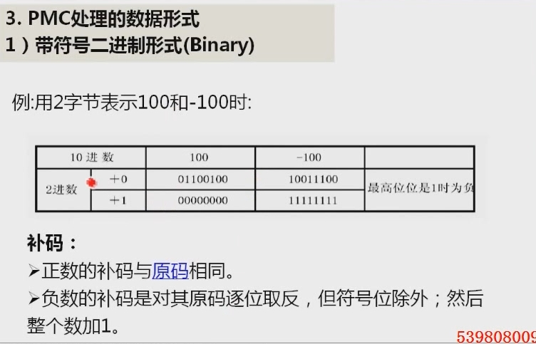

### 2.2 BCD 形式（Binary Coded Decimal，二—十進制）

- 在十進制數的二—十進制表示中，用 **4 位二進制數表示十進制數的每一位**。
- 可處理 2 位或 4 位的十進制數。**符號用其他信號進行處理**，不在這些位元中表示。

一個位元組可表示 2 位十進制數（個位與十位）；要表示 4 位十進制數，就需要 2 個位元組：

| 位址 | #7 ~ #4 | #3 ~ #0 |
| --- | --- | --- |
| +0 | 十位（80、40、20、10） | 個位（8、4、2、1） |
| +1 | 千位（8000、4000、2000、1000） | 百位（800、400、200、100） |

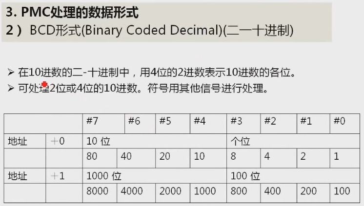

#### 例

| 10 進制數 | 63 | 1234 |
| --- | --- | --- |
| BCD 碼 +0 | 01100011 | 00110100 |
| BCD 碼 +1 | —— | 00010010 |

- 63：個位 3 → `0011`，十位 6 → `0110`，合起來 `0110 0011`，一個位元組即可。
- 1234：個位 4 → `0100`、十位 3 → `0011`，組成 +0 的 `0011 0100`；百位 2 → `0010`、千位 1 → `0001`，組成 +1 的 `0001 0010`。

BCD 碼與二進制數之間的變換指令為 **DCNV**、**DCNVB**。

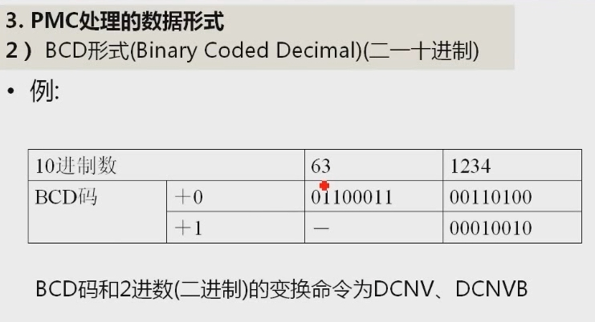

#### DCNV（資料轉換，SUB 14）

DCNV 可將二進制碼轉換成 BCD 碼，也可將 BCD 碼轉換成二進制碼。

控制條件（由下往上依序為 ACT、RST、CNV、BYT）：

- **BYT**：指定資料大小。BYT = 0 處理 1 位元組（8 位）；BYT = 1 處理 2 位元組（16 位）。
- **CNV**：指定轉換類型。CNV = 0 將二進制碼轉換為 BCD 碼；CNV = 1 將 BCD 碼轉換為二進制碼。
- **RST**：復位。RST = 0 解除復位；RST = 1 復位錯誤輸出線圈 W1（即 W1 = 1 時置 RST = 1，則 W1 = 0）。
- **ACT**：執行指令。ACT = 0 不轉換，W1 不變；ACT = 1 進行資料轉換。

指令之後還要指定兩個參數：**輸入資料位址**與**轉換結果輸出位址**。

錯誤輸出 W1：

- W1 = 0：正常。
- W1 = 1：轉換出錯。被轉換資料應為 BCD 資料而實際是二進制資料時，或二進制資料轉換為 BCD 資料時超過預先指定的資料大小（位元組長度）時，W1 = 1。

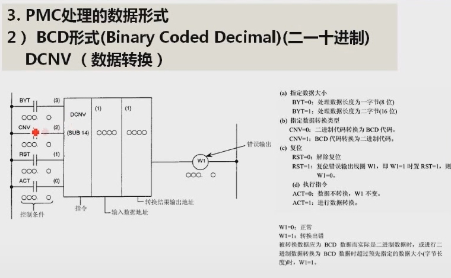

#### DCNVB（擴展資料轉換，SUB 31）

DCNVB 是擴展的資料轉換，除了互相轉換之外，還能**表示 BCD 碼的正負**，並可指定資料的位元組長度。

控制條件：SIN、CNV、RST、ACT。

- **SIN**：被轉換資料的符號。SIN 只在把 BCD 碼轉換成二進制碼時有意義，表示 BCD 碼資料的符號；在二進制轉換為 BCD 時雖然沒有意義，但不能省略。SIN = 0：輸入資料（BCD 碼）為正；SIN = 1：輸入資料（BCD 碼）為負。
- **CNV**：CNV = 0 二進制碼轉換為 BCD 碼；CNV = 1 BCD 碼轉換為二進制碼。
- **RST**：RST = 0 解除復位；RST = 1 復位錯誤輸出線圈 W1，即使 W1 = 0。
- **ACT**：ACT = 0 資料不轉換，W1 不變；ACT = 1 進行資料轉換。

指令之後的三個參數：

1. **格式指定**：指定資料長度，可為 1、2 或 4 位元組（在參數的第 1 位指定位元組長度）。
2. **輸入資料位址**：指定存放輸入資料的位址。
3. **轉換結果輸出位址**：指定轉換為 BCD 或二進制形式的資料的輸出位址。

運算結束後，結果會設置到寄存器 R9000。二進制資料轉換為 BCD 資料時，正 / 負符號參見 R9000：其中一位表示溢出（資料超過了指定的位元組數），另一位表示負。

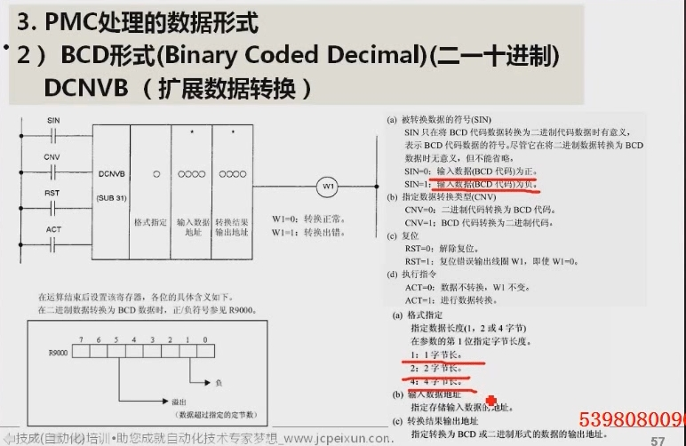

### 2.3 位元型（Bit）

處理 1 位元信號和資料時，在位址之後以小數點指定**位元號**。

| 位址 | #7 | #6 | #5 | #4 | #3 | #2 | #1 | #0 |
| --- | --- | --- | --- | --- | --- | --- | --- | --- |
| xxxxx |  |  |  |  |  |  |  |  |

- 例：`X0001.2`（位址 X0001 的位元 2）。
- 位元從右往左數：最右邊是第 0 位，接著是第 1 位、第 2 位，最高為第 7 位。
- 可以以位元為單位，讀寫資料表等的部分數值資料。

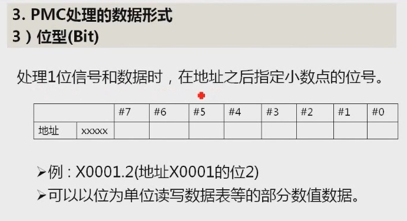

至此，「三、PMC 元件」與「PMC 處理的資料形式」全部講完。

---

## 三、I/O Link 位址分配

本節從四個方面講解：

1. FANUC 常用的 I/O 裝置
2. 硬體連接
3. 名稱的設定
4. I/O Link 的軟體設定

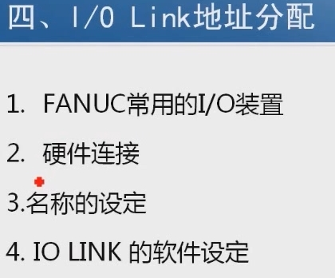

### 3.1 FANUC 常用的 I/O 裝置

常見的 I/O 裝置包括：分線盤 I/O、I/O UNIT-MODEL A、具有 I/O Link 介面的 I/O Link 軸（伺服單元）、0iC 用 I/O 單元、操作面板用 I/O 單元、機床操作面板。

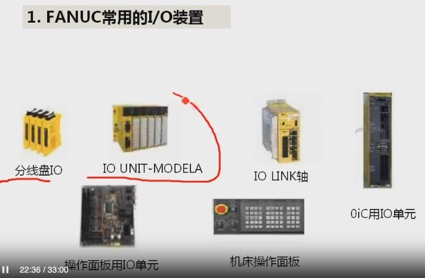

#### （1）機床操作面板（標準型）

FANUC 標準型機床操作面板，帶有矩陣開關和 LED 顯示：面板上有許多按鈕與開關，每個按鈕上有指示燈（LED 顯示）。

- 信號點數：輸入 / 輸出 = **96 / 64**。

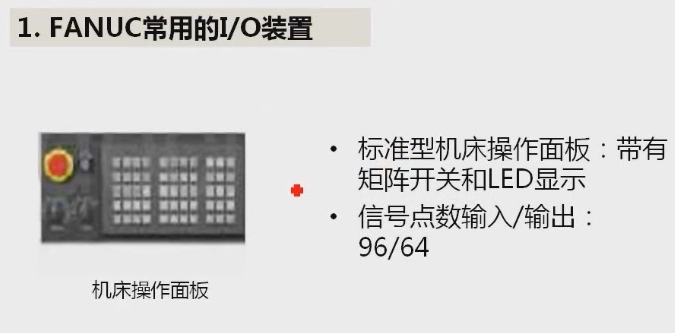

#### （2）通用操作面板 I/O 單元（操作面板用 I/O 單元）

標準操作面板之外，若想節省成本，也可以自己製作操作面板；自製面板就必須使用這種通用操作面板 I/O 單元。

- 可用於連接用戶自製的各種機床面板，帶一個可連接**三個手輪**的介面。
- 在 FANUC 0i 系統上常見。
- 輸入輸出點數：**48 / 32**。

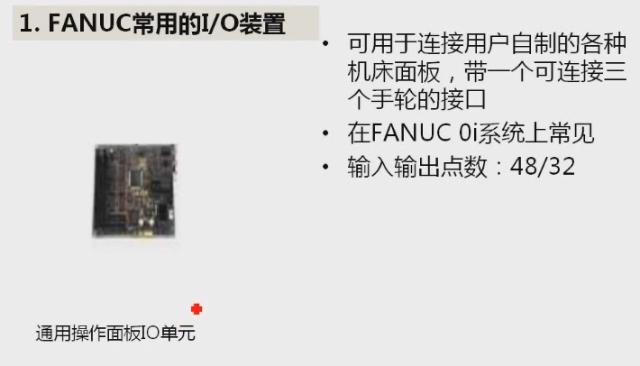

#### （3）0iC 用 I/O 單元

0iC 取消了內置的 I/O 卡，只使用 I/O 單元。這是一種通用的機床開關 I/O 單元，有外殼，可以單獨佈置。

- 輸入輸出點數：**96 / 64**。

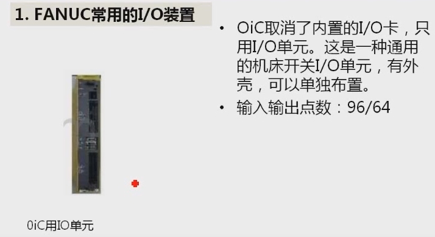

#### （4）分線盤 I/O

分線盤 I/O 是一種分散型的 I/O 模塊，能適應機床強電電路輸入、輸出信號任意組合的要求。

- 由一個基本單元和最多三個擴展單元組成。
- 且具有模擬量輸入功能。
- 輸入輸出點數：**96 / 64**。

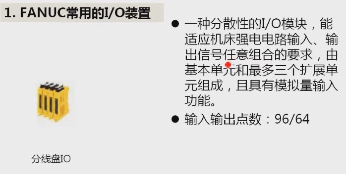

#### （5）I/O Link 軸（β 系列伺服單元）

使用 β 系列 SVU（帶 I/O Link），可以通過 PMC 外部信號來控制伺服電機進行定位。

- 輸入輸出點數：**128 / 128**。

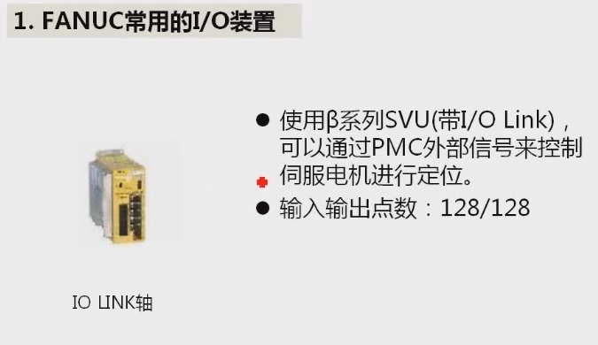

### 3.2 硬體連接

系統所連接的 I/O 單元，硬體連接之後，其**物理位址**要如何確定？靠三個參數：**組（Group）**、**基座（Base）**、**槽（Slot）**。設定了這三個值，就能知道它在物理上對應的是哪個設備。

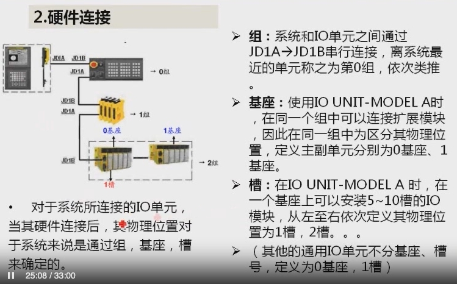

圖中的連接順序依序為：第 0 組、第 1 組（分線盤 I/O）、第 2 組（I/O UNIT-MODEL A，含 0 基座與 1 基座，模塊從 1 槽起算）。

#### 組（Group）

系統與各 I/O 單元之間透過 I/O Link 匯流排串聯連接，I/O Link 的介面是 **JD1A、JD1B**。

- 離系統最近的一個單元為**第 0 組**。
- 從第 0 組的 JD1A / JD1B 接出去的，是**第 1 組**。
- 從第 1 組的 JD1A / JD1B 接出去的，是**第 2 組**，依此類推，後面還可以繼續連接。

#### 基座（Base）

基座主要用於 I/O UNIT-MODEL A。同一個組裡可以連接擴展模塊，為了區分同一組內的物理位置，定義：主單元為 **0 基座**，擴展單元為 **1 基座**。

其他通用 I/O 單元不分基座、槽號，一律定義為 **0 基座、1 槽**。

#### 槽（Slot）

在 I/O UNIT-MODEL A 中，一個基座可以安裝 5 個或 10 個槽的 I/O 模塊，槽由左往右依序編號：第 1 槽、第 2 槽、第 3 槽、第 4 槽……

> **重點**：**組**從 0 開始，**基座**也從 0 開始，但**槽沒有第 0 槽，一定從第 1 槽開始**。

舉例（依上圖）：

| 設備 | 組 | 基座 | 槽 |
| --- | --- | --- | --- |
| 第 0 組的單元（通用 I/O 單元，不分基座和槽） | 0 | 0 | 1 |
| 第 1 組的分線盤 I/O | 1 | 0 | 1 |
| 第 2 組 MODEL A 主單元的第 1 個模塊 | 2 | 0 | 1 |
| 第 2 組 MODEL A 主單元的第 2 個模塊 | 2 | 0 | 2 |
| 第 2 組 MODEL A 擴展單元（1 基座）的第 1 個模塊 | 2 | 1 | 1 |

### 3.3 名稱的設定

組、基座、槽決定了硬體的位置之後，還要給每個硬體**分配輸入輸出的位元組數**。名稱的定義要遵循 FANUC 的規定，是依據實際硬體單元所具備的容量，給定一個名稱，就等於給定了一定大小的輸入 / 輸出位元組。

常用名稱如下：

| 名稱 | 方向 | 位元組數 |
| --- | --- | --- |
| OC01I | 輸入（I） | 12，適用於通用 I/O 單元 |
| OC02I | 輸入（I） | 16，適用於通用 I/O 單元 |
| OC03I | 輸入（I） | 32，適用於通用 I/O 單元 |
| /n | 輸入 | n（1 ~ 8），適用於通用、特殊 I/O 單元 |
| OC01O | 輸出（O） | 8，適用於通用 I/O 單元 |
| OC02O | 輸出（O） | 16，適用於通用 I/O 單元 |
| OC03O | 輸出（O） | 32，適用於通用 I/O 單元 |
| /n | 輸出 | n（1 ~ 8），適用於通用、特殊 I/O 單元 |

名稱結尾的 **I** 表示輸入，**O** 表示輸出（投影片上的「OC01O」印成了「OC010」，實際是字母 O）。

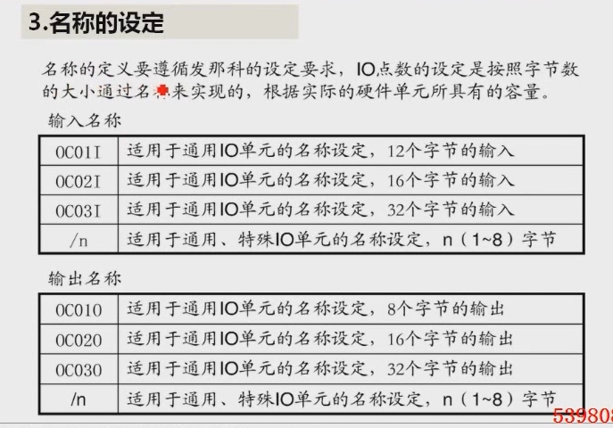

### 3.4 I/O Link 的軟體設定

I/O 裝置相關的硬體位置（組、基座、槽）確定之後，需要透過系統畫面的軟體，設定每個單元的**輸入輸出起始位址和點數**。

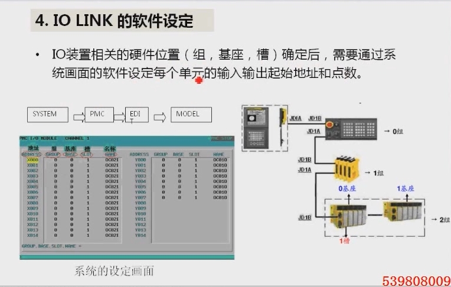

進入設定畫面（PMC I/O MODULE，CHANNEL 1）的方式：在系統上按 **SYSTEM** 功能鍵 → 軟鍵 **PMC** → 軟鍵 **EDIT**（編輯）→ 軟鍵 **MODULE**。

以操作面板為例：

- **輸入側**：以 X0 為首，給「0 組 0 基座 第 1 槽」這個設備（即操作面板）分配名稱 **OC02I**，也就是 16 個位元組的輸入位址：X0 ~ X15，這 16 個位元組全部給這塊操作面板使用。
- **輸出側**：同樣針對「0 組 0 基座 第 1 槽」的操作面板，分配名稱 **OC01O**，也就是 8 個位元組的輸出位址：Y0 ~ Y7，這 8 個位元組給標準操作面板使用。

畫面欄位依序為 ADDRESS（位址）、GROUP（組）、BASE（基座）、SLOT（槽）、NAME（名稱）。截圖中輸入側列到 X014，依 OC02I 為 16 位元組，應涵蓋 X0 ~ X15。

以上就是 I/O Link 軟體設定的做法。

---

## 本課時小結

- **C 計數器**每個佔 4 位元組（前 2 為設定值、後 2 為當前值）；**A** 存放顯示資訊字元；**K 參數**中有一批固定的管理參數（SB7 的 K900 系列）；**R9000 / R9002~R9005 / R9091** 是系統保留區，只能讀不能寫。
- PMC 資料形式：**帶符號二進制**（補碼，1 / 2 / 4 位元組，位址大者為高位）、**BCD**（每位 4 個位元，變換用 DCNV / DCNVB）、**位元型**（位址後加小數點與位號，如 X0001.2）。
- I/O Link 位址分配的流程：認識 I/O 裝置 → 以**組 / 基座 / 槽**確定硬體位置 → 以**名稱**（如 OC02I、OC01O）確定位元組數 → 在 PMC 的 MODULE 畫面設定起始位址。
- 口訣：**組、基座從 0 開始，槽從 1 開始。**
