# 第12課時 FANUC PMC 功能指令（一）

> 本課時為 FANUC 數控機床 PMC 編程課程的「第 3 講：FANUC PMC 功能指令」的第一部分，內容包括功能指令的格式、結束指令（END1 / END2 / END），以及兩種定時器指令（TMR、TMRB）。
>
> 圖片請放在與本檔同層的 `images/` 資料夾中。

## 本講目錄

1. 功能指令格式
2. 功能指令詳解
3. 功能指令綜合實例（以隨機換刀為例）

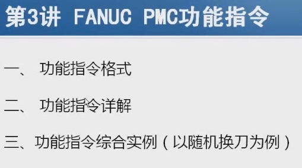

---

## 一、功能指令格式

在 PMC-SA1 / SB7 中，除了基本邏輯指令外，還有大量實現**算術運算、定時、計數、比較、程式轉移**等方面的指令。這些指令不能用普通的觸點、線圈形式表示，在梯形圖中是以**功能框**的形式出現，因此稱為「功能指令」。

編制順序程式時，有些功能很難只用執行位運算的基本指令實現。例如控制刀庫或工作台旋轉時，要判斷「往正方向轉比較近，還是往反方向轉比較近」，這種**沿更短路徑方向旋轉**的功能，用功能指令編程會方便得多。

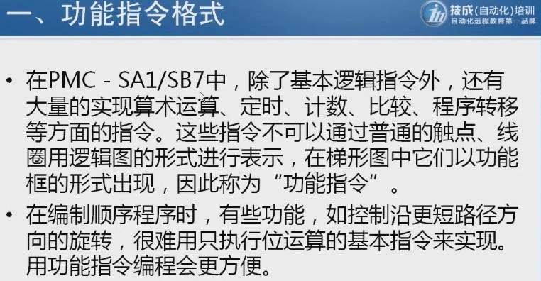

### 1.1 功能指令的組成

一條功能指令由以下幾個部分構成：

- **控制條件**（框左邊的觸點）。
- **指令代碼**（功能框內的指令名稱）。
- **參數**。
- **狀態輸出線圈 W1**（框右邊的線圈）。
- 與之相關的**功能指令操作結果寄存器**（R9000 ~ R9005）。

#### 控制條件

控制條件的**數目和意義依功能指令而變化**，有的只有一條，有的有四、五條。

其中 **RST（復位）** 有**最高優先權**：RST 與 ACT 同時存在時，ACT 是「為 1 時執行指令」，RST 是「為 1 時對指令進行復位」；即使 ACT = 0（不執行指令），只要 RST = 1，復位動作仍會執行。

#### 指令代碼

指令代碼以**助記符**的形式表示，幫助記憶。例如 TMR 是定時器指令（Timer），CTRC 是旋轉計數指令。

#### 參數

基本指令只處理「位」，而功能指令可以**處理數字值**。資料中的參考資料和位址，透過參數輸入；參數的個數和意義隨功能指令而變化，有的指令只有 1 個參數，有的有 4 個。

#### 狀態輸出線圈 W1

當功能指令的操作結果為 1 位二進制（1 或 0）時，就把結果輸出到 W1。W1 的位址由編程者自由決定，其意義依功能指令而不同。**注意：並非所有功能指令都有 W1。**

#### 功能指令操作結果寄存器

PMC 的特殊內部繼電器 **R9000 ~ R9005**，是算術運算或比較指令的運算結果狀態輸出寄存器，用來存放算術運算指令的結果與中間結果，以及除法運算的餘數等。

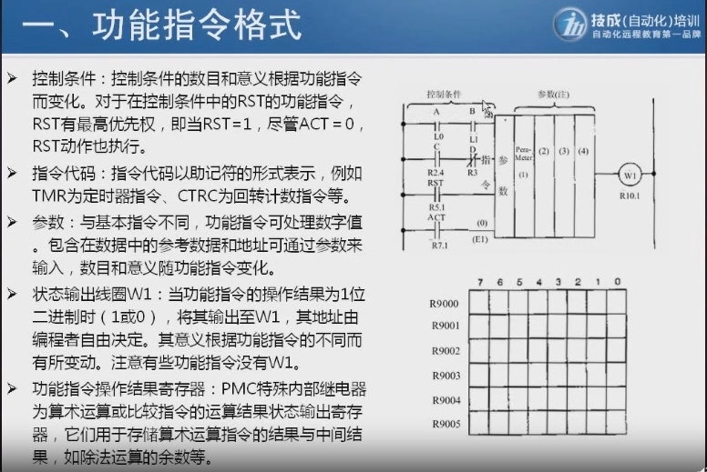

### 1.2 功能指令要處理的資料

功能指令處理的資料有三種：**位、BCD 碼、二進制碼**。

#### BCD 碼資料

以 BCD 碼形式處理的資料有 **1 個位元組（0 ~ 99，兩位 BCD）** 或 **2 個位元組（0 ~ 9999，四位 BCD）**。

示例：BCD 碼資料 1234 儲存到位址 R250 和 R251 中（要用 2 個位元組）：

| 位址 | 位元 #7 ~ #4 | 位元 #3 ~ #0 | 表示 |
| --- | --- | --- | --- |
| R250 | 0011 | 0100 | 3、4 |
| R251 | 0001 | 0010 | 1、2 |

**注意**：由功能指令指定較小的位址 R250，**低位數位輸入到小的位址中**，也就是個位（4）放在 R250 的最低 4 位。

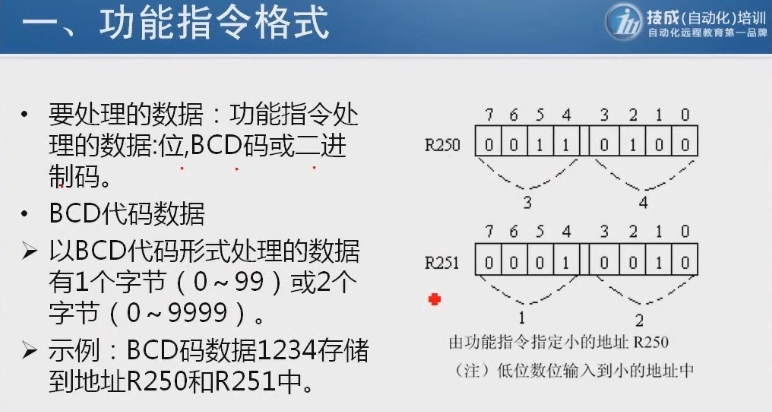

#### 二進制碼資料

二進制碼資料有 **1 位元組、2 位元組和 4 位元組** 三種。

| 長度 | 範圍 | 位址（以 R200 起算） |
| --- | --- | --- |
| 1 位元組 | -128 ~ +127 | R200：#7 為符號位（0 正、1 負），#6 ~ #0 為數值 |
| 2 位元組 | -32768 ~ +32767 | R200（2⁷ ~ 2⁰）、R201（#7 為符號位，2¹⁴ ~ 2⁸） |
| 4 位元組 | -2147483648 ~ +2147483647 | R200 ~ R203，R203 的 #7 為符號位，其餘為數值 |

**符號位一律在最高位元組的第 7 位**：2 位元組資料的符號位在 R201 的 #7，4 位元組資料的符號位在 R203 的 #7；其餘各位都表示數值大小。透過功能指令指定較小的位址 R200，即可處理整組資料。

> 註：投影片上 4 位元組資料的範圍印成「-99999999 ~ +99999999」，這與 4 位元組二進制的實際範圍不符；4 位元組帶符號二進制為 -2147483648 ~ +2147483647（見第 11 課時），這裡以後者為準。

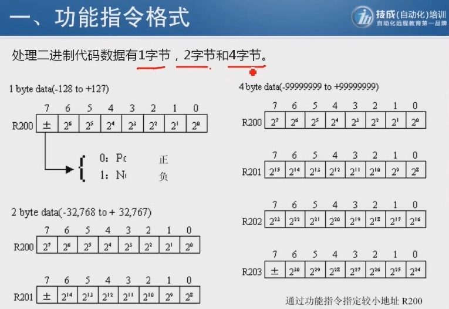

#### 負值與補碼

- 負值透過**二進制補碼**確定。
- 當功能指令處理的資料為 2 位元組或 4 位元組時，功能指令參數中給出的位址**最好是偶數位址**，偶數位址會略微減少功能指令的執行時間。
- 補碼：正數的補碼與原碼相同；負數的補碼是將其原碼**逐位取反（符號位除外），然後整個數加 1**。

投影片上的例子（1 位元組）：

| 十進制 | 二進制 |
| --- | --- |
| +1 | 0000 0001 |
| -1 | 1111 1111 |
| +127 | 0111 1111 |
| -127 | 1000 0001 |

- **-1**：+1 為 `0000 0001`，除符號位外逐位取反得 `1111 1110`，再加 1 得 `1111 1111`。
- **-127**：+127 為 `0111 1111`，除符號位外取反得 `0000 0000`（符號位仍為 1，即 `1000 0000`），再加 1 得 `1000 0001`。

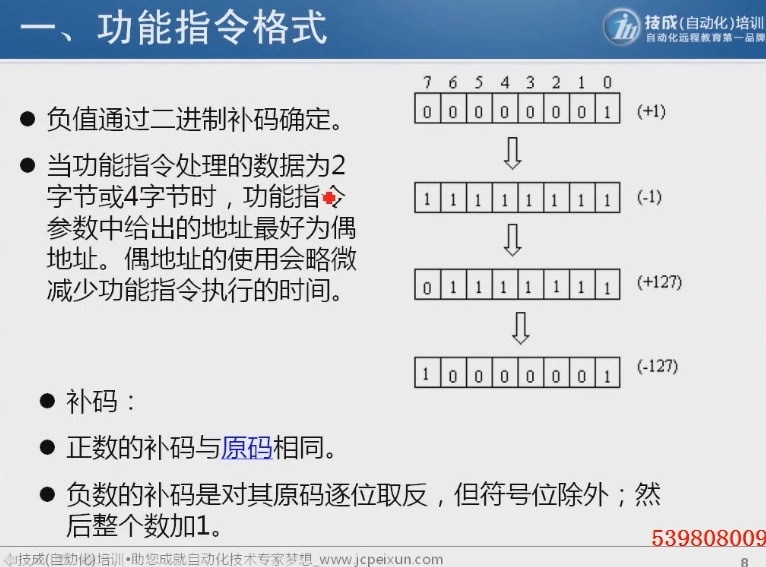

### 1.3 功能指令計算結果寄存器（R9000 ~ R9005）

有些功能指令的結果存放在 R9000 ~ R9005 中，使用時要注意：

- 功能指令執行完畢後，應**立即查看**寄存器的資訊，否則在下一個功能指令執行完畢後，前一條指令的資訊就會丟失。
- 寄存器的計算資訊**不能在順序程式的不同級別中傳送**（例如第一級程式輸出的結果，不能傳到第二級程式去用）。
- 寄存器的計算結果可以保存到**同一級別的下一個功能指令執行完畢為止**。
- 其中的資訊依功能指令的不同而有所區別。它可以被順序程式**讀出，但不能被寫入**。

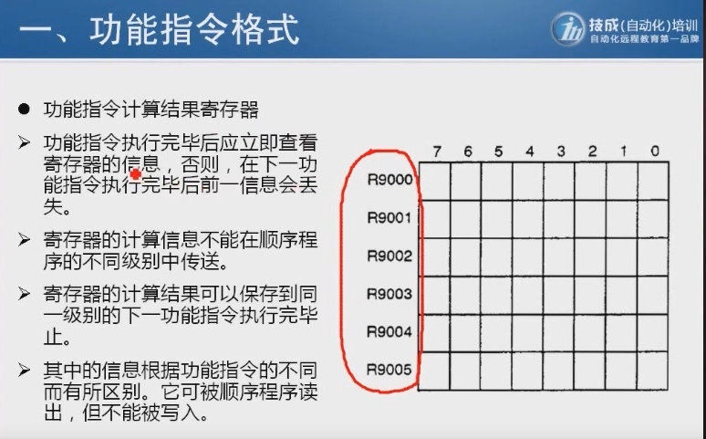

<!-- chs12_08.jpg 未在本次上傳中，若有對應投影片請補傳後插入於此 -->

---

## 二、功能指令詳解

下面一個一個功能指令來講解它是怎麼用、怎麼編的。

### 2.1 結束指令：END1（SUB 1）、END2（SUB 2）、END（SUB 64）

PMC 程式是分級執行的：

- **第一級程式**：快速執行程式區，**每 8 ms 掃描一次**。
- **第二級程式**：系統會依第二級程式的長短分成若干段（分割 1、分割 2 ……分割 n），**每 8 ms 順序執行一段**，為主程式區。
- 從時序圖看，每個 8 ms 週期內，先用約 1.25 ms 執行第一級程式，其餘時間執行第二級程式的一個分割段（以及 NC 本身使用的時間）。

三個結束指令：

| 指令 | 功能指令號 | 作用 |
| --- | --- | --- |
| END1 | SUB 1 | 第一級 PMC 程式區結束指令 |
| END2 | SUB 2 | 第二級 PMC 程式區結束指令 |
| END | SUB 64 | PMC 程式整體結束指令；END 和 END2 之間是子程式區 |

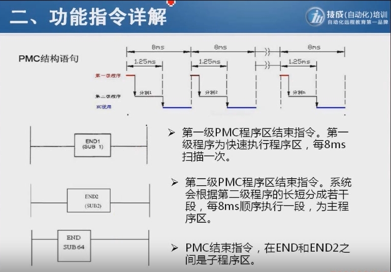

### 2.2 定時器指令 TMR（SUB 3）

**TMR** 取自 Timer，是**延時定時器**（接通延時）。

- **ACT = 1**：啟動定時器，開始計時；設定時間到時，輸出 **W1** 接通。
- **ACT = 0**：斷開定時器（時間繼電器），W1 也隨之斷開。
- 若計時還沒到，ACT 就斷開了，則定時器不計時，W1 始終不會接通。

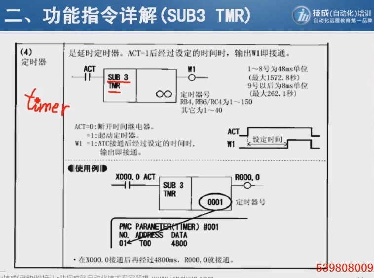

#### 定時器號與設定時間

- 指令中指定的是**定時器號**；設定時間不在程式裡，而是存放在 **PMC 參數（TIMER）** 中，可以在系統畫面上設定。每個定時器佔用 **2 個位元組**（T000、T002、T004 ……）。
- 定時器號範圍：PMC-RB4、RB6 / RC4 為 1 ~ 150，其他機型為 1 ~ 40。
- **精度**：
  - **1 ~ 8 號**：以 **48 ms** 為單位（最大 1572.8 秒）。
  - **9 號以後**：以 **8 ms** 為單位（最大 262.1 秒）。
- 因此，設定值必須是精度單位的整數倍，**餘數會被捨去**。例如 1 ~ 8 號定時器輸入 5000，實際會變成 4992（= 48 × 104）。

#### 範例

X000.0 作為 ACT，使用 1 號定時器，輸出 R000.0。在 PMC 參數 TIMER 的 #001 中（位址 T00）設定資料為 4800，單位是 ms：

- X000.0 接通後，經過 **4800 ms（4.8 秒）**，R000.0 就接通。
- X000.0 在 4.8 秒之前就斷開，R000.0 始終不會接通；超過 4.8 秒才斷開，R000.0 在 4.8 秒時接通，並在 X000.0 斷開時隨之斷開。

### 2.3 實機實驗：TMR 定時器

實驗目標：用操作面板上一個系統沒有使用的按鈕 **X27.4** 作為 TMR 的 ACT，輸出到 **Y27.4**（對應面板上的指示燈），使用 **1 號定時器**。

**（1）在 FANUC LADDER-III 中編寫梯形圖**

輸入功能指令時選擇 TMR，ACT 條件填 X0027.4，定時器號填 0001，輸出填 Y0027.4；程式結尾為 SUB2（END2）。

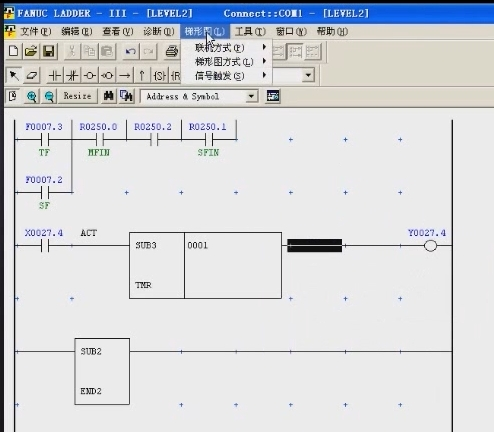

**（2）把梯形圖載入機床**

將程式傳輸到機床後，PMC 會先停止，需要再讓 PMC 運行。

**（3）在機床上設定定時器時間**

定時器的時間要到機床的 PMC 參數畫面去設定。畫面如下：

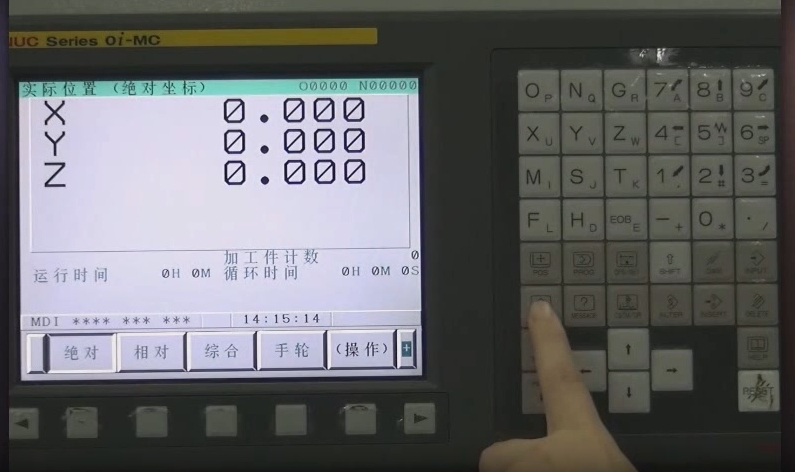

按 **SYSTEM** 功能鍵，再按軟鍵 **PMC**：

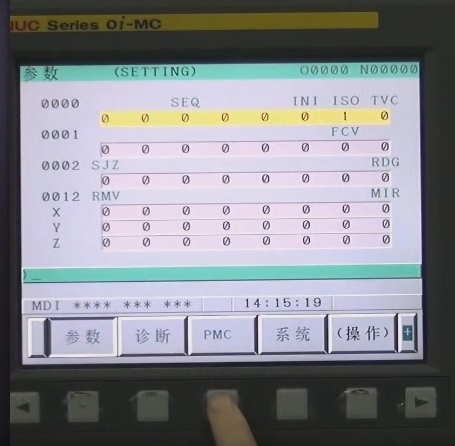

進入 PMC 控制系統選單（PMC CONTROL SYSTEM MENU）：

| 軟鍵 | 功能 |
| --- | --- |
| PMCLAD | 梯形圖 |
| PMCDGN | 診斷功能 |
| PMCPRM | 參數（T / C / K / D） |
| RUN/STOP | 運行 / 停止順序程式 |
| EDIT | 編輯功能 |
| I/O | I/O 順序程式 |
| SYSPRM | 系統參數 |
| MONIT | PMC 監視 |

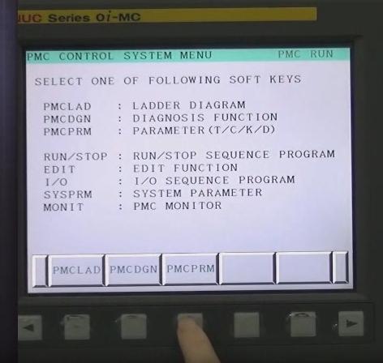

選擇 **PMCPRM**，再選 **TIMER**，進入定時器參數畫面（NO. 001 起，位址 T000、T002 ……）。設定前資料均為 0：

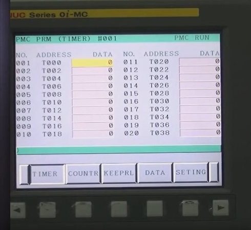

在 1 號定時器輸入 5000（毫秒），輸入後畫面顯示的卻是 **4992**。原因就是 1 ~ 8 號定時器以 48 ms 為單位，5000 的餘數被捨去：

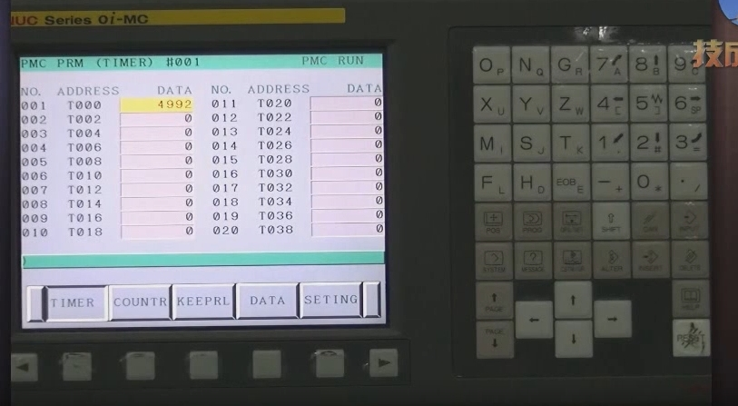

回到 LADDER-III 線上顯示，功能框內也顯示 `4992`，與參數畫面一致：

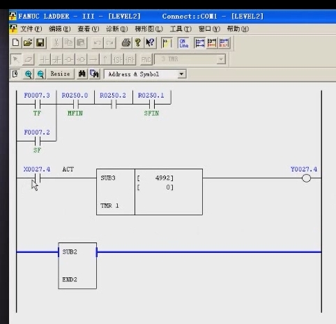

**（4）操作驗證**

按住操作面板上的 **X27.4** 按鈕，X27.4 接通並開始計時，時間一到 **Y27.4** 接通，對應按鈕上方的指示燈亮起。如果在時間到之前就放開按鈕，指示燈不會亮。

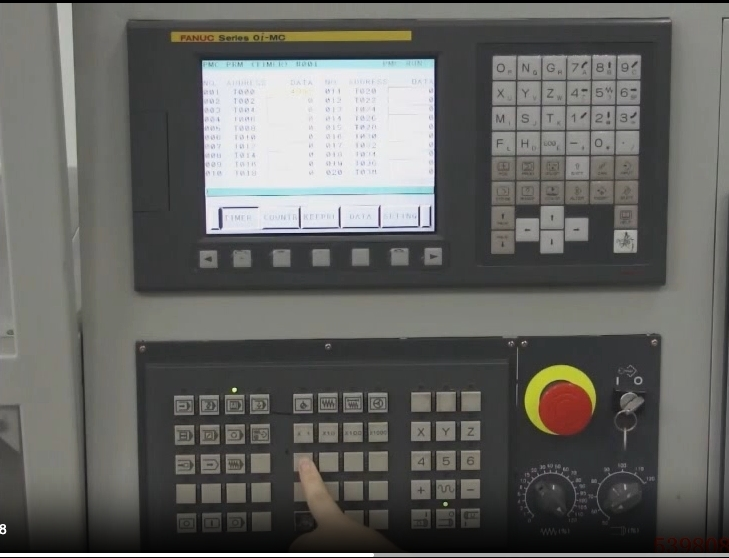

### 2.4 固定定時器 TMRB（SUB 24）

**TMRB** 是**固定定時器**，名稱後面的 B 表示「固定」。

- 設定時間是固定的延時時間，由**功能指令的參數直接指定**，不是放在 PMC 參數畫面中。
- **ACT = 0**：斷開時間繼電器。**ACT = 1**：啟動定時器。
- **W1 = 1**：在 ACT 接通後經過設定時間，輸出接通。
- **定時器號**：1 ~ 100（與 TMR 的定時器號互不相關）。
- **設定時間**：以 ms 為單位的十進制數，最大 262136。

範例：X000.0 為 ACT，指令 SUB24 TMRB，定時器號 001，設定時間 5000，輸出 R000.0。X000.0 接通後經過 **5 秒**，R000.0 接通。

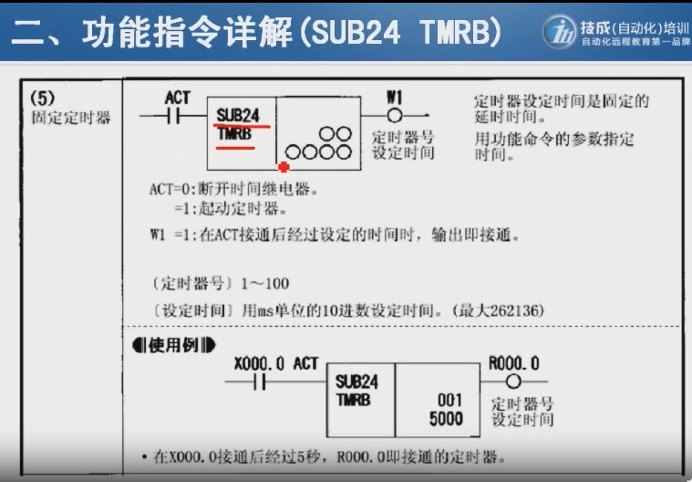

#### 實機實驗：TMRB

同樣以 X27.4 為執行條件、Y27.4 為輸出，指令改為 SUB24 TMRB，定時器號 1，設定時間 3000（毫秒，即 3 秒）。梯形圖如下，功能框內第二個參數 `0000003000` 就是設定時間：

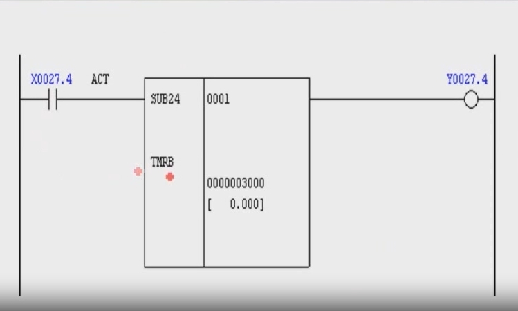

在 FANUC LADDER-III 中的畫面：

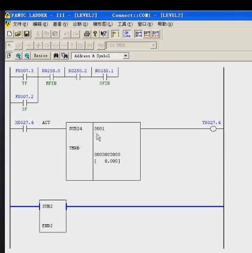

傳輸程式時 PMC 會停止，需重新運行；按住 X27.4 三秒後，Y27.4 接通，指示燈亮起。這個時間寫在梯形圖裡，在 PMC 參數畫面中是看不到的（畫面上的 TIMER 資料仍然是 0）。

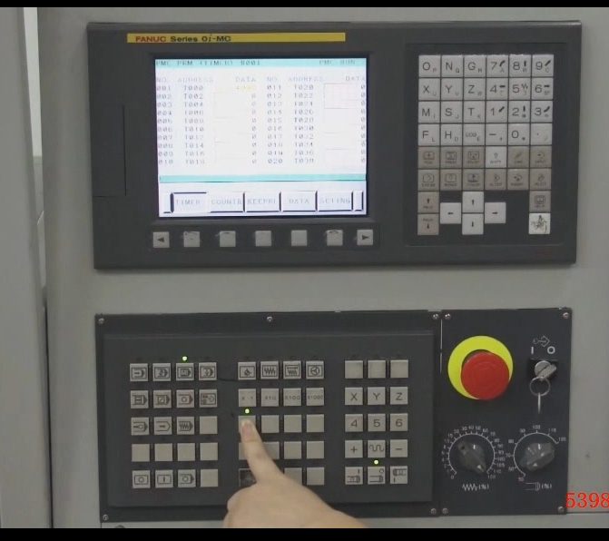

### 2.5 TMR 與 TMRB 的比較

| 項目 | TMR（SUB 3） | TMRB（SUB 24） |
| --- | --- | --- |
| 設定時間存放處 | PMC 參數（TIMER）畫面，即 MDI 畫面上設定 | 功能指令的參數，在梯形圖程式裡（例如 300 即 300 ms） |
| 修改方式 | 在機床上直接改參數即可 | 預置時間隨順序程式固化在 ROM 中，只有修改並重新寫入 ROM 檔案才能更改 |
| 精度 | 1 ~ 8 號 48 ms；9 號以後 8 ms | 以 ms 為單位的十進制數 |
| 定時器號 | 1 ~ 40（RB4、RB6 / RC4 為 1 ~ 150） | 1 ~ 100，與 TMR 的號碼無關 |

投影片上的對照範例：TMR 的設定在 PMC PRM（TIMER）畫面（NO.、ADDRESS、DATA 三欄，1 ~ 8 號精度 48 ms、9 號起精度 8 ms）；TMRB 的範例是 `SUB 24 TMRB`，定時器號 1、時間 300 ms，輸出 R0231.1。

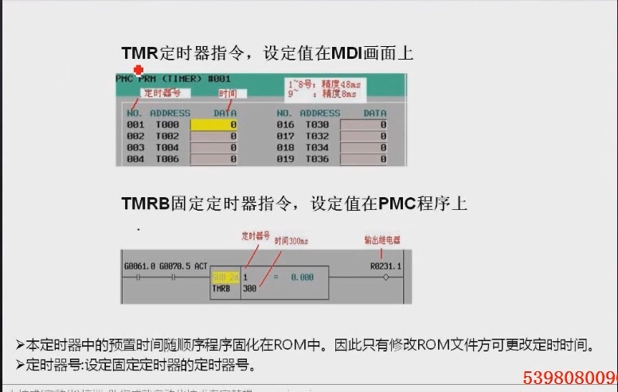

---

## 三、綜合例：定時器間歇打油（潤滑）應用

**控制要求**：

1. 每次開機，**自動打油 15 秒**。
2. 正常時**自動打油 30 秒，間歇 30 分鐘**（即每隔 30 分鐘打一次，每次 30 秒）。
3. 可**手動打油**（按住手動鍵就出油）。

自動打油時（上面第 1、2 種），每次出油的方式是**打 2.5 秒、停 2.5 秒**，間歇進行，並不是一直出油。

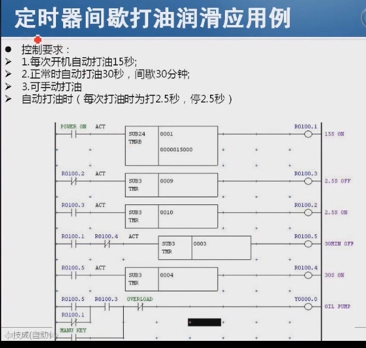

### 梯形圖逐條說明

| 梯級 | 條件（ACT） | 指令 | 輸出 | 說明 |
| --- | --- | --- | --- | --- |
| 1 | POWER ON | SUB 24 TMRB，定時器號 0001，時間 15000 | R0100.1 | 開機後固定定時 15 秒，到時 R0100.1 接通（標示 15S ON） |
| 2 | R0100.2 常閉 | SUB 3 TMR，定時器號 0009 | R0100.3 | 閃爍用定時器一（標示 2.5S OFF） |
| 3 | R0100.3 常開 | SUB 3 TMR，定時器號 0010 | R0100.2 | 閃爍用定時器二（標示 2.5S ON） |
| 4 | R0100.1 常開、R0100.4 常閉 | SUB 3 TMR，定時器號 0003 | R0100.5 | 開機打油結束後起算 30 分鐘間歇（標示 30MIN OFF） |
| 5 | R0100.5 常開 | SUB 3 TMR，定時器號 0004 | R0100.4 | 間歇結束後打油 30 秒（標示 30S ON） |
| 6 | 見下 | —— | Y0000.0 | 油泵輸出（OIL PUMP） |

#### 開機 15 秒（梯級 1）

用 **TMRB** 固定定時器（時間 15000 ms 寫在程式裡），開機後計時；15 秒內 R0100.1 為 0，所以「打油」的條件用 **R0100.1 的常閉觸點**。

#### 閃爍信號（梯級 2、3）

用**兩個 TMR 交叉串接**做出週期性的閃爍信號：

- 定時器一（9 號）的條件是 **R0100.2 的常閉觸點**，輸出 **R0100.3**。
- 定時器二（10 號）的條件是 **R0100.3 的常開觸點**，輸出 **R0100.2**。

動作過程：R0100.2 = 0 時，9 號開始計時，到時 R0100.3 接通；R0100.3 接通後，10 號開始計時，到時 R0100.2 接通，這使 9 號失去條件、R0100.3 斷開，進而 10 號也失去條件、R0100.2 斷開，隨後重複。結果 R0100.3 就是一個「接通一段時間、斷開一段時間」的閃爍信號，接通和斷開的時間由 9 號、10 號定時器的設定值決定。

9 號以後的 TMR 精度為 8 ms，所以這兩個閃爍定時器的時間可以設得比較精確。

#### 正常打油：間歇 30 分鐘、打 30 秒（梯級 4、5）

同樣是兩個定時器交叉串接的振盪電路，只是時間長得多：

- 3 號定時器的條件是 **R0100.1 常開**（開機打油已結束）串 **R0100.4 常閉**，輸出 **R0100.5**，作為間歇 30 分鐘的計時；
- 4 號定時器的條件是 **R0100.5 常開**，輸出 **R0100.4**，作為打油 30 秒的計時；R0100.4 接通後會使 3 號斷開，進而使 R0100.5 斷開、4 號斷開，如此循環。

#### 油泵輸出（梯級 6）

Y0000.0 的條件（依投影片）：

- **（R0100.5 或 R0100.1 的常閉）串 R0100.3**：開機 15 秒內（R0100.1 常閉成立）或正常打油時（R0100.5 接通），都由閃爍信號 R0100.3 控制油泵間歇出油；
- **MANU KEY（手動鍵）** 與之並聯：按住手動鍵就出油；
- 最後串 **OVERLOAD（過載）常閉**：油泵過載時斷開輸出。

### 實機驗證

為了方便觀察，實機上把定時器設定值設得比較短。TIMER 參數畫面中各定時器的設定值如下：

| 定時器號 | 設定值（ms） | 精度換算 | 對應用途 |
| --- | --- | --- | --- |
| 001 | 4992 | 48 × 104 | 開機自動打油的固定時間（約 5 秒） |
| 003 | 9984 | 48 × 208 | 間歇時間（約 10 秒） |
| 004 | 4992 | 48 × 104 | 打油時間（約 5 秒） |
| 009 | 496 | 8 × 62 | 閃爍用定時器一（約 0.5 秒） |
| 010 | 496 | 8 × 62 | 閃爍用定時器二（約 0.5 秒） |

可以看到，1 ~ 8 號的設定值都是 48 的倍數，9 號以後都是 8 的倍數，輸入值的餘數都被捨去了。

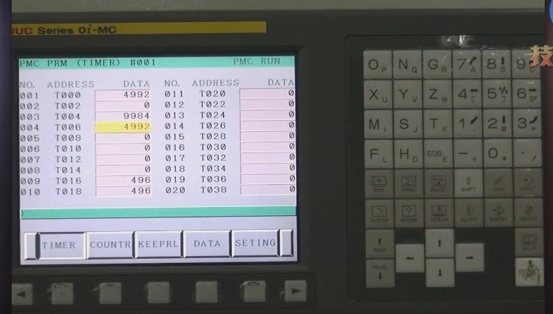

設定完成後，到操作面板操作對應按鈕，觀察 Y 輸出指示燈依設定的時間間歇亮滅：

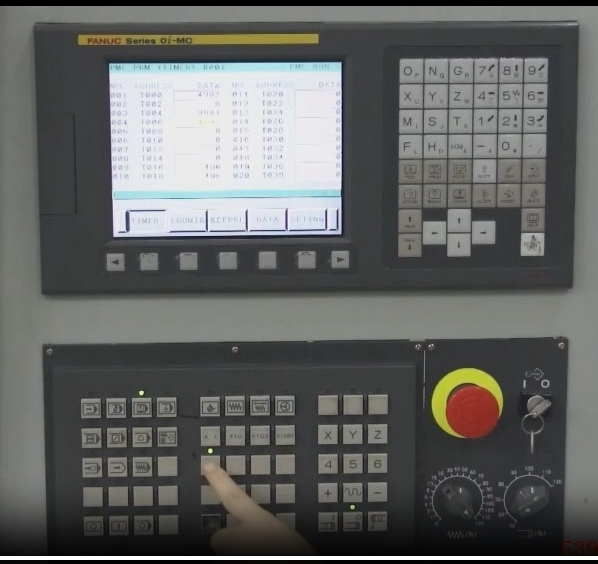

> 註：投影片梯形圖中的定時器號與逐字稿中提到的號碼略有出入，實機畫面上的設定值也是縮短後的測試值，以上均以投影片和畫面為準；展示中各定時器分別對應投影片的哪一個號碼，逐字稿辨識不清，未逐一確認。

---

## 本課時小結

- 功能指令由**控制條件、指令代碼、參數、W1、結果寄存器**構成；RST 優先權最高。
- 資料形式：**BCD**（低位放小位址）、**二進制**（1 / 2 / 4 位元組，符號位在最高位元組 #7，負數用補碼，2 / 4 位元組最好用偶數位址）。
- R9000 ~ R9005 只能讀不能寫，執行完指令要立刻查看，且不能跨級傳送。
- PMC 分級執行：第一級每 8 ms 掃描一次（END1）；第二級分段執行（END2）；整個程式結束用 END（SUB 64）。
- **TMR（SUB 3）**：時間在 PMC 參數畫面設定，1 ~ 8 號精度 48 ms，9 號起 8 ms，餘數捨去。
- **TMRB（SUB 24）**：時間寫在指令參數裡，預置時間固化在 ROM，改時間要改程式。
- **間歇打油例**：TMRB 管開機 15 秒；兩個 TMR 交叉串接產生閃爍信號；再用兩個 TMR 做「間歇 30 分鐘、打 30 秒」的循環，最後在 Y 輸出與手動鍵、過載保護合成。
