# 第13課時 FANUC PMC 功能指令（二）

> 本課時接續第 12 課時，繼續講解「功能指令詳解」：第三種定時器 **TMRC（SUB 54，可變定時器）**，以及 **DEC（SUB 4）** 與 **DECB（SUB 25）** 兩種譯碼指令，最後開始講 **CTR（SUB 5，計數器）**。章節編號 (6) ~ (9) 沿用投影片。
>
> 圖片請放在與本檔同層的 `images/` 資料夾中。

## 本課時目錄

1. (6) 可變定時器 TMRC（SUB 54）
2. (7) 譯碼處理 DEC（SUB 4）
3. (8) 二進制譯碼 DECB（SUB 25）
4. (9) 計數器 CTR（SUB 5）

---

## 一、(6) 可變定時器 TMRC（SUB 54）

TMRC 是第三種定時器：**可變定時器**。它利用**資料表（D 位址）**來設定定時器的時間。

### 1.1 指令格式

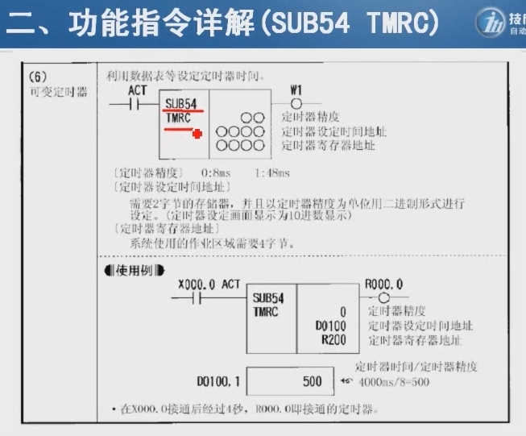

- **ACT**：執行條件。ACT = 1 時開始計時。
- **W1**：時間到時接通。
- 三個參數：

| 參數 | 內容 | 說明 |
| --- | --- | --- |
| 第 1 個 | 定時器精度 | 0：8 ms；1：48 ms |
| 第 2 個 | 定時器設定時間位址 | 需要 **2 位元組**的存儲器，並以定時器精度為單位，用**二進制形式**設定（定時器設定畫面顯示為 10 進制） |
| 第 3 個 | 定時器寄存器位址 | 系統使用的作業區域，需要 **4 位元組** |

**注意**：這裡的精度與前面 TMR 的不同。TMR 的 1 ~ 8 號精度固定是 48 ms；而 TMRC 的精度可以由第 1 個參數指定。

**實際時間 = 設定值 × 精度**：

- 精度設為 0（8 ms）：設定值 2 → 2 × 8 = 16 ms。
- 精度設為 1（48 ms）：設定值 2 → 2 × 48 = 96 ms。

**定時器寄存器**用的 4 個位元組是 PMC 內部運算需要的，所以一旦被 TMRC 指令使用，這 4 個位元組就不能再作其他用途。

### 1.2 範例

X000.0 為 ACT，精度設為 0（8 ms），設定時間放在 D0100，定時器寄存器位址為 R200，輸出 R000.0：

```text
 X000.0  ACT
 ──┤ ├──────[SUB 54 TMRC]
                 0        ← 定時器精度（0：8 ms）
                 D0100    ← 定時器設定時間位址
                 R200     ← 定時器寄存器位址（R200 ~ R203，系統使用）
                                              ──────( R000.0 )
```

- D0100 中設定 **500**，則設定時間為 500 × 8 = **4000 ms = 4 秒**。
- X000.0 接通後經過 4 秒，R000.0 接通。
- R200 ~ R203 這 4 個位元組由系統使用，不能再拿來做別的。

助記符形式：

```text
RD       X0000.0
SUB      54
PRM      0
PRM      D0100
PRM      R0200
WRT      R0000.0
```

### 1.3 實機實驗

實驗目標：X27.4 為 ACT，輸出 Y27.4，精度設為 0，設定時間位址 D0100，寄存器 R0100（R0100 ~ R0103）。

**（1）編寫梯形圖**

在 FANUC LADDER-III 中選用 54 TMRC：第 1 個參數 0（8 ms 精度）、第 2 個參數 D0100、第 3 個參數 R0100。

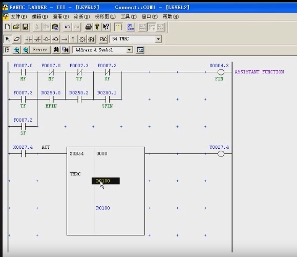

**（2）設定 D 資料表為 2 位元組**

因為設定時間要用 **2 位元組**，所以必須先把資料表（D）設成 2 位元組。進入方式：SYSTEM → PMC → PMCPRM，然後按軟鍵 **DATA**：

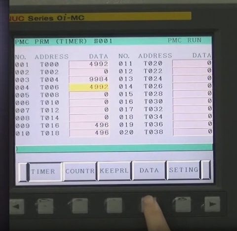

接著進入資料表控制畫面（**G.CONT**，PMC DATA TBL CONTROL）。畫面上的 **TYPE** 欄：

- **0**：1 位元組。
- **1**：2 位元組。

把 TYPE 設為 **1**（2 位元組）。畫面上 NO. OF DATA 為 5000，位址從 D0000 開始：

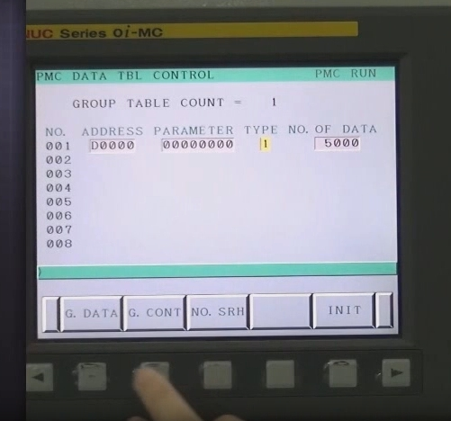

設為 2 位元組後，資料表中每個資料佔 2 個位址：第一個是 D0000，下一個是 D0002、D0004 ……

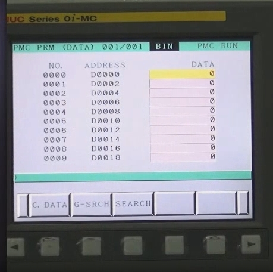

**（3）在 D0100 寫入設定值**

找到 D0100（NO.0050）並輸入 **500**：

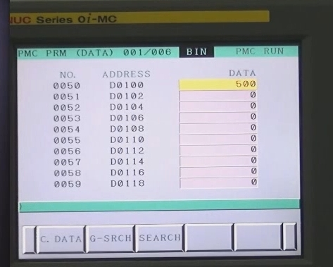

由於精度為 0（8 ms），延時時間 = 500 × 8 = 4000 ms = **4 秒**。

**（4）操作驗證**

按住操作面板上的 X27.4 按鈕，**4 秒後** Y27.4 指示燈延時接通。

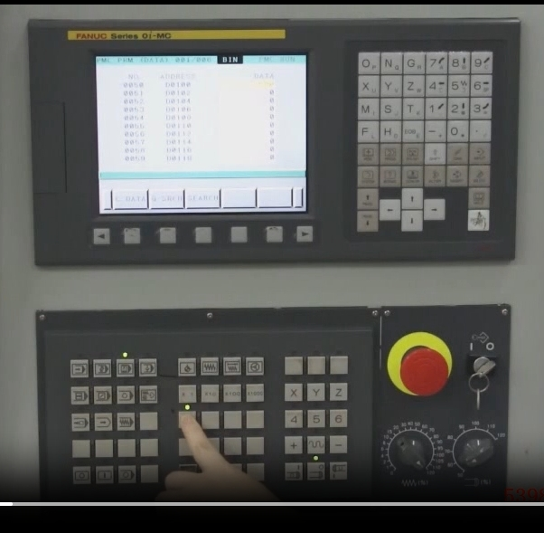

### 1.4 用 PMC 狀態畫面監控信號

除了觀察指示燈，也可以到 PMC 的**狀態（STATUS）畫面**監控 X、Y、F、G、D、R 等信號的狀態。

進入方式：SYSTEM → PMC：

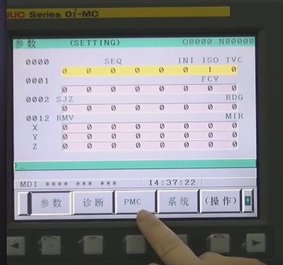

在 PMC 控制系統選單中選 **PMCDGN**（診斷功能）：

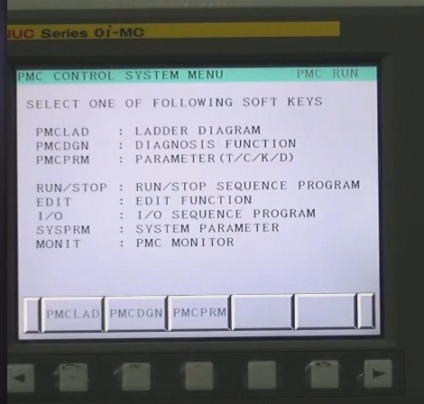

進入診斷畫面後，軟鍵有 TITLE、STATUS、ALARM、TRACE。這個 TITLE 畫面同時顯示了 PMC 的基本資訊，例如 PMC 類型為 SB7，掃描時間 8 ms：

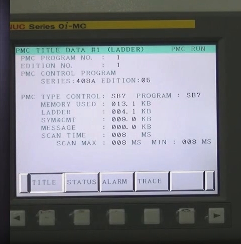

按 **STATUS**，就進入信號狀態畫面（PMC SIGNAL STATUS），畫面上橫向是位元 #7 ~ #0，直向是位址。預設顯示 G0000 起的位址：

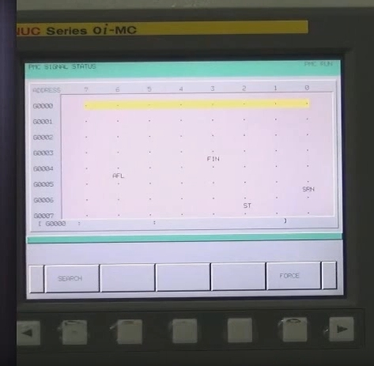

用軟鍵 **SEARCH** 輸入要監控的位址，例如 **Y27.4**，就能看到這一位的狀態。按下 X27.4 的按鈕，4 秒之後 Y27.4 這一位變為 1（顯示為 1），放開按鈕則回到 0：

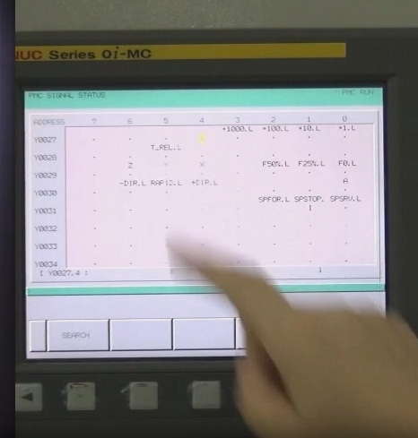

### 1.5 TMRC 指令的特點

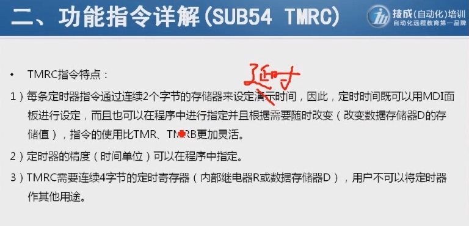

1. 每條定時器指令透過**連續 2 個位元組的存儲器**來設定延時時間，因此定時時間既可以用 MDI 面板設定，也可以**在程式中指定**，並可以根據需要隨時改變（改變資料存儲器 D 的存儲值），所以比 TMR、TMRB 更加靈活。
2. 定時器的**精度（時間單位）可以在程式中指定**。
3. TMRC 需要**連續 4 位元組的定時寄存器**（內部繼電器 R 或資料存儲器 D），使用者不可以將這 4 個位元組作其他用途。

### 1.6 三種定時器小結

| 項目 | TMR（SUB 3） | TMRB（SUB 24） | TMRC（SUB 54） |
| --- | --- | --- | --- |
| 名稱 | 定時器 | 固定定時器 | 可變定時器 |
| 設定時間位置 | PMC 參數 TIMER 畫面 | 指令參數（程式裡） | 資料表 D（或其他 2 位元組存儲器） |
| 修改方式 | 機床上改參數 | 要改程式 | 改 D 的值，程式中也能隨時改 |
| 精度 | 1 ~ 8 號 48 ms；9 號起 8 ms | ms 為單位 | 由第 1 個參數指定：0 為 8 ms、1 為 48 ms |
| 額外佔用 | 無 | 無 | 4 位元組定時寄存器 |

---

## 二、(7) 譯碼處理 DEC（SUB 4）

DEC 對 **2 位 BCD 碼**進行譯碼：當資料與指示的值**相同**時，W1 接通；不一致則 W1 斷開。

> 指令名稱裡沒有 B 的是處理 **BCD 碼**的指令；有 B 的（如 DECB）處理的是二進制資料。

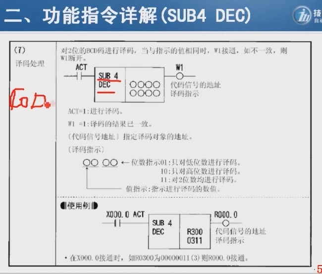

### 2.1 指令格式

- **ACT = 1**：進行譯碼。
- **W1 = 1**：譯碼結果已一致。
- 兩個參數：
  1. **代碼信號位址**：指定譯碼對象的位址，也就是對哪個位址中的資料進行譯碼。
  2. **譯碼指示**：由 4 位數字組成，前兩位是**值指示**，後兩位是**位數指示**。

譯碼指示 `○○ ○○`：

| 部分 | 意義 |
| --- | --- |
| 前兩位：**值指示** | 指示要進行譯碼（比較）的數值 |
| 後兩位：**位數指示 = 01** | 只對**低位數**進行譯碼 |
| 後兩位：**位數指示 = 10** | 只對**高位數**進行譯碼 |
| 後兩位：**位數指示 = 11** | 對 **2 位數均**進行譯碼 |

### 2.2 範例

```text
 X000.0  ACT
 ──┤ ├──────[SUB 4 DEC]
                 R300      ← 代碼信號的位址
                 0311      ← 譯碼指示：值 03、位數指示 11
                                           ──────( R000.0 )
```

- 譯碼指示 `0311`：值指示 **03**，位數指示 **11**（高位、低位都譯碼）。
- X000.0 接通時，如果 R0300 為 `0000 0011`（BCD 的 03），則 R000.0 接通；如果 R0300 不是 03，R000.0 不接通。

助記符形式：

```text
RD       X0000.0
SUB      4
PRM      R0300
PRM      0311
WRT      R0000.0
```

---

## 三、(8) 二進制譯碼 DECB（SUB 25）

DECB 對 **1、2、4 位元組**長的**二進制**形式的代碼資料進行譯碼。**代碼資料一致時，對應的位為「1」，不一致則為「0」。**

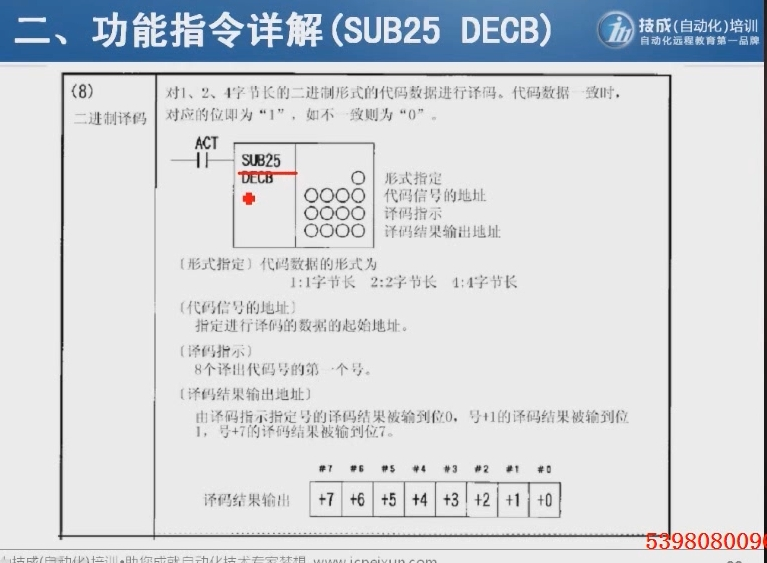

### 3.1 DEC 與 DECB 的差別

- DEC 只能對**一個數**進行譯碼（例如只能譯 03），結果用 W1 的 0 / 1 表示。
- DECB 可以一次對**八個連續的數**進行譯碼，所以沒有 W1，結果改用**一個位元組**的 8 個位元來表示。

### 3.2 指令格式

控制條件只有 **ACT**，沒有 W1。四個參數：

| 參數 | 內容 | 說明 |
| --- | --- | --- |
| 第 1 個 | 形式指定 | 代碼資料的長度：**1** = 1 位元組；**2** = 2 位元組；**4** = 4 位元組 |
| 第 2 個 | 代碼信號位址 | 要譯碼的資料的**起始位址** |
| 第 3 個 | 譯碼指示 | 8 個譯出代碼號的**第一個號** |
| 第 4 個 | 譯碼結果輸出位址 | 一個位元組，共 8 位 |

**譯碼結果**：由譯碼指示指定的號，其譯碼結果輸出到**位 0**；號 +1 的結果輸出到**位 1**；……；號 +7 的結果輸出到**位 7**。

例如譯碼指示為 03，就是對 03、04、05、06、07、08、09、10 這八個數進行譯碼，依序對應到結果位元組的 #0 ~ #7。

### 3.3 範例：M 代碼譯碼

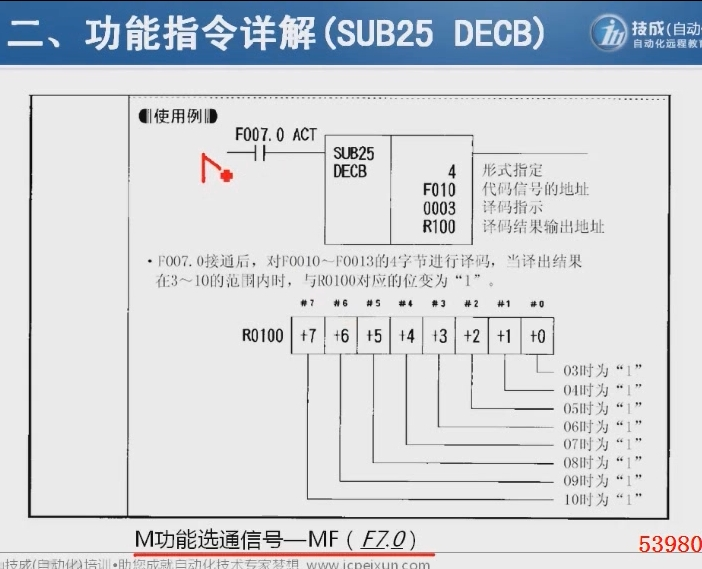

```text
 F007.0  ACT
 ──┤ ├──────[SUB 25 DECB]
                 4         ← 形式指定：4 位元組
                 F010      ← 代碼信號位址
                 0003      ← 譯碼指示：從 03 開始
                 R100      ← 譯碼結果輸出位址
```

- **F007.0** 是 **M 功能選通信號 MF**：在加工程式中遇到 M 代碼時，這個信號就接通；有 M 代碼才需要執行譯碼，所以用它做 ACT。
- F007.0 接通後，對 **F0010 ~ F0013** 這 4 個位元組（也就是 M 代碼資料）進行譯碼。當譯出的結果在 **3 ~ 10** 的範圍內時，與 R0100 對應的位變為 1：

| R0100 的位元 | #0 | #1 | #2 | #3 | #4 | #5 | #6 | #7 |
| --- | --- | --- | --- | --- | --- | --- | --- | --- |
| 為 1 時對應的 M 代碼 | M03 | M04 | M05 | M06 | M07 | M08 | M09 | M10 |

助記符形式：

```text
RD       F0007.0
SUB      25
PRM      4
PRM      F0010
PRM      0003
PRM      R0100
```

### 3.4 應用：M 代碼譯碼處理

投影片上以 M07 為例（形式指定 1，即只對 F0010 一個位元組譯碼，結果放到 R0010）：當 F0010 的值為 7（執行 M07 指令）時，因為譯碼指示從 M03 開始，結果位元組中 M03 對應 #0、M04 對應 #1……M07 對應 **#4**，所以 **R0010 的 #4 變為 1**，其餘為 0。

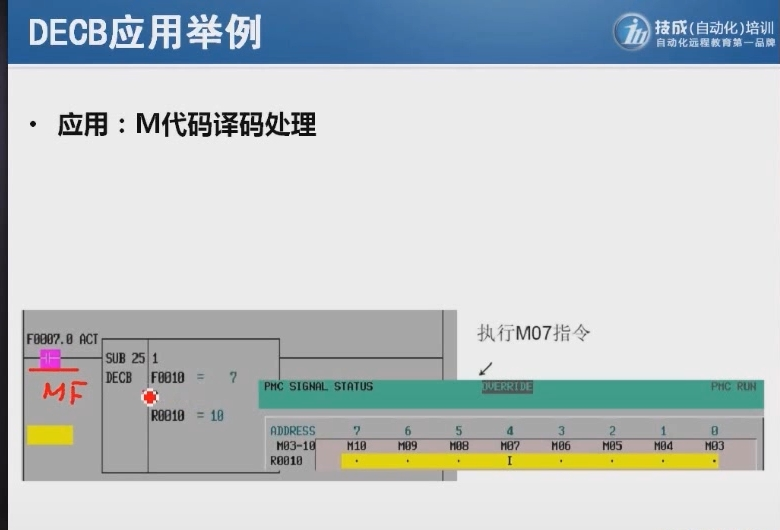

這樣，梯形圖後面只需用 R0010.4 當作「M07」信號，就能控制對應的動作（例如開冷卻、開主軸等）。這比 DEC 一次只能譯一個數方便得多。

---

## 四、(9) 計數器 CTR（SUB 5）

### 4.1 計數器的功能

CTR 用作計數器，計數器可用於 NC 機床的多種用途。預置值或計數值的資料，可以透過**系統參數**以 BCD 格式或二進制格式使用。

> 注意：把錯誤的 BCD 代碼送入 BCD 型計數器時，CTR 的動作可能有誤。

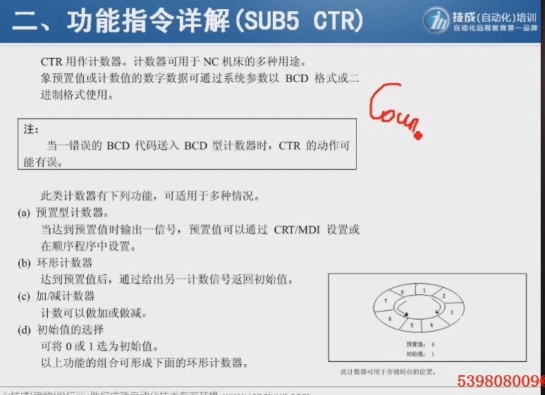

CTR 具有以下功能，可適用於多種情況：

- **(a) 預置型計數器**：計數達到**預置值**時輸出一個信號；預置值可以透過 CRT / MDI 設置，也可以在順序程式中設置。
- **(b) 環形計數器**：達到預置值之後，再給一個計數信號，就返回初始值，重新計數。例如預置值 8，就是 1、2、3 ……8，再來一個信號又回到 1，如此循環。
- **(c) 加 / 減計數器**：計數可以做加，也可以做減。加計數從初始值往上加，到預置值輸出信號；減計數從預置值往下減，減到最小值再輸出信號。
- **(d) 初始值的選擇**：可將 **0 或 1** 選為初始值。例如工件計數，加工前是 0，所以初始值選 0；刀庫或轉台的位置不會是 0（從 1 號位開始），初始值選 1。

以上功能組合起來，就是一個**環形計數器**，例如預置值為 8、初始值為 1，可用來記錄轉台的位置。

### 4.2 CTR 指令格式

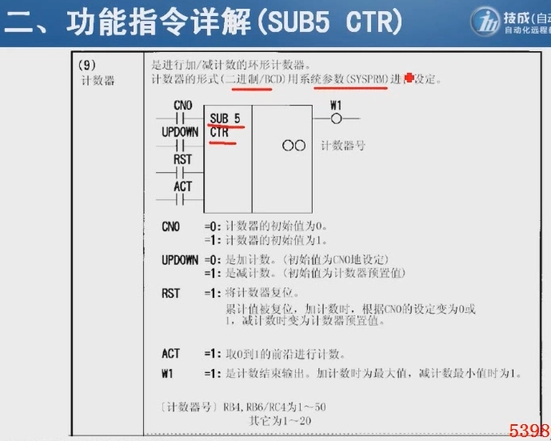

CTR 是進行**加 / 減計數的環形計數器**。計數器的形式（二進制 / BCD）用**系統參數（SYSPRM）** 設定。

控制條件（由上到下為 CNO、UPDOWN、RST、ACT），參數為**計數器號**：

| 控制條件 | 值 | 意義 |
| --- | --- | --- |
| **CNO** | 0 | 計數器的初始值為 0 |
|  | 1 | 計數器的初始值為 1 |
| **UPDOWN** | 0 | 加計數（初始值由 CNO 設定） |
|  | 1 | 減計數（初始值為計數器預置值） |
| **RST** | 1 | 將計數器復位。累計值被復位：加計數時，依 CNO 的設定變為 0 或 1；減計數時變為計數器預置值 |
| **ACT** | 1 | 取由 0 變 1 的**前緣（上升沿）** 進行計數 |
| **W1** | 1 | 計數結束輸出。加計數時為最大值（到達預置值），減計數時為最小值（1）時接通 |

- **計數器號**：PMC-RB4、RB6 / RC4 為 1 ~ 50，其他機型為 1 ~ 20。
- 每個計數器用 **4 個位元組**（C 位址，見第 11 課時）：**前 2 個位元組是預置值**（由使用者設定），**後 2 個位元組是累計值**（隨計數變化，不能設定）。例如 1 號計數器佔用 C0 ~ C3，10 號計數器佔用 C36 ~ C39。
- ACT 取的是**上升沿**：信號接通期間有一個寬度，只在它從 0 變 1 的那一瞬間計一次數。

### 4.3 範例（投影片）

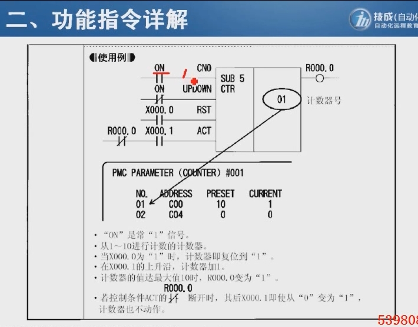

```text
 ON(R9091.1)   CNO
 ──┤ ├───────┐
 ON(R9091.1)   UPDOWN
 ──┤/├───────┤
 X000.0        RST
 ──┤ ├───────┤──[SUB 5 CTR  01]────────────( R000.0 )
 R000.0  X000.1  ACT
 ──┤/├────┤↑├──┘
```

投影片中的「ON」是**常 1 信號**（即 R9091.1），所以：

- **CNO** 接常開的 ON → 恆為 1 → 初始值為 **1**。
- **UPDOWN** 接 ON 的**常閉觸點** → 恆為 0 → **加計數**。
- **RST** = X000.0：X000.0 為 1 時，計數器復位到初始值「1」。
- **ACT** = X000.1 的上升沿（再串一個 R000.0 的常閉觸點）：每出現一次上升沿，計數器加 1。
- 計數器號 **01**，預置值設在 PMC PARAMETER（COUNTER）#001 中：NO.01、位址 C00、**PRESET = 10**、CURRENT = 1（累計值，隨計數變化）。
- 這是一個**從 1 數到 10** 的計數器：計數值達到最大值 10 時，**R000.0 變為 1**。
- R000.0 接在 ACT 條件裡當常閉觸點：計數到 10 之後 R000.0 = 1，ACT 條件斷開，此後即使 X000.1 從 0 變 1，計數器也不再動作，直到按 X000.0 復位。

助記符形式（依 FANUC 指令表習慣整理，供參考）：

```text
RD         R9091.1        ; CNO（常 1）
RD.NOT.STK R9091.1        ; UPDOWN（常 0，加計數）
RD.STK     X0000.0        ; RST
RD.NOT.STK R0000.0        ; ACT：先 R000.0 常閉
AND        X0000.1        ;      再串 X000.1
SUB        5              ; CTR
PRM        01             ; 計數器號
WRT        R0000.0        ; W1：計數結束
```

### 4.4 實機實驗

實驗目標：用 **10 號計數器**對 X27.4 按鈕的按壓次數計數，預置值 **13**，數到 13 時 Y27.4 指示燈亮；用另一個按鈕 X27.5 復位。

**（1）編寫梯形圖**

- **CNO**：R9091.1（常 1 信號）→ 初始值為 1。
- **UPDOWN**：R9091.0（常 0 信號）→ 加計數。
- **RST**：X27.5（面板上的另一個按鈕）。
- **ACT**：X27.4（計數按鈕）。
- 計數器號：**0010**；輸出（W1）：Y27.4。

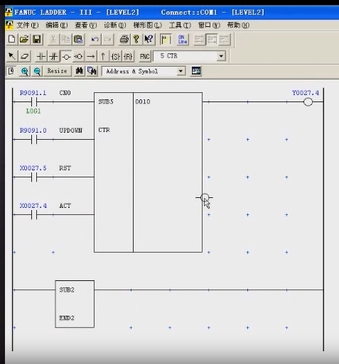

文字版：

```text
 R9091.1  CNO     ← 常 1：初始值為 1
 ──┤ ├──────┐
 R9091.0  UPDOWN  ← 常 0：加計數
 ──┤ ├──────┤
 X27.5    RST     ← 復位按鈕
 ──┤ ├──────┤──[SUB 5 CTR  0010]────────( Y27.4 )
 X27.4    ACT     ← 計數按鈕
 ──┤ ├──────┘
```

> 注意：R9091.0 是常 0 信號，所以接常開觸點時 UPDOWN 恆為 0（加計數）；R9091.1 是常 1 信號，接常開觸點時 CNO 恆為 1（初始值 1）。（見第 11 課時的系統計時器 R9091。）

**（2）設定計數器預置值**

按 SYSTEM → PMC：

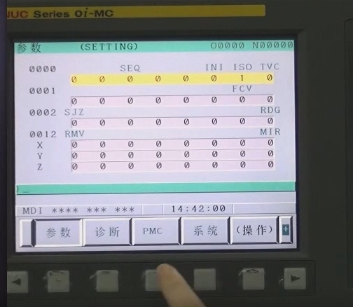

進入 PMC 控制系統選單，選 PMCPRM：

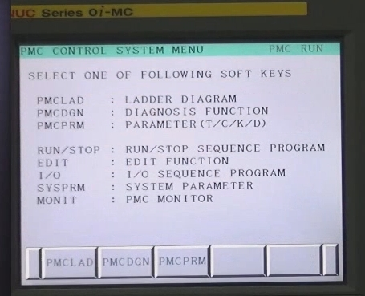

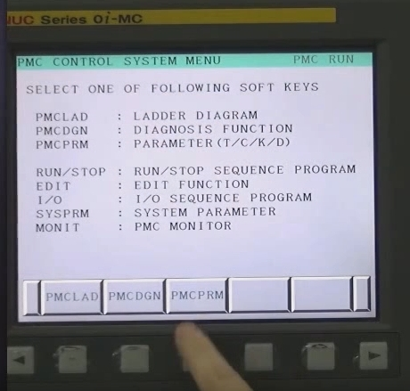

進入參數畫面後預設是 TIMER 頁，改按軟鍵 **COUNTR**（計數器）：

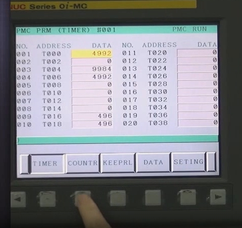

計數器畫面的欄位是：NO.（計數器號）、ADDRESS（位址）、PRESET（預置值，可以輸入）、CURRENT（累計值，不能輸入，隨計數變化）。每個計數器佔 4 位元組，所以位址以 4 遞增（C000、C004、C008 ……）。畫面上 1 號計數器的預置值是先前留下的 16：

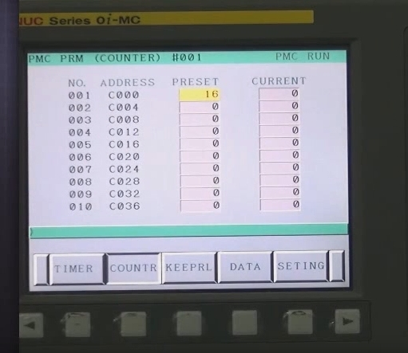

要用的是 **10 號計數器**（位址 C036），在它的 PRESET 欄輸入 **13**：

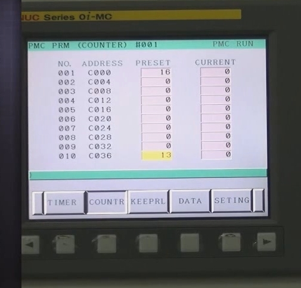

**（3）操作驗證**

按 X27.4 按鈕，一下一下地按，畫面上 10 號計數器的 CURRENT 欄會隨按壓次數 1、2、3 ……往上加；數到 **13**（等於預置值）時，Y27.4 指示燈亮。（下圖畫面上 CURRENT 已經顯示為 13）。需要重新計數時，按 X27.5 按鈕復位，累計值回到初始值 1。

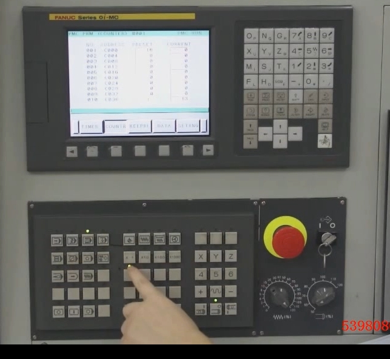

**（4）對照投影片，加上「計數結束後不再計數」的條件**

在沒有任何額外條件時，計數器是**環形**的：達到預置值之後再來一個計數信號，會返回初始值，重新從頭計數（見 4.1 的 (b) 環形計數器）。若希望像投影片範例那樣，**計到預置值之後就不再計數**，可以在 ACT 條件中再串一個輸出的**常閉觸點**：這裡串 **Y27.4 的常閉觸點**，Y27.4 一接通（計到 13），ACT 的條件就斷開，之後再按 X27.4 也不會計數，直到按 X27.5 復位。

LADDER-III 修改梯形圖後會提示「原始程式已經被更新，編譯嗎？」，選「是」編譯：

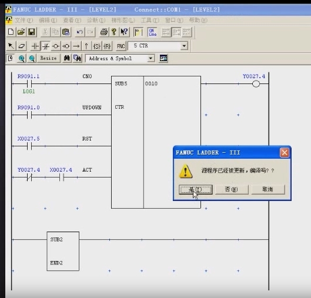

```text
 Y27.4    X27.4    ACT     ← 計到預置值後不再計數
 ──┤/├────┤ ├──────┘
```

> 註：逐字稿後半段是大量重複的數字，無法還原逐步的操作過程。第 (3)、(4) 兩節是依投影片的功能說明與實機畫面整理的：預置值 13 與 CURRENT = 13 見畫面，「超過預置值後再按會回到初始值」是環形計數器的功能說明，並非逐字稿明確可辨的實測結果。

---

## 本課時小結

- **TMRC（SUB 54）**：利用 2 位元組的資料存儲器（D）設定時間，**第 1 個參數指定精度**（0：8 ms、1：48 ms），時間 = 設定值 × 精度；另需要 4 位元組定時寄存器。使用前必須把資料表設成 2 位元組（TYPE = 1）。
- **PMC 狀態畫面**：SYSTEM → PMC → PMCDGN → STATUS，用 SEARCH 輸入位址，可以監控 X、Y、F、G、D、R 等信號。
- **DEC（SUB 4）**：對 2 位 BCD 碼譯碼，譯碼指示 = 值指示 + 位數指示（01 低位、10 高位、11 兩位），結果用 W1 表示。
- **DECB（SUB 25）**：對 1 / 2 / 4 位元組二進制資料譯碼，可一次譯 8 個連續的數，結果放到一個位元組的 8 位元中；常用於 **M 代碼譯碼**（以 MF = F7.0 為 ACT、F10 起為代碼資料）。
- **CTR（SUB 5）**：加 / 減環形計數器，CNO 選初始值 0 或 1，UPDOWN 選加 / 減，RST 復位，ACT 取上升沿計數；每個計數器佔 4 位元組（預置值 2 + 累計值 2）。
- **CTR 實驗**：CNO 接 R9091.1（常 1）、UPDOWN 接 R9091.0（常 0）、RST 接 X27.5、ACT 接 X27.4，10 號計數器預置值 13；ACT 串輸出常閉觸點可讓計數在到達預置值後停止。
