# 第14課時 FANUC PMC 功能指令（三）

> 本課時接續第 13 課時，內容包括：用 CTR 計數器做**工件計數**的應用例（含 DEC 譯碼 M02 的實機實驗）、第二種計數器 **CTRC（SUB 55）**，以及**旋轉控制 ROT（SUB 6）**。章節編號 (10)、(11) 沿用投影片。
>
> 圖片請放在與本檔同層的 `images/` 資料夾中。

## 本課時目錄

1. 計數器的工件計數例（CTR + DEC）
2. (10) 計數器 CTRC（SUB 55）
3. (11) 旋轉控制 ROT（SUB 6）

---

## 一、計數器的工件計數例

### 1.1 梯形圖

加工時，每執行完一個加工程式就等於加工完一個工件。怎麼知道執行完一個程式？加工程式的結尾要用 **M30**（或 **M02**）：遇到一次 M30，就表示一個程式（一個工件）加工完了。因此，**對 M30 計數，就能知道加工了多少個工件**。

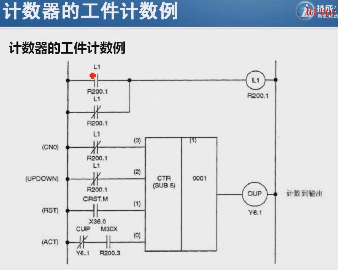

這是投影片上的梯形圖，逐條說明：

| 部分 | 內容 | 說明 |
| --- | --- | --- |
| 恆為 1 的信號 | L1 線圈（R200.1），並聯 L1 的常開和常閉觸點 | 一個線圈自己的常開觸點和常閉觸點並聯，兩個觸點總有一個導通，所以 L1 線圈**永遠為 1** |
| CNO | L1 的**常閉**觸點 | 恆為 0 → 計數器**初始值為 0** |
| UPDOWN | L1 的**常閉**觸點 | 恆為 0 → **加計數** |
| RST | CRST.M（X36.0） | 復位按鈕（計數器復位） |
| ACT | CUP 常閉（Y6.1）串 M30X（R200.3） | 每遇到一次 M30 信號計一次數；計數到達後 CUP 接通，常閉觸點斷開，**就不再計數** |
| 計數器號 | 0001 | 使用 1 號計數器，預置值在 PMC 參數的 COUNTER 畫面設定 |
| 輸出（W1） | CUP（Y6.1） | 計數到輸出：加工完指定數量的工件就接通 |

文字版：

```text
 L1(R200.1)                               ← 恆為 1 的信號
 ──┬──┤ ├──┬─────────────────────( L1 R200.1 )
   └──┤/├──┘

 L1(R200.1)  CNO
 ──┤/├──────┐                          ← 恆為 0 → 初始值 0
 L1(R200.1)  UPDOWN
 ──┤/├──────┤                          ← 恆為 0 → 加計數
 CRST.M(X36.0)  RST
 ──┤ ├─────┤──[SUB 5 CTR  0001]──────( CUP  Y6.1 )   計數到輸出
 CUP(Y6.1)  M30X(R200.3)  ACT
 ──┤/├──────┤ ├──────┘
```

### 1.2 實機實驗：用 DEC 和 CTR 做工件計數

這次實驗用 **DEC 功能指令** 把加工程式的 **M02**（程式結束）譯出來，再用 **CTR 計數器** 對它計數。

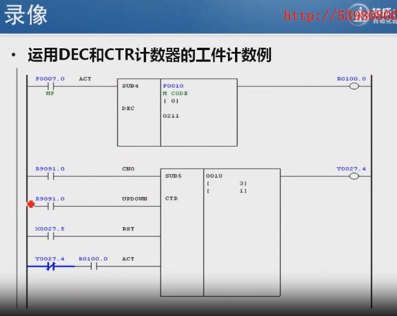

**（1）DEC 譯碼 M02**

- **ACT**：F0007.0（MF，M 功能選通信號）。遇到 M 代碼時 MF 接通，才進行譯碼。
- DEC 的第 1 個參數：**F0010**（M 代碼資料）。
- DEC 的第 2 個參數：**0211**（譯碼指示）。前兩位 **02** 是要比較的值（M02），後兩位 **11** 是位數指示（高位、低位都要比較）。
- 輸出：**R0100.0**。當 F0010 的值為 M02 時，R0100.0 接通；遇到其他 M 代碼（例如 M30、M03、M05）則不接通。

**（2）CTR 對 M02 計數**

- **CNO**：R9091.0（常 0 信號）→ 初始值為 0。因為 M02 結束代碼還沒有出現之前，已加工的工件數是 0。
- **UPDOWN**：R9091.0（常 0 信號）→ 加計數。
- **RST**：X0027.5（面板上的按鈕，復位）。
- **ACT**：Y0027.4 的**常閉觸點**串 **R0100.0**：對 R0100.0（即 M02）計數；計數到預置值、Y27.4 接通之後，常閉觸點斷開，不再計數。
- 計數器號 **0010**（10 號計數器），輸出 **Y0027.4**。

文字版：

```text
 F007.0(MF)  ACT
 ──┤ ├──────[SUB 4 DEC  F0010  0211]──────( R0100.0 )     ← 譯出 M02

 R9091.0  CNO
 ──┤ ├──────┐
 R9091.0  UPDOWN
 ──┤ ├──────┤
 X27.5    RST
 ──┤ ├──────┤──[SUB 5 CTR  0010]──────────( Y27.4 )
 Y27.4    R0100.0   ACT
 ──┤/├──────┤ ├────┘
```

助記符形式（依 FANUC 指令表習慣整理，供參考）：

```text
RD         F0007.0
SUB        4              ; DEC
PRM        F0010
PRM        0211
WRT        R0100.0

RD         R9091.0        ; CNO
RD.STK     R9091.0        ; UPDOWN
RD.STK     X0027.5        ; RST
RD.NOT.STK Y0027.4        ; ACT
AND        R0100.0
SUB        5              ; CTR
PRM        0010
WRT        Y0027.4
```

**（3）設定預置值**

到 PMC PARAMETER 的 COUNTER 畫面，把 **10 號計數器的預置值設為 3**（加工 3 個工件後輸出）。畫面上累計值還是之前實驗留下的 13：

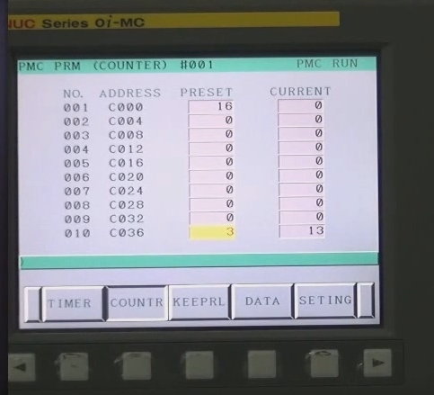

**（4）先復位**

按面板上的復位按鈕（X27.5），累計值變為 **0**：

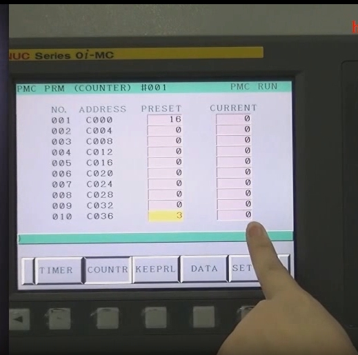

為什麼復位後是 0 而不是 1？因為 CNO 接的是 R9091.0（常 0 信號），初始值就是 0。

**（5）編寫並運行加工程式（以 M02 結尾）**

在 EDIT（編輯）模式下，新建程式 O0001：

```text
O0001 ;
G90 G54 ;
M03 S300 ;
M05 ;
M02 ;
%
```

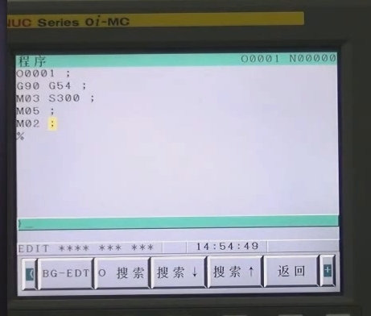

把操作模式切換到 **MEM（自動）** 模式，按循環起動鍵運行程式；同時到 PMC 的 COUNTER 畫面觀察 10 號計數器的累計值：

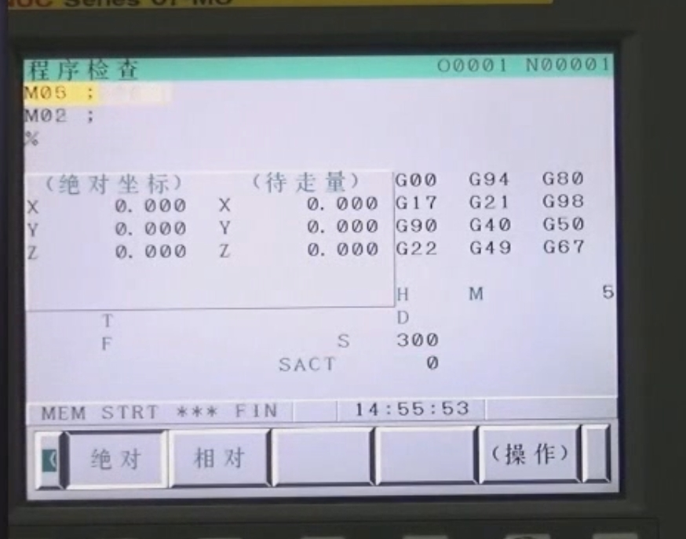

- 運行 **1 次**：累計值變為 **1**。
- 運行 **2 次**：累計值變為 **2**。
- 運行 **3 次**：累計值變為 **3**（等於預置值），**Y27.4 接通**。

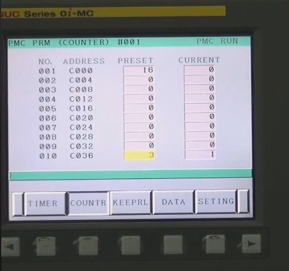

- 第 **4 次**運行：計數值**不變**，因為 ACT 條件裡有 Y27.4 的常閉觸點，Y27.4 已經接通，就不再計數。

**（6）驗證：以 M30 結尾的程式不計數**

我們譯碼的是 **M02**，所以若程式是以 **M30** 結尾，就不會計數。新建程式 O0002，其餘都一樣，只把結尾改成 M30：

```text
O0002 ;
G90 G54 ;
M03 S300 ;
M05 ;
M30 ;
%
```

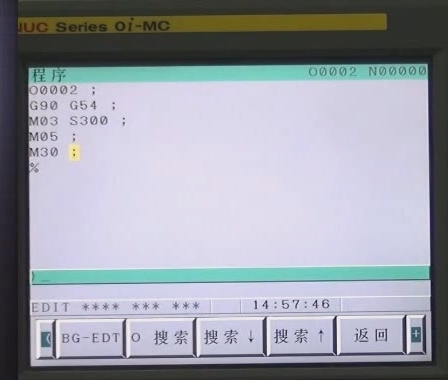

運行之前，計數值為 0；運行一遍之後再看，計數值**沒有變化**：

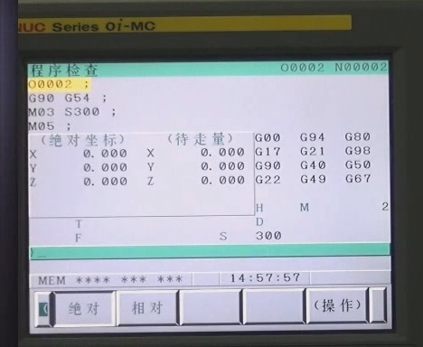

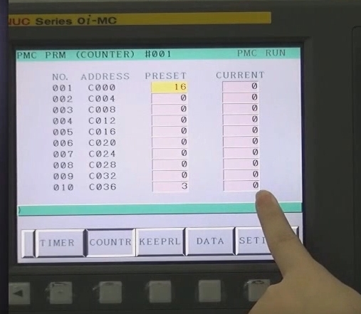

> 若要讓 M30 結尾的程式也能計數，只要另外再增加一個譯碼 M30 的 DEC，或把譯碼指示改成 M30 即可。

---

## 二、(10) 計數器 CTRC（SUB 55）

### 2.1 功能

CTRC 與前面的 CTR 功能類似，也是**環形計數器**，但**資料都是二進制的**，不需要用系統參數去設定 BCD 或二進制：

- **(a) 預置型計數器**：對計數值進行預置，計數達到預置值時輸出信號。
- **(b) 環形計數器**：計數值到達預置值時，再輸入計數信號，就**復位到初始值，並重新計數**。
- **(c) 加 / 減計數器**：這是可逆計數器，既可用於做加，也可以做減。
- **(d) 初始值的選擇**：初始值可為 0 或 1。

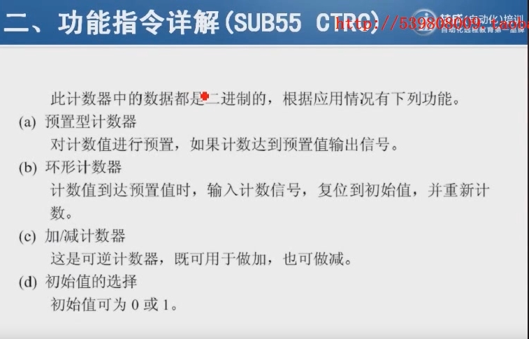

### 2.2 指令格式

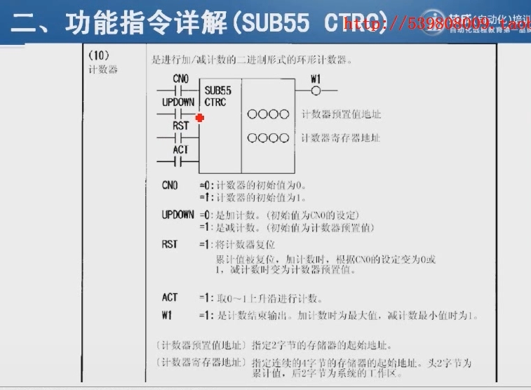

控制條件與 CTR 相同：

| 控制條件 | 值 | 意義 |
| --- | --- | --- |
| **CNO** | 0 / 1 | 計數器的初始值為 0 / 1 |
| **UPDOWN** | 0 | 加計數（初始值由 CNO 設定） |
|  | 1 | 減計數（初始值為計數器預置值） |
| **RST** | 1 | 將計數器復位（加計數時依 CNO 變為 0 或 1；減計數時變為預置值） |
| **ACT** | 1 | 取 0 → 1 的上升沿進行計數 |
| **W1** | 1 | 計數結束輸出。加計數時為最大值，減計數時為最小值 |

CTRC 有**兩個參數**（CTR 只有一個計數器號）：

| 參數 | 說明 |
| --- | --- |
| 計數器預置值位址 | 指定 **2 位元組**存儲器的**起始位址** |
| 計數器寄存器位址 | 指定連續 **4 位元組**存儲器的起始位址：**頭 2 位元組為累計值，後 2 位元組為系統的工作區**（不能再作他用） |

所以一個 CTRC 實際使用了 **6 個位元組**：預置值 2 個、累計值 2 個、工作區 2 個。

### 2.3 範例（投影片）

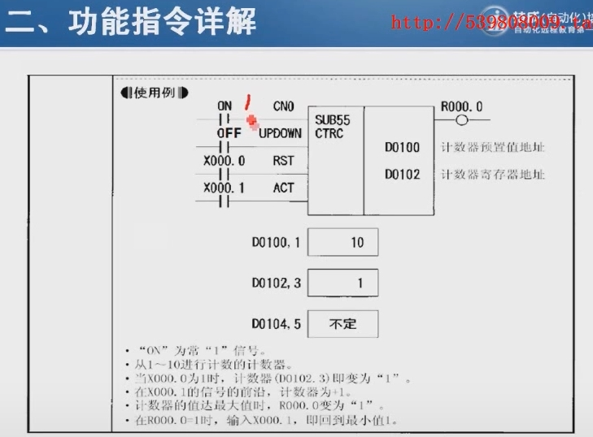

```text
 ON   CNO
 ──┤ ├──────┐                           ← 常 1：初始值 1
 OFF  UPDOWN
 ──┤ ├──────┤                           ← 常 0：加計數
 X000.0  RST
 ──┤ ├──────┤──[SUB 55 CTRC]──────────( R000.0 )
              D0100   ← 計數器預置值位址
              D0102   ← 計數器寄存器位址
 X000.1  ACT
 ──┤ ├──────┘
```

資料存儲器內容：

| 位址 | 內容 |
| --- | --- |
| D0100、D0101 | 預置值 = **10** |
| D0102、D0103 | 累計值（起始為 1） |
| D0104、D0105 | 系統工作區（不定） |

- 「ON」為常 1 信號，「OFF」為常 0 信號。這是一個**從 1 數到 10** 的計數器。
- X000.0 為 1 時，計數器（D0102、D0103）立即變為 **1**。
- 在 X000.1 的上升沿，計數器加 1。
- 計數值達到最大值（10）時，R000.0 變為 1。
- 在 R000.0 = 1 時，再輸入 X000.1，就**回到最小值 1**（環形計數器的功能）。

### 2.4 實機實驗：減計數

實驗目標：用 **減計數**，預置值設為 3，按 X27.4 按鈕每按一下減 1，減到 0 時 Y27.4 接通。

**（1）編寫梯形圖**

- **CNO**：R9091.0（常 0）→ 初始值為 **0**。
- **UPDOWN**：R9091.1（常 1）→ **減計數**。
- **RST**：X27.5。
- **ACT**：X27.4。
- 預置值位址：**D0100**；寄存器位址：**D0102**；輸出：Y27.4。

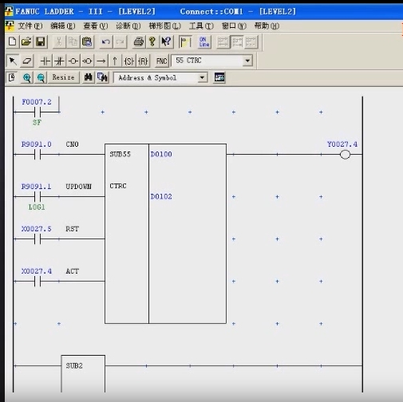

**（2）把資料表設成 2 位元組**

與 TMRC 一樣：因為預置值和累計值都是 2 位元組，要先到 PMC PRM 的 **DATA** 畫面，進入 **G.CONT**（資料表控制畫面），把 **TYPE 設為 1**（2 位元組）。

**（3）設定預置值**

在資料表中找到 D0100，輸入預置值 **3**：

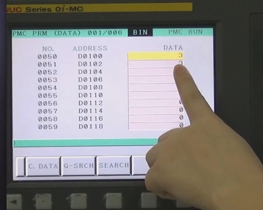

- D0100：預置值（第一個參數）。
- D0102：累計值，隨計數變化。
- D0104：系統工作區。

**（4）操作驗證**

按 X27.4 按鈕計數，觀察 D0102（累計值）：

- 因為這是**減計數器**，累計值從預置值 **3** 開始，每按一下依序變為 **2、1、0**。
- 到達 **0**（也就是初始值，因為 CNO = 0）時，**Y27.4 接通**。

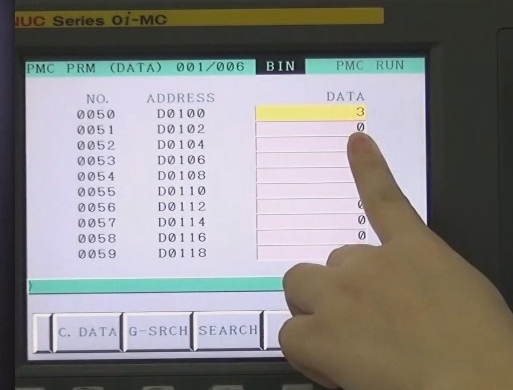

- 再按一下，累計值又**回到 3**，重新開始減計數（環形計數器），Y27.4 斷開。

> 註：逐字稿中最後這一段（再按一下之後）說得斷斷續續，這裡依 CTRC 是環形計數器的功能與投影片的說明整理，細節以實機為準。

---

## 三、(11) 旋轉控制 ROT（SUB 6）

### 3.1 功能

ROT 用於**回轉控制**，例如**刀架、ATC（自動換刀裝置）、旋轉工作台**等。它有三個功能：

- **(a) 選擇短路徑的回轉方向**：例如目前在 7 號位，要轉到 5 號位，到底是正轉比較近還是反轉比較近，ROT 可以幫你選。
- **(b) 計算由當前位置到目標位置的步數**：7 轉到 5 要幾步，它可以算出來。
- **(c) 計算目標前一位置的位置，或到目標位置前一位置的步數**：例如要轉到 5 號位，轉到 5 之前的位置就是 6，這時要轉多少步，它也可以算出來。

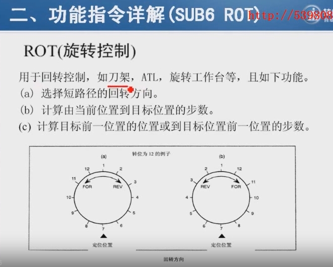

上圖是「轉位為 12 的例子」：回轉體共 12 個位置，圖中標出**正轉 FOR** 與**反轉 REV** 的方向，定位位置在下方。

### 3.2 指令格式

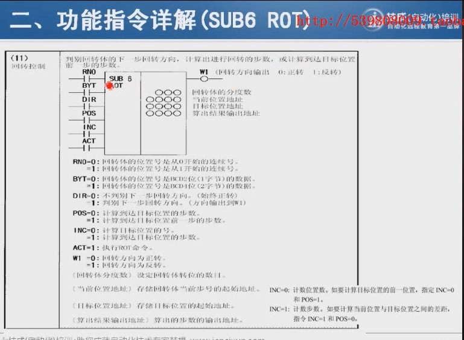

控制條件（由上到下為 RN0、BYT、DIR、POS、INC、ACT）：

| 控制條件 | 值 | 意義 |
| --- | --- | --- |
| **RN0** | 0 | 回轉體的位置號是從 **0** 開始的連續號 |
|  | 1 | 回轉體的位置號是從 **1** 開始的連續號（一般情況，如刀號從 1 開始） |
| **BYT** | 0 | 位置號是 **BCD 2 位（1 位元組）** 的資料 |
|  | 1 | 位置號是 **BCD 4 位（2 位元組）** 的資料 |
| **DIR** | 0 | **不判別**下一步回轉方向（始終正轉） |
|  | 1 | **判別**下一步回轉方向（方向輸出到 W1） |
| **POS** | 0 | 計算到達**目標位置**的步數 |
|  | 1 | 計算到達**目標位置前一步**的步數 |
| **INC** | 0 | 計算**目標位置的號**（位置數） |
|  | 1 | 計算到達目標位置的**步數**（一般情況用這個） |
| **ACT** | 1 | 執行 ROT 命令 |
| **W1** | 0 | 回轉方向為**正轉** |
|  | 1 | 回轉方向為**反轉** |

四個參數：

1. **回轉體的分度數**：設定回轉體轉位的數目（刀庫有幾把刀、轉台分成幾等分）。
2. **當前位置位址**：存放回轉體**當前位置**的起始位址。
3. **目標位置位址**：存放**目標位置**的起始位址。
4. **算出結果輸出位址**：存放算出的步數的位址。

組合用法（投影片註）：

- 要計算**目標位置的前一位置**：指定 **INC = 0、POS = 1**。
- 要計算**當前位置與目標位置之間的差距（步數）**：指定 **INC = 1、POS = 0**。

### 3.3 範例（投影片）

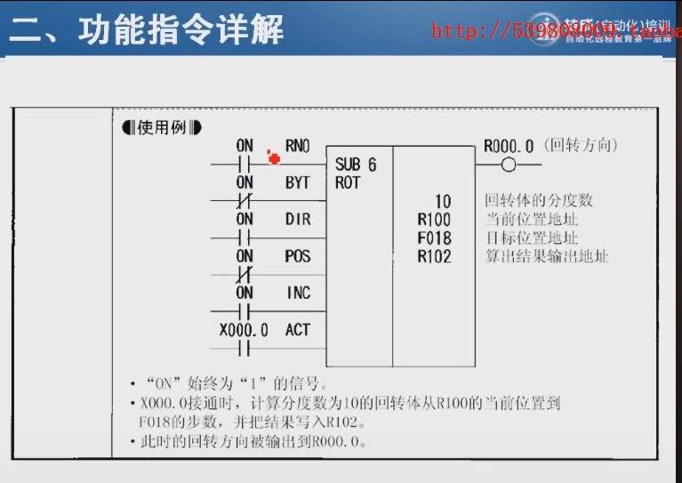

```text
 ON  RN0   ──┤ ├──┐       ← 1：位置號從 1 開始
 ON  BYT   ──┤/├──┤       ← 0：BCD 2 位（1 位元組）
 ON  DIR   ──┤ ├──┤       ← 1：判別回轉方向
 ON  POS   ──┤/├──┤       ← 0：計算到目標位置的步數
 ON  INC   ──┤ ├──┤──[SUB 6 ROT]──────( R000.0 )   回轉方向
 X000.0 ACT ─┤ ├──┘            10     ← 回轉體的分度數
                               R100   ← 當前位置位址
                               F018   ← 目標位置位址
                               R102   ← 算出結果輸出位址
```

- 「ON」始終為「1」的信號（常 1）。
- X000.0 接通時，計算**分度數為 10 的回轉體**，從 **R100 的當前位置**到 **F018 的目標位置**所需的步數，並把結果寫入 **R102**。
- 此時的回轉方向（正轉 / 反轉）被輸出到 **R000.0**：0 為正轉，1 為反轉。

助記符形式（依 FANUC 指令表習慣整理，供參考）：

```text
RD         R9091.1        ; RN0  = 1
RD.NOT.STK R9091.1        ; BYT  = 0
RD.STK     R9091.1        ; DIR  = 1
RD.NOT.STK R9091.1        ; POS  = 0
RD.STK     R9091.1        ; INC  = 1
RD.STK     X0000.0        ; ACT
SUB        6              ; ROT
PRM        10             ; 分度數
PRM        R0100          ; 當前位置
PRM        F0018          ; 目標位置
PRM        R0102          ; 結果（步數）
WRT        R0000.0        ; W1：0 正轉、1 反轉
```

### 3.4 實機實驗

實驗目標：回轉體分成 **12 個位置**，用 D 資料表存放當前位置、目標位置，按 X27.4 計算**要正轉還是反轉、轉幾步**，方向由 Y27.5 指示（0 為正轉，1 為反轉）。

**（1）編寫梯形圖**

- **RN0**：R9091.1（常 1）→ 位置號從 **1** 開始。
- **BYT**：R9091.0（常 0）→ BCD **2 位**（1 位元組）。
- **DIR**：R9091.1（常 1）→ **判別**回轉方向。
- **POS**：R9091.0（常 0）→ 計算到達**目標位置**的步數。
- **INC**：R9091.1（常 1）→ 計算**步數**。
- **ACT**：X27.4（面板按鈕）。
- 參數：**分度數 12**（`0012`）、**當前位置 D0100**、**目標位置 D0102**、**結果輸出 D0104**。
- **W1**（回轉方向）：Y27.5。

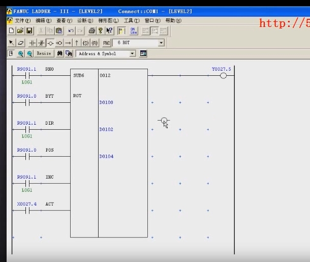

文字版：

```text
 R9091.1  RN0   ──┤ ├──┐        ← 1：位置號從 1 開始
 R9091.0  BYT   ──┤ ├──┤        ← 0：BCD 2 位
 R9091.1  DIR   ──┤ ├──┤        ← 1：判別方向
 R9091.0  POS   ──┤ ├──┤        ← 0：算到目標位置的步數
 R9091.1  INC   ──┤ ├──┤──[SUB 6 ROT  0012]──────( Y27.5 )   0 正轉、1 反轉
 X27.4    ACT   ──┤ ├──┘          D0100   ← 當前位置
                                  D0102   ← 目標位置
                                  D0104   ← 算出的步數
```

**（2）資料表**

與前面的 TMRC、CTRC 一樣，D 資料表設成 2 位元組（TYPE = 1），所以位置號放在 D0100、D0102、D0104（每個位址相差 2）。位置號是 BCD 2 位，這裡的位置號都小於 10，BCD 與二進制的值相同，直接輸入即可。

**（3）驗證**

**① 當前位置 3、目標位置 5**：在資料表中 D0100 輸入 3、D0102 輸入 5：

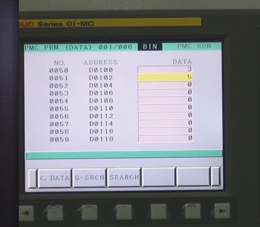

線上梯形圖中也能看到 D0100 [3]、D0102 [5]、D0104 [0]：

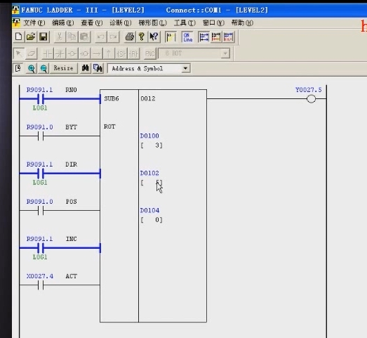

按下 X27.4 計算：**Y27.5 = 0，表示正轉**；D0104 變為 **2**，表示還要轉 **2 步**（3 → 4 → 5）。與預想一致。

**② 當前位置改為 5、目標位置 5**：轉到位之後，D0100 = 5，再按 X27.4 計算：D0104 = **0**，表示已經在目標位置，不需要再轉。

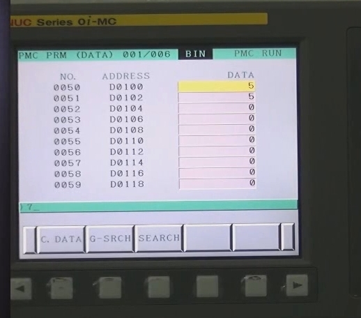

> 逐字稿在這一段還提到一個中間狀態（當前位置 4，目標 5，應為正轉 1 步），說得不清楚；這個結果是依 4 → 5 推算的，沒有對應的畫面。

**③ 當前位置 6、目標位置 5**：把 D0100 改為 6（D0102 仍為 5）：

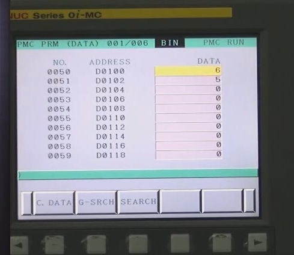

此時往回轉 1 步（6 → 5）比往前轉 11 步近得多，按下 X27.4 計算：**Y27.5 接通，表示反轉**；D0104 = **1**，表示反轉 **1 步**。

從這三種情況可以看出，ROT 會依當前位置與目標位置，自動選擇**步數較少的方向**，並算出要轉幾步。

---

## 本課時小結

- **工件計數**：加工程式結尾 M02 / M30 表示一個工件完成；用 DEC 譯出 M02（`0211`），再用 CTR 計數，ACT 串 Y27.4 常閉觸點可使計數到預置值後停止。DEC 只譯 M02 時，M30 結尾的程式不計數。
- **CNO / UPDOWN 常用信號**：R9091.0（常 0）、R9091.1（常 1）；一個線圈的常開與常閉觸點並聯也能得到恆為 1 的信號。
- **CTRC（SUB 55）**：資料全為二進制，有預置值位址和寄存器位址兩個參數，共用 6 個位元組（預置值 2、累計值 2、工作區 2）；使用前要把資料表設成 2 位元組；減計數時累計值從預置值減到初始值。
- **ROT（SUB 6）**：回轉控制，可選短路徑方向、算步數、算目標前一位置。RN0 選起始號、BYT 選 BCD 位數、DIR 選是否判別方向、POS / INC 選算什麼；W1 輸出方向（0 正轉、1 反轉）。
- **ROT 實驗**：12 分度，當前位置 D0100、目標位置 D0102、步數 D0104、方向 Y27.5；3 → 5 正轉 2 步，5 → 5 不需轉，6 → 5 反轉 1 步。
