# 第15課時　FANUC-PMC 功能指令 04

> 本課時內容：
> 1. **SUB26　ROTB**　二進制回轉控制
> 2. **SUB7　COD**　代碼轉換（BCD）
> 3. **SUB27　CODB**　二進制代碼轉換
> 4. **SUB8　MOVE**　邏輯乘數據傳送

---

## 一、SUB26　ROTB（二進制回轉控制）

### 1. 功能說明

ROTB 是前面所學 ROT 指令的**二進制版本**：

- ROT 處理的數據是 BCD 碼，ROTB 處理的數據全部是**二進制**（指令名稱後面多一個 B）。
- 另一個特點：回轉體的**分度數可以用地址來指定**。ROT 的分度數是直接給一個常數，而 ROTB 是給一個地址，由地址內的數值決定分度數。
- 其他功能與 ROT 指令相同。

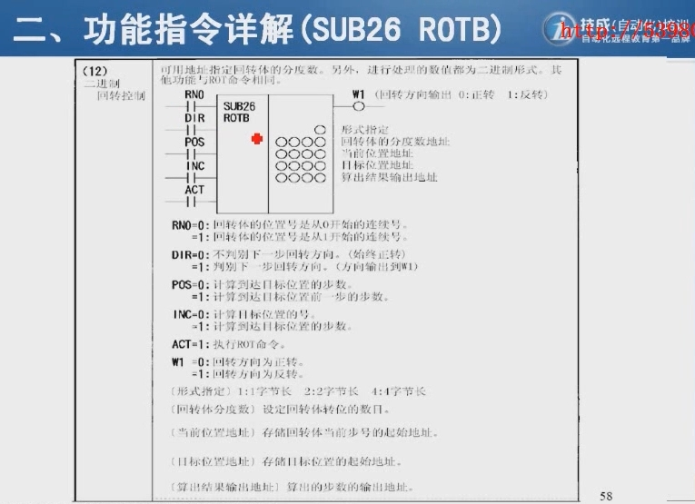

### 2. 指令條件與參數

| 條件／參數 | 說明 |
|---|---|
| **RNO** | 0：回轉體的位置號從 0 開始；1：位置號從 1 開始 |
| **DIR** | 0：不判別回轉方向（始終正轉）；1：判別最近路徑方向（方向輸出到 W1） |
| **POS** | 0：計算到達目標位置的步數；1：計算到達目標位置**前一步**的步數 |
| **INC** | 0：計算目標位置的號；1：計算到達目標位置的步數 |
| **ACT** | 1：執行 ROTB 指令 |
| **W1** | 0：回轉方向為正轉；1：回轉方向為反轉 |
| **形式指定** | 因為處理的是二進制數，必須指定數據長度：1＝1 字節、2＝2 字節、4＝4 字節 |
| **回轉體分度數地址** | 設定回轉體轉位的數目（這裡用地址指定，ROT 則用常數） |
| **當前位置地址** | 存放回轉體當前步號的起始地址 |
| **目標位置地址** | 存放目標位置的起始地址 |
| **算出結果輸出地址** | 算出的步數的輸出地址 |

### 3. 使用範例

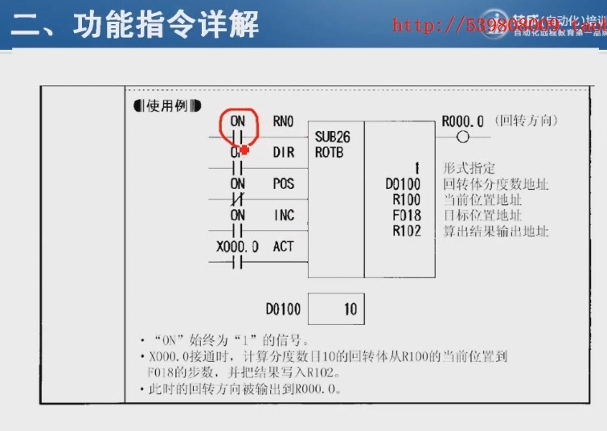

範例說明：

- "ON" 始終為 "1" 的信號：RNO＝1（位置號從 1 開始）、DIR＝1（判別方向）、POS＝0（計算到達目標位置的步數）、INC＝1（計算步數）。
- 形式指定為 1（1 個字節）；分度數放在 D0100，其值為 10；當前位置在 R100；目標位置在 F018；結果放在 R102。
- X000.0 接通時，計算分度數為 10 的回轉體從 R100 的當前位置到 F018 位置所需的步數，並把結果寫入 R102。
- 此時的回轉方向被輸出到 R000.0（0＝正轉，1＝反轉）。

### 4. 實機演示

演示程式的參數設定如下：

| 項目 | 設定 |
|---|---|
| RNO | R9091.1（常 1）→ 位置號從 1 開始 |
| DIR | R9091.1（常 1）→ 判別最近路徑方向 |
| POS | R9091.0（常 0）→ 計算到達目標位置的步數 |
| INC | R9091.1（常 1）→ 計算步數 |
| ACT | X27.4 |
| 形式指定 | 0001（1 字節） |
| 分度數地址 | D0106 |
| 當前位置地址 | D0100 |
| 目標位置地址 | D0102 |
| 結果輸出地址 | D0104 |
| 方向輸出（W1） | Y27.4 |

> R9091.0 ＝ 常 0 信號，R9091.1 ＝ 常 1 信號。

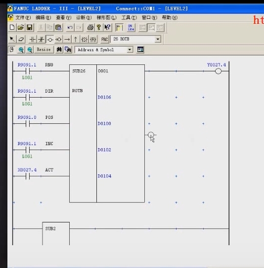

先在 PMC 數據表中設定各數值：**D0106（分度數）＝8、D0100（當前位置）＝3、D0102（目標位置）＝8**。

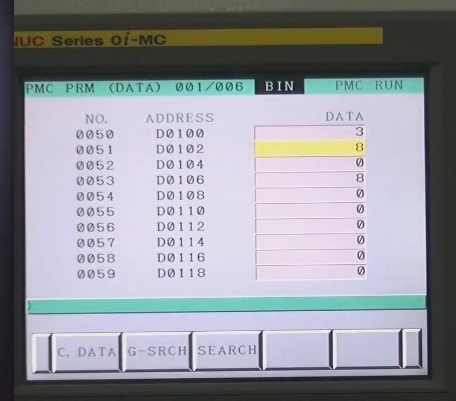

按下 X27.4 執行後，在線監控畫面顯示：D0104＝3，即**需要 3 步**，並且方向輸出 Y27.4 為 1（**反轉**）。

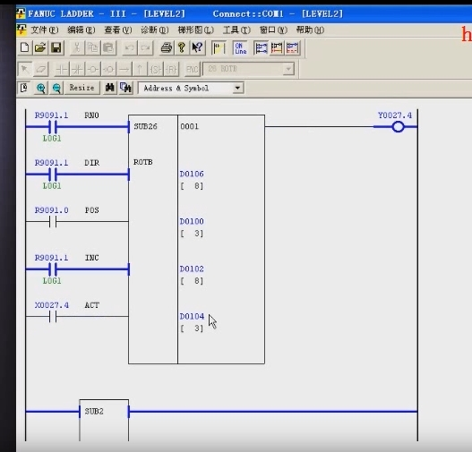

**自己先推算驗證：**

- 正轉：3 → 4 → 5 → 6 → 7 → 8，需要 **5 步**。
- 反轉：3 → 2 → 1 → 8，只需 **3 步**。

所以最近路徑是反轉 3 步，與指令算出的結果完全一致。

**如果不選擇最近方向：** 把 DIR 改為 R9091.0（常 0，不判別方向），其他數值不變。再按 X27.4，結果 D0104＝**5**，方向始終為正轉（Y27.4＝0）。

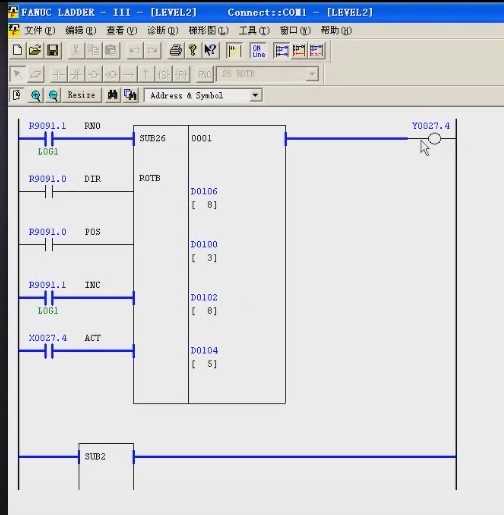

> 小結：DIR＝1 時，ROTB 會比較正轉與反轉的步數，選擇步數較少的方向；DIR＝0 時，始終按正轉計算。

---

## 二、SUB7　COD（代碼轉換）

### 1. 功能說明

COD 指令是將 BCD 代碼轉換為任意的 2 位或 4 位 BCD 數字。使用代碼轉換必須提供三樣東西：

1. **轉換數據輸入地址**：輸入數據所在的地址；
2. **轉換表**：一張數據表；
3. **轉換數據輸出地址**：轉換後的結果放在哪裡。

工作方式：在「轉換輸入數據地址」中，以 2 位 BCD 碼形式指定一個**表內號**，指令根據這個表內號到轉換表中取出對應的數據，再輸出到「轉換數據輸出地址」。

如圖所示：當轉換數據輸入地址中輸入 3 時，位於轉換表中位置 3 的內容 137 就被輸出到轉換數據輸出地址。

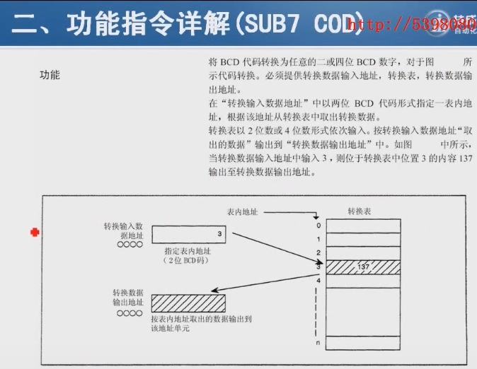

### 2. 指令格式與參數

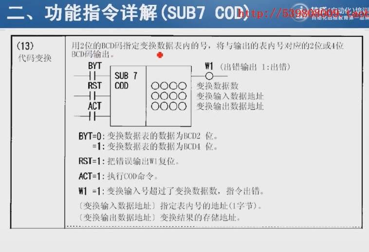

| 條件／參數 | 說明 |
|---|---|
| **BYT** | 0：轉換數據表中的數據為 BCD 2 位；1：轉換數據表中的數據為 BCD 4 位 |
| **RST** | 1：把錯誤輸出 W1 復位 |
| **ACT** | 1：執行 COD 指令 |
| **W1** | 1：轉換輸入號超過了轉換數據數，指令出錯 |
| **轉換數據數** | 轉換數據表中一共有多少個數據 |
| **轉換輸入數據地址** | 指定表內號的地址（1 字節，2 位 BCD 碼） |
| **轉換輸出數據地址** | 轉換結果的存放地址 |

> ⚠ 注意區別：BYT 所說的「2 位／4 位 BCD」是指**數據表裡面的數據**；而轉換輸入數據地址裡的表內號，永遠是 1 字節（2 位 BCD 碼）。

### 3. 使用範例

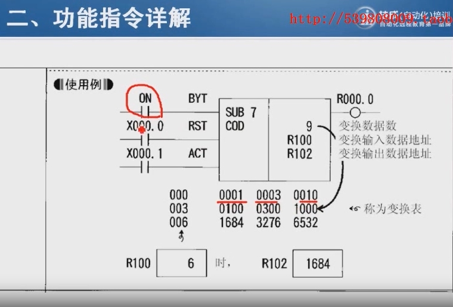

範例說明：

- BYT＝1：數據表中的數據為 4 位 BCD 碼；
- 轉換數據數＝9：表內共有 9 個數據（表內號 0～8，注意 9 是**個數**，不是序號）；
- 轉換輸入數據地址 R100，轉換輸出數據地址 R102；
- 轉換表內容（表內號由 0 起，依序為）：
  `0001, 0003, 0010, 0100, 0300, 1000, 1684, 3276, 6532`
- 當 R100＝6 時，取出表內號 6 的數據，所以 **R102＝1684**。

### 4. 實機演示

演示程式設定：

| 項目 | 設定 |
|---|---|
| BYT | R9091.1（常 1）→ 表內數據為 4 位 BCD |
| RST | X27.5 |
| ACT | X27.4 |
| 轉換數據數 | 0009（9 個數據） |
| 轉換輸入數據地址 | D0100 |
| 轉換輸出數據地址 | D0102 |
| 錯誤輸出 W1 | Y27.5 |

輸入轉換數據數 9 之後，編輯軟體會立即跳出數據表（左邊是序號，右邊才是數據）。在運行程式之前，**一定要先把數據表填好**，演示用的數據表如下：

| 表內號 | 0 | 1 | 2 | 3 | 4 | 5 | 6 | 7 | 8 |
|---|---|---|---|---|---|---|---|---|---|
| 數據 | 0001 | 0003 | 0010 | 0100 | 0300 | 1000 | 1684 | 3276 | 6532 |

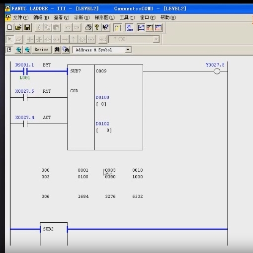

因為 COD 處理的是 BCD 碼，所以數據表的顯示格式要設定為 BCD（在數據表控制畫面的參數最後第 0 位為 0 表示 BCD 碼），這樣顯示出來的數值才正常。

**演示一：查表內號 6**
在 D0100 中設定 6，按 X27.4 執行，D0102 變成 **1684**（表內號 6 對應的數據）。

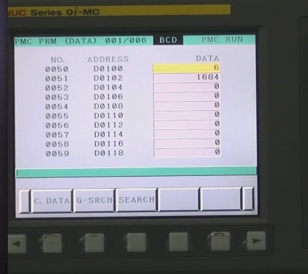

**演示二：查表內號 4**
把 D0100 改為 4，這時 D0102 並不會立刻改變，要再按一下執行條件 X27.4 才會更新，結果 D0102＝**300**。

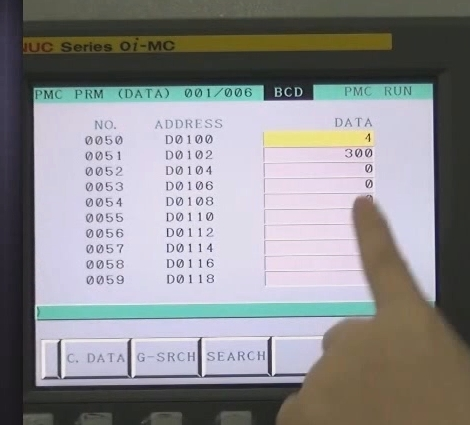

**演示三：查表內號 8**
D0100 設為 8，再按 X27.4，D0102＝**6532**。

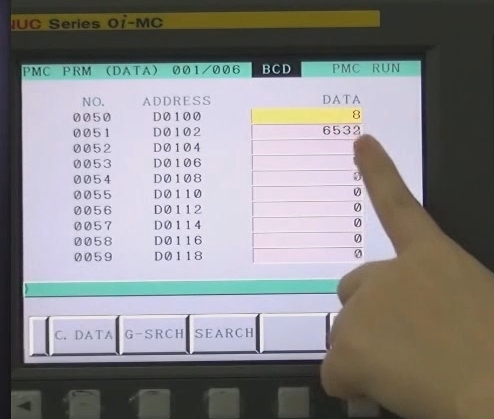

---

## 三、SUB27　CODB（二進制代碼轉換）

### 1. 功能說明

前面的 COD 處理 BCD 代碼，CODB 則是**二進制代碼轉換**。此指令將二進制格式的數據轉換為 1 字節、2 字節或 4 字節的二進制數據。

與 COD 一樣，必須提供轉換數據地址、轉換表、轉換數據輸出地址。與 COD 相比，CODB 的特點是：

1. 可處理 **1、2 或 4 字節**長度的二進制格式數據；
2. 轉換表的容量大，最大可達 **256 個數據**（表內號 0～255）。

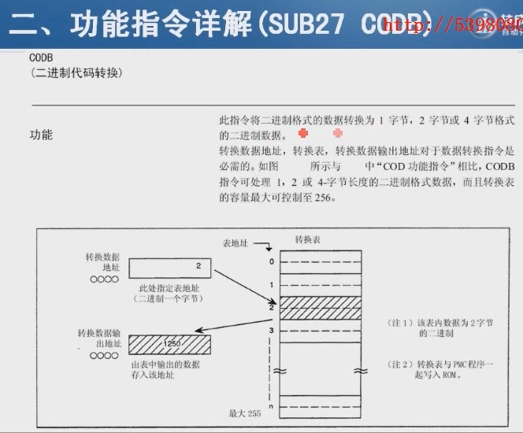

### 2. 指令格式與參數

用 2 位的二進制碼指定轉換數據表內的號，將與輸入的表內號對應的 1、2、4 字節的數值輸出。

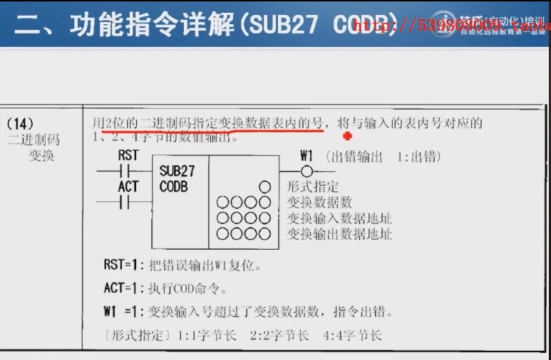

| 條件／參數 | 說明 |
|---|---|
| **RST** | 1：把錯誤輸出 W1 復位 |
| **ACT** | 1：執行 CODB 指令 |
| **W1** | 1：轉換輸入號超過了轉換數據數，指令出錯 |
| **形式指定** | 1＝1 字節、2＝2 字節、4＝4 字節 |
| **轉換數據數** | 數據表中有多少個數據 |
| **轉換輸入數據地址** | 表內號所在地址 |
| **轉換輸出數據地址** | 轉換結果的存放地址 |

> 出錯的情況：例如數據表只有 8 個數（表內號 0～7），而給的表內號是 9，超過了轉換數據數，W1 就會輸出 1，表示出錯。

### 3. 應用舉例：倍率開關的處理

CODB 可用於倍率開關（進給倍率）的處理：

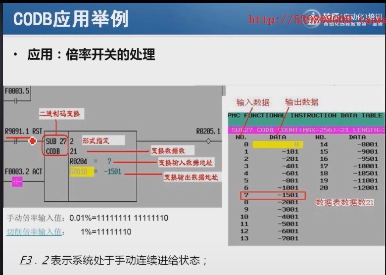

- RST 接 R9091.1（常 1 信號），即不對錯誤輸出進行復位；
- ACT 接 F0003.2：表示系統處於**手動連續進給狀態**時，才執行倍率開關的處理；
- 形式指定＝2：數據為 2 字節；
- 轉換數據數＝21：表內共 21 個數據（表內號 0～20）；
- 轉換輸入數據地址 R0204，其內容為 7，即查找表內號 7；
- 表內號 7 的數據為 **−1501**，輸出到轉換輸出數據地址（圖中反白處，用以控制倍率）。

資料表（表內號 → 數據）如下，共 21 個：

| 表內號 | 數據 | 表內號 | 數據 | 表內號 | 數據 |
|---|---|---|---|---|---|
| 0 | 0 | 7 | −1501 | 14 | −8001 |
| 1 | −101 | 8 | −2001 | 15 | −9001 |
| 2 | −201 | 9 | −3001 | 16 | −9501 |
| 3 | −401 | 10 | −4001 | 17 | −10001 |
| 4 | −601 | 11 | −5001 | 18 | −10501 |
| 5 | −801 | 12 | −6001 | 19 | −11001 |
| 6 | −1001 | 13 | −7001 | 20 | −12001 |

倍率輸入值與數據格式：

- 手動倍率輸入值：0.01% ＝ `11111111 11111110`
- 切削倍率輸入值：1% ＝ `11111110`

### 4. 實機演示

演示程式設定：

| 項目 | 設定 |
|---|---|
| RST | X27.5 |
| ACT | X27.4 |
| 錯誤輸出 W1 | Y27.5 |
| 形式指定 | 0002（2 字節） |
| 轉換數據數 | 0005（5 個數據） |
| 轉換輸入數據地址 | D0100 |
| 轉換輸出數據地址 | D0102 |

輸入參數後，同樣會跳出數據表對話框，演示的數據表為：

| 表內號 | 0 | 1 | 2 | 3 | 4 |
|---|---|---|---|---|---|
| 數據 | 0 | −101 | −201 | −401 | −601 |

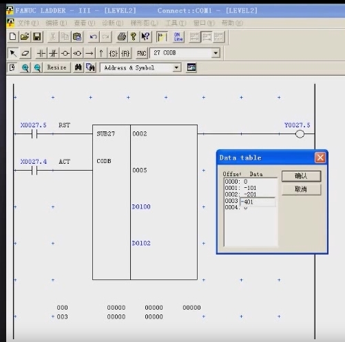

數據表填好後，梯形圖下方即顯示出表內的數據：

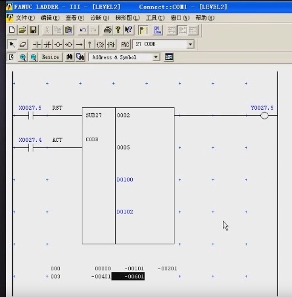

> 提示：因為 CODB 是 2 字節二進制數據，以 2 字節或 1 字節的形式顯示同一個數，其顯示的數值是不同的，所以要注意格式指定與顯示格式要對應。

**演示一：查表內號 4**
D0100 設為 4，按 X27.4 之後，D0102 立刻變成 **−601**，正是數據表中表內號 4 的數據。

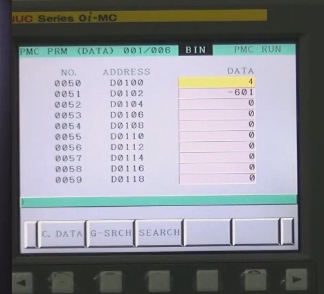

**演示二：查表內號 3**
D0100 設為 3，再按 X27.4，D0102 變成 **−401**。

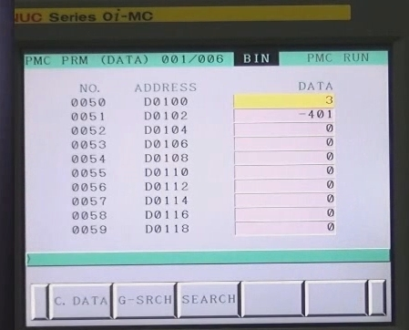

**補充：表內號超出範圍。** 下圖 D0100＝8，已超過轉換數據數 5（表內號只有 0～4），屬於超範圍的輸入，此時 D0102 顯示的 25906 並不是表內的數據（指令出錯，W1＝Y27.5 輸出為 1）。

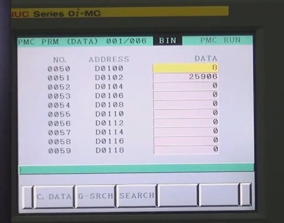

**數據表控制畫面：** PMC 的「DATA TBL CONTROL」畫面可用來設定數據表的位址、參數（PARAMETER）、類型（TYPE）與數據個數（NO. OF DATA）。參數最後第 0 位為 0 表示數據表為 BCD 格式，為 1 表示二進制格式。

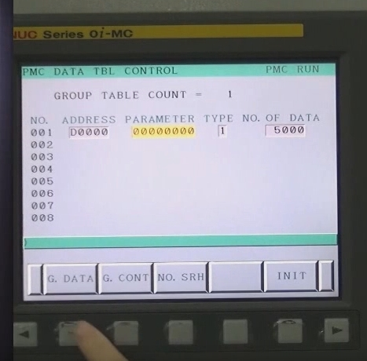

---

## 四、SUB8　MOVE（邏輯乘數據傳送）

### 1. 功能說明

MOVE 指令是將**輸入數據與邏輯乘數（比較數據）進行邏輯乘（AND）**，並將結果輸出到指定的地址。它還可以用來從指定地址的一個 8 位信號中，**排除不需要的位**。

下圖中，輸入數據共 8 位（第 7～0 位），邏輯乘數也是 8 位，分成**高 4 位邏輯乘數**（第 7～4 位）和**低 4 位邏輯乘數**（第 3～0 位）兩部分來指定。

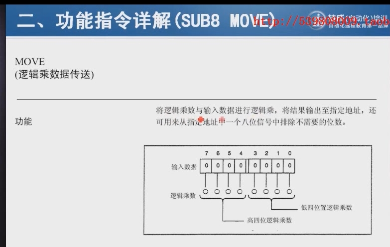

### 2. 指令格式與參數

- 功能指令號：SUB8，指令符：MOVE（邏輯乘後數據傳送）；
- 將傳送地址指定的 **1 字節**數據與比較數據進行邏輯乘（AND），並把結果寫入輸出數據地址；
- 參數共四個：**比較數據高位 4 位**、**比較數據低位 4 位**、**輸入數據地址**、**輸出數據地址**；
- 只有 ACT 一個控制條件，且**沒有結果輸出線圈**，所以功能指令的輸出直接接到右母線。（前面講過，大部分功能指令都留有輸出線圈位置；MOVE 沒有，所以直接接右母線。）
- 用途：**數據的屏蔽**、**斷開指定位**。

### 3. 原理與使用範例

邏輯乘的規則：**與 0 相乘的結果都是 0，與 1 相乘則保留原來的數值**。因此只要把想屏蔽的位對應的比較數據設為 0，想保留的位設為 1，就能實現數據的屏蔽。

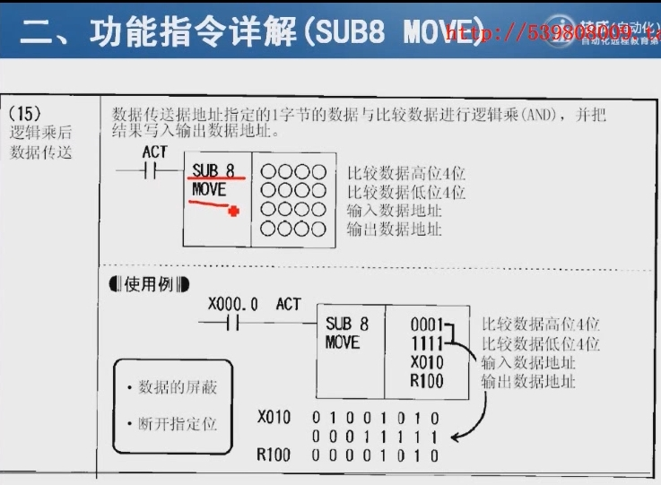

範例一：X000.0 接通（ACT）時執行 MOVE，比較數據高 4 位為 `0001`、低 4 位為 `1111`，輸入數據地址 X010，輸出數據地址 R100：

```
X010  = 0 1 0 0 1 0 1 0
比較數 = 0 0 0 1 1 1 1 1
R100  = 0 0 0 0 1 0 1 0
```

比較數據為 0 的位（第 7、6、5 位）被屏蔽為 0；為 1 的位保留原狀態。

**應用舉例：屏蔽某些位的輸出。**

範例二：X0005.0（ACT）接通時，比較數據高 4 位 `0`（0000）、低 4 位 `1111`，輸入數據 X0004＝FF（8 位全是 1），輸出到 D0100，結果 D0100＝**0F**。即把 X0004 的前 4 位屏蔽掉，只輸出後面 4 位，後 4 位保持原來的狀態。

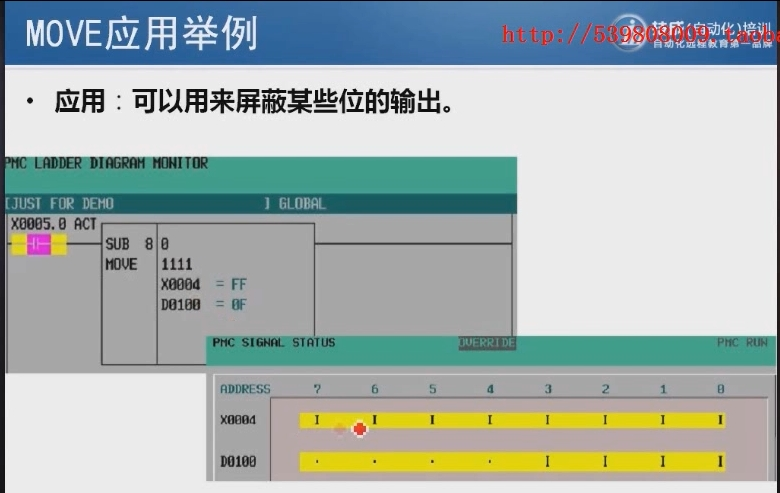

### 4. 實機演示

演示程式設定：

| 項目 | 設定 |
|---|---|
| ACT（執行條件） | X27.4 |
| 比較數據（高 4 位） | 0000 |
| 比較數據（低 4 位） | 1111（即 0F） |
| 輸入數據地址 | D0100 |
| 輸出數據地址 | D0102 |

MOVE 沒有輸出線圈，指令直接接右母線。程式編輯完成後，傳送（Store of ladder）到 PMC：

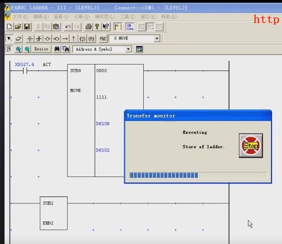

接著用 PMC 的**信號強制（SIGNAL FORCING）**功能，給 D0100 強制賦值（演示中把 D0100 的低 7 位全部置 1，即 7F），運行程式後按下 X27.4：

- D0100：第 6～0 位為 1（`0111 1111`）；
- D0102：只有第 3～0 位為 1（`0000 1111`）。

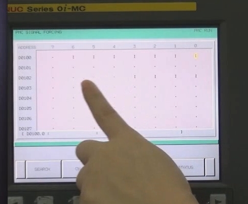

D0100 與 `0000 1111` 做邏輯乘之後，結果傳到 D0102：因為高 4 位比較數據為 0，高 4 位被屏蔽為 0；低 4 位比較數據為 1，低 4 位保持 D0100 原來的狀態。

---

## 本課時小結

| 指令 | 功能號 | 功能 | 重點 |
|---|---|---|---|
| ROTB | SUB26 | 二進制回轉控制 | 數據為二進制，須指定 1/2/4 字節；分度數用地址指定 |
| COD | SUB7 | BCD 代碼轉換 | 表內號為 2 位 BCD（1 字節）；表內數據 2 位或 4 位 BCD（BYT 決定） |
| CODB | SUB27 | 二進制代碼轉換 | 可處理 1/2/4 字節；轉換表最大 256 個數據 |
| MOVE | SUB8 | 邏輯乘數據傳送 | 與 0 相乘為 0、與 1 相乘保留；用於屏蔽不需要的位 |
