# 第16課時　FANUC-PMC 功能指令 05

> 本課時內容：
> 1. **SUB28　MOVOR**　邏輯或後的數據傳送
> 2. **SUB43　MOVB**　傳送 1 字節數據
> 3. **SUB44　MOVW**　傳送 2 字節數據
> 4. **SUB9／SUB29　COM／COME**　公共線控制
> 5. **SUB10／SUB30　JMP／JMPE**　跳轉
> 6. **SUB68　JMPB**　標號跳轉 1
> 7. **SUB73　JMPC**　標號跳轉 2

---

## 一、SUB28　MOVOR（邏輯或後的數據傳送）

### 1. 功能說明

MOVOR 指令將**輸入數據與邏輯和數據（比較數據）進行邏輯加（OR）運算**，然後將結果送到指定地址。

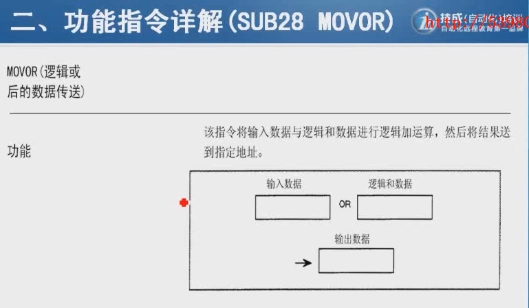

### 2. 指令格式與參數

用輸入數據地址指定的 1 字節數據與比較數據進行邏輯和（OR），並把結果寫入輸出數據地址。

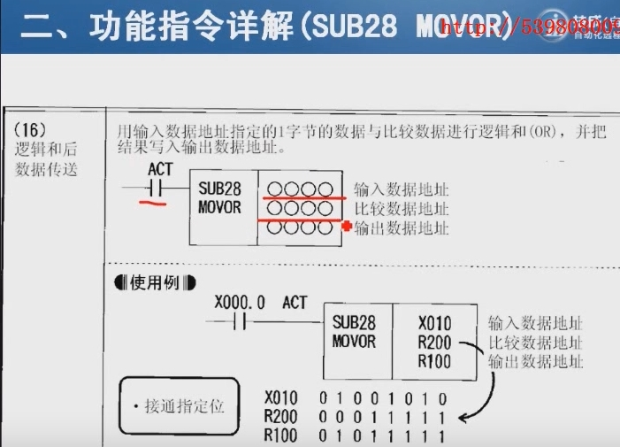

| 參數 | 說明 |
|---|---|
| **ACT** | 1：執行 MOVOR 指令 |
| **輸入數據地址** | 被運算的 1 字節輸入數據所在地址 |
| **比較數據地址** | 與輸入數據做 OR 運算的數據所在地址 |
| **輸出數據地址** | 運算結果的輸出地址 |

> ⚠ 與上一課時的 MOVE 比較：MOVE 的比較數據是**直接給定的常數**（高 4 位／低 4 位），而 MOVOR 的比較數據是**給一個地址**，由該地址內的數值參與運算。

### 3. 原理與使用範例

邏輯加（OR）的規則：**與 1 相加結果為 1，與 0 相加則保留原來的數值**。因此要接通指定位，只要把比較數據中對應的位設為 1，其餘位設為 0 即可，其餘位保持輸入數據原來的狀態。所以 MOVOR 可以起到**接通指定位**的作用，也就是**強制某些位輸出為 1**。

範例一：X000.0 接通（ACT）時執行 MOVOR，輸入數據地址 X010，比較數據地址 R200，輸出數據地址 R100。若要接通後 5 位，就把 R200 的後 5 位設為 1：

```
X010 = 0 1 0 0 1 0 1 0
R200 = 0 0 0 1 1 1 1 1
R100 = 0 1 0 1 1 1 1 1
```

R100 的後 5 位必然為 1，前面的位保留 X010 原來的狀態。

範例二（應用：可以強制某些位輸出為 1）：X0006.0（ACT）接通時，輸入數據 X0004＝0F（`0000 1111`），比較數據 X0005＝F0（`1111 0000`），結果輸出到 D0100＝FF（`1111 1111`）。也就是把輸入數據的**高 4 位全部強制為 1**，低 4 位保持原來的狀態。

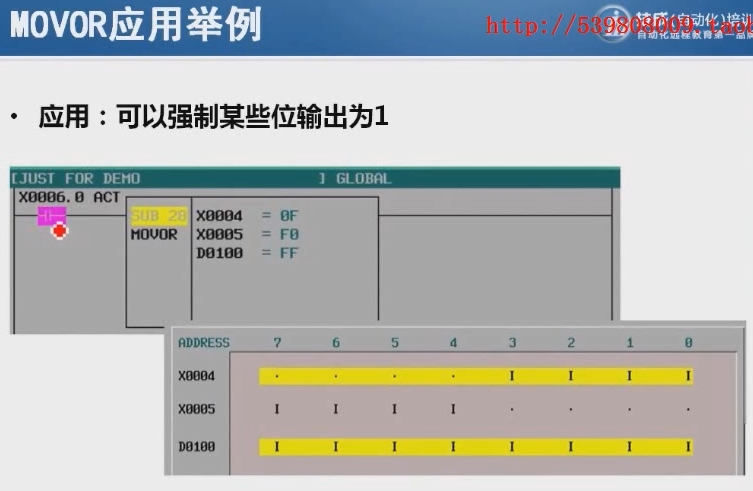

### 4. 實機演示

演示程式設定：

| 項目 | 設定 |
|---|---|
| 功能指令號 | 28（SUB28 MOVOR） |
| ACT（執行條件） | X27.4 |
| 輸入數據地址 | D0100 |
| 比較數據地址 | D0101 |
| 輸出數據地址 | D0102 |

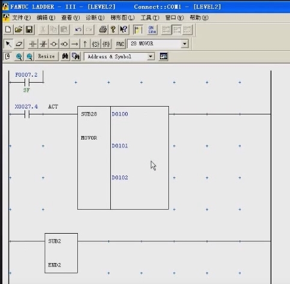

使用這個功能指令之前，要先在 PMC 的**數據表控制畫面**（PMC DATA TBL CONTROL）把數據格式設定好：參數保持 `00000000`，數據類型（TYPE）設為 0（1 字節），數據個數 10000。

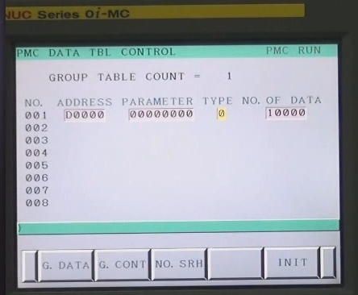

在 PMC 參數（DATA）畫面中，設定 **D0100＝57、D0101＝30**（BIN 格式，十進制顯示）。

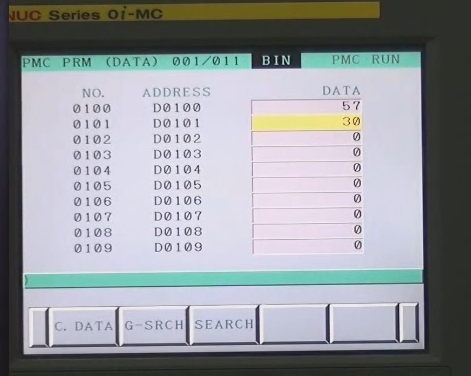

用信號狀態畫面（PMC SIGNAL STATUS）查看二進制位：

- D0100＝57＝`0011 1001`（第 5、4、3、0 位為 1）；
- D0101＝30＝`0001 1110`（第 4、3、2、1 位為 1）。

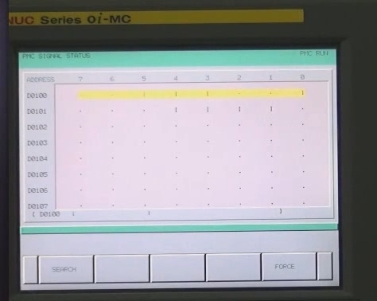

按下 X27.4 執行後，D0102 的第 5～0 位全部為 1（`0011 1111`，即十進制 63），正是 D0100 與 D0101 逐位 OR 的結果。

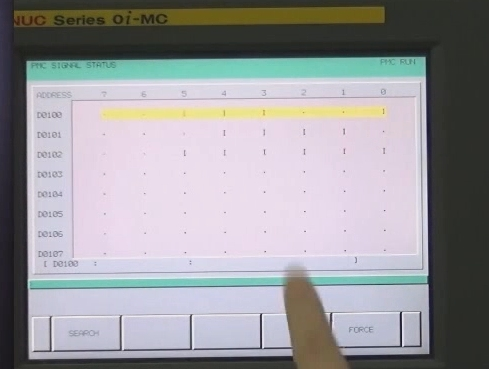

---

## 二、SUB43　MOVB（傳送 1 字節數據）

把 1 字節的數據從被指令的**傳出位置地址**傳送到**傳入位置地址**。

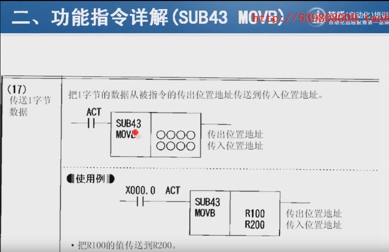

| 參數 | 說明 |
|---|---|
| **ACT** | 1：執行 MOVB 指令 |
| **傳出位置地址** | 數據的來源地址 |
| **傳入位置地址** | 數據的目的地址 |

使用例：X000.0 接通時，把 **R100** 的值傳送到 **R200**。

---

## 三、SUB44　MOVW（傳送 2 字節數據）

把 2 字節的數據從被指令的傳出位置地址傳送到傳入位置地址。

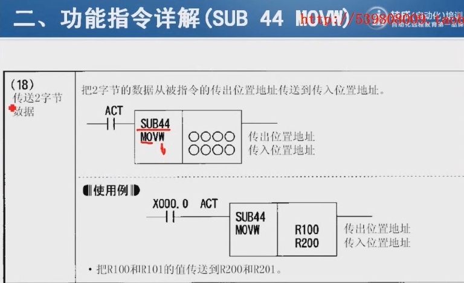

使用例：X000.0 接通時，把 **R100 和 R101** 的值傳送到 **R200 和 R201**。

> 小結：MOVB 傳 1 個字節，MOVW 傳 2 個字節（連續的兩個地址）。

---

## 四、SUB9／SUB29　COM／COME（公共線控制）

### 1. 功能說明

COM 指令控制**直至公共線結束指令（COME）範圍內的線圈**工作。指令中的參數 0 為線圈數，用公共線結束指令 COME（SUB29）來指定控制範圍。

若未指定公共線結束指令，CNC 會顯示 **"COM FUNCTION MISSING"** 信息。

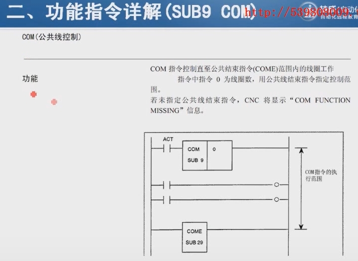

### 2. 指令格式與動作

COM 用來**斷開 COME 指令之前的區間線圈**。

| 條件／參數 | 說明 |
|---|---|
| **ACT＝0** | 無條件斷開 COME 之前的線圈 |
| **ACT＝1** | 什麼都不動（線圈正常工作） |
| **進行斷開的線圈數** | RB／RC 以外的 PMC 型號必須指定 "0" |

使用例：X000.0 為 "0" 時，COM 到 COME 之間的線圈 X、Y、Z（分別由 A、B、C 接點控制）將**無條件地變為 "0"**。

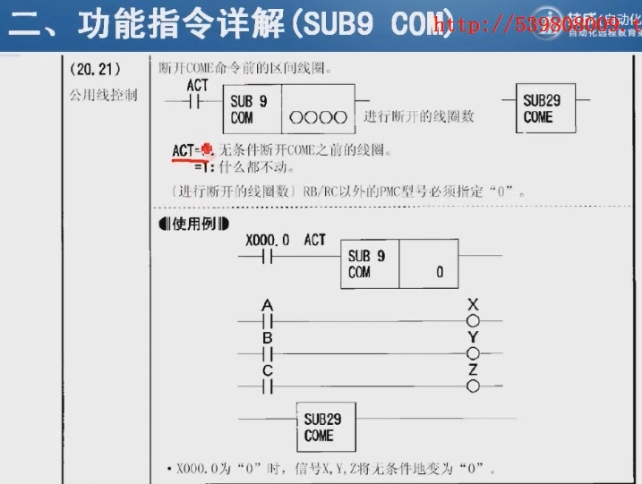

---

## 五、SUB10／SUB30　JMP／JMPE（跳轉）

### 1. 功能說明

JMP 指令使梯形圖程序轉移。指定 JMP 指令時，執行過程會**跳至跳轉結束指令 JMPE**，不執行 JMP 與 JMPE 之間的邏輯指令（包括功能指令）。

線圈數指定為 0，並用 JMPE 指令指定要跳過的範圍。若未指定跳轉結束指令，將顯示 **"JUMP FUNCTION MISSING"** 信息。

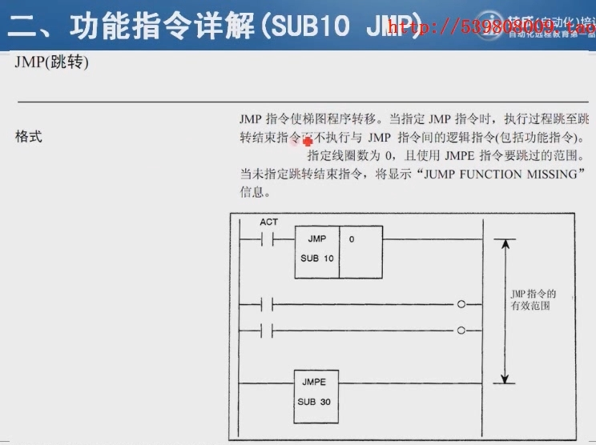

### 2. 指令格式與動作

跳過 JMPE 指令之前的區間。

| 條件／參數 | 說明 |
|---|---|
| **ACT＝0** | 不跳轉，執行下面的命令 |
| **ACT＝1** | 跳過指定區間 |
| **進行跳過的線圈數** | RB／RC 以外的 PMC 型號必須指定 "0" |

使用例：X000.0 為 "1" 時，JMP 到 JMPE 之間的線圈 X、Y、Z **不變化**（保持原狀態，不被執行）。

> JMP 指令的操作：當 ACT＝1 時，程序跳轉到跳轉結束指令處（JMPE），指定範圍內的邏輯指令（包括功能指令）不執行。

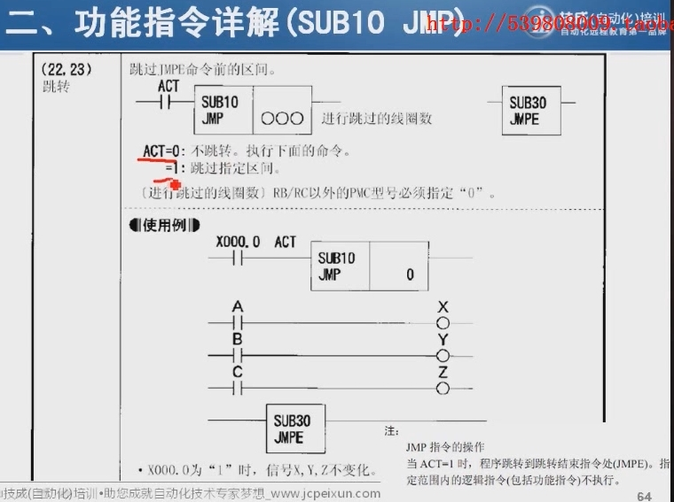

### 3. 注意事項

編程時要注意：使用 JMP 和 JMPE 指令所導致的跳轉，**不應跳至或跳自 COM 和 COME 指令之間的程序**，否則在跳轉後，梯形圖有可能不正常執行。圖中兩種情況（跳入 COM～COME 區間、從 COM～COME 區間內跳出）都標示為「禁用」。

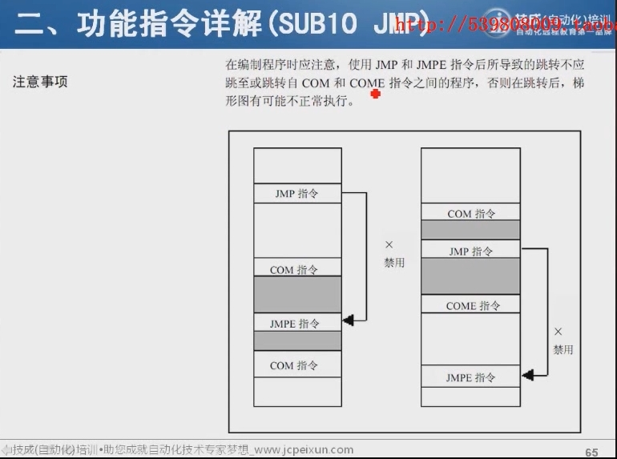

---

## 六、SUB68　JMPB（標號跳轉 1）

### 1. 功能說明

JMPB 指令立即將控制轉移至設置在梯形圖程序中的**標號（LBL）**之後的程序。跳轉指令可使控制在程序單元內（主程序或子程序）在此指令前後自由地跳轉（參見功能指令 LBL 的規格，後面講述）。

與傳統的 JMP 指令相比，JMPB 有以下附加功能：

- **多條跳轉指令可以使用同一標號**；
- **跳轉指令可以嵌套**。

適用機型：PA1（✕ 不可使用）、SA1（✕ 不可使用）、SA3（○ 可以使用）。

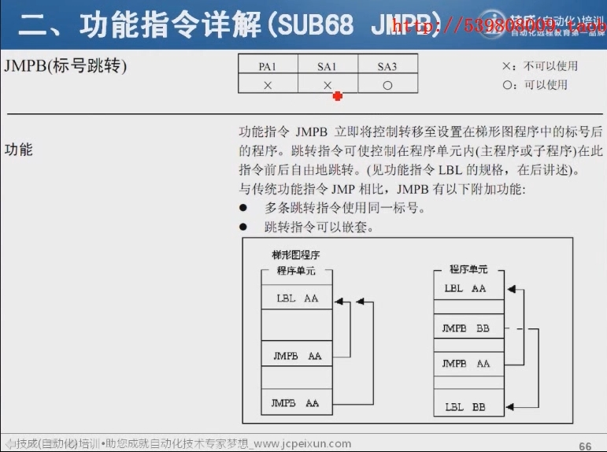

### 2. 指令格式與參數

轉移到被指定標號。

| 條件／參數 | 說明 |
|---|---|
| **ACT＝0** | 不跳轉，執行下面的命令 |
| **ACT＝1** | 跳轉到被指定的標號 |
| **跳入位置的標號號** | L1～L9999；指定不跳過主程序、子程序等的程序單位範圍的標號 |

- 對 1 個標號也可指定多個 JMPB 命令；
- 也可把跳轉命令做成嵌套；
- ⚠ 使用該命令向前跳轉時，請注意不要造成**無限循環**。

使用例：X000.0 為 "1" 時，轉移到標號 **L10**。

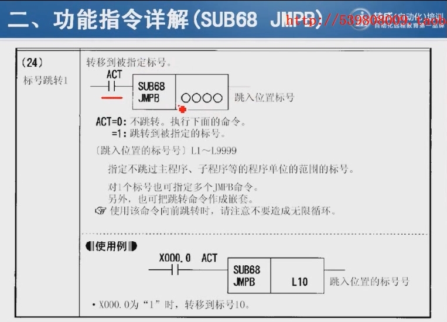

---

## 七、SUB73　JMPC（標號跳轉 2）

### 1. 功能說明

JMPC 指令將控制由**子程序交還回主程序**，確保在主程序中有目的標號代碼。JMPC 的規格與 JMPB 相同，只是 JMPC 總是將控制返回主程序。

- 多條跳轉指令可用同一標號。

適用機型：PA1（✕）、SA1（✕）、SA3（○）。

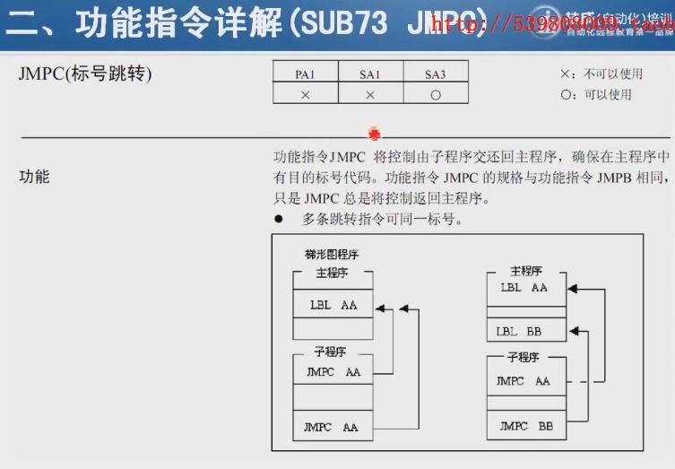

### 2. 指令格式與參數

轉移到被主程序指定的標號。

| 條件／參數 | 說明 |
|---|---|
| **ACT＝0** | 不跳轉，執行下面的命令 |
| **ACT＝1** | 跳轉到被指定的標號 |
| **跳入位置的標號號** | L1～L9999；指定主程序上的標號 |

- 對 1 個標號也可指定多個 JMPC 命令；
- ⚠ 使用該命令進行跳轉時，請注意不要造成無限循環。

使用例：X000.0 為 "1" 時，轉移到主程序的標號 **10**。

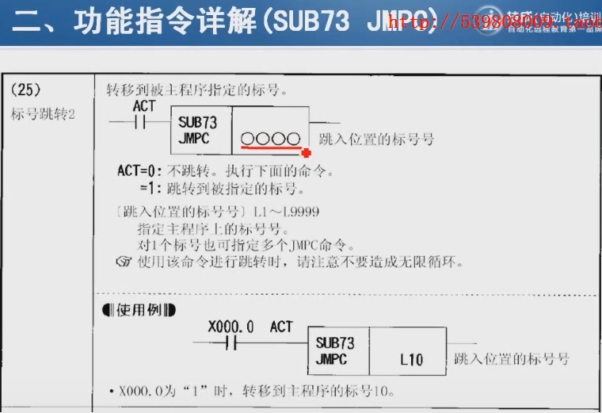

---

## 八、SUB69　LBL（標號）

LBL 指令用來**定義標號**，是 JMPB、JMPC 指令的跳轉目的地。

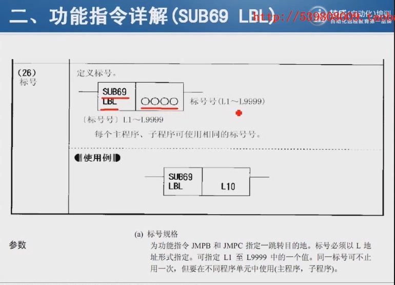

- 標號號：**L1～L9999**，以 L 地址形式指定；
- 每個主程序、子程序都可以使用相同的標號號；
- 同一個標號號在同一個程序單元內不能使用多於一次，但可以在不同的程序單元（主程序、子程序）中分別使用；
- 使用例：`SUB69 LBL　L10`，定義標號 L10。

---

## 九、SUB11　PARI（奇偶校驗）

### 1. 功能說明

PARI 指令對代碼信號進行奇偶校驗，檢測到不正常時輸出錯誤報警。可以指定是進行**偶數校驗**還是**奇數校驗**。校驗的數據是 **1 個字節（8 位）**數據。

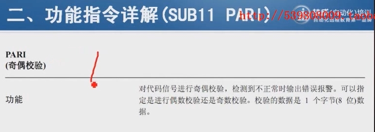

### 2. 指令格式與參數

對被指定的地址進行奇偶校驗，如不正常時，輸出出錯報警。

| 條件／參數 | 說明 |
|---|---|
| **OE** | 0：進行偶數校驗；1：進行奇數校驗 |
| **RST** | 1：把錯誤輸出 W1 復位 |
| **ACT** | 1：執行奇偶校驗指令 |
| **W1** | 在奇偶校驗中發生錯誤時變為接通 |
| **校驗數據地址** | 被校驗的 1 字節數據所在地址 |

使用例：OE＝ON（奇數校驗），RST 接 F001.1，ACT 接 X000.0，校驗數據地址 X010，出錯輸出 R000.0。

- X000.0 接通時，在 X010 的位置數據中，"1" 的個數不是奇數時，出錯輸出 R000.0 即變為 "1"：
  - `X010 = 0 1 0 0 1 1 0 0`（3 個 1，是奇數）⇒ R000.0＝0；
  - `X010 = 0 1 0 1 0 0 0 0`（2 個 1，不是奇數）⇒ R000.0＝1。
- 信號 F001.1 閉合時，出錯輸出 R000.0 即被復位。

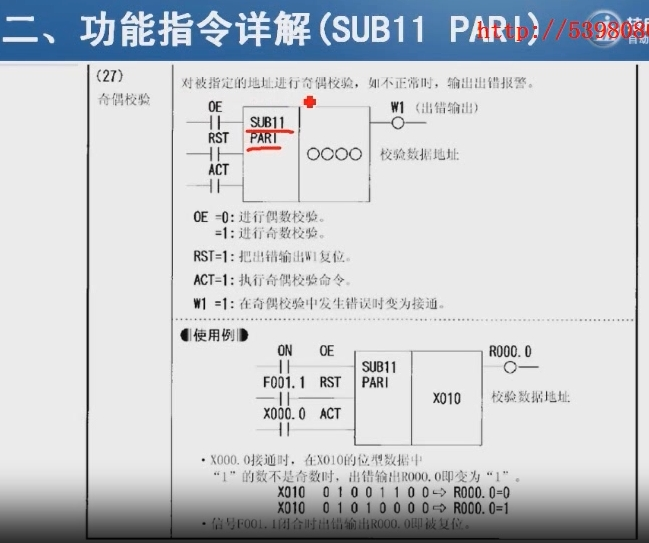

### 3. PARI 指令的使用舉例（對 X36 做奇數校驗）

下圖是對地址 X036 的代碼信號進行奇數校驗的例子：X036 中，低 6 位（第 5～0 位）為 **6 位代碼信號**，另有一位作為**奇數校驗位**。梯形圖中：

- (2) OE：由繼電器 R228.0（A）控制，決定奇／偶校驗；
- (1) RST：接 ERST.M（X32.7）；
- (0) ACT：接 TF（F7.3）；
- 校驗數據地址為 X036，出錯輸出為 ERR。

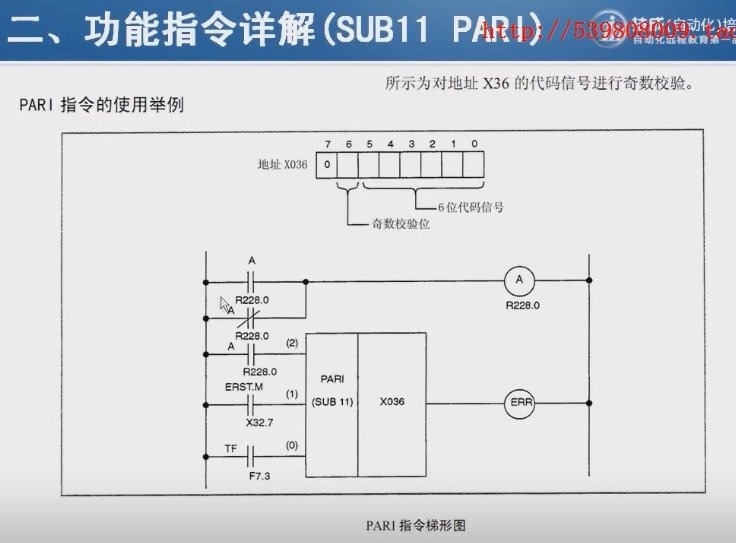

### 4. 應用舉例

- 在 FANUC 標準面板的倍率開關上，都有一位信號作為**校驗位**而存在，可以取樣這個信號進行開關信號的**掉線檢測**處理；
- 同樣的指令也可以應用在刀塔的編碼器反饋刀位檢測上；
- 校驗數據地址：校驗指令只對**一個字節**的數據寄存器進行校驗檢查。

圖中 X0020 的第 5 位為校驗位（偶校驗）。

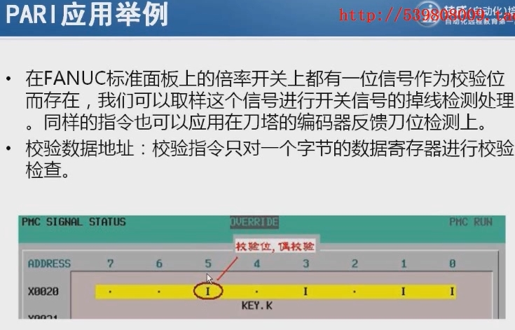

### 5. 實機演示

演示程式設定：

| 項目 | 設定 |
|---|---|
| OE | R9091.0（常 0）→ 偶數校驗；改接 R9091.1（常 1）→ 奇數校驗 |
| RST | X27.5 |
| ACT | X27.4 |
| 校驗數據地址 | D0100（內容 57） |
| 出錯輸出（W1） | Y27.5 |

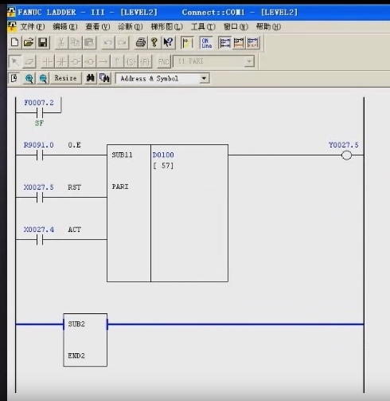

D0100＝57＝`0011 1001`，共有 4 個 "1"（第 5、4、3、0 位），是偶數。（下圖信號狀態中 D0101、D0102 是上一個 MOVOR 演示留下的數值，與本例無關。）

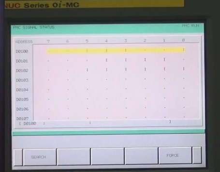

按下 X27.4 執行校驗，並觀察 Y27.5 是否接通：

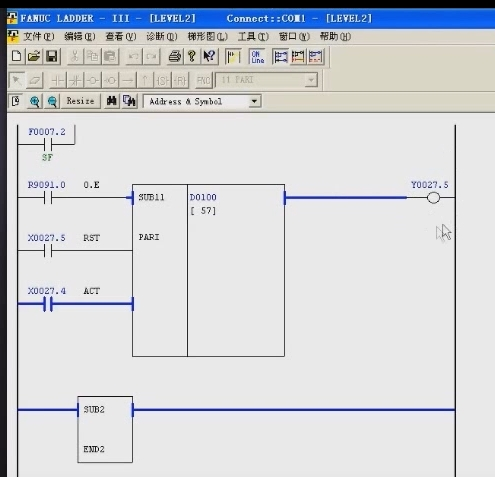

再把 OE 改接成 R9091.1（常 1，改為奇數校驗），重新編譯後再校驗，觀察 Y27.5 的變化：

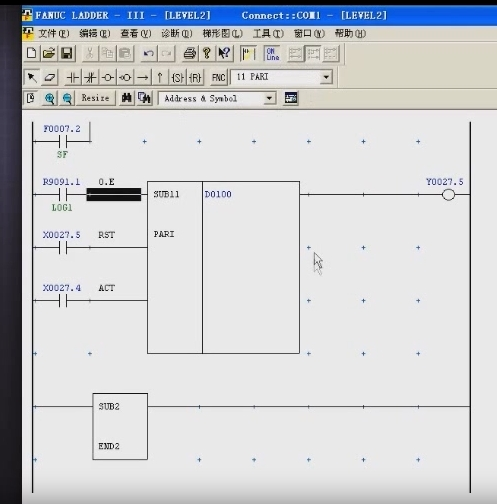

> 判斷規則：偶校驗時，數據中 "1" 的個數為偶數才正常；奇校驗時，"1" 的個數為奇數才正常，不符合則 W1（Y27.5）接通報警。D0100＝57 有 4 個 "1"，所以偶校驗正常、奇校驗報警。

---

## 十、SUB14　DCNV（數據變換）

### 1. 功能說明

DCNV 指令把 1 字節或 2 字節的數據從**二進制碼變換成 BCD 碼**，或從 **BCD 碼變換成二進制碼**。

### 2. 指令格式與參數

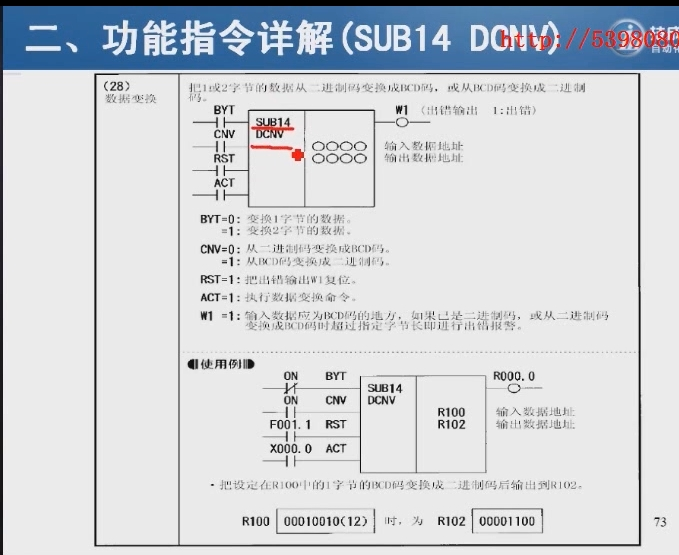

| 條件／參數 | 說明 |
|---|---|
| **BYT** | 0：變換 1 字節的數據；1：變換 2 字節的數據 |
| **CNV** | 0：從二進制碼變換成 BCD 碼；1：從 BCD 碼變換成二進制碼 |
| **RST** | 1：把錯誤輸出 W1 復位 |
| **ACT** | 1：執行數據變換命令 |
| **W1** | 1：出錯。輸入數據應為 BCD 碼的地方，如果已是二進制碼；或從二進制變換成 BCD 碼時超過指定字節長，即進行出錯報警 |
| **輸入數據地址** | 被變換的數據所在地址 |
| **輸出數據地址** | 變換結果的存放地址 |

使用例：BYT＝0（1 字節）、CNV＝1（BCD→二進制）、RST 接 F001.1、ACT 接 X000.0，輸入地址 R100，輸出地址 R102。

- 把設定在 R100 中的 1 字節 BCD 碼變換成二進制碼後輸出到 R102；
- R100＝`0001 0010`（BCD 的 12）時，R102＝`0000 1100`（二進制的 12）。

### 3. 應用舉例

BYT＝R9091.0（1 字節）、CNV＝R9091.0（二進制→BCD），輸入地址 D0001，輸出地址 D0003。D0001＝`0000 1100`（二進制 12），變換後 D0003＝`0001 0010`（BCD 的 12）。

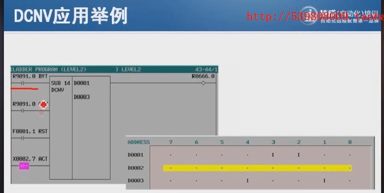

### 4. 實機演示

演示程式設定：

| 項目 | 設定 |
|---|---|
| BYT | R9091.0（常 0）→ 變換 1 字節 |
| CNV | R9091.0（常 0）→ 二進制碼變換成 BCD 碼；稍後改接 R9091.1 → BCD 碼變換成二進制碼 |
| RST | X27.5 |
| ACT | X27.4 |
| 輸入數據地址 | D0100 |
| 輸出數據地址 | D0102 |
| 出錯輸出（W1） | Y27.5 |

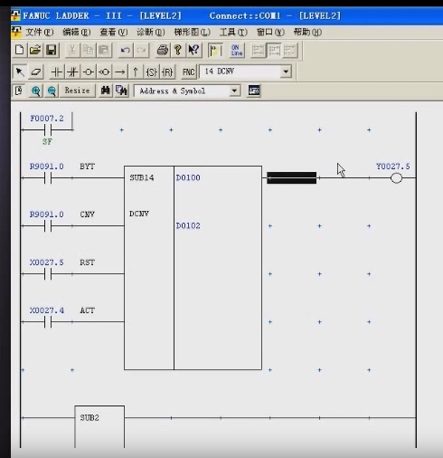

**演示一：二進制 → BCD。** 用信號強制給 D0100 賦值 `0101 0111`（即 57H，十進制 87）：

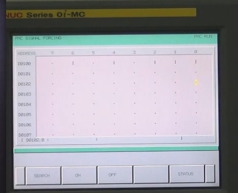

按下 X27.4 後，D0102＝`1000 0111`，也就是 BCD 碼的 87（87H）。

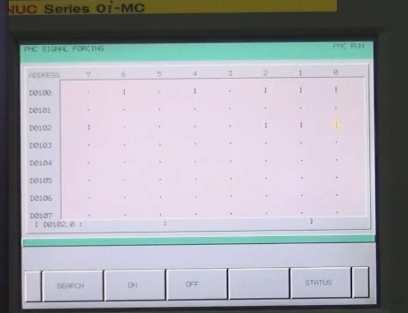

**演示二：BCD → 二進制。** 把 CNV 改接為 R9091.1（常 1），編譯時會跳出「源程序已經被更新，編譯嗎？」的提示，選擇「是」：

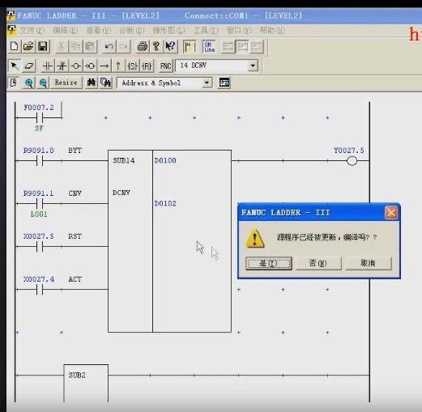

此時 D0100 的 `0101 0111` 被視為 BCD 碼的 57，按下 X27.4 後，D0102＝`0011 1001`，即二進制的 57（39H）。

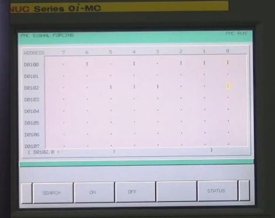

> 小結：同一個數據 `0101 0111`，當成二進制是 87，當成 BCD 是 57，DCNV 的 CNV 參數決定按哪一種方向變換。

---

### 5. 補充演示：改變 D0100 的值再觀察 D0102

接著在 BCD → 二進制的狀態下（CNV＝R9091.1），用信號強制把 D0100 改成 `1001 0111`（BCD 的 97）。此時 D0102＝`0110 0001`，即二進制的 97（61H），變換結果與預期一致。

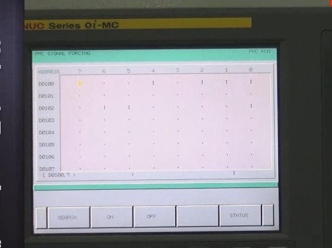

繼續用信號強制選取 D0100 的第 6 位，準備修改該位的狀態：

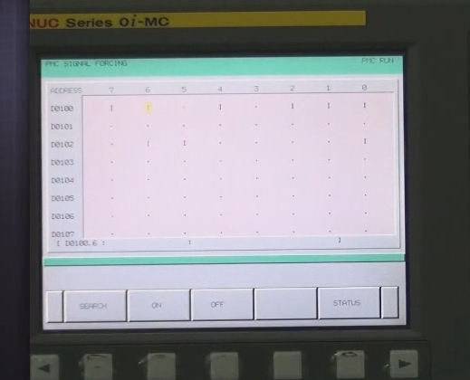

修改梯形圖後，要重新運行 PMC 程序，系統會跳出「Program RUN/STOP」確認視窗，選擇「是」即可。畫面中 BYT、CNV 均已改回 R9091.0，輸出 Y27.5 為出錯輸出：

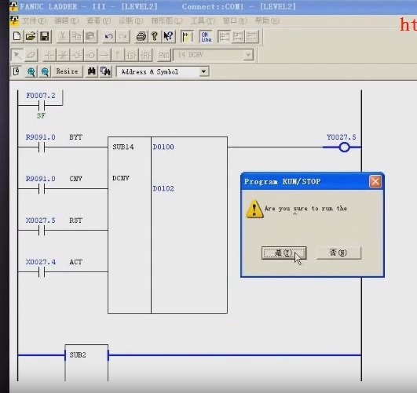

重新運行後，D0100 仍為 `1001 0111`，游標停在第 6 位，D0102 保持上一次的結果 `0110 0001`，等待再次按下 X27.4 執行變換：

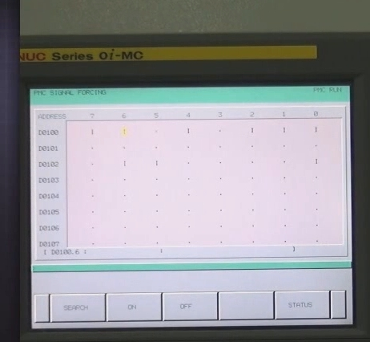

> 提示：CNV＝0（二進制→BCD）時，若輸入的二進制數大於 99，變換結果超過 1 字節 BCD 能表示的範圍，W1 就會接通出錯（Y27.5）；CNV＝1（BCD→二進制）時，若輸入數據不是合法的 BCD 碼，同樣會出錯。這一段的最後兩張圖（chs16_38、39）講稿沒有對應說明，上述出錯情況是依指令規格補充的，未在截圖中得到確認。

---

## 本課時小結

| 指令 | 功能號 | 功能 | 重點 |
|---|---|---|---|
| MOVOR | SUB28 | 邏輯或後的數據傳送 | 輸入數據與比較數據（用地址指定）做 OR；可強制某些位為 1 |
| MOVB | SUB43 | 傳送 1 字節數據 | 傳出地址 → 傳入地址 |
| MOVW | SUB44 | 傳送 2 字節數據 | 連續 2 個地址一起傳送 |
| COM／COME | SUB9／SUB29 | 公共線控制 | ACT＝0 時，無條件斷開 COME 之前的線圈；缺少 COME 報 COM FUNCTION MISSING |
| JMP／JMPE | SUB10／SUB30 | 跳轉 | ACT＝1 時跳過 JMPE 之前的區間；不可跳入／跳出 COM～COME 區間 |
| JMPB | SUB68 | 標號跳轉 1 | 跳到標號 L1～L9999；多條跳轉可共用標號、可嵌套；注意無限循環 |
| JMPC | SUB73 | 標號跳轉 2 | 由子程序返回主程序標號；其餘規格同 JMPB |
| LBL | SUB69 | 標號 | 定義 L1～L9999；同一程序單元內不可重複 |
| PARI | SUB11 | 奇偶校驗 | OE＝0 偶校驗、1 奇校驗；校驗 1 字節；用於倍率開關掉線檢測、刀塔編碼器 |
| DCNV | SUB14 | 數據變換 | BYT 選 1/2 字節；CNV＝0 二進制→BCD，CNV＝1 BCD→二進制 |

