# 第 17 課時：FANUC PMC 功能指令 06

> 本課時內容：**擴展數據變換 DCNVB**、**大小比較 COMP**、**二進制大小比較 COMPB**、**一致性判斷 COIN**、**移位寄存器 SFT**。
> 圖片統一放在 `images/` 目錄，沿用原檔名（chs17_01 ～ chs17_42）。

## 目錄

1. 擴展數據變換 DCNVB（SUB 31）
2. 大小比較 COMP（SUB 15）
3. 二進制大小比較 COMPB（SUB 32）
4. 一致性判斷 COIN（SUB 16）
5. 移位寄存器 SFT（SUB 33）
6. 全課總結

---

## 本課時指令一覽

| 指令名稱 | 功能指令號 | 助記符 | 處理的數據類型 | 結果輸出 |
|---|---|---|---|---|
| 擴展數據變換 | SUB 31 | DCNVB | 1/2/4 字節，二進制 ⇄ BCD | W1（出錯）、R9000 |
| 大小比較 | SUB 15 | COMP | 2 位或 4 位 BCD | W1 |
| 二進制大小比較 | SUB 32 | COMPB | 1/2/4 字節二進制 | R9000 |

---

## 一、擴展數據變換 DCNVB（SUB 31）

### 1.1 功能概述

擴展數據變換可以把 **1、2、4 字節** 的二進制碼變換成 BCD 碼，或把 BCD 碼變換成二進制碼。與基本的數據變換指令（DCNV）相比，它的特點是：**可以處理帶符號的數據**。

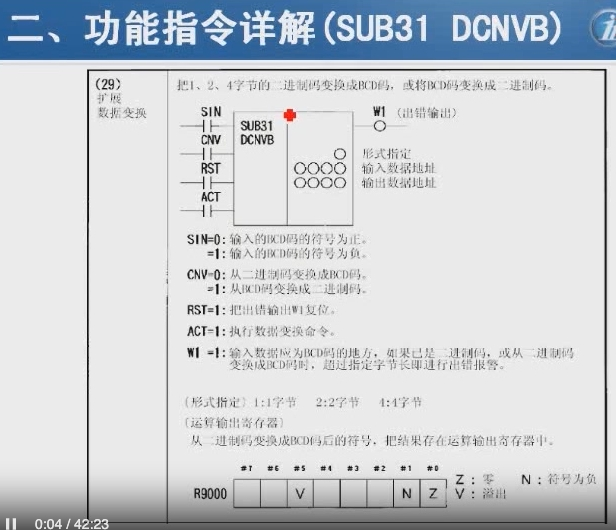

### 1.2 控制條件

| 控制條件 | 取值 | 含義 |
|---|---|---|
| **SIN** | 0 | 輸入的 BCD 碼符號為**正** |
| | 1 | 輸入的 BCD 碼符號為**負** |
| **CNV** | 0 | 二進制碼 → BCD 碼 |
| | 1 | BCD 碼 → 二進制碼 |
| **RST** | 1 | 把出錯輸出 W1 復位 |
| **ACT** | 1 | 執行數據變換指令 |
| **W1**（輸出） | 1 | 出錯 |

**關於符號的說明：**

- 二進制數本身有符號位（最高位即符號位），所以二進制不需要額外指定符號。
- BCD 碼本身**沒有符號位**，因此需要藉由 **SIN** 這個控制條件，告訴 PMC 這個 BCD 碼是正數還是負數。

**W1 出錯的情況：**

1. 本應輸入 BCD 碼的地方，放入的卻是二進制數據；
2. 二進制 → BCD 變換後，結果超過了所指定字節的長度。

### 1.3 參數說明

| 參數 | 說明 |
|---|---|
| 形式指定 | 指定處理的字節數：`1` = 1 字節，`2` = 2 字節，`4` = 4 字節 |
| 輸入數據地址 | 被變換數據的地址 |
| 輸出數據地址 | 變換結果存放的地址 |

### 1.4 運算輸出寄存器 R9000

**從二進制碼變換成 BCD 碼後的符號，結果存放在運算輸出寄存器 R9000 中。**

| 位 | 符號 | 含義 |
|---|---|---|
| #0 | Z | 零 |
| #1 | N | 符號為負 |
| #5 | V | 溢出 |

> 📌 注意：SIN 指定的是 **輸入的 BCD 碼** 的符號；R9000 輸出的是 **變換後輸出的 BCD 碼** 的符號。兩者方向不同，不要混淆。
> （課堂講解時對位的口述較模糊，請以手冊圖中「#1 = N（負）、#0 = Z（零）」為準。）

### 1.5 使用示例：BCD → 二進制（負數）

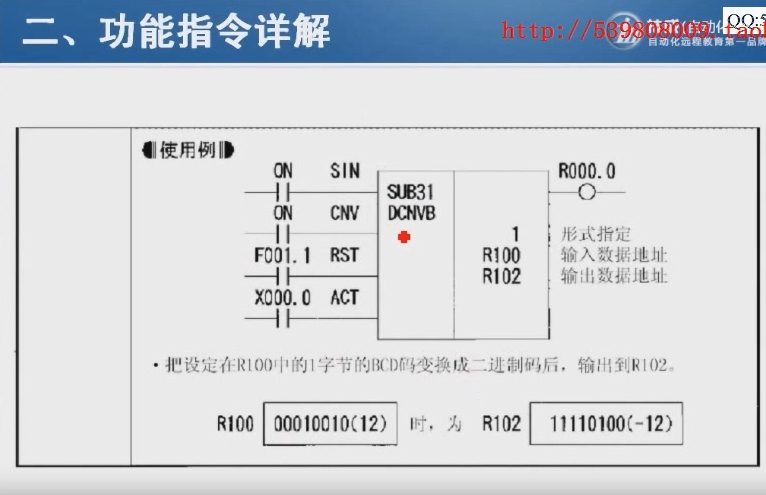

示例條件：

- `SIN = ON` → 輸入的 BCD 碼是**負數**
- `CNV = ON` → 做 **BCD → 二進制**
- 形式指定 `1` → 1 字節
- 輸入地址 `R100`，輸出地址 `R102`
- `ACT = X0.0`

R100 中的 BCD 碼為 `0001 0010`，即十進制 **12**；由於 SIN = 1，所以它表示 **−12**。變換後 R102 得到 `1111 0100`（−12 的二進制補碼）。

#### −12 的二進制補碼推導

1. **先求 12 的二進制**：12 = 8 + 4 → `0000 1100`
2. **因為是負數，求補碼**：先「取反」，再「加 1」
   - 取反：`0000 1100` → `1111 0011`
   - 加 1：`1111 0011` + 1 = `1111 0100`
3. 最高位（符號位）為 1，表示負數，最終得到 **`1111 0100`**。

### 1.6 機床實操演示一：BCD → 二進制（−87）

#### （1）編寫梯形圖

在梯形圖編輯軟體中輸入 DCNVB 指令（功能指令號 31），各項設定如下：

| 項目 | 設定 | 說明 |
|---|---|---|
| SIN | `R9091.1` | R9091.1 是常 1 信號，表示輸入 BCD 為負 |
| CNV | `R9091.1` | 常 1，BCD → 二進制 |
| RST | `X27.5` | 復位 |
| ACT | `X27.4` | 執行條件，按下 X27.4 對應的按鍵時執行 |
| 形式指定 | `0001` | 1 字節 |
| 輸入地址 | `D0100` | |
| 輸出地址 | `D0102` | |
| 出錯輸出 | `Y27.5` | |

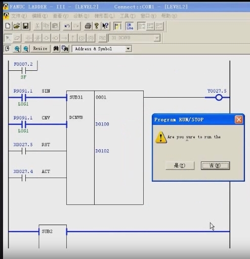

> 寫入 PMC 時，軟體會跳出「Program RUN/STOP」確認視窗，選擇「是」即可運行程式。

#### （2）設定 D 數據表

D 地址數據在使用前要先建立數據表。進入 PMC 的 **數據表控制畫面（PMC DATA TBL CONTROL）**：

- 地址 `D0000`
- 數據數量（NO. OF DATA）`10000`
- 類型（TYPE）`0`（字節型）

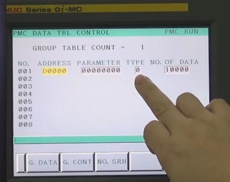

#### （3）寫入數據並運行

1. 在 D0100 中寫入 BCD 數據 **87**（二進制顯示為 `1000 0111`）。
2. 觸發 `X27.4`，執行指令。
3. 觀察 D0102 的結果，如下圖：D0100 = `1000 0111`（BCD 87），D0102 = `1010 1001`。

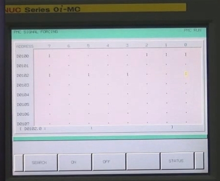

驗證 `1010 1001` 是否為 −87：

1. 87 的二進制 = 64 + 16 + 4 + 2 + 1 = `0101 0111`（可用計算器核對，如下圖，計算器顯示 `1010111`）。
2. 取反：`1010 1000`
3. 加 1：`1010 1001` ✔

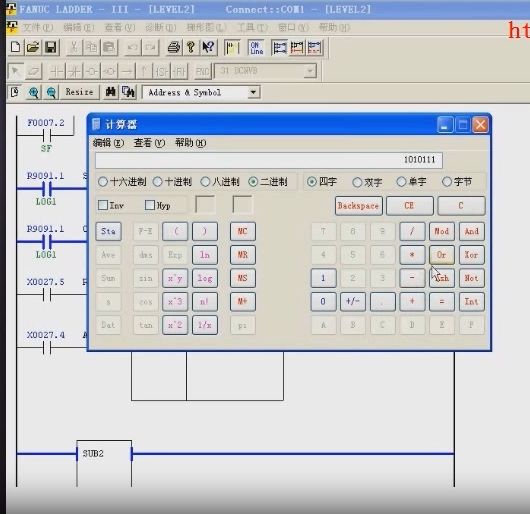

### 1.7 機床實操演示二：二進制 → BCD

把 CNV 的觸點由 `R9091.1`（常 1）改為 `R9091.0`（常 0），即可切換為 **二進制 → BCD**。

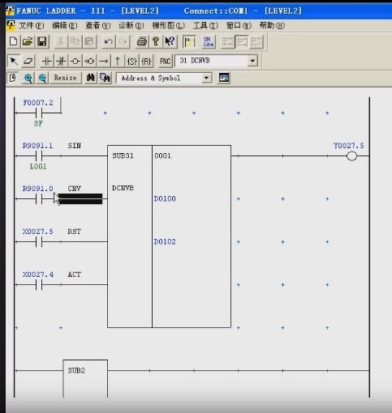

此時：

- D0100 中放的是二進制數 `1100 0111`（即 −57 的二進制補碼）；
- 執行後，D0102 得到 BCD 碼 `0101 0111`（即 57）；
- 負號資訊則輸出到 R9000 的符號位。

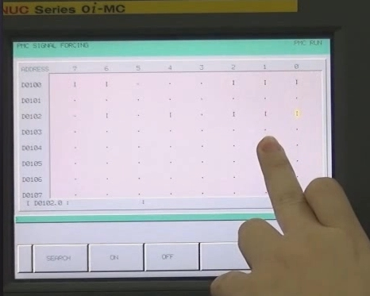

### 1.8 重點小結

- DCNVB = 帶符號、可處理 1/2/4 字節的二進制 ⇄ BCD 變換。
- BCD 無符號位 → 輸入 BCD 的正負由 **SIN** 決定；二進制自帶符號位。
- **CNV = 0**：二進制 → BCD；**CNV = 1**：BCD → 二進制。
- 負數的二進制表示 = **取反加 1**（補碼）。
- 輸入數據格式不對，或結果超過字節長度 → **W1 = 1 出錯**，需用 **RST** 復位。

---

## 二、大小比較 COMP（SUB 15）

### 2.1 功能概述

比較 **2 位或 4 位 BCD** 數值，並把比較結果輸出到 W1。**注意：COMP 只能用於 BCD 數據。**

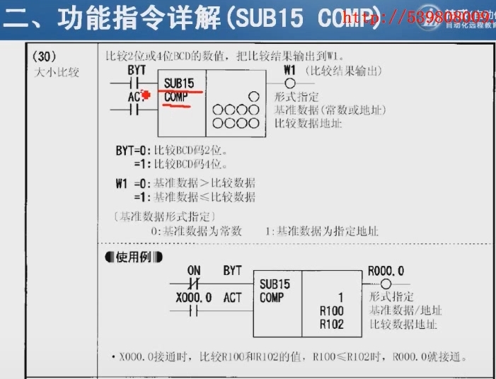

### 2.2 控制條件與輸出

| 控制條件 | 取值 | 含義 |
|---|---|---|
| **BYT** | 0 | 比較 BCD 碼 **2 位**（1 字節） |
| | 1 | 比較 BCD 碼 **4 位**（2 字節） |
| **ACT** | 1 | 執行比較 |

| 輸出 W1 | 含義 |
|---|---|
| **W1 = 0** | 基準數據 **>** 比較數據 |
| **W1 = 1** | 基準數據 **≤** 比較數據 |

### 2.3 參數說明

| 參數 | 說明 |
|---|---|
| 形式指定 | `0`：基準數據為**常數**；`1`：基準數據為**指定地址** |
| 基準數據 | 常數或地址（由形式指定決定） |
| 比較數據地址 | 被比較數據所在地址 |

### 2.4 使用示例

當 `X0.0` 接通時，比較 R100 與 R102 的值；當 **R100 ≤ R102** 時，R0.0 接通。

> 記憶要點：COMP 是拿「**基準數據**」去和「**比較數據**」比，輸出為 1 的條件是 **基準 ≤ 比較**。

### 2.5 COMP 應用舉例（模擬畫面）

下圖三種情況的基準數據為 D0001、比較數據為 D0003（= 0012）：

- 基準數據小於 0012 → 線圈接通；
- 基準數據 = 0012 → 線圈接通（等於也屬於「≤」）；
- 基準數據 = 0014 → 線圈**不**接通（基準 > 比較）。

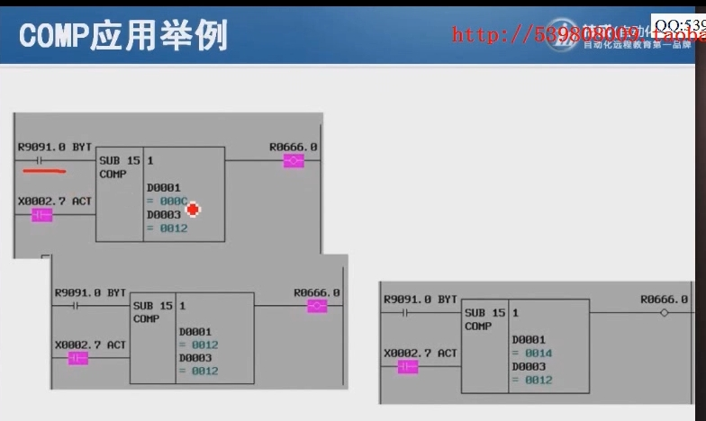

### 2.6 機床實操演示

#### （1）梯形圖（基準為常數）

| 項目 | 設定 |
|---|---|
| BYT | `R9091.0`（常 0 → 比較 2 位 BCD） |
| ACT | `X27.4` |
| 形式指定 | `0000`（基準數據為常數） |
| 基準數據 | 常數 `0015` |
| 比較數據地址 | `D0100` |
| 輸出 | `Y27.5` |

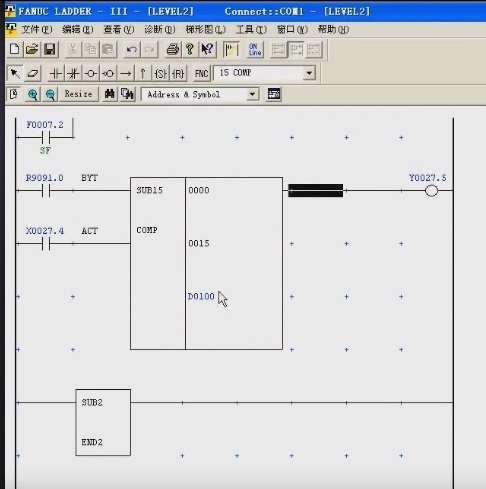

#### （2）設定數據表為 BCD 顯示

因為 COMP 比較的是 BCD 數據，所以在 **PMC DATA TBL CONTROL** 中，要把「PARAMETER」的最低位設為 **1**（`00000001`），D 數據才會以 **BCD** 格式顯示與輸入。

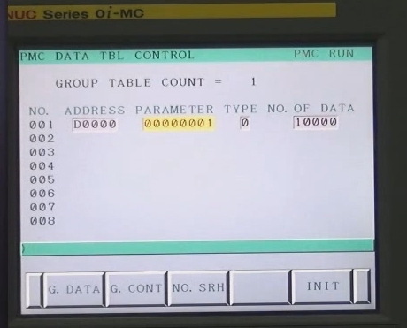

#### （3）觀察結果

1. **D0100 = 7**：
   基準 15 與比較 7 相比，15 ≤ 7 不成立 → **Y27.5 = 0**。

   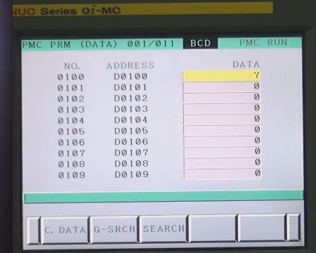

2. **D0100 = 21**：
   基準 15 ≤ 21 成立 → **Y27.5 = 1**。

   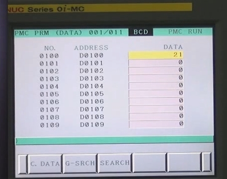

#### （4）基準數據改為地址

把形式指定改為 `0001`，基準數據改為地址 `D0102`，比較數據仍為 `D0100`：

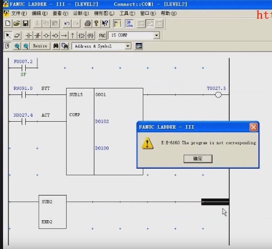

> 畫面中的 `E:E-6160 The program is not corresponding` 是編輯過程中軟體給出的提示（程式與當前狀態不對應），確認後完成修改並重新寫入即可。

- **D0102 = 15、D0100 = 21**：15 ≤ 21 → Y27.5 = **1**

  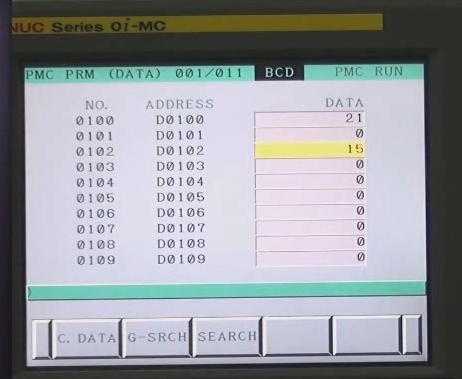

- **D0102 = 15、D0100 = 7**：15 ≤ 7 不成立 → Y27.5 = **0**

  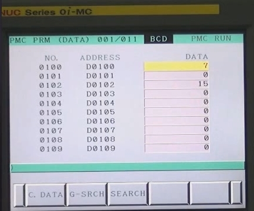

### 2.7 重點小結

- COMP：僅用於 **BCD**；BYT = 0 比 2 位、BYT = 1 比 4 位。
- 形式指定：0 = 常數基準，1 = 地址基準。
- 輸出：**基準 ≤ 比較 → W1 = 1**；基準 > 比較 → W1 = 0。

---

## 三、二進制大小比較 COMPB（SUB 32）

### 3.1 功能概述

對 **1、2、4 字節** 的**二進制形式**數據進行比較，**比較結果輸出到運算輸出寄存器 R9000**（而不是 W1）。

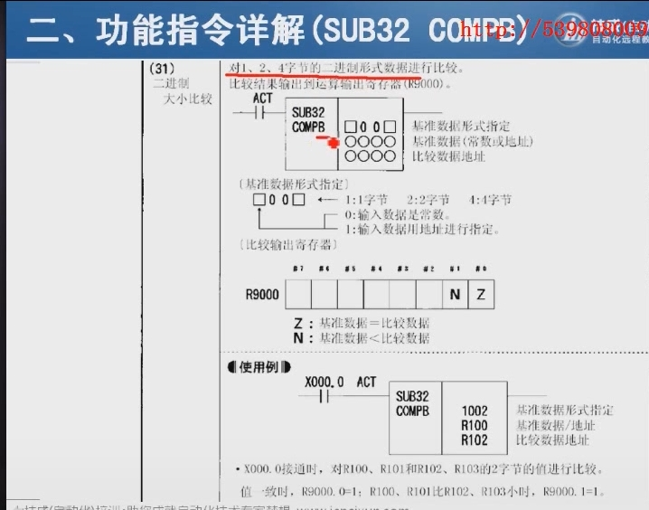

### 3.2 控制條件與參數

- **ACT**：執行條件，ACT = 1 時執行比較。
- **形式指定**（寫成 `□ 0 0 □` 的格式，兩端各一位）：

| 位置 | 取值 | 含義 |
|---|---|---|
| 最右一位（字節數） | 1 | 1 字節 |
| | 2 | 2 字節 |
| | 4 | 4 字節 |
| 最左一位（基準數據類型） | 0 | 輸入數據是**常數** |
| | 1 | 輸入數據用**地址**指定 |

例如 `1002` 表示：基準數據用**地址**指定、處理 **2 字節**。

| 參數 | 說明 |
|---|---|
| 形式指定 | 如 `1002` |
| 基準數據 | 常數或地址 |
| 比較數據地址 | 被比較數據的地址 |

### 3.3 比較輸出寄存器 R9000

| 位 | 符號 | 含義 |
|---|---|---|
| #0 | Z | 基準數據 **=** 比較數據 |
| #1 | N | 基準數據 **<** 比較數據 |

### 3.4 使用示例

`X0.0` 接通時，對 **R100、R101** 與 **R102、R103** 這兩組 2 字節數據進行比較：

- 兩者**一致**時，`R9000.0 = 1`；
- R100、R101 **小於** R102、R103 時，`R9000.1 = 1`。

### 3.5 COMPB 應用舉例

輸出結果：

- `R9000#0 = 1` → 輸入值 = 比較值
- `R9000#1 = 1` → 輸入值 < 比較值

演示中基準數據為常數 **35**，比較數據 D0100 = **53**。基準 35 < 比較 53，所以 R9000 的 **#1 位為 1**。

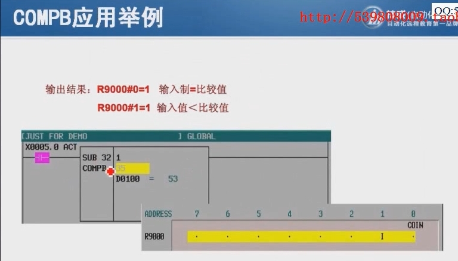

### 3.6 COMP 與 COMPB 對照

| 項目 | COMP（SUB 15） | COMPB（SUB 32） |
|---|---|---|
| 數據類型 | BCD | 二進制 |
| 數據長度 | 2 位 / 4 位 | 1 / 2 / 4 字節 |
| 結果輸出 | W1（線圈） | R9000（運算輸出寄存器） |
| 輸出判斷 | 基準 ≤ 比較 → 1 | #0：相等；#1：基準 < 比較 |
| 基準數據形式 | 0 常數 / 1 地址 | 形式指定首位：0 常數 / 1 地址 |

接下來用機床做一次 COMPB 的實際比較。

### 3.7 機床實操演示：梯形圖

| 項目 | 設定 | 說明 |
|---|---|---|
| ACT | `X27.4` | 執行條件 |
| 形式指定 | `1001` | 首位 `1` = 基準數據用**地址**指定；末位 `1` = **1 字節** |
| 基準數據地址 | `D0100` | |
| 比較數據地址 | `D0102` | |

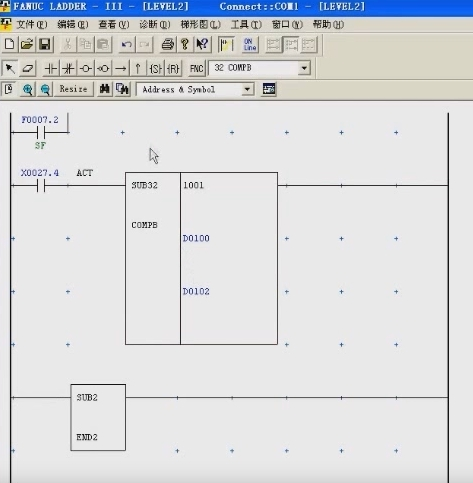

### 3.8 機床實操演示：設定數據並觀察結果

1. 先在信號強制畫面（PMC SIGNAL FORCING）中設定基準數據 **D0100 = `1000 0111`**，此時 D0102 為 0：

   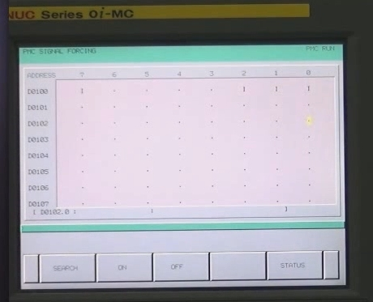

2. 再把 D0102 設為 **`0101 0111`**（十進制 87）：

   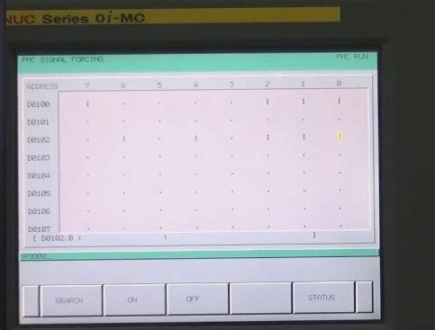

3. 觸發 `X27.4` 執行比較，再到 **R9000** 查看結果。畫面中 R9000 的各位均為 0，即 `#0（相等）= 0`、`#1（基準 < 比較）= 0`，表示**基準數據大於比較數據**：

   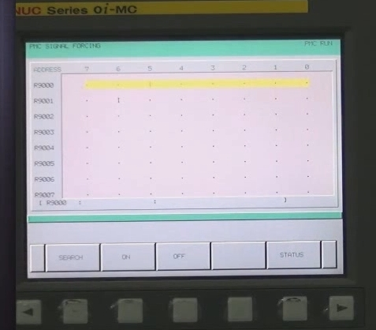

> 📌 COMPB 的結果只有三種：**相等**（R9000#0 = 1）、**基準 < 比較**（R9000#1 = 1）、**兩位都為 0 → 基準 > 比較**。
> 這裡 D0100 的最高位為 1，但結果仍判為「大於」，可見此處是按數值大小（無符號）比較。這一點是依畫面結果推斷，實際使用時建議自行驗證。

---

## 四、一致性判斷 COIN（SUB 16）

### 4.1 功能概述

**一致性檢測**：檢測輸入值和比較值是否一致。**該指令僅適用於 BCD 數據。**

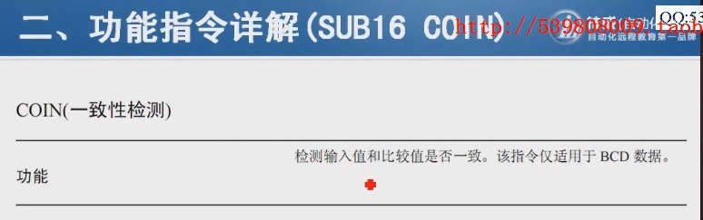

### 4.2 控制條件與參數

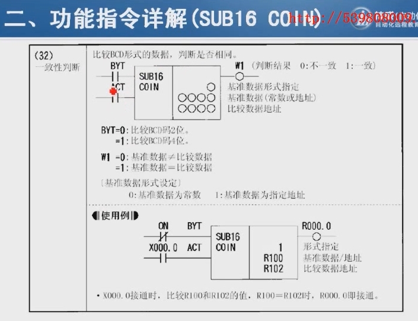

| 控制條件 | 取值 | 含義 |
|---|---|---|
| **BYT** | 0 | 比較 BCD 碼 **2 位**（1 字節） |
| | 1 | 比較 BCD 碼 **4 位**（2 字節） |
| **ACT** | 1 | 執行比較 |

| 輸出 W1（判斷結果） | 含義 |
|---|---|
| **W1 = 0** | 基準數據 ≠ 比較數據（不一致） |
| **W1 = 1** | 基準數據 = 比較數據（一致） |

| 參數 | 說明 |
|---|---|
| 形式指定 | `0`：基準數據為**常數**；`1`：基準數據為**指定地址** |
| 基準數據 | 常數或地址 |
| 比較數據地址 | 被比較數據所在地址 |

**手冊示例：** `X0.0` 接通時，比較 R100 與 R102 的值，**R100 = R102** 時，R0.0 接通。

### 4.3 COIN 應用舉例

BYT = 0（2 位 BCD），形式指定為 `0`（基準為常數），基準常數 = **21**，比較數據為 D0100。D0100 = 0021 與常數 21 一致，所以輸出 Y0.5 接通。

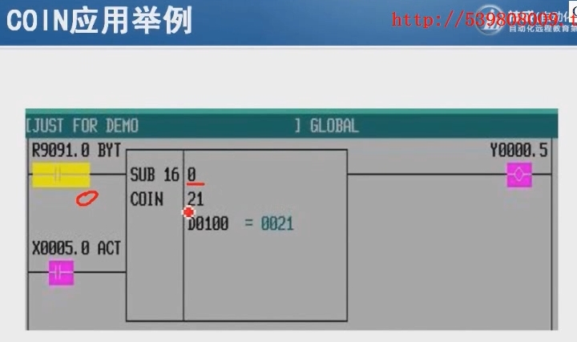

### 4.4 機床實操演示

#### （1）梯形圖

| 項目 | 設定 |
|---|---|
| BYT | `R9091.0`（常 0 → 2 位 BCD） |
| ACT | `X27.4` |
| 形式指定 | `0000`（基準為常數） |
| 基準數據 | 常數 `0021` |
| 比較數據地址 | `D0100` |
| 輸出 | `Y27.5` |

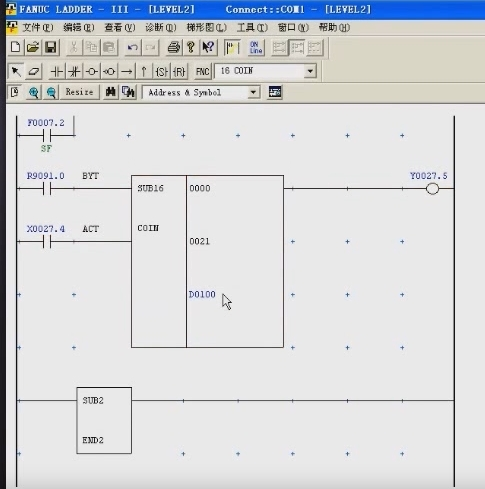

#### （2）數據表設為 BCD 顯示

因為 COIN 只處理 BCD 數據，所以和 COMP 一樣，數據表控制畫面的 PARAMETER 要設為 `00000001`（BCD 顯示）：

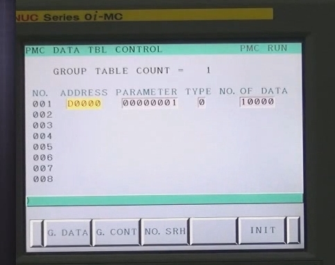

#### （3）觀察結果

- **D0100 = 21**：與常數 21 **一致** → **Y27.5 = 1**

  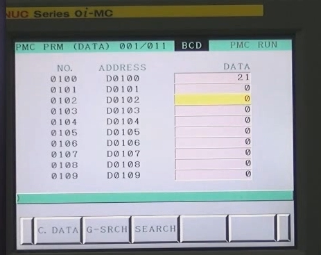

- **D0100 = 20**：與常數 21 **不一致** → **Y27.5 = 0**

  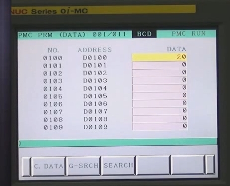

### 4.5 三個比較指令對照

| 項目 | COIN（SUB 16） | COMP（SUB 15） | COMPB（SUB 32） |
|---|---|---|---|
| 判斷內容 | 是否相等 | 基準是否 ≤ 比較 | 相等 / 小於 / 大於 |
| 數據類型 | BCD | BCD | 二進制 |
| 結果輸出 | W1：1 = 一致 | W1：1 = 基準 ≤ 比較 | R9000（#0 相等、#1 小於） |

---

## 五、移位寄存器 SFT（SUB 33）

### 5.1 功能概述

把**連續 2 字節**的數據**向右或向左移動 1 位**。被移出的那一位，會通過 **W1** 輸出（移出位為 1 時，W1 接通）。

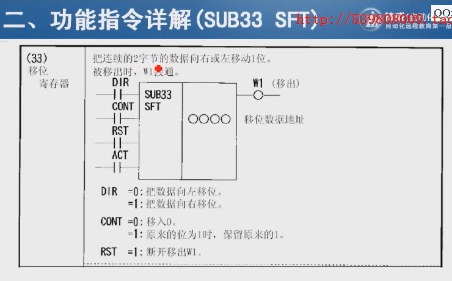

### 5.2 控制條件與參數

| 控制條件 | 取值 | 含義 |
|---|---|---|
| **DIR**（方向） | 0 | 數據向**左**移位 |
| | 1 | 數據向**右**移位 |
| **CONT**（補位方式） | 0 | 移入 0 |
| | 1 | 原來的位為 1 時，保留原來的 1 |
| **RST**（復位） | 1 | 斷開移出輸出 W1 |
| **ACT**（執行） | 1 | 執行移位 |

| 參數 | 說明 |
|---|---|
| 移位數據地址 | 被移位數據的起始地址（處理連續 2 字節，如 R100 與 R101） |

> 📌 **注意：** SFT 是**兩個字節連續移動**——例如指定 R100，則 R100 與 R101 作為一個 16 位的整體進行移位，字節之間的位是連通的。

### 5.3 手冊使用例（右移，補 0）

設定：`DIR = 1`（右移）、`CONT = 0`（空位補 0）、`RST = 0`（不復位），`ACT = X0.0`。
當 X0.0 為 1 時，把 R100、R101 的數據向右移 1 位；**進行移位前，如果最低位 R100.0 = 1，則移出的 R0.0（W1）變為 1**。

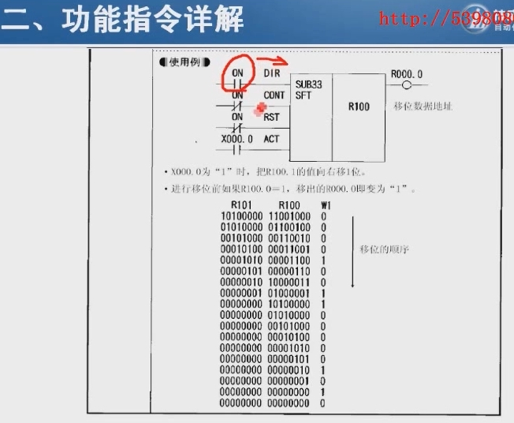

圖中是逐次右移的過程，可以看到：

- 每移一次，R101 的最低位會進入 R100 的最高位；
- 左邊空出來的最高位，因為 `CONT = 0`，補入 **0**；
- 每次被移出的那一位決定 W1：移出 **1** 時 W1 = 1，移出 **0** 時 W1 = 0；
- 持續移位，最終數據全部移出，R100、R101 變為全 0。

### 5.4 用 DIFU 控制 ACT（重要）

**ACT 是電平執行條件**：只要 ACT = 1，每一個掃描週期都會移位一次。若直接用按鈕接 ACT，按一下鍵就可能一下移很多位。

所以實操時要用上升沿指令 **DIFU（SUB 57）** 把按鈕信號變成「只有一個掃描週期」的脈衝，再去驅動 ACT，這樣**按一次，只移一位**。

### 5.5 機床實操演示一：左移，補 0

#### （1）梯形圖

| 項目 | 設定 | 說明 |
|---|---|---|
| DIFU（SUB 57） | 輸入 `X27.4`，輸出 `R100.1`，編號 `0001` | 取上升沿，產生單週期脈衝 |
| DIR | `R9091.0` | 常 0 → **左移** |
| CONT | `R9091.0` | 常 0 → 空位**補 0** |
| RST | `X27.5` | 復位 W1 |
| ACT | `R100.1` | 由 DIFU 脈衝驅動 |
| 移位數據地址 | `D0100` | 同時處理 D0100、D0101 |
| 輸出 W1 | `Y27.5` | 移出位 |

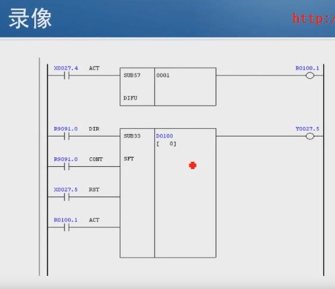

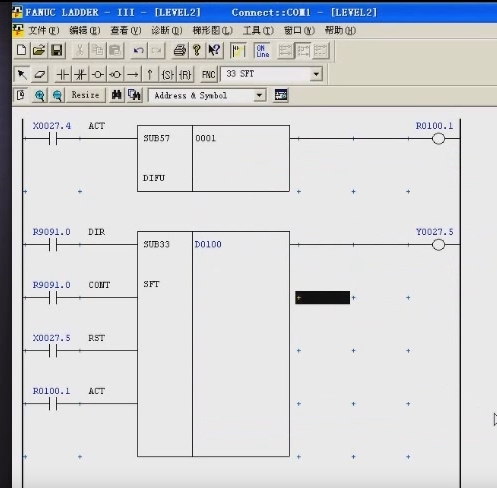

#### （2）設定初始數據

在信號強制畫面中，把 D0100 設為 **`0010 1100`**（第 5、3、2 位為 1，即圖中「1011」的排列），D0101 為 0：

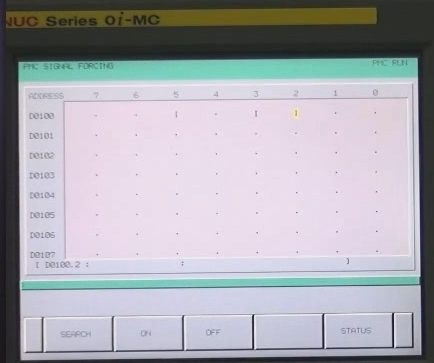

#### （3）逐次按 X27.4，觀察左移

每按一次 `X27.4`，數據左移一位，右邊空位補 0：

- **第 1 次**：D0100 = `0101 1000`

  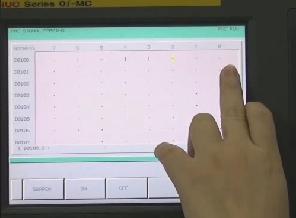

- **第 2 次**：D0100 = `1011 0000`

  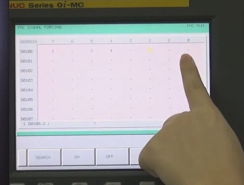

- **繼續移位**：D0100 的最高位被移入 **D0101** 的最低位（兩個字節連通）。第 4 次後，D0100 = `1100 0000`，D0101 = `0000 0010`

  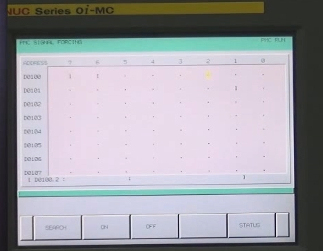

- **再繼續移位**：數據逐步全部進入 D0101，D0100 變為全 0（圖中 D0101 = `1011 0000`）

  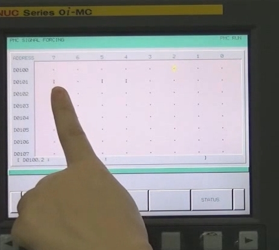

**觀察 Y27.5（W1）：**

- 前面幾次移出的都是 0 → Y27.5 = 0；
- 當有 1 從 D0101 的最高位移出時 → Y27.5 = 1；
- 數據全部移出後，兩個字節都變成 0，之後移出的都是 0（補入的是 0）。

### 5.6 機床實操演示二：右移，保留原位的 1

上一個演示是「左移，補 0」。這次把兩個控制條件都改掉：

| 控制條件 | 上次（左移補 0） | 這次（右移保留） |
|---|---|---|
| DIR | `R9091.0`（常 0）→ 左移 | `R9091.1`（常 1）→ **右移** |
| CONT | `R9091.0`（常 0）→ 補 0 | `R9091.1`（常 1）→ **保留原位的 1** |

其餘部分不變：DIFU（SUB 57）把 `X27.4` 轉成單週期脈衝 `R100.1`，驅動 ACT；`RST = X27.5`；移位數據地址 `D0100`；輸出 W1 = `Y27.5`。

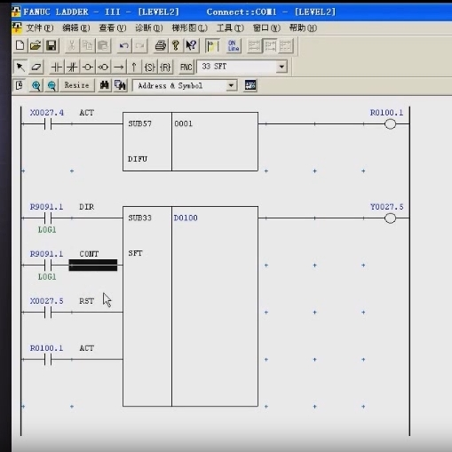

> 小提醒：`R9091.1` 是常 1 信號，`R9091.0` 是常 0 信號，通過切換這兩個觸點，就能不接任何外部開關而固定控制條件。

### 5.7 設定初始數據

為了方便觀察右移，把數據設為：**D0100 = `0000 0000`、D0101 = `1000 0000`**（即 16 位數據中只有最高位為 1）。

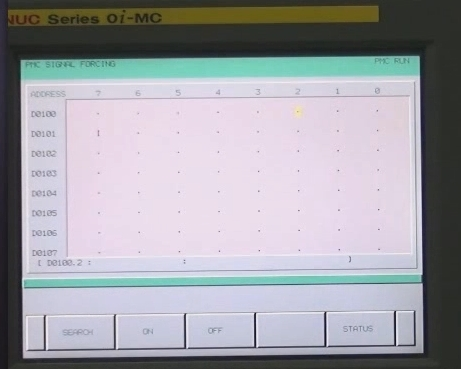

### 5.8 逐次按 X27.4，觀察右移

每按一次 `X27.4`，整個 16 位數據向右移動一位：

- D0101 的最低位會進入 D0100 的最高位（兩個字節連通）；
- 左邊（D0101 最高位）空出來的位置，因 `CONT = 1`，**保留原來的 1**，而不是補 0。

所以和「補 0」的情況不同，這裡高位的 1 不會消失，而是不斷「留在原位」，同時向右側擴散。

下圖是連續移位過程中的一個狀態（D0100 低 7 位為 1，D0101 另有幾位為 1）：

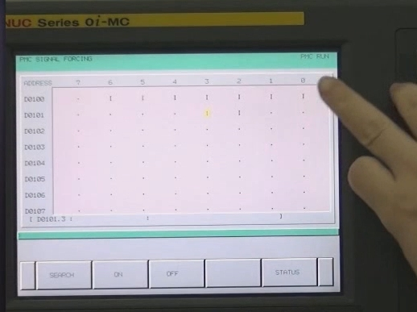

> 📌 這張圖只是移位過程的中間畫面，我無法僅憑它還原精確的移位次數與每一步的位元圖，建議在機床上自行逐步觀察。
> 觀察重點是：**CONT = 1 時，最高位的 1 不會被補成 0，而會不斷被保留下來**；與 CONT = 0 時「右移後左邊全補 0、數據最終全部移出為 0」形成對比。

### 5.9 CONT 的兩種設定對比

| 項目 | CONT = 0 | CONT = 1 |
|---|---|---|
| 空出的位 | 補 **0** | **保留原來的位**（原位為 1 時保留 1） |
| 持續移位的結果 | 數據最終全部移出，變為全 0 | 高位的 1 被保留，不會變成全 0 |
| 典型用途 | 一般的逐位移出、計數 | 需要保留高位標誌時 |

### 5.10 SFT 小結

- SFT 處理**連續 2 字節**（16 位）的整體移位，字節間位是連通的。
- **DIR**：0 = 左移，1 = 右移；**CONT**：0 = 空位補 0，1 = 保留原位的 1。
- 被移出的位通過 **W1** 輸出，**RST** 用來復位 W1。
- ACT 為電平執行，每個掃描週期移一次，所以要配合 **DIFU** 做到「按一次移一位」。

---

## 六、全課總結

### 一、本課時學了哪些指令

| 指令 | 功能指令號 | 功能 | 重點 |
|---|---|---|---|
| **DCNVB** 擴展數據變換 | SUB 31 | 1/2/4 字節二進制 ⇄ BCD，**可帶符號** | SIN 決定輸入 BCD 的正負；CNV 決定方向；結果符號輸出到 R9000 |
| **COMP** 大小比較 | SUB 15 | 比較 2 位或 4 位 BCD | W1 = 1 表示 基準 ≤ 比較 |
| **COMPB** 二進制大小比較 | SUB 32 | 比較 1/2/4 字節二進制 | 結果在 R9000：#0 相等、#1 基準 < 比較 |
| **COIN** 一致性判斷 | SUB 16 | 判斷兩個 BCD 數是否相等 | W1 = 1 一致、0 不一致 |
| **SFT** 移位寄存器 | SUB 33 | 連續 2 字節整體左移／右移 1 位 | DIR 定方向、CONT 定補位、W1 輸出移出位；ACT 要配 DIFU |

### 二、「形式指定」與數據格式速記

| 指令 | 形式指定怎麼寫 | 說明 |
|---|---|---|
| DCNVB | `1` / `2` / `4` | 字節數 |
| COMP、COIN | 以 BYT 區分長度；形式指定 `0` 常數、`1` 地址 | BYT = 0 為 2 位 BCD，BYT = 1 為 4 位 BCD |
| COMPB | `□00□`：首位 `0` 常數 / `1` 地址；末位 `1` / `2` / `4` 字節 | 如 `1002` = 地址基準、2 字節；`1001` = 地址基準、1 字節 |

### 三、關鍵概念回顧

1. **BCD 沒有符號位，二進制有。**
   BCD 的正負要靠 DCNVB 的 SIN 另行指定；二進制的負數用「**取反加 1**」的補碼表示（例：−12 = `1111 0100`）。
2. **結果輸出位置不同。**
   COMP、COIN → **W1**（線圈）；COMPB、DCNVB 的符號 → **R9000**（運算輸出寄存器）。
3. **BCD 類指令（COMP、COIN）和 D 數據表。**
   使用 D 地址數據前先設定數據表；比較 BCD 時，要把數據表的 PARAMETER 最低位設為 1（`00000001`），才會以 BCD 顯示與輸入。
4. **SFT 的 ACT 是電平執行。**
   不加處理，每個掃描週期都移一次；用 **DIFU（SUB 57）** 取上升沿，才能做到「按一次、移一位」。
5. **常 0／常 1 信號**：`R9091.0`（常 0）、`R9091.1`（常 1），常用來固定控制條件。

### 四、常見出錯點

- DCNVB：本應輸入 BCD 的地方放了二進制，或變換結果超出指定字節長度 → **W1 = 1**，需用 **RST** 復位。
- COMP／COIN：數據不是 BCD 格式 → 比較結果不可靠。
- COMP：記得判斷條件是「**基準 ≤ 比較**」，不是「基準 < 比較」。
- SFT：忘記用 DIFU → 按一次鍵移很多位；忘記是 **2 字節連通** → 對高位字節的變化感到意外。

---

*（第 17 課時 完）*
