# 第18課時　FANUC-PMC 功能指令 07

> 本課時內容：
> 1. **SUB17　DSCH**　數據檢索
> 2. **SUB34　DSCHB**　二進制數據檢索
> 3. **SUB18　XMOV**　變址數據傳送
> 4. **XMOVB**　二進制變址數據傳送

---

## 一、SUB17　DSCH（數據檢索）

### 1. 功能說明

DSCH（Data Search）指令在數據表中**搜索指定的數據，並輸出其表內號**；如果未找到指定數據，則 **W1＝1**。該指令僅適用於 PMC 所使用的數據表。

與前面學過的 COD 相反：COD 是給出表內號、從表中取出數據；DSCH 是**給出一個數，到表中檢索有沒有這個數**，有的話就把它所在的表內號輸出到「檢索結果輸出」地址，沒有就輸出 W1。

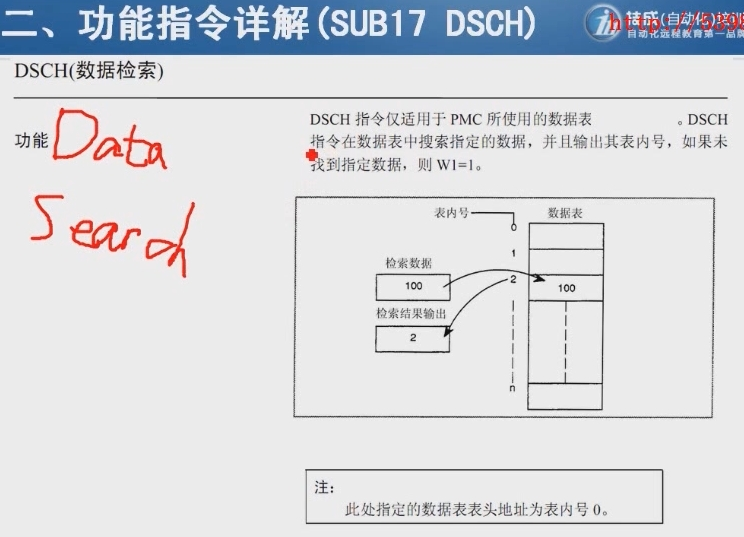

> 注：此處指定的數據表表頭地址為表內號 0。

### 2. 指令格式與參數

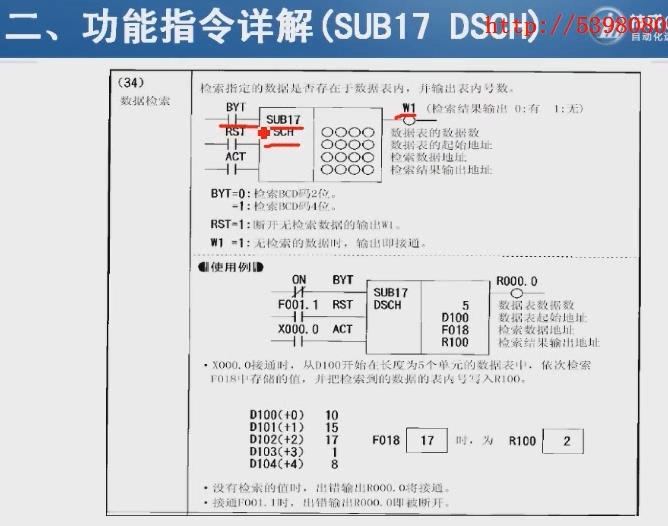

| 條件／參數 | 說明 |
|---|---|
| **BYT** | 0：檢索 BCD 碼 2 位；1：檢索 BCD 碼 4 位 |
| **RST** | 1：斷開無檢索數據的輸出 W1（復位） |
| **ACT** | 1：執行檢索 |
| **W1** | 檢索結果輸出，0：有；1：無（無檢索的數據時，輸出即接通） |
| **數據表的數據數** | 數據表裡共有多少個數據 |
| **數據表的起始地址** | 數據表第一個數據（表內號 0）的地址 |
| **檢索數據地址** | 要檢索的那個數所在的地址 |
| **檢索結果輸出地址** | 找到之後，把表內號輸出到這個地址 |

### 3. 使用範例

- BYT＝0（BCD 2 位）；數據表以 D100 為首，共 5 個數據（D100～D104）；檢索數據地址 F018；檢索結果輸出地址 R100；
- X000.0 接通時，從 D100 開始、長度為 5 個單元的數據表中，依次檢索 F018 中存儲的值，並把檢索到的數據的表內號寫入 R100。

數據表內容：

| 表內號 | 地址 | 數據 |
|---|---|---|
| +0 | D100 | 10 |
| +1 | D101 | 15 |
| +2 | D102 | 17 |
| +3 | D103 | 1 |
| +4 | D104 | 8 |

當 F018＝17 時，在表內號 2 找到，所以 **R100＝2**（表內號從 0 開始）。

- 沒有檢索的值時，出錯輸出 R000.0 將接通；
- 接通 F001.1 時，出錯輸出 R000.0 即被斷開。

### 4. 實機演示

演示程式設定：

| 項目 | 設定 |
|---|---|
| BYT | R9091.0（常 0）→ BCD 2 位（所以不能用 R9091.1） |
| RST | X27.5 |
| ACT | X27.4 |
| 出錯輸出（W1） | Y27.5 |
| 數據表的數據數 | 0010（10 個數據） |
| 數據表起始地址 | D0100 |
| 檢索數據地址 | D0110 |
| 檢索結果輸出地址 | D0112 |

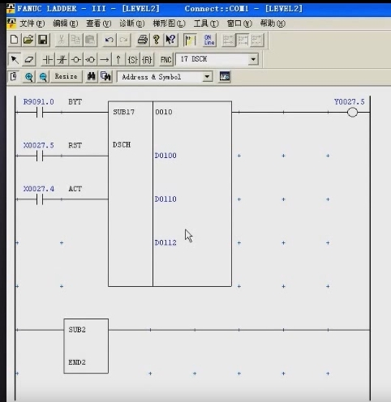

運行之前，要先在 PMC 的數據表控制畫面把數據格式設定為 **BCD、1 字節**（TYPE＝0，參數最後一位為 1 表示 BCD 格式）：

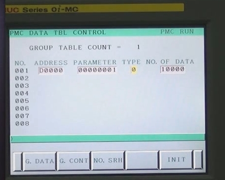

接著在 D0100 起輸入 10 個數據：**3、4、5、6、7、8、9、10、11、12**（D0100～D0109，BCD 顯示）：

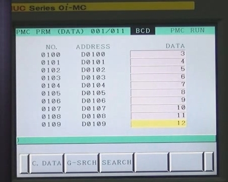

在 D0110 設定要檢索的數 **7**，然後按下 X27.4 執行，D0112 立即變成 **4**：在表中找到了 7，它的表內號（從 0 起：3→0、4→1、5→2、6→3、7→4）是 4，所以把 4 放進結果輸出地址 D0112。

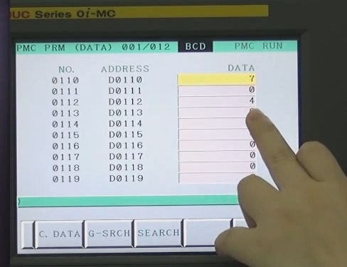

---

## 二、SUB34　DSCHB（二進制數據檢索）

### 1. 功能說明

DSCHB 與 DSCH 的不同點：

1. 處理的數值必須是**二進制**形式（可為 1、2、4 字節）；
2. 數據表的數據個數**可以用地址來指定**。DSCH 的數據個數是寫死在功能指令的參數裡的，DSCHB 則由地址內的數值決定，所以程序編好、甚至 ROM 製作完成後，仍可調整表的容量。

### 2. 指令格式與參數

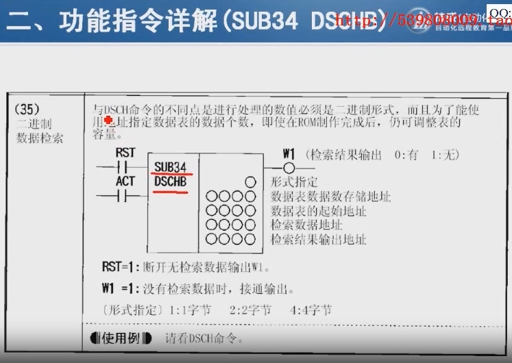

| 條件／參數 | 說明 |
|---|---|
| **RST** | 1：斷開無檢索數據輸出 W1 |
| **ACT** | 1：執行檢索 |
| **W1** | 檢索結果輸出，0：有；1：無（沒有檢索數據時，接通輸出） |
| **形式指定** | 1＝1 字節、2＝2 字節、4＝4 字節 |
| **數據表數據數存儲地址** | 存放數據表數據個數的地址 |
| **數據表的起始地址** | 數據表第一個數據的地址 |
| **檢索數據地址** | 要檢索的數所在的地址 |
| **檢索結果輸出地址** | 找到後輸出表內號的地址 |

使用例請參照 DSCH 指令。

### 3. 實機演示

演示程式設定：

| 項目 | 設定 |
|---|---|
| RST | X27.5 |
| ACT | X27.4 |
| 出錯輸出（W1） | Y27.5 |
| 形式指定 | 0002（2 字節） |
| 數據表數據數存儲地址 | D0120 |
| 數據表起始地址 | D0100 |
| 檢索數據地址 | D0122 |
| 檢索結果輸出地址 | D0124 |

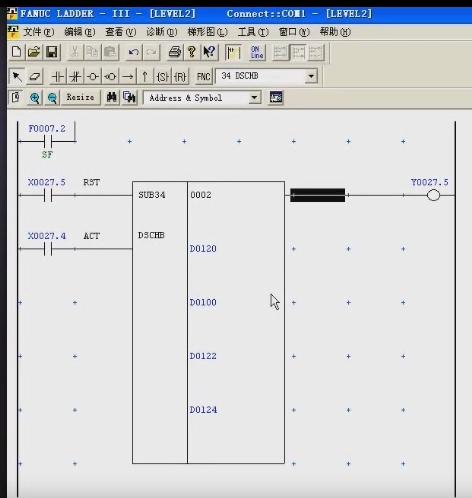

這次的數據是二進制、2 字節，所以數據表控制畫面要設定為：TYPE＝1（2 字節），參數最後一位為 0（二進制）。

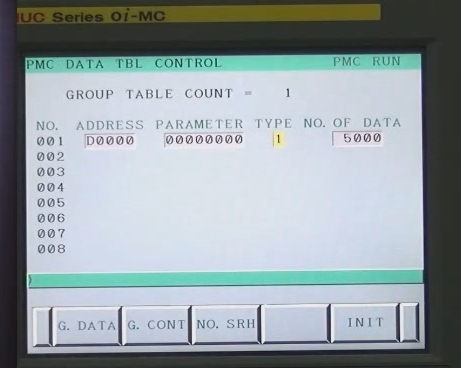

數據表（2 字節，所以地址每次加 2）：

| 表內號 | 0 | 1 | 2 | 3 | 4 | 5 | 6 | 7 | 8 | 9 |
|---|---|---|---|---|---|---|---|---|---|---|
| 地址 | D0100 | D0102 | D0104 | D0106 | D0108 | D0110 | D0112 | D0114 | D0116 | D0118 |
| 數據 | 1027 | 1541 | 2055 | 2569 | 3083 | 0 | 10 | 7 | 80 | 1 |

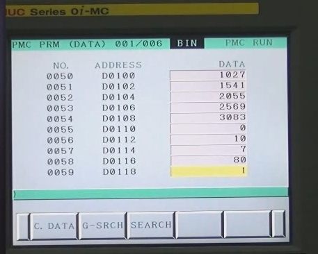

<!-- chs18_10.jpg 尚未上傳，待補 -->

D0120 存放數據表的個數，設為 **10**；D0122 放要檢索的數 **2055**：

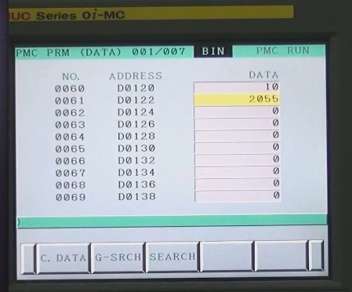

按下 X27.4 執行後，D0124＝**2**：2055 在表內號 2（表內號從 0 起算：1027→0、1541→1、2055→2），與預期一致。

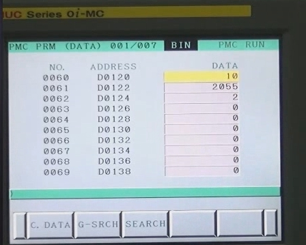

---

## 三、SUB18　XMOV（變址數據傳送）

### 1. 功能說明

XMOV 指令用來**讀或改寫數據表中的內容**。如同 DSCH 指令一樣，XMOV 指令僅適用於 PMC 所使用的數據表。

- 可以根據表內號，把數據表中該號的數據**讀出**，放到輸入／輸出數據的存儲地址；
- 也可以把輸入／輸出數據地址中的數據**寫入**數據表中該表內號的位置。

> 注：此處指定的數據表頭地址被指定為表內號 0。

下圖中，表內號存儲地址的值為 2，① 表示從數據表讀出表內號 2 的數據；② 表示向數據表表內號 2 的位置寫入數據。

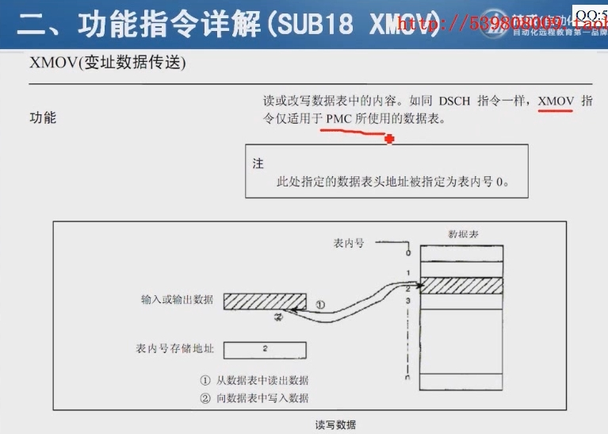

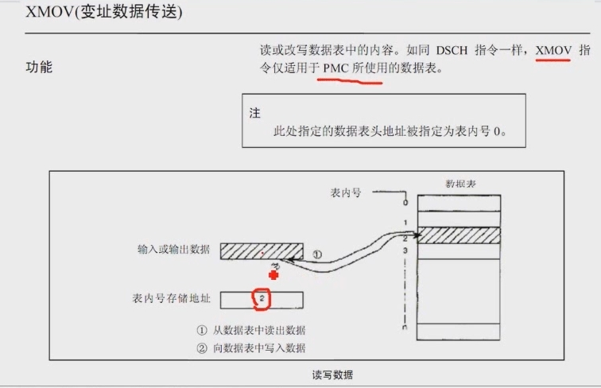

### 2. 指令格式與參數

讀取或寫入數據表內指定號的數據。進行處理的數值為 BCD 2 位或 BCD 4 位。

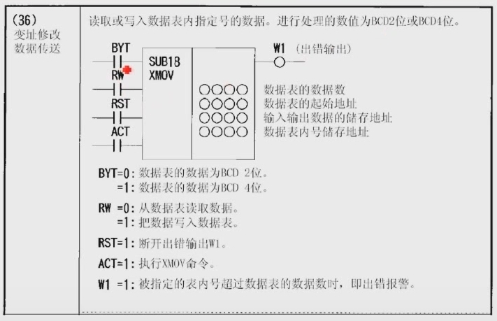

| 條件／參數 | 說明 |
|---|---|
| **BYT** | 0：數據表的數據為 BCD 2 位；1：數據表的數據為 BCD 4 位 |
| **RW** | 0：從數據表讀取數據；1：把數據寫入數據表 |
| **RST** | 1：斷開出錯輸出 W1 |
| **ACT** | 1：執行 XMOV 命令 |
| **W1** | 1：被指定的表內號超過數據表的數據數時，即出錯報警 |
| **數據表的數據數** | 數據表共有多少個數據 |
| **數據表的起始地址** | 數據表第一個數據的地址 |
| **輸入輸出數據的儲存地址** | 讀出時：讀出的數據放這裡；寫入時：要寫入的數據在這裡 |
| **數據表內號儲存地址** | 存放表內號的地址 |

### 3. 使用範例（講稿說明）

- BYT＝0（BCD 2 位）、RW＝0（讀數據表）；
- 數據表以 D100 為首，共 5 個數據（D100～D104）；
- 表內號儲存在 R200，R200＝2，即讀表內號 2，該位置的數據是 8，所以把 8 讀到輸入輸出數據的儲存地址 R100，**R100＝8**；
- 如果 R200＝6，超過了數據表的數據數 5（表內號只有 0～4），就會出錯，W1 接通。
- 範例中 BYT、RW 都接常閉的 "ON" 觸點，即 BYT＝0、RW＝0；RST 接 F001.1，ACT 接 X000.0。用 R200 指定的表內號不正確時，出錯輸出 R000.0 變為 "1"；使出錯復位的 F001.1 為 "1" 時，R000.0 即變為 "0"。

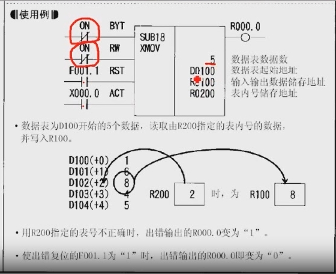

### 4. 實機演示

演示程式設定：

| 項目 | 設定 |
|---|---|
| BYT | R9091.0（常 0）→ BCD 2 位 |
| RW | R9091.0（常 0）→ 讀；改接 R9091.1（常 1）→ 寫 |
| RST | X27.5 |
| ACT | X27.4 |
| 出錯輸出（W1） | Y27.5 |
| 數據表的數據數 | 0010（10 個數據） |
| 數據表起始地址 | D0100 |
| 輸入輸出數據的儲存地址 | D0120 |
| 數據表內號儲存地址 | D0122 |

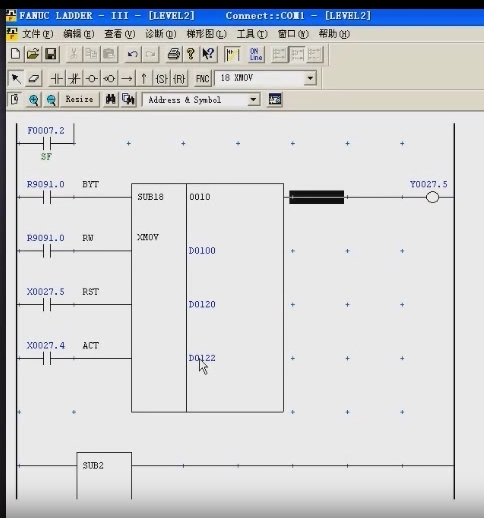

運行之前，數據表控制畫面要設定為 BCD 格式、1 字節（參數最後一位為 1，TYPE＝0）：

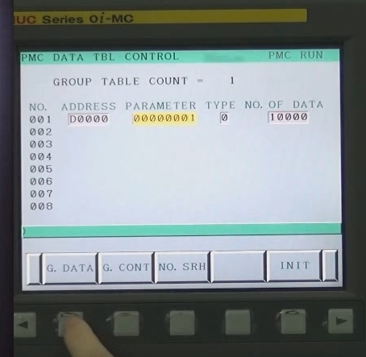

數據表從 D0100 開始，內容為 **3、4、5、6、7、8、9、10、11、12**（共 10 個）：

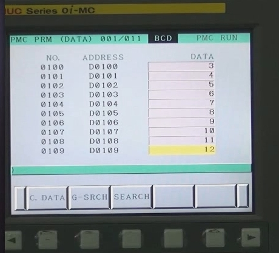

D0110 之後沒用的數據也先清為 0，方便觀察：

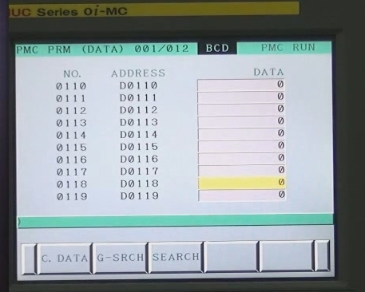

**演示一：讀數據。** 把表內號儲存地址 D0122 設為 **7**（D0120 原為 0）：

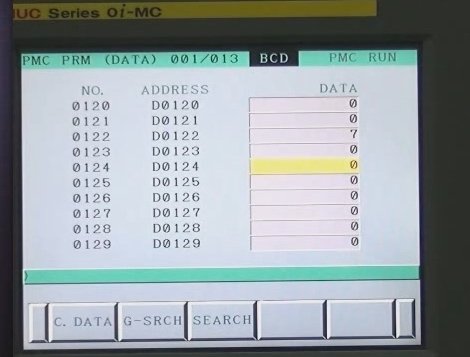

RW 為常 0（讀）。按下 X27.4 後，D0120 變成 **10**：表內號 7（即 D0107）的數據是 10，被讀到輸入輸出地址 D0120。

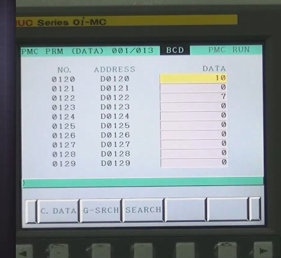

教材中對應的錄像畫面（讀數據）：

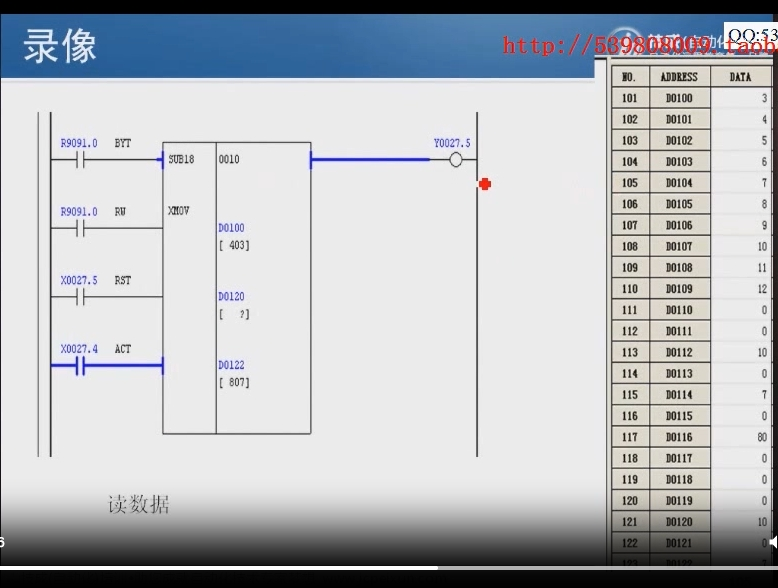

**演示二：寫數據。** 要把 D0120 里面的數據寫進表內號 7 的位置：先把 D0120 設為 **55**，D0122 仍為 7：

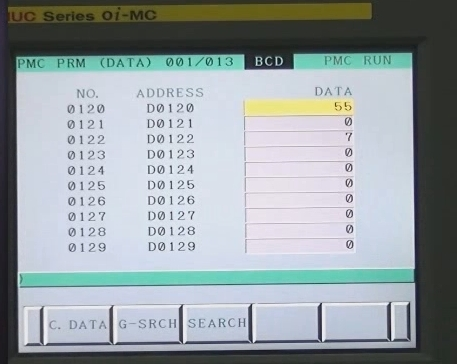

把 RW 改接成 R9091.1（常 1，寫），修改梯形圖後會跳出「源程序已經被更新，編譯嗎？」的提示，選擇「是」：

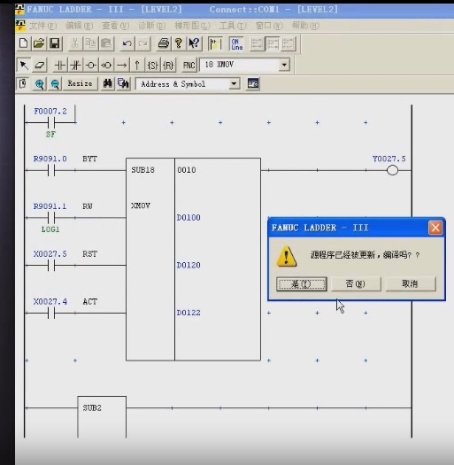

按下 X27.4 執行後，觀察數據表：D0107 由 10 變成 **55**，就是 D0120 的數據被寫入表內號 7。

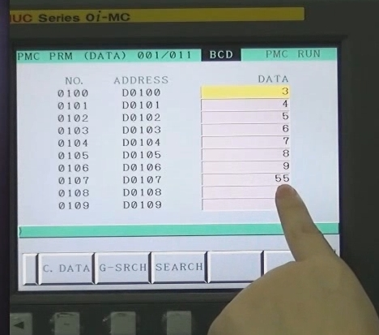

教材中對應的錄像畫面（寫數據）：

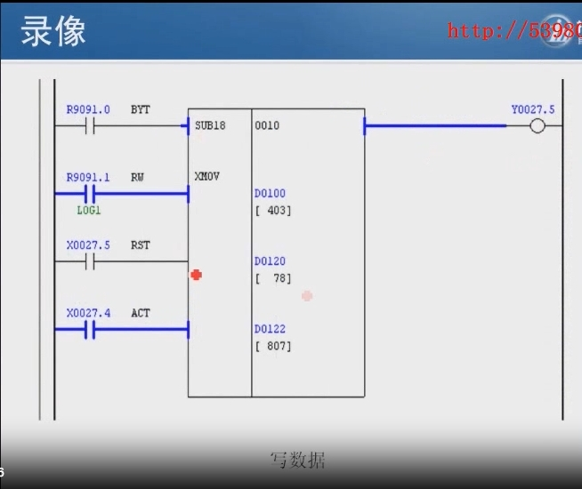

---

## 四、SUB35　XMOVB（二進制變址數據傳送）

### 1. 功能說明

XMOVB 與 XMOV 一樣，用於**讀出或改寫數據表中的數據**。它們之間有兩點區別：

1. 此指令處理的數字數據全部為**二進制**形式（XMOV 為 BCD）；
2. 數據表中的數據數目（表容量）可以**用地址來指定**，這樣即使在程序寫入 ROM 後，依然可以改變表容量。

下圖左側 (a) 為**從數據表中讀出數據**：表內號存儲地址 I＝3，則把 DT[3] 的內容 B 讀到輸入／輸出數據存儲地址 S；右側 (b) 為**向數據表中寫入數據**：把 S 的內容 B 寫入 DT[I]。指令操作分別為 DT[I]→S 和 S→DT[I]。

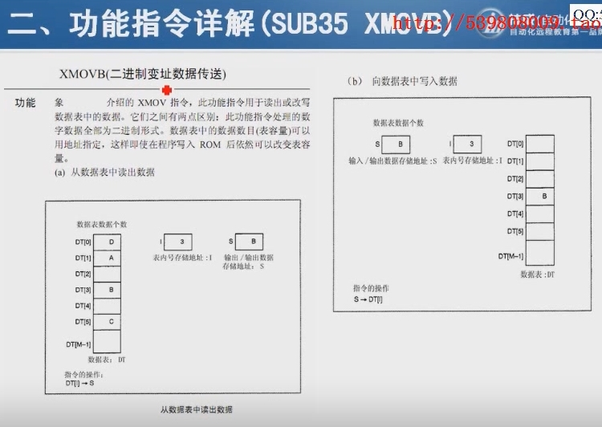

### 2. 指令格式與參數

讀取或寫入數據表內指定號的數據。處理的數據為二進制形式，因為表容量是用地址指定的，所以在寫入 ROM 後，還能修改表容量。

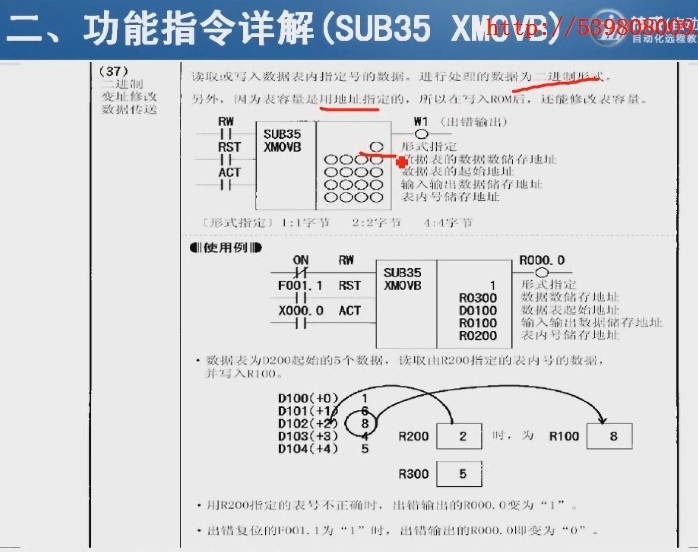

| 條件／參數 | 說明 |
|---|---|
| **RW** | 0：從數據表讀取；1：向數據表寫入 |
| **RST** | 1：斷開出錯輸出 W1 |
| **ACT** | 1：執行 XMOVB 指令 |
| **W1** | 表內號超出數據表範圍時，出錯輸出接通 |
| **形式指定** | 1：1 字節；2：2 字節；4：4 字節 |
| **數據表的數據數儲存地址** | 存放表容量的地址 |
| **數據表的起始地址** | 數據表第一個數據的地址 |
| **輸入輸出數據儲存地址** | 讀出／寫入的數據所在地址 |
| **表內號儲存地址** | 存放表內號的地址 |

使用例：RW＝0（讀）、RST 接 F001.1、ACT 接 X000.0；形式指定 1（1 字節），數據數儲存地址 R0300，表起始地址 D0100，輸入輸出數據儲存地址 R0100，表內號儲存地址 R0200。

- 數據表為 5 個數據（D100～D104：1、6、8、4、5；投影片文字寫成 D200 起始，與參數 D0100 不符，應為筆誤），R300＝5；
- R200＝2 時，讀取表內號 2 的數據 8，寫入 R100，所以 R100＝**8**；
- 用 R200 指定的表號不正確（超出 0～4）時，出錯輸出 R000.0 變為 "1"；出錯復位的 F001.1 為 "1" 時，R000.0 變為 "0"。

### 3. 實機演示

演示程式設定：

| 項目 | 設定 |
|---|---|
| RW | R9091.0（常 0）→ 讀 |
| RST | X27.5 |
| ACT | X27.4 |
| 出錯輸出（W1） | Y27.5 |
| 形式指定 | 0001（1 字節） |
| 數據表的數據數儲存地址 | D0110 |
| 數據表起始地址 | D0100 |
| 輸入輸出數據儲存地址 | D0112 |
| 表內號儲存地址 | D0114 |

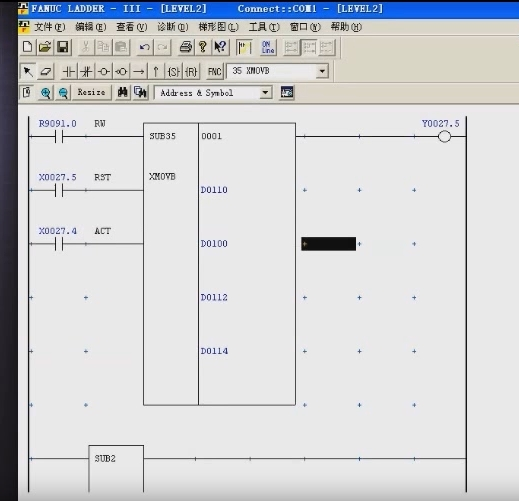

因為 XMOVB 處理二進制數據，數據表控制畫面的參數設為 `00000000`（二進制），TYPE＝0（1 字節）：

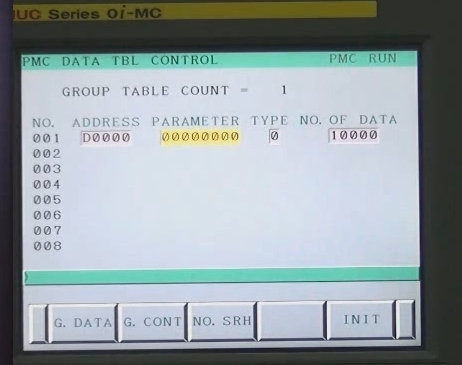

設定 D0110＝**10**（表有 10 個數據）、D0114＝**8**（要讀表內號 8）：

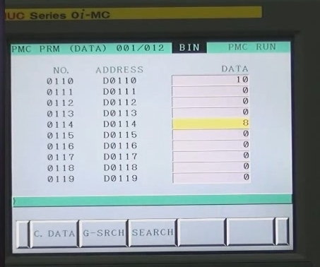

用二進制顯示數據表，內容為 3、4、5、6、7、8、9、**85**、17、18。（這是上一個演示留下的數據：D0107 原寫入的 BCD 55，以二進制顯示就是 85；D0108、D0109 的 BCD 11、12 顯示為 17、18。）

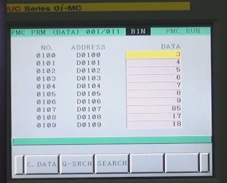

按下 X27.4 執行後，D0112＝**17**：表內號 8（D0108）的數據是 17，被讀到輸入輸出地址 D0112。

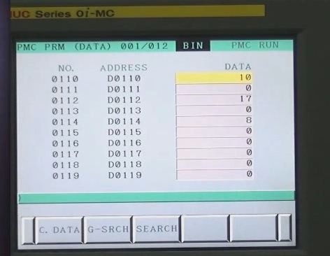

---

## 本課時小結

| 指令 | 功能號 | 功能 | 重點 |
|---|---|---|---|
| DSCH | SUB17 | 數據檢索 | 給出數據，找出表內號；找不到 W1＝1；BYT 決定 BCD 2／4 位 |
| DSCHB | SUB34 | 二進制數據檢索 | 二進制，可 1／2／4 字節；數據個數用地址指定 |
| XMOV | SUB18 | 變址數據傳送 | 按表內號讀／寫 BCD 數據表；RW＝0 讀、1 寫；表內號超範圍 W1＝1 |
| XMOVB | SUB35 | 二進制變址數據傳送 | 二進制，可 1／2／4 字節；表容量用地址指定 |

<!-- chs18_10、chs18_16～18 尚未上傳，收到後再補 -->
