# 第19课时.FANUC-PMC功能指令08

> 本課為 FANUC 數控機床 PLC 編程的第二講。
> 本教程根據課程錄音逐字稿整理（語音辨識原文有不少錯字，已依上下文校正），並配合課件與機台畫面截圖。
> 圖片請放在與本文件同層的 `images` 資料夾，沿用原檔名 `chs08_01.jpg ~ chs08_35.jpg`。
> 本份涵蓋全部 35 張圖片（`chs08_01 ~ chs08_35`）。
> 來源：`第8课时_FANUC数控机床PMC基礎知识01.txt`（第一、二節）、`第19课时_FANUC-PMC功能指令08.txt`（第三節「功能指令詳解」）及圖片 `chs08_01 ~ 35`。

---

## 本課內容

1. 數控機床 PMC 概述
2. FANUC 數控機床 PMC 工作原理
3. PMC 的元件
4. I/O Link 地址分配

---

## 一、數控機床 PMC 概述

本節講四件事：

- PLC 與 PMC 的關係
- 數字控制（NC）與順序控制的概念
- PMC 與數控機床（MT）、數控系統（CNC）的關係

### 1.1 PLC 與 PMC 的關係

**PLC** 三個字母的含義：

| 字母 | 英文 | 含義 |
|---|---|---|
| P | Program(mable) | 可編程的 |
| L | Logic | 邏輯 |
| C | Controller | 控制器 |

合起來就是「可編程邏輯控制器」。

早期 PLC 主要做邏輯運算。隨著技術發展，PLC 的功能已不限於邏輯運算，也能做數值運算與其他控制，因此後來有人把「Logic」去掉，簡稱 **PC**。但 PC 容易和個人電腦（Personal Computer）混淆，所以習慣上仍稱 **PLC**，只是要記住它的功能早已不限於邏輯控制。

**PMC** 三個字母的含義：

| 字母 | 英文 | 含義 |
|---|---|---|
| P | Program(mable) | 可編程的 |
| M | Machine | 機床 |
| C | Controller | 控制器 |

即「可編程機床控制器」。**PMC 與 PLC 本質上是同一回事，只是專用於機床**，FANUC 把它稱為 PMC；西門子等系統仍習慣稱為 PLC。

#### FANUC PMC 與一般 PLC 的區別

作用大致相同，但 FANUC PMC 多了一部分**與 CNC 系統交互的專用接口信號**：

- **一般 PLC**：只處理對外圍元件的輸入輸出控制（X、Y、R 地址）。
- **FANUC PMC**：處理完外圍接口信號後，還要把結果送到系統對應的**專用地址（F、G 地址）**，以實現相應的系統功能。

**舉例**：在 MDI 輸入 `M03 S600`（主軸正轉、轉速 600）。

1. CNC 執行到 `M03 S600`，輸出專用的 **F 信號**（M 代碼選通等），在梯形圖中對應成一個中間點。
2. 梯形圖再判斷外圍輸入條件：卡盤（三爪卡盤）夾緊了沒有？尾座頂緊了沒有？防護門關上了沒有？……
3. 條件全部滿足後，再把信號送入系統專用的 **G 地址**，此時主軸才能轉動。

可見執行一條簡單的程序就涉及 F、G 這類系統專用地址，這是一般 PLC 所沒有的。

### 1.2 數字控制與順序控制

數控機床是在自動控制下動作的設備，它所做的控制可分為兩類：

**① 數字控制（Numerical Control）**
對各個**坐標軸運動**的控制：移動距離、速度、各軸之間的插補等。
例如數控車床有 X、Z 兩軸，銑床／加工中心有 X、Y、Z 三軸。這部分由 **NC** 負責處理。

**② 順序控制（Sequence Control）**
在機床運行過程中，以 CNC 內部和機床各行程開關、傳感器、按鈕、繼電器等**開關量信號的狀態為條件**，按預先規定的**邏輯順序**進行的控制。

例如：

- 主軸起停：按下按鈕後，還要檢查卡盤夾緊了沒有、門關好了沒有，條件都滿足主軸才能轉；
- 主軸正轉／反轉切換；
- 刀具更換（換刀）；
- 工件夾緊、鬆開；
- 液壓、冷卻液、潤滑系統的運行。

與數字控制相比，順序控制處理的信息主要是**開關量信號**。這部分由 **PMC** 處理。

> **小結**：數字控制 → NC；順序控制 → PMC。本課程的「數控機床 PMC 編程」主要就是講順序控制。

### 1.3 PMC 與 CNC、MT 的關係

三者關係可簡化為：

```
  CNC  ⇄  PMC  ⇄  MT
 (系統)  (橋梁)  (機床本體)
```

- **CNC**：Computer Numerical Control，計算機數字控制，即數控系統。
- **MT**：Machine Tool，機床本體（機械部分，如工作台、立柱等）。
- **PMC**：位於 CNC 與 MT 之間的**信號橋梁**。機床與 CNC 之間的信號，都必須經過 PMC 處理。

信號流向（四種地址）：

| 地址 | 方向 | 說明 |
|---|---|---|
| **X** | 機床 → PMC | 機床輸入信號。例如按下按鈕，經接口變成 X 信號輸入 PMC |
| **G** | PMC → CNC | PMC 處理後生成的信號，專門給 CNC。不同的 G 地址有各自特定的含義，CNC 收到後便知道要做什麼 |
| **F** | CNC → PMC | CNC 處理後返回的信號，例如報警、系統正常等狀態 |
| **Y** | PMC → 機床 | PMC 再處理後輸出，驅動指示燈、接觸器線圈等 |

> 注意：地址方向以 PMC 為中心。G 是「給 CNC 的」，F 是「CNC 給回來的」。

---

## 二、FANUC 數控機床 PMC 工作原理

本部分分三塊：

1. PMC 順序程序的格式
2. PMC 程序的結構
   - 程序的分級（優先級）
   - PMC 的執行時序
   - PMC 的功能模塊
3. PMC 程序的特點

### 2.1 PMC 順序程序的格式

PMC 程序又叫**順序程序**，用梯形圖（Ladder）表示，三種叫法是一回事。梯形圖中的元素：

| 元素 | 說明 |
|---|---|
| **網格號**（N0001、N0002…） | 每個網格（rung）的編號，主要用於查找 |
| **母線** | 左右兩條豎線，中間畫橫向的邏輯線，外形像梯子，故名「梯形圖」 |
| **注釋** | 用括號加星號 `(* … *)` 包住的文字，**不影響程序執行** |
| **常開觸點** `─┤ ├─` | 地址信號為 0 時斷開，為 1 時閉合，電流通過 |
| **常閉觸點** `─┤/├─` | 與常開相反：信號為 0 時**接通**，為 1 時**斷開** |
| **線圈** `─( )─` | 內部繼電器（或輸出）線圈 |
| **地址** | 位於觸點／線圈上方，例如 `R0.6` |
| **符號注釋** | 位於地址下方，例如 `CRESP`，說明該信號的用途，方便閱讀 |

補充：

- 符號注釋上方若帶有**橫線（信號名上劃線）**，表示該信號**低電平有效**。
  例如 `G114.0`（X 軸正方向超程）：為 0 時表示超程有效，為 1 時表示未超程。
- 例如 `G70.7` 的符號 `MRDYA`，意思是「機床準備好」信號。
- 梯形圖右側的英文（如 over travel）是對該繼電器的說明注釋。

#### 基本指令與功能指令

PMC 程序除了基本邏輯指令之外，還有**功能指令**。

數控機床使用的 PMC 指令必須滿足機床信息處理與動作控制的特殊要求，例如：

- NC 輸出 M、S、T 二進制代碼信號時，需要**譯碼**後才能處理；
- 機械部件或液壓系統動作狀態的**延時確認**（需要定時器）；
- 加工零件的**計數**；
- 刀庫旋轉、自動換刀的控制；
- 分度工作台旋轉時**如何沿最短路徑旋轉**（正轉近還是反轉近，要計算現在位置到目標位置需轉多少步）。

此外還有**比較、檢索、代碼轉換、數據運算、信息顯示**等控制功能。

這些功能如果只靠基本邏輯指令（一次只能做一位的操作），雖然也能實現，但程序非常繁瑣、困難。因此增加了一類專門的指令來解決，稱為**功能指令**。

FANUC PMC 的功能指令有 50 多條，常用的有 20 多條。

#### 功能指令的格式

以 FANUC 固定定時器的功能指令為例，框形的功能指令通常包含：

```
 執行條件 ─┤├─┬──────────────┬── 輸出（執行結果）
           ...│ SUBxx 助記符 │
              │   參數 …     │
              └──────────────┘
```

- **執行條件**（框左側的觸點）
- **助記符**（指令名稱，如 ADD）
- **功能指令號**（SUB 編號，如 SUB19）
- **參數**（框內各項設定值）
- **輸出**（框右側，功能指令執行結果輸出的繼電器）

具體用法後面逐條講解。

---

## 三、功能指令詳解：加法與減法運算

以下為課件與機台實機演示。六條運算指令如下：

| 指令 | 編號 | 運算類型 | 處理數據 |
|---|---|---|---|
| **ADD** | SUB19 | BCD 加法 | BCD 2 位或 4 位 |
| **ADDB** | SUB36 | 二進制加法 | 1、2、4 字節 |
| **SUB** | SUB20 | BCD 減法 | BCD 2 位或 4 位 |
| **SUBB** | SUB37 | 二進制減法 | 1、2、4 字節 |
| **MUL** | SUB21 | BCD 乘法 | BCD 2 位或 4 位 |
| **MULB** | SUB38 | 二進制乘法 | 1、2、4 字節 |
| **DIV** | SUB22 | BCD 除法 | BCD 2 位或 4 位 |

**演示環境共通約定**（六個範例都相同）：

- `X0027.5` 接 **RST**（復位），`X0027.4` 接 **ACT**（執行），`Y0027.5` 接輸出 **W1**（出錯／結果特殊狀態輸出）；
- 梯形圖編輯畫面上方另有一個 `F0007.2`（符號 `SF`）觸點，並未接入功能指令，應是畫面上其他梯級的殘留，下面的文字梯形圖不含它；
- 運行前，先到「PMC 參數 → 數據表」設定資料表的 **TYPE（每筆字節數）** 與 **PARAMETER（BIN／BCD）**；
- **文字梯形圖圖例**：`--[ 地址 ]--` = 常開觸點；`( 地址 )` = 輸出線圈；方框內第一行為指令號與助記符，其下依序為各參數。每個範例另附 FANUC 指令表（助記符）寫法：`RD` 讀入第一個條件，`RD.STK` 把其餘條件依序壓入堆疊，`SUB nn` 為功能指令，`PRM` 為各參數，`WRT` 為輸出線圈；D 地址在 PRM 中只寫數字（D0100 → `100`）。指令表寫法請以 FANUC LADDER-III 的源程序視圖核對。
- 操作流程：設定資料表 → 在 D 區填入初始數據 → 把程序傳到機床 → PMC 運行 → 若 Y0027.5 為接通，先用 X0027.5 復位 → 接通 X0027.4 執行 → 觀察結果地址的數據變化。

### 3.1 ADD（SUB19）— BCD 加法

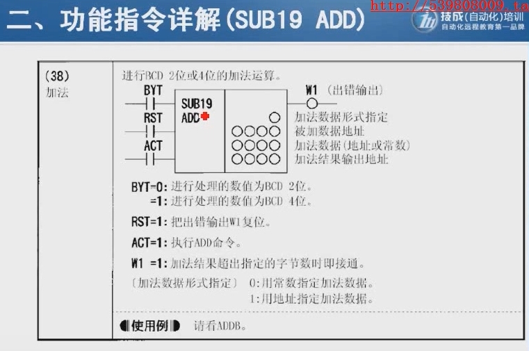

**功能**：進行 BCD 2 位或 4 位的加法運算。

**控制條件：**

| 條件 | 含義 |
|---|---|
| `BYT = 0` | 處理的數值為 BCD **2 位** |
| `BYT = 1` | 處理的數值為 BCD **4 位** |
| `RST = 1` | 把出錯輸出 W1 **復位** |
| `ACT = 1` | **執行** ADD 命令 |
| `W1 = 1` | 加法結果超出指定的字節數時接通（溢出報錯） |

**參數（由上至下四項）：**

1. 加法數據形式指定：`0` = 用**常數**指定加法數據；`1` = 用**地址**指定加法數據
2. 被加數據地址
3. 加法數據（地址或常數）
4. 加法結果輸出地址

#### 梯形圖編輯畫面

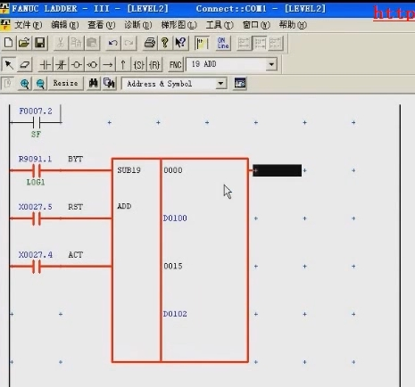

此例中：

- 畫面上方的 `F0007.2`（符號 `SF`）觸點未接入功能指令；
- `R9091.1`（符號 `LOG1`）接 **BYT**。R9091.1 為系統固定為 1 的常 1 信號，故 BYT = 1，即 **BCD 4 位**（4 位 BCD = 2 字節）；
- `X0027.5` 接 **RST**，`X0027.4` 接 **ACT**；
- 參數：`0000`（形式指定：用常數）、`D0100`（被加數地址）、`0015`（加數常數 15）、`D0102`（結果地址）。
- 因為用的是 2 字節，資料表要設 **TYPE = 1**，且 **PARAMETER 設為 BCD（bit0 = 1）**。
- 輸出（W1）接 `Y0027.5`，編輯畫面中黑色反白處為正在輸入的輸出位置。

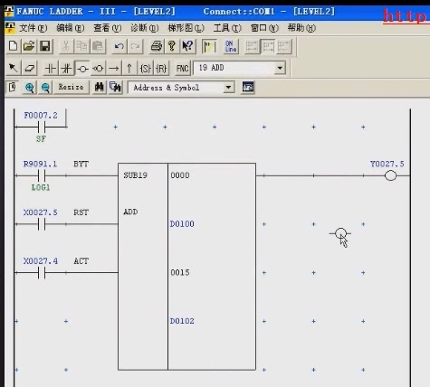

**文字梯形圖（ADD 範例）**

```
|                       +----------------------------
|--[ R9091.1 ]-- BYT ---| SUB19  ADD
|                       | 0000       形式指定：常數              ----( Y0027.5 )  W1
|--[ X0027.5 ]-- RST ---| D0100      被加數地址
|                       | 0015       加數（常數 15）
|--[ X0027.4 ]-- ACT ---| D0102      結果地址
|                       +----------------------------

指令表：
RD       R9091.1   ; BYT（常1 → BCD 4 位）
RD.STK   X0027.5   ; RST
RD.STK   X0027.4   ; ACT
SUB      19
PRM      0         ; 形式指定：常數
PRM      100       ; 被加數 D0100
PRM      15        ; 加數常數
PRM      102       ; 結果 D0102
WRT      Y0027.5   ; W1
```


#### 資料表設定：BCD 格式

在 PMC 的「數據表控制」畫面（PMC DATA TBL CONTROL）設定 D 區的數據類型：

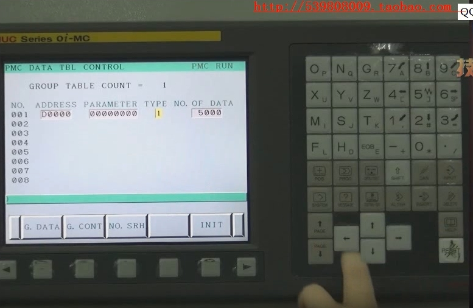

- 地址 `D0000`，**TYPE = 1** 表示每筆數據佔 **2 個字節**，數據數 5000。
- **PARAMETER** 的最低位（bit0）決定顯示格式：`0` = 二進制（BIN），`1` = **BCD**。此畫面為 `00000000`，後面的數據畫面標題顯示 BCD，表示 bit0 已改為 1（`00000001`）。
- 因為每筆 2 字節（4 位 BCD 數剛好 2 字節），相鄰的數據地址相差 2（D0100、D0102、D0104……）。

**運算演示**：

D0100 先設為 **403**（BCD）：

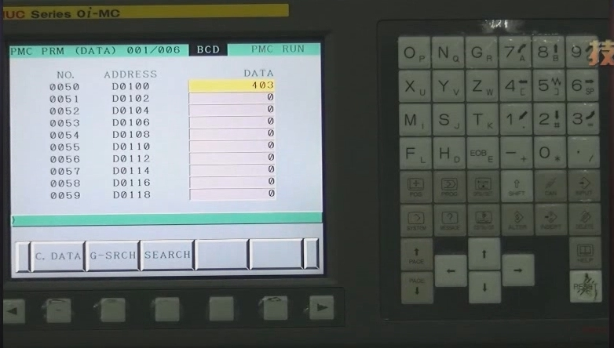

D0100 原有 403（BCD），旁邊的 D0102 起初為 0。接通 ACT（X0027.4）執行後，`403 + 15 = 418`，結果寫入 D0102：

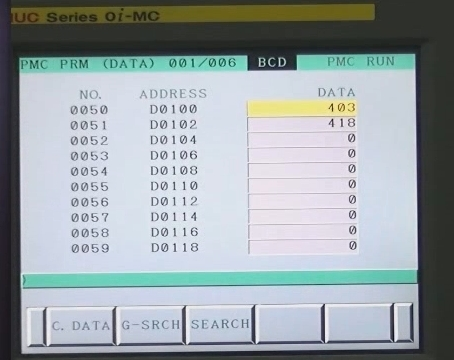

### 3.2 ADDB（SUB36）— 二進制加法

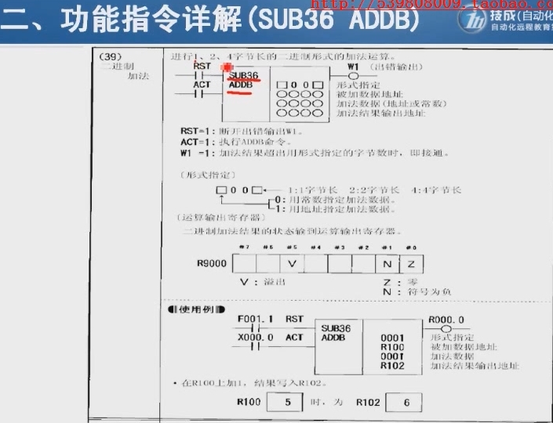

**功能**：進行 1、2、4 字節長的二進制加法運算。

| 條件 | 含義 |
|---|---|
| `RST = 1` | 斷開出錯輸出 W1 |
| `ACT = 1` | 執行 ADDB 命令 |
| `W1 = 1` | 加法結果超出用形式指定的字節數時接通 |

與 ADD 相比，ADDB **沒有 BYT 控制條件**，字節長度改由「形式指定」參數決定。

**形式指定**（參數第一項，3 位數 `□ 0 0 □`）：

- 最高位（左）：`1` = 1 字節長；`2` = 2 字節長；`4` = 4 字節長
- 最低位（右）：`0` = 用**常數**指定加法數據；`1` = 用**地址**指定加法數據

其餘參數：被加數據地址、加法數據（地址或常數）、加法結果輸出地址。

**運算輸出寄存器 R9000**：二進制加法結果的狀態會輸出到 R9000：

| 位 | 符號 | 含義 |
|---|---|---|
| #5 | V | 溢出（Overflow） |
| #1 | N | 符號為負（Negative） |
| #0 | Z | 結果為零（Zero） |

**課件使用例**：在 R100 上加 1，結果寫入 R102。形式指定 `0001`、被加數 R100、加數 `0001`、結果 R102。R100 = 5 時，R102 = 6。

#### 梯形圖編輯與演示

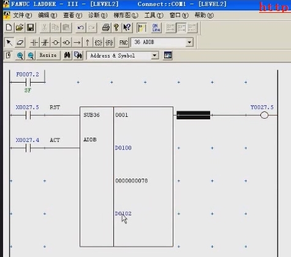

**文字梯形圖（ADDB 範例）**

```
|                       +----------------------------
|                       | SUB36  ADDB
|--[ X0027.5 ]-- RST ---| 0001       形式指定：常數、1 字節         ----( Y0027.5 )  W1
|                       | D0100      被加數地址
|--[ X0027.4 ]-- ACT ---| 0000000078 加數（常數 78）
|                       | D0102      結果地址
|                       +----------------------------

指令表：
RD       X0027.5   ; RST
RD.STK   X0027.4   ; ACT
SUB      36
PRM      1         ; 形式指定 0001
PRM      100       ; 被加數 D0100
PRM      78        ; 加數常數
PRM      102       ; 結果 D0102
WRT      Y0027.5   ; W1
```


此例參數：形式指定 `0001`（最高位 0 = 加數用**常數**，最低位 1 = **1 字節**）、被加數 `D0100`、加數常數 `78`、結果 `D0102`；輸出 `Y0027.5`。

資料表設為 **TYPE = 0（每筆 1 字節）、PARAMETER = `00000000`（二進制）**：

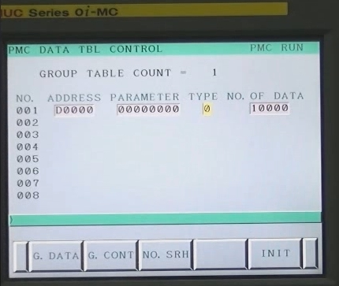

每筆 1 字節、二進制，所以每個字節各佔一個地址（D0100、D0101、D0102…），畫面標題顯示 **BIN**：

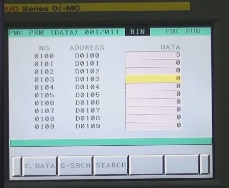

在線監視梯形圖，可看到 D0100 = 3，D0102 = 0（尚未執行）：

![梯形圖在線監視：D0100 [3]、D0102 [0]](images/chs08_11.jpg)

執行 ACT 後，`3 + 78 = 81`，D0102 = 81：

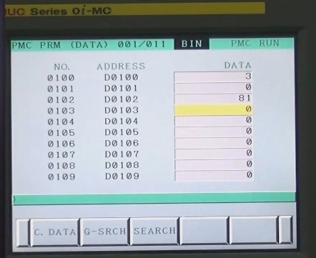

> **BCD 與 BIN 的差別**：同一個 D 地址，用 BCD 或二進制解讀，數值意義不同；寫程序前要先確認該 D 區資料表的 PARAMETER（BCD／BIN）與 TYPE（字節數）設定，並選用對應的指令（BCD → ADD／SUB；二進制 → ADDB／SUBB）。

### 3.3 SUB（SUB20）— BCD 減法

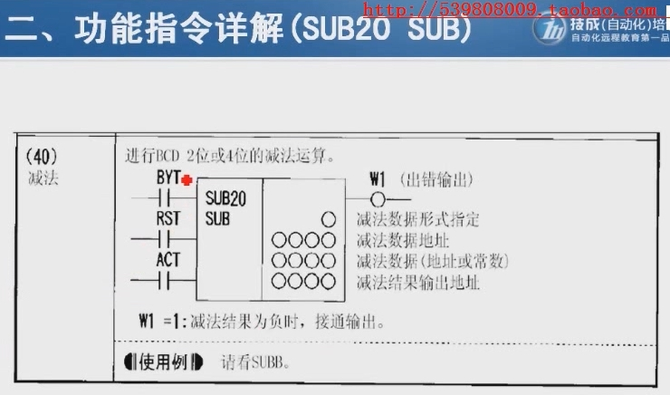

**功能**：進行 BCD 2 位或 4 位的減法運算。

控制條件與 ADD 相同（BYT、RST、ACT），參數順序也相同：

1. 減法數據形式指定（0 = 常數，1 = 地址）
2. 減法數據地址（被減數）
3. 減法數據（地址或常數，即減數）
4. 減法結果輸出地址

**輸出**：`W1 = 1`：減法結果為**負**時，接通輸出。

#### 梯形圖編輯

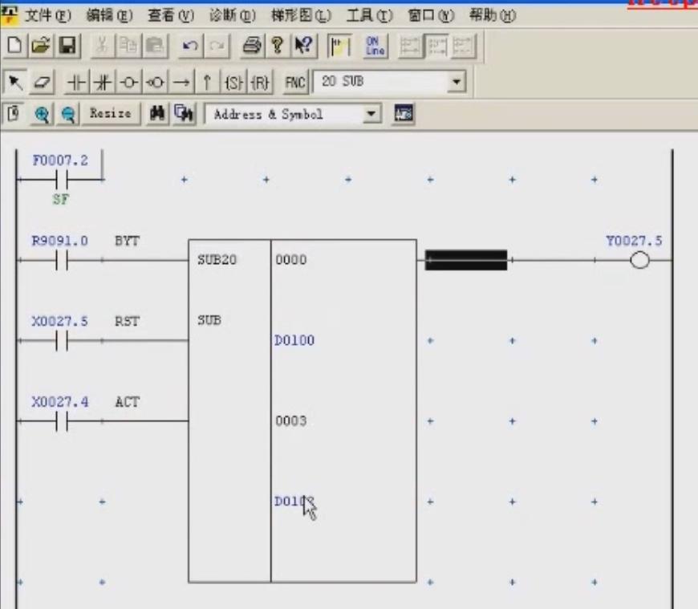

**文字梯形圖（SUB 範例）**

```
|                       +----------------------------
|--[ R9091.0 ]-- BYT ---| SUB20  SUB
|                       | 0000       形式指定：常數              ----( Y0027.5 )  W1
|--[ X0027.5 ]-- RST ---| D0100      被減數地址
|                       | 0003       減數（常數 3）
|--[ X0027.4 ]-- ACT ---| D0102      結果地址
|                       +----------------------------

指令表：
RD       R9091.0   ; BYT（常0 → BCD 2 位）
RD.STK   X0027.5   ; RST
RD.STK   X0027.4   ; ACT
SUB      20
PRM      0         ; 形式指定：常數
PRM      100       ; 被減數 D0100
PRM      3         ; 減數常數
PRM      102       ; 結果 D0102
WRT      Y0027.5   ; W1（結果為負時接通）
```


此例中：

- `R9091.0`（常 0 信號）接 **BYT** → BYT = 0，即 **BCD 2 位**；
- 參數：`0000`（常數）、被減數 `D0100`、減數常數 `0003`、結果 `D0102`；
- 輸出接 `Y0027.5`。

#### 資料表與運算演示

資料表 TYPE = 0（每筆 1 字節），PARAMETER 欄位被反白編輯：

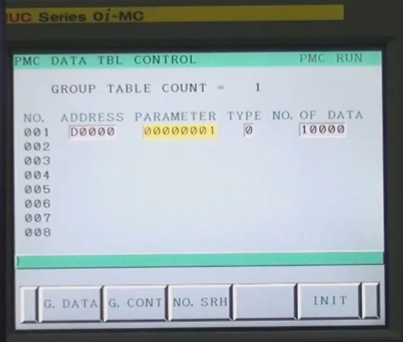

> 此處把 PARAMETER 由 `00000000` 改為 `00000001`，即 bit0 = 1，改為以 **BCD** 顯示（下一張畫面標題變為 BCD）。各位元定義請以 FANUC PMC 編程說明書為準。

BCD 格式、每筆 1 字節，D0100 = 30，D0102 = 0：

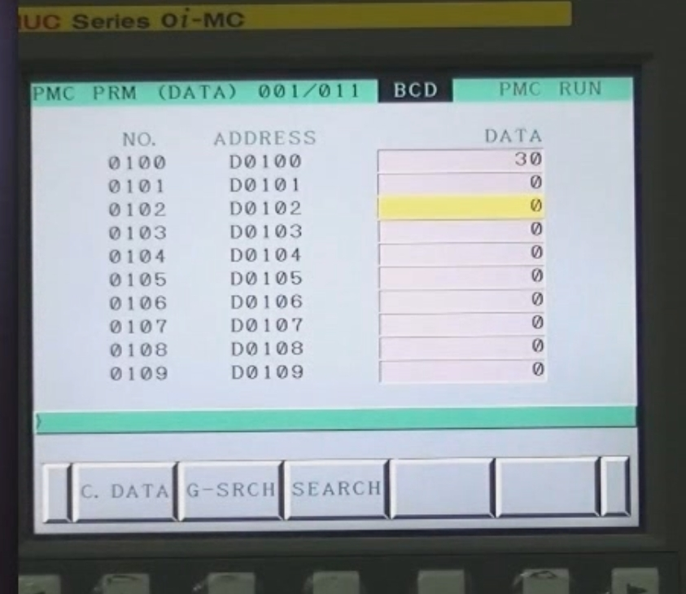

執行後，`30 − 3 = 27`，D0102 = 27：

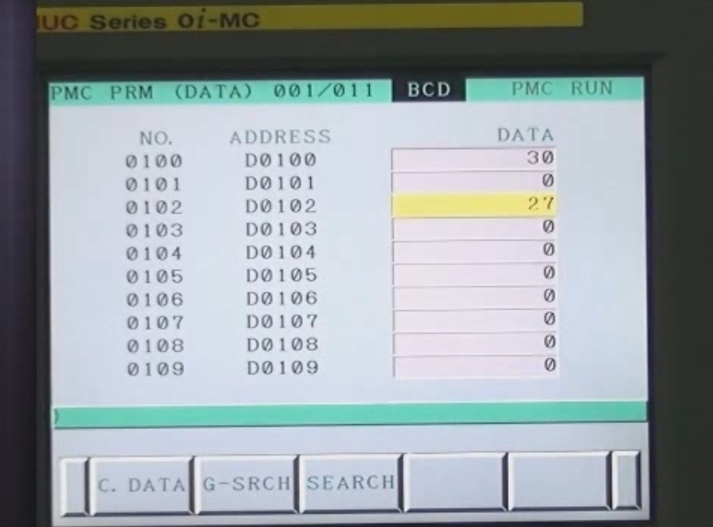

### 3.4 SUBB（SUB37）— 二進制減法

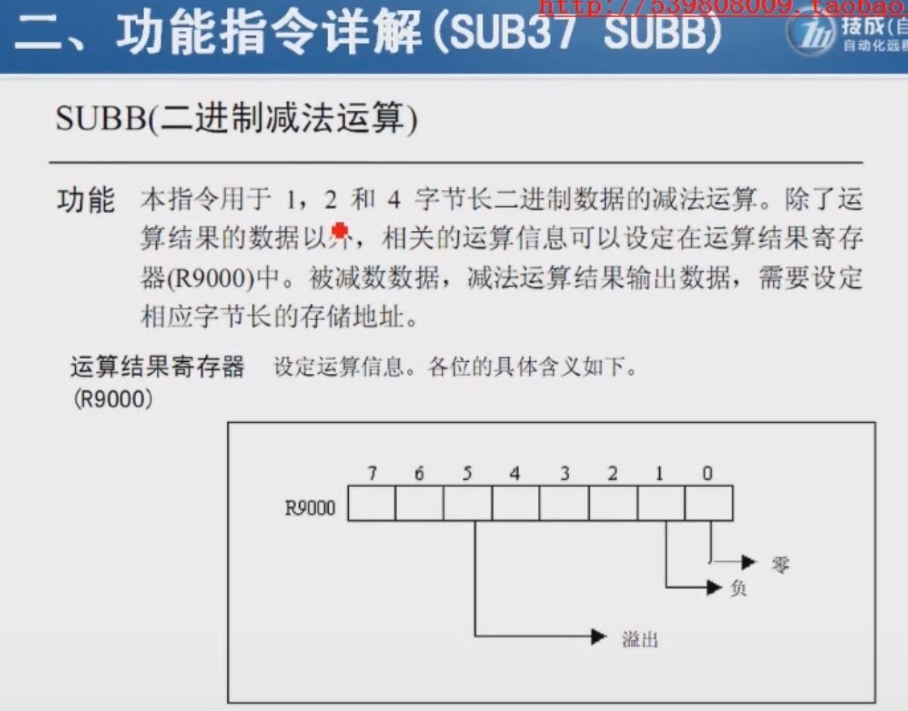

**功能**：本指令用於 1、2、4 字節長二進制數據的減法運算。除了運算結果的數據以外，相關的運算信息可以設定在**運算結果寄存器（R9000）**中。被減數數據、減法運算結果輸出數據，需要設定相應字節長的存儲地址。

**運算結果寄存器 R9000** 各位含義：

| 位 | 含義 |
|---|---|
| #0 | **零**（結果為 0） |
| #1 | **負**（結果為負） |
| #5 | **溢出** |

（#2、#3、#4、#6、#7 本指令未使用。）

**課件使用例**：

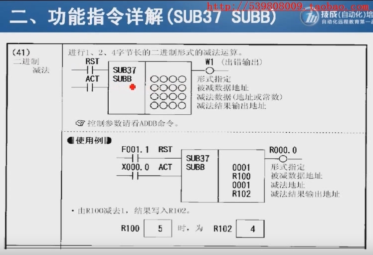

由 R100 減去 1，結果寫入 R102。形式指定 `0001`、被減數 R100、減數 `0001`、結果 R102。R100 = 5 時，R102 = 4。控制參數（形式指定）的寫法與 ADDB 相同。

#### 梯形圖編輯

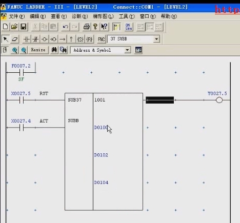

**文字梯形圖（SUBB 範例）**

```
|                       +----------------------------
|                       | SUB37  SUBB
|--[ X0027.5 ]-- RST ---| 1001       形式指定：減數用地址、1 字節      ----( Y0027.5 )  W1
|                       | D0100      被減數地址
|--[ X0027.4 ]-- ACT ---| D0102      減數地址
|                       | D0104      結果地址
|                       +----------------------------

指令表：
RD       X0027.5   ; RST
RD.STK   X0027.4   ; ACT
SUB      37
PRM      1001      ; 形式指定
PRM      100       ; 被減數 D0100
PRM      102       ; 減數 D0102
PRM      104       ; 結果 D0104
WRT      Y0027.5   ; W1
```


此例參數：

- 形式指定 `1001`：1 字節長，且減數**用地址指定**（最低位為 1）；
- 被減數 `D0100`、減數 `D0102`、結果 `D0104`；
- 輸出接 `Y0027.5`。

#### 資料表與運算演示

資料表為 TYPE = 0（1 字節）、二進制：

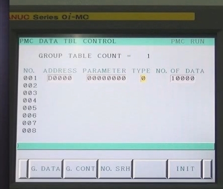

（執行前若 Y0027.5 已接通，先接通 X0027.5 復位。）設定 D0100 = 30、D0102 = 45：

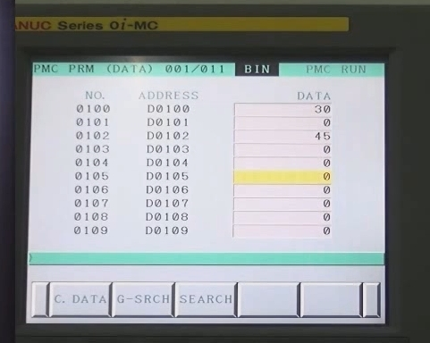

執行後 `30 − 45 = −15`，D0104 = −15（結果為負）：

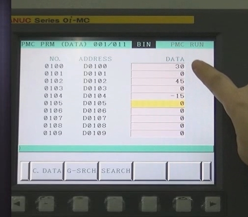

減法結果的符號可以在運算結果寄存器 **R9000** 查到。查看方法：`SYSTEM` → `PMC` → `PMC 診斷` → `STATUS`（信號狀態），輸入 `R9000` 後按 `SEARCH`。可見 **bit1（負）= 1**，表示結果為負：

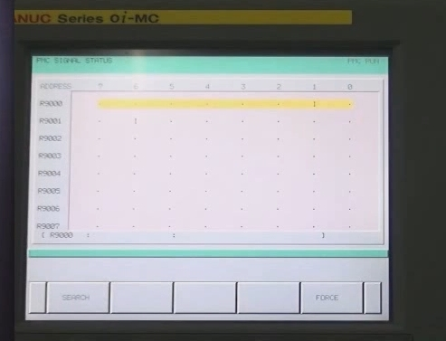

### 3.5 MUL（SUB21）— BCD 乘法

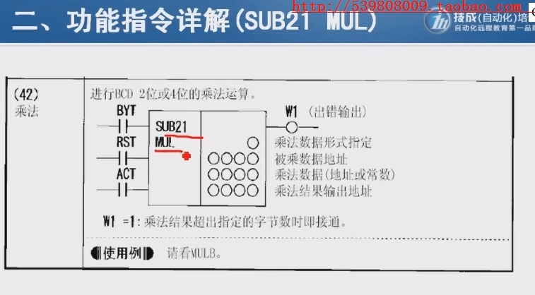

**功能**：進行 BCD 2 位或 4 位的乘法運算。控制條件與 ADD 相同（BYT、RST、ACT）。

- `BYT = 0`：BCD 2 位；`BYT = 1`：BCD 4 位。
- 形式指定：`0` = 乘法數據為**常數**；`1` = 乘法數據用**地址**給定。

參數（由上至下）：乘法數據形式指定、被乘數據地址、乘法數據（地址或常數）、乘法結果輸出地址。

`W1 = 1`：乘法結果超出指定的字節數時接通。

使用例請參考 MULB。

### 3.6 MULB（SUB38）— 二進制乘法

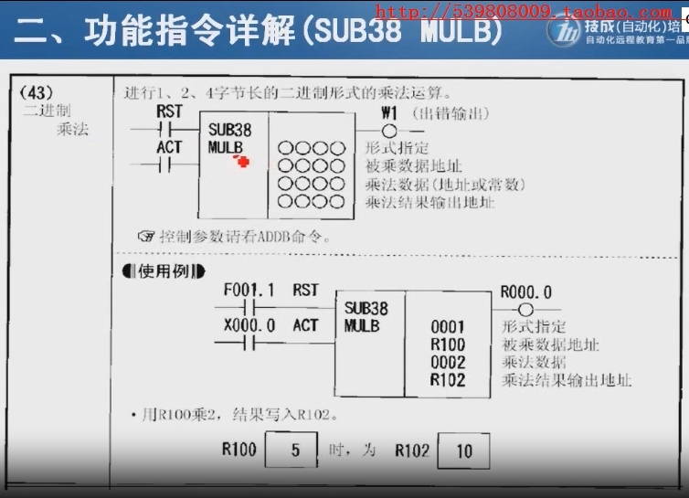

**功能**：進行 1、2、4 字節長的二進制乘法運算。控制參數請參考 ADDB 命令。

**課件使用例**：用 R100 乘 2，結果寫入 R102。形式指定 `0001`、被乘數 R100、乘數 `0002`、結果 R102。R100 = 5 時，R102 = 10。

#### 梯形圖編輯

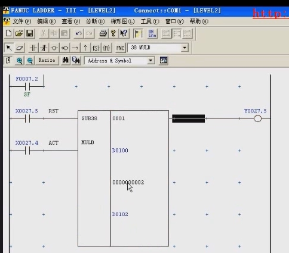

**文字梯形圖（MULB 範例）**

```
|                       +----------------------------
|                       | SUB38  MULB
|--[ X0027.5 ]-- RST ---| 0001       形式指定：常數、1 字節         ----( Y0027.5 )  W1
|                       | D0100      被乘數地址
|--[ X0027.4 ]-- ACT ---| 0000000002 乘數（常數 2）
|                       | D0102      結果地址
|                       +----------------------------

指令表：
RD       X0027.5   ; RST
RD.STK   X0027.4   ; ACT
SUB      38
PRM      1         ; 形式指定 0001
PRM      100       ; 被乘數 D0100
PRM      2         ; 乘數常數
PRM      102       ; 結果 D0102
WRT      Y0027.5   ; W1
```


此例參數：形式指定 `0001`（最高位 0 = 乘數為**常數**，最低位 1 = 1 字節）、被乘數 `D0100`、乘數常數 `2`、結果 `D0102`；輸出 `Y0027.5`。

形式指定的格式與 ADDB 相同：最低位決定字節數（1／2／4），第一位 0 = 常數、1 = 地址。

#### 資料表與運算演示

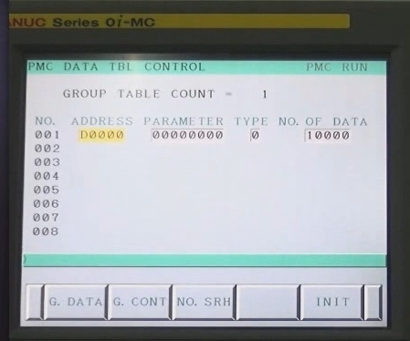

D0100 = 30（BIN）：

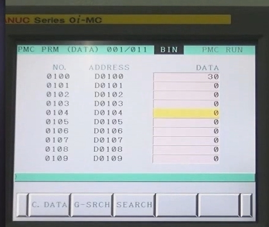

執行後 `30 × 2 = 60`，D0102 = 60：

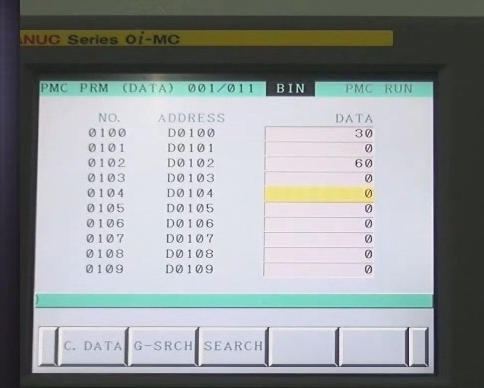

### 3.7 DIV（SUB22）— BCD 除法

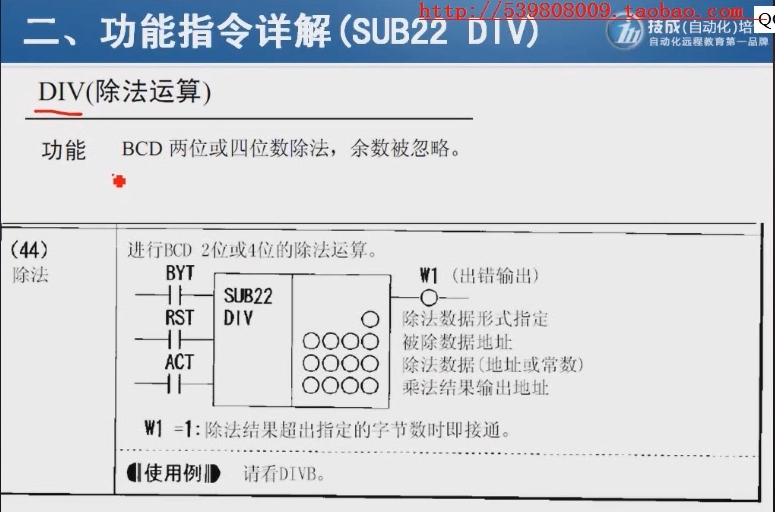

**功能**：BCD 兩位或四位數除法，**餘數被忽略**。

控制條件與 ADD 相同（BYT、RST、ACT）：`BYT = 0` 為 BCD 2 位，`BYT = 1` 為 BCD 4 位。形式指定：`0` = 除數為**常數**，`1` = 除數用**地址**給定。參數：除法數據形式指定、被除數據地址、除法數據（地址或常數）、除法結果輸出地址。（課件最後一項誤寫為「乘法結果輸出地址」，應為除法結果。）

`W1 = 1`：除法結果超出指定的字節數時接通。使用例請參考 DIVB。

#### 梯形圖編輯

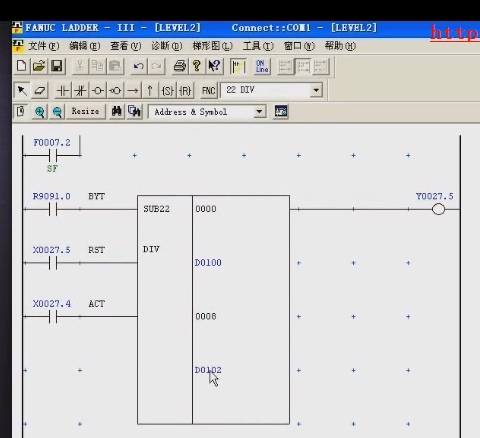

**文字梯形圖（DIV 範例）**

```
|                       +----------------------------
|--[ R9091.0 ]-- BYT ---| SUB22  DIV
|                       | 0000       形式指定：常數              ----( Y0027.5 )  W1
|--[ X0027.5 ]-- RST ---| D0100      被除數地址
|                       | 0008       除數（常數 8）
|--[ X0027.4 ]-- ACT ---| D0102      結果地址
|                       +----------------------------

指令表：
RD       R9091.0   ; BYT（常0 → BCD 2 位）
RD.STK   X0027.5   ; RST
RD.STK   X0027.4   ; ACT
SUB      22
PRM      0         ; 形式指定：常數
PRM      100       ; 被除數 D0100
PRM      8         ; 除數常數
PRM      102       ; 商 D0102（餘數捨去）
WRT      Y0027.5   ; W1
```


此例中：

- `R9091.0`（常 0）接 **BYT** → BCD **2 位**；
- 參數：`0000`（常數）、被除數 `D0100`、除數常數 `0008`、結果 `D0102`；輸出 `Y0027.5`。

#### 資料表與運算演示

BCD 2 位 = 1 字節，所以資料表 **TYPE = 0（1 字節）**，**PARAMETER = `00000001`（BCD）**：

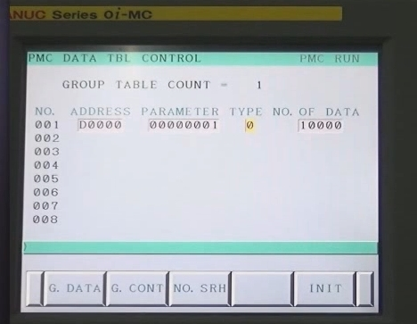

D0100 設為 43（BCD），其餘為 0：

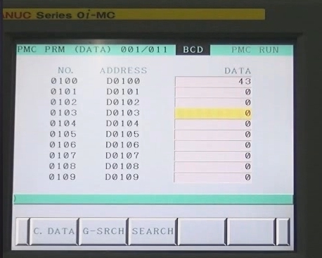

把程序傳到機床時，畫面右上角顯示 **PMC STOP**（PMC 停止），此時梯形圖不執行，D0102 仍為 0；傳完程序後需把 PMC 啟動為 RUN：

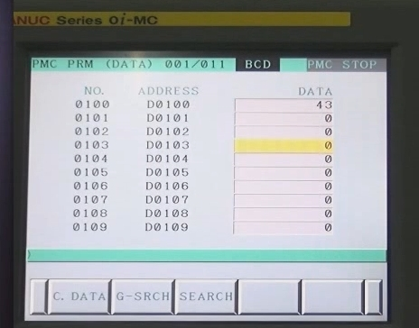

接通 X0027.4 執行後，D0102 變為 **5**：`43 ÷ 8 = 5`，**餘數 3 被忽略**（截圖中沒有這個結果畫面，數值依講師口述）。

> PMC 必須處於 **PMC RUN** 狀態，運算指令才會執行。

---

## 四、本部分小結

1. **PMC = 機床專用的 PLC**，在 CNC 與機床之間起信號橋梁作用；X/Y 對機床，F/G 對 CNC。
2. **NC 管數字控制（坐標軸運動），PMC 管順序控制（開關量邏輯）。**
3. 基本邏輯指令不夠用時，使用**功能指令**（框形指令：執行條件＋助記符＋指令號＋參數＋輸出）。
4. 四則運算指令速查：

| 運算 | BCD | 二進制 |
|---|---|---|
| 加法 | ADD（SUB19） | ADDB（SUB36） |
| 減法 | SUB（SUB20） | SUBB（SUB37） |
| 乘法 | MUL（SUB21） | MULB（SUB38） |
| 除法 | DIV（SUB22） | （DIVB，課件未列） |

5. 使用前先確認資料表設定：**TYPE = 每筆字節數**（0 = 1 字節、1 = 2 字節…），**PARAMETER bit0：0 = BIN、1 = BCD**；BCD 4 位佔 2 字節。
6. `R9091.0` = 常 0、`R9091.1` = 常 1，常用來固定 BYT 的值；二進制運算結果狀態查看 `R9000`（Z / N / V）。
7. 運算指令只有在 **PMC RUN** 狀態下才會執行。
8. 四個範例的資料表設定對照：

| 指令 | TYPE | PARAMETER |
|---|---|---|
| ADD（2 字節 BCD） | 1 | BCD（bit0 = 1） |
| ADDB／SUBB／MULB（1 字節二進制） | 0 | BIN（00000000） |
| SUB／DIV（1 字節 BCD） | 0 | BCD（00000001） |
