# 第20課時　FANUC-PMC 功能指令 09

> 本課時內容：二進制除法 DIVB、BCD 常數定義 NUME、二進制常數定義 NUMEB、信息顯示 DISPB、上升沿檢測 DIFU、下降沿檢測 DIFD、異或 EOR、邏輯乘 AND、邏輯和 OR、邏輯非 NOT、程式結束 END、子程式調用 CALL / CALLU、子程式 SP / SPE。

---

## 一、DIVB — 二進制除法運算（SUB 39）

前面學過的 DIV 是 BCD 碼除法，**無法得到餘數**。DIVB 是二進制除法，可得到餘數。

### 1.1 功能說明

- 對 **1、2、4 位元組**的二進制資料進行除法運算。
- 除了運算結果以外，相關的運算資訊放在**運算結果暫存器 R9000** 中。
- **餘數**存放在 **R9000 以後**的位址中（R9000～R9005），佔用的位元組數取決於資料長度。
- 被除數、除數、運算結果都要指定相應位元組長度的儲存位址。

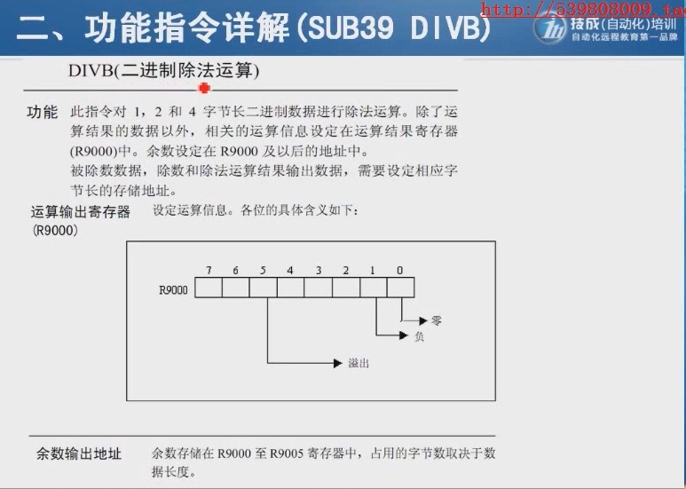

**R9000 各位元含義**（運算輸出暫存器）：

| 位元 | 含義 |
|:---:|---|
| bit0 | 零（結果為 0） |
| bit1 | 負（結果為負） |
| bit5 | 溢出 |

### 1.2 指令格式與使用例

指令的控制端：

| 端子 | 作用 |
|---|---|
| RST | 重置（RST=1 時，出錯輸出 W1 被重置） |
| ACT | 執行條件（ACT=1 時執行 DIVB） |
| W1 | 出錯輸出 |

四個參數依序為：**形式指定**、**被除數位址**、**除數（位址或常數）**、**除法結果輸出位址**。

形式指定（4 位數）：

- 第一位數：除數是**常數**（`0`）還是**位址**（`1`）。
- 末位數：資料長度，1＝1 位元組，2＝2 位元組，4＝4 位元組。

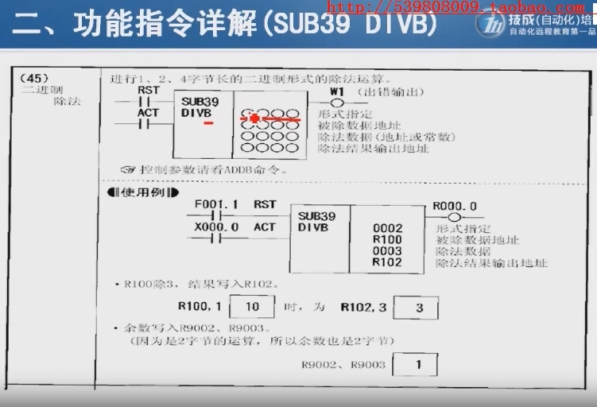

**使用例**：

```
F001.1 ─┤ ├─ RST ┌────────┬────────────┐
                 │ SUB 39 │ 0002       │ 形式指定
X000.0 ─┤ ├─ ACT │ DIVB   │ R100       │ 被除數位址
                 │        │ 0003       │ 除數
                 │        │ R102       │ 除法結果輸出位址
                 └────────┴────────────┘─────( R000.0 )
```

- 形式指定 `0002`：除數用**常數**表示，資料為 **2 位元組**。
- 被除數：以 R100 為首的 2 位元組（R100、R101），資料為 10。
- 除數：常數 3。
- 結果：10 ÷ 3 = 3，放入以 R102 為首的 2 位元組（R102、R103）。
- **餘數** = 1，放入 R9002、R9003（因為是 2 位元組運算，所以餘數也是 2 位元組）。

### 1.3 實機演示

**（1）梯形圖編寫**

在 FANUC LADDER-III 中找到功能指令 **39 DIVB**：

- 重置條件：X27.5
- 執行條件：X27.4
- 出錯輸出：Y27.5
- 參數 1（形式指定）：`0001` → 除數為常數，資料長度 1 位元組
- 參數 2（被除數）：D0100
- 參數 3（除數）：常數 `0000000008`，即除以 8
- 參數 4（結果）：D0102

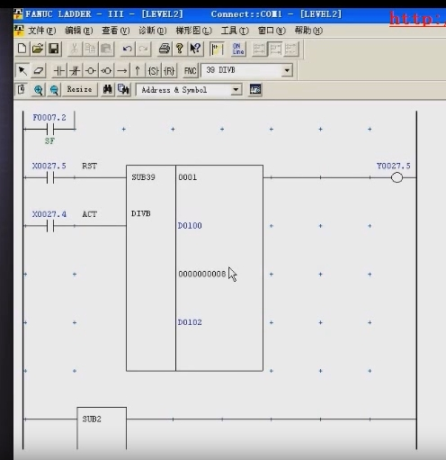

**（2）設定資料格式**

運算前要先設定資料的格式。進入 `SYSTEM → PMC → PMC PRM → DATA`，在「**C.DATA（資料表控制）**」畫面中：

- 因為 DIVB 是二進制運算，所以 **PARAMETER 設為 `00000000`**（二進制）；
- **TYPE = 0**（1 位元組長度）。

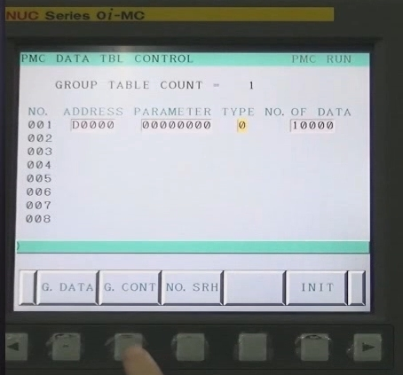

**（3）設定被除數**

回到資料表，把 D0100 設為 **60**（60 ÷ 8），D0102 清為 0：

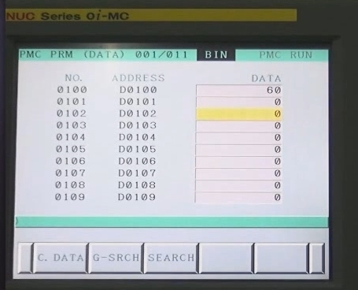

**（4）傳送程式並運行**

`ONLINE → 編譯`（無錯誤）→ `傳輸 → 確定 → 運行`。接通 **X27.4**，觀察 D0102：

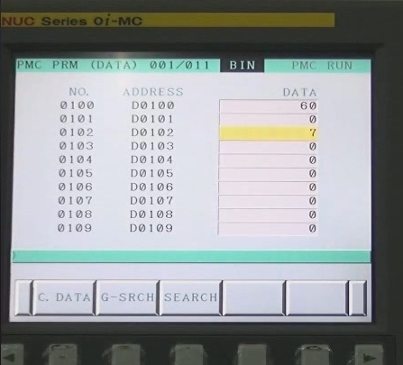

D0102 變成 **7**，即 60 ÷ 8 = 7（商）。

**（5）查看餘數**

餘數放在 **R9002、R9003**。進入 `PMC → STATUS（信號狀態）`，搜尋 R9002，看到 R9002 為 `00000100`，也就是十進制的 **4**：

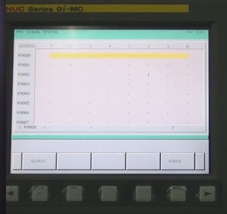

驗證：60 ÷ 8 = 7 餘 **4**，正確。

### 1.4 被除數為負數的情況

把 D0100 改為 **−90**，再除以 8：

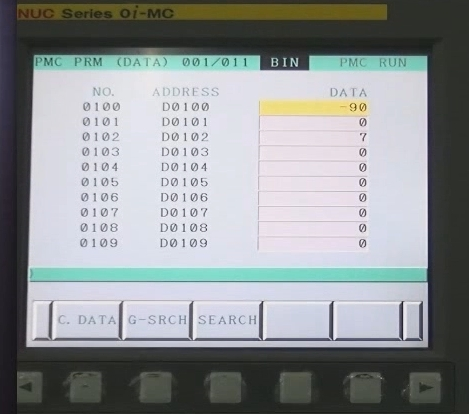

接通 X27.4 後，D0102 變成 **−11**：

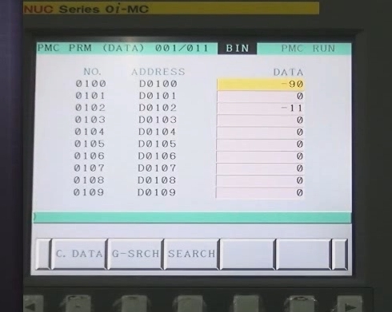

餘數同樣放在 R9002。查看 R9002 為 `11111110`：

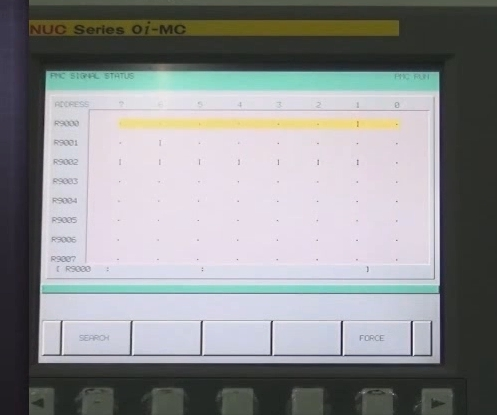

> 這是一個**負數**，以**二進制補數**表示：最高位（bit7）是符號位，`11111110` = **−2**。
> 驗證：−90 = 8 × (−11) + (−2)，商 −11、餘數 −2，正確。

---

## 二、NUME — BCD 常數定義（SUB 23）

### 2.1 功能與格式

**定義 BCD 2 位或 4 位的常數**，並寫入指定位址。

| 控制條件 | 說明 |
|---|---|
| BYT = 0 | 處理的數值為 **BCD 2 位**（1 位元組） |
| BYT = 1 | 處理的數值為 **BCD 4 位**（2 位元組） |
| ACT = 1 | 執行 NUME 指令 |

兩個參數：**常數**、**常數輸出位址**。

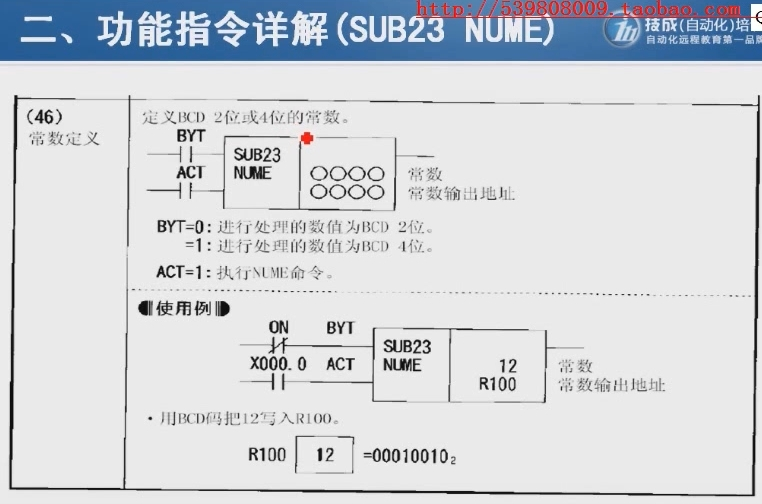

**使用例**：用 BCD 碼把 12 寫入 R100。BYT = 0（BYT 接常閉 ON，故為 0，處理 2 位 BCD），結果 R100 = 12，即二進制 `0001 0010`。

### 2.2 實機演示

梯形圖：

- BYT：R9091.0（R9091.0 恆為 0，表示處理 BCD 2 位）
- ACT：X27.4
- 參數 1：常數 `0012`
- 參數 2：D0100（要把 12 這個常數定義到 D0100）

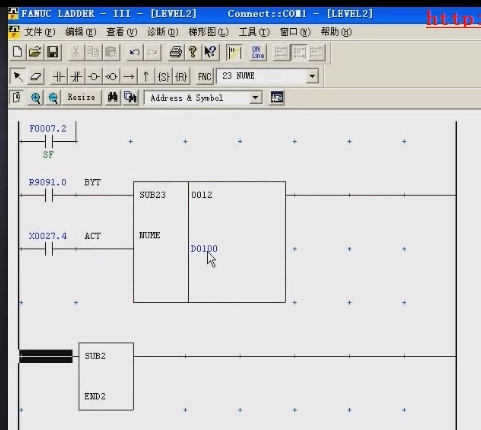

**先清除 D0100**。進入 `SYSTEM → PMC → PMC PRM → DATA → C.DATA`，因為這是 BCD 碼，所以 **PARAMETER 設為 `00000001`（BCD 格式）**，TYPE = 0：

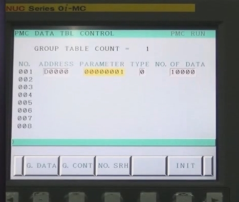

回到資料表，畫面右上角顯示 **BCD**，把 D0100 全部清為 0：

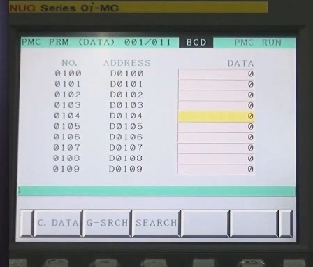

傳送程式、運行後，接通 **X27.4**，觀察 D0100 的變化，變成 **12**：

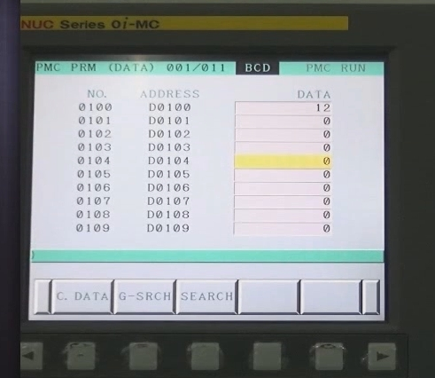

這就是把常數 12 以 BCD 碼定義給了 D0100。

---

## 三、NUMEB — 二進制常數定義（SUB 40）

### 3.1 功能與格式

NUMEB 是在 NUME 功能碼後加 **B**，表示**二進制**。可定義 **1、2、4 位元組長**的二進制形式常數。

三個參數：**形式指定**、**常數**、**常數輸出位址**。

形式指定：`1`＝1 位元組長，`2`＝2 位元組長，`4`＝4 位元組長。

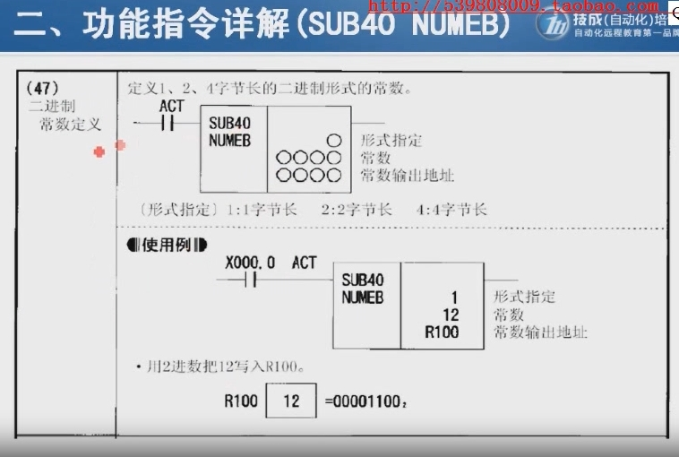

**使用例**：用二進制把 12 寫入 R100。形式指定 1（1 位元組），常數 12，輸出位址 R100，結果 R100 = 12 = `0000 1100`。

> **注意 BCD 與二進制的區別**：同樣是 12，NUME（BCD）存成 `0001 0010`，NUMEB（二進制）存成 `0000 1100`。

### 3.2 2 位元組例子：256

X4.1 接通時，執行二進制常數定義：把 **256** 放到以 D100 為首的 **2 位元組**（D100 與 D101）中，形式指定為 2。

256 用二進制表示為 `0000 0001 0000 0000`。PMC 低位元組在前，所以 **D100 = 0**、**D101 = 1**（D101 的 bit0 為 1），如圖中信號狀態所示：

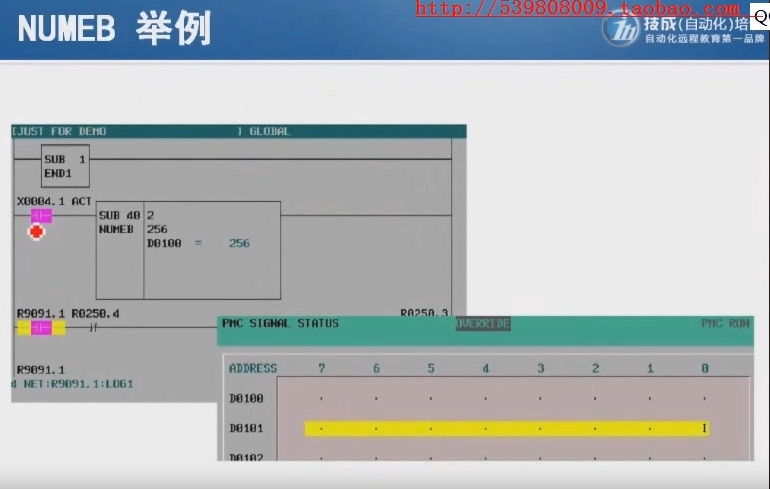

### 3.3 實機演示

梯形圖：

- ACT：X27.4
- 參數 1（形式指定）：`0001`，1 位元組
- 參數 2（常數）：`0000000012`
- 參數 3：D0100

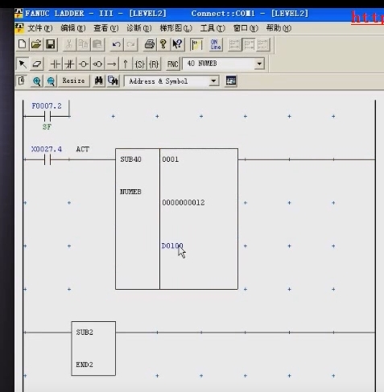

因為是二進制，運行前同樣要進入 **C.DATA**，把 **PARAMETER 設為 `00000000`（二進制）**，TYPE = 0（1 位元組）：

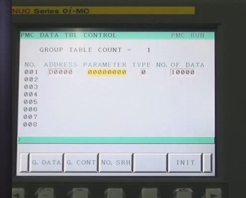

運行前，D0100 為 0：

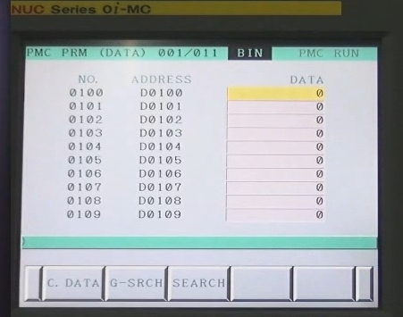

傳送程式後，接通 X27.4，D0100 變成 **12**：

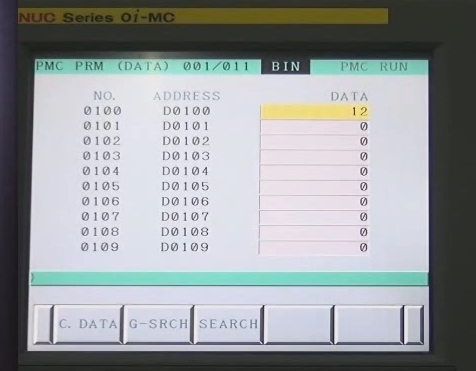

### 3.4 NUME 與 NUMEB 的區別

在 PMC 信號狀態畫面（`PMC → STATUS`）中查看 D0100 的位元，bit3、bit2 為 1，即 `0000 1100`：

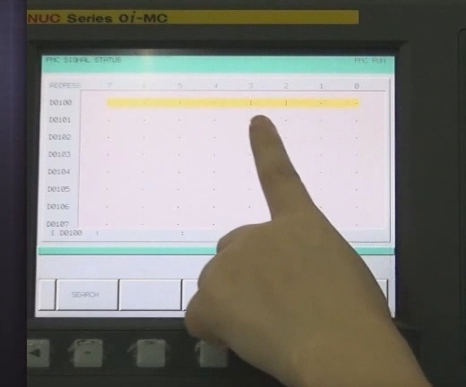

| 指令 | 12 的位元表示 | 說明 |
|---|---|---|
| NUMEB（二進制） | `0000 1100` | 二進制 12 |
| NUME（BCD 碼） | `0001 0010` | BCD 碼 12 |

兩者顯示的十進制數都是 12，但內部位元不同。

---

## 四、DISPB — 信息顯示（SUB 41）

### 4.1 功能

在 CRT 顯示器上顯示**外部資訊**。通過指定**信息號**可編制相應的**報警**，**最多可編制 200 條**。顯示的內容與 **A 位址**有關：選定相應的 A 位址後，顯示對應的資訊。

例如 A0.0 為 1 時，就顯示 A0.0 對應的資訊表中的那條資訊。

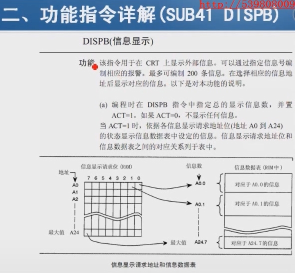

說明：

- 編程時，在 DISPB 指令中指定**總的顯示信息數**，並設 ACT = 1。若 ACT = 0，則不顯示任何資訊。
- ACT = 1 時，依據各**資訊顯示請求位址位元**（位址 A0～A24，共 25 個位元組，每位元組 8 位元）的狀態，顯示**資訊資料表**中設定的資訊。
- 請求位元與資料表的對應關係：A0.0 對應第 1 條資訊、A0.1 對應第 2 條資訊……最大 A24.7 對應最後一條資訊。
- 資訊顯示請求位元存放在 RAM 中，資訊資料表存放在 ROM 中。

### 4.1.1 指令格式與使用例

參數只有一個：**信息數**（總共有幾條資訊）。

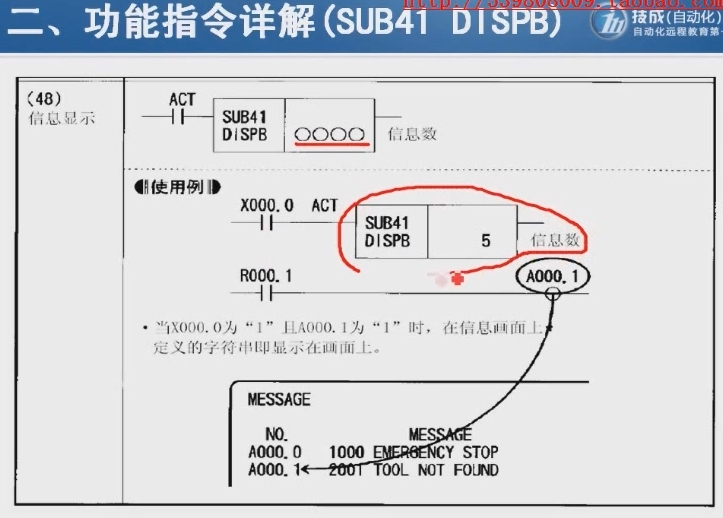

使用例：X0.0 = 1（ACT）且 **A0.1 = 1** 時，在資訊畫面上就會顯示該資訊所定義的字串。圖中範例的資訊表為：

| 位址 | 信息號 | 信息內容 |
|---|---|---|
| A000.0 | 1000 | EMERGENCY STOP |
| A000.1 | 2001 | TOOL NOT FOUND |

指令中的 `5` 是資訊總數。

### 4.2 顯示信息的三個條件

要讓一條資訊顯示出來，**必須同時做到三件事**：

1. **編輯資訊內容**：在 CRT 上（或在編程軟體的 message 表中）輸入每個 A 位址對應的資訊文字，例如 A0.0 對應「電機過熱」。沒有編輯就沒有內容可顯示。
2. **使資訊對應的 A 位址為 1**：資訊是否顯示，取決於 A0.0、A0.1…… 這些位址是否接通，例如用 R0.1 接通 A0.1。
3. **執行 DISPB 指令**：DISPB 的 ACT 條件要成立。

### 4.3 實機演示

- DISPB 的功能指令號：**41**
- 執行條件（ACT）：**X27.4**
- 參數：資訊數等。要顯示哪一條資訊，取決於對應的 A 位址有沒有接通。

編制 A 位址的程式：

| 按鈕 | 動作 |
|---|---|
| X27.4 | 執行 DISPB（顯不顯示） |
| X27.5 | 接通 **A0.0** |
| X27.6 | 接通 **A0.1** |

資訊內容在 **message** 的程式清單中**雙擊**對應的 A 位址來輸入，例如：

- A0.0 → **1001　OVERLOAD**（過載）
- A0.1 → **1000　OIL LEVEL LOW**（油位過低）

**（1）資訊在 PMC 畫面上的編輯**

在 CNC 的 PMC MESSAGE 畫面中，資訊的格式是「A 位址 ＋ 信息號 ＋ 信息文字」。下圖左側是在 CNC 上編輯 A0.0 的資訊（`1001 MOTOR OVER HOT`），右側是觸發後在報警畫面上顯示的結果：

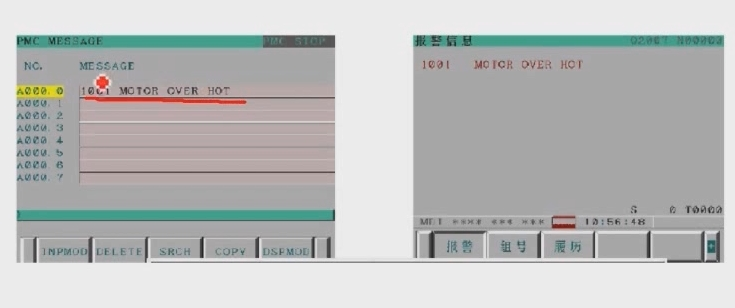

**（2）梯形圖**

- 功能指令 **41 DISPB**，ACT：**X27.4**，參數 `0005`（資訊數）。
- **X27.5** 驅動線圈 **A0000.0**。
- **X27.6** 驅動線圈 **A0000.1**。

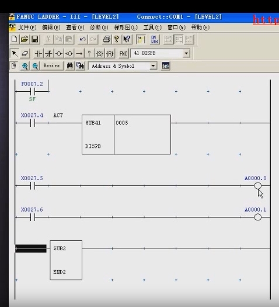

**（3）在編程軟體中編輯資訊**

在 LADDER-III 左側 **Program List** 中，雙擊 **Message**，進入資訊編輯畫面：

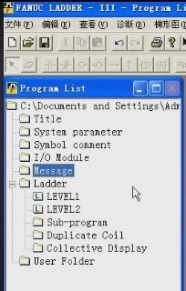

在編輯畫面中輸入：

| A 位址 | 信息號 | 內容 |
|---|---|---|
| A0.0 | 1001 | OVERLOAD |
| A0.1 | 1000 | OIL LEVEL LOW |

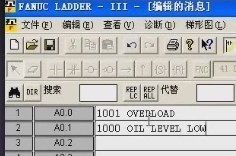

**（4）運行與結果**

編輯好後傳送程式，回到 CNC 的 **MESSAGE / ALARM** 畫面。先使 **X27.4 接通**（運行 DISPB），再接通 **X27.5**（使 A0.0 = 1），報警畫面出現 **1001 OVERLOAD**：

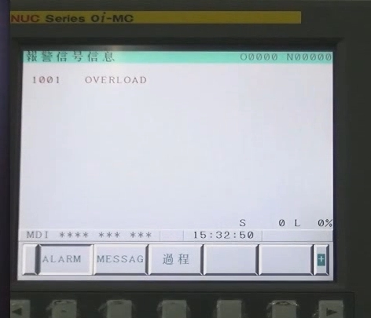

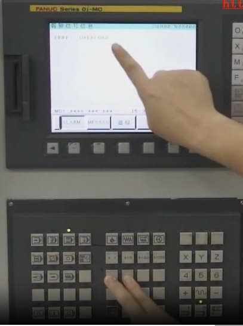

鬆開後，報警就消失。接通 **X27.6**（A0.1 = 1），則顯示 **1000 OIL LEVEL LOW**，此時 CNC 狀態列出現 **ALM**（報警狀態）：

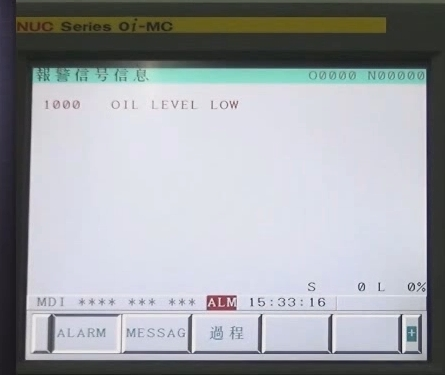

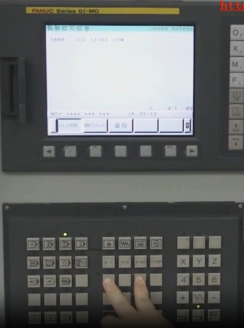

> 注意：要顯示資訊，**X27.4（ACT）必須接通**，只接通 X27.5 / X27.6 是不會顯示的。

### 4.4 信息號範圍

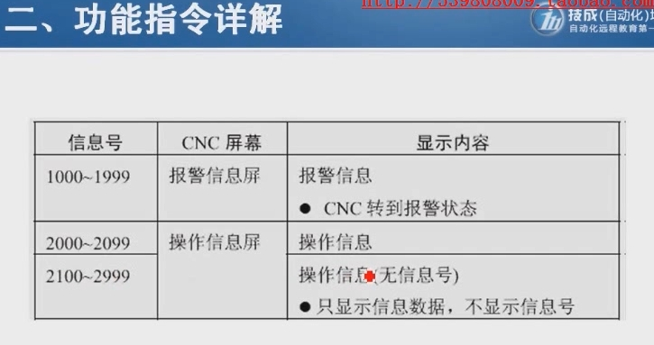

| 信息號範圍 | CNC 畫面 | 顯示內容 |
|---|---|---|
| 1000～1999 | 報警信息屏 | **報警信息**，CNC 轉到報警狀態 |
| 2000～2099 | 操作信息屏 | **操作信息** |
| 2100～2999 | 操作信息屏 | 操作信息（無信息號），只顯示信息資料，不顯示信息號 |

> 一般按此規定使用。

---

## 五、DIFU — 上升沿檢測（SUB 57）

- 功能指令號：**57**
- 助記符：**DIFU**
- 功能：**讀取輸入信號的上升沿**。輸入由 0 變 1 的那一瞬間，輸出馬上為 1，並維持**一個掃描週期**後恢復為 0。
- 參數：**上升沿號**（1～256）。**上升沿號不能重複使用**。

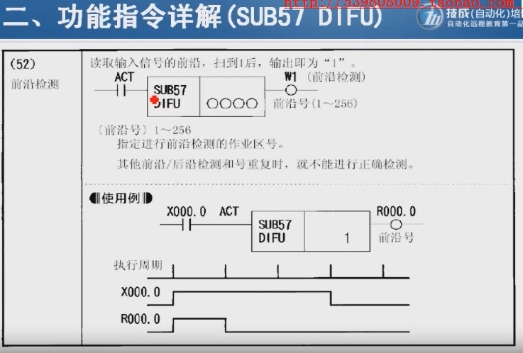

說明：**掃描到 1 之後，輸出即為「1」**。上升沿號 1～256，用來指定進行上升沿檢測的作業區號；**其他前沿 / 後沿檢測的號重複時，就不能進行正確檢測**。

使用例：X0.0 為 ACT，指令 `SUB57 DIFU 1`，輸出 R0.0。從時序圖可見：X0.0 接通的那一個掃描週期，R0.0 為 1；下一個週期就回到 0。

例：檢測 X0.0 的信號。X0.0 一接通，R0.0 在**接通的那一瞬間**為 1，並持續一個週期就斷開（不論 X0.0 後來持續接通多久）。

---

## 六、DIFD — 下降沿檢測（SUB 58）

- 助記符：**DIFD**
- 功能：**讀取輸入信號的下降沿**，與 DIFU 類似。
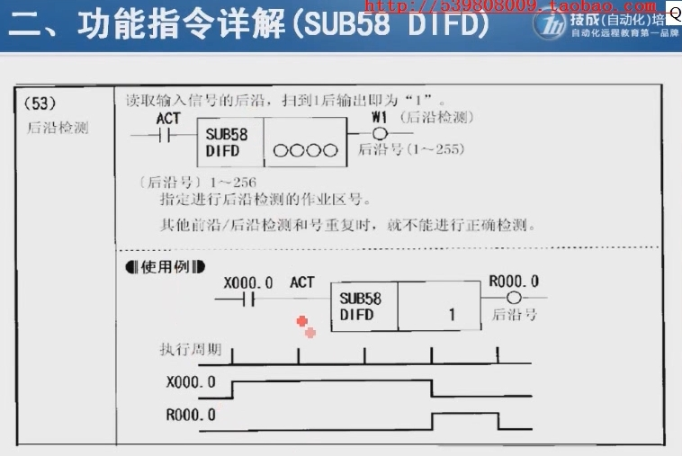

使用例：X0.0 為 ACT，指令 `SUB58 DIFD 1`，輸出 R0.0。從時序圖可見：X0.0 由 1 變 0（斷開）的那一刻，R0.0 輸出一個掃描週期的 1，再回到 0。下降沿號範圍同為 1～256，不可與其他前沿 / 後沿號重複。

- 當 ACT 信號由 1 變為 0 的那一瞬間，在輸出位址（如 R0.0）產生一個**脈衝**（持續一個週期）。
- 同樣需要指定**下降沿號**，且不可重複。

---

## 七、EOR — 異或（SUB 59）

### 7.1 功能與格式

對位址的內容與**常數**（或位址的內容）進行**異或**運算，結果寫入輸出位址。

四個參數：**形式指定**、**被運算資料**、**與之運算的資料**、**結果輸出位址**。

- 形式指定：第一位數指定「常數 / 位址」，末位數指定位元組長度（1、2、4 位元組），與前面指令類似。

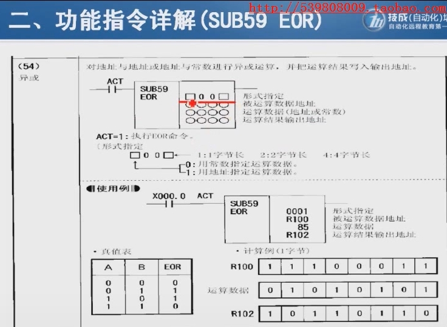

形式指定為 4 位數 `□00□`：

- 第一位：`0`＝用**常數**指定運算資料；`1`＝用**位址**指定運算資料。
- 末位：資料長度，1＝1 位元組，2＝2 位元組，4＝4 位元組。

### 7.2 什麼是異或

兩個數 A、B 做異或：**相同為 0，不同為 1**。

| A | B | 輸出 |
|:--:|:--:|:--:|
| 0 | 0 | 0 |
| 0 | 1 | 1 |
| 1 | 0 | 1 |
| 1 | 1 | 0 |

### 7.3 使用例

X0.0 接通時，把以 **R100** 為首的 **1 位元組**資料，與常數 **85** 做異或，結果放入以 **R102** 為首的 1 位元組。

常數 85 的二進制為 `0101 0101`（64 + 16 + 4 + 1 = 85）。

位元相同為 0，位元不同為 1。計算例（1 位元組）：

| | bit7 | bit6 | bit5 | bit4 | bit3 | bit2 | bit1 | bit0 |
|---|:-:|:-:|:-:|:-:|:-:|:-:|:-:|:-:|
| R100 | 1 | 1 | 1 | 0 | 0 | 0 | 1 | 1 |
| 運算資料（85） | 0 | 1 | 0 | 1 | 0 | 1 | 0 | 1 |
| R102（結果） | 1 | 0 | 1 | 1 | 0 | 1 | 1 | 0 |

### 7.4 實機演示

- 功能指令號：**59**，執行條件：X27.4。
- 四個參數：形式指定（用常數，1 位元組）、被運算資料 R100、常數 85、結果放 R102。

梯形圖：

- 形式指定：`0001`（用常數、1 位元組）
- 被運算資料位址：R0100
- 運算資料（常數）：`0000000085`
- 結果輸出位址：R0102

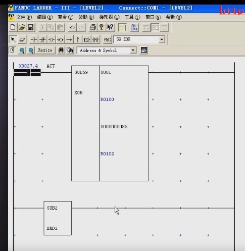

運算前先設定 R100：進入 `SYSTEM → PMC → STATUS`，找到 R100，用 **FORCE（強制）** 功能（`ON` / `OFF` 軟鍵）把 R100 設為 `1110 0011`（bit7、6、5、1、0 為 1），R102 清零：

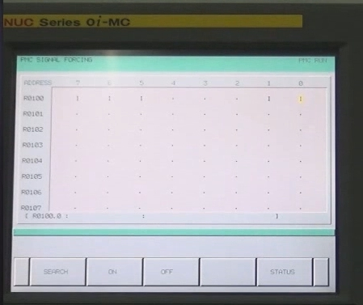

接通 X27.4，觀察 R102。結果 R102 = `1011 0110`（bit7、5、4、2、1 為 1），正是 R100 與 `0101 0101` 逐位異或的結果：

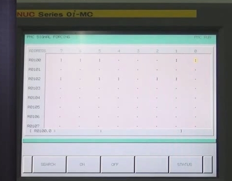

---

## 八、AND — 邏輯乘（SUB 60）

### 8.1 功能與格式

對位址與位址（或位址與常數）進行**邏輯乘**運算，並把運算結果寫入輸出位址。

邏輯乘就是「相與」：**只有兩個位元都為 1，輸出才為 1**；只要有一個為 0，輸出就為 0。

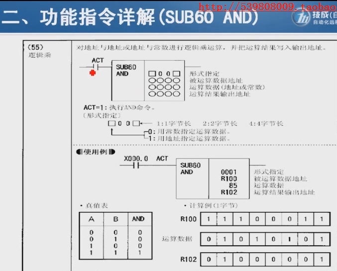

四個參數：**形式指定**、**被運算資料位址**、**運算資料（位址或常數）**、**運算結果輸出位址**。形式指定 `□00□`：第一位 `0`＝用常數指定運算資料、`1`＝用位址指定運算資料；末位 1、2、4 表示 1、2、4 位元組長。

| A | B | 輸出 |
|:--:|:--:|:--:|
| 0 | 0 | 0 |
| 0 | 1 | 0 |
| 1 | 0 | 0 |
| 1 | 1 | 1 |

### 8.2 使用例

X0.0 接通時，把以 R100 為首的 1 位元組，與常數 85（`0101 0101`）做邏輯乘，結果放入 R102。計算例（1 位元組）：

| | bit7 | bit6 | bit5 | bit4 | bit3 | bit2 | bit1 | bit0 |
|---|:-:|:-:|:-:|:-:|:-:|:-:|:-:|:-:|
| R100 | 1 | 1 | 1 | 0 | 0 | 0 | 1 | 1 |
| 運算資料（85） | 0 | 1 | 0 | 1 | 0 | 1 | 0 | 1 |
| R102（結果） | 0 | 1 | 0 | 0 | 0 | 0 | 0 | 1 |

兩個位元都為 1 的位置（bit6、bit0）輸出為 1，其餘全為 0。

### 8.3 實機演示

梯形圖：功能指令 **60 AND**，執行條件 X27.4；形式指定 `1001`（用**位址**指定運算資料、1 位元組）；被運算資料 **R0100**；運算資料 **R0101**；結果 **R0102**。

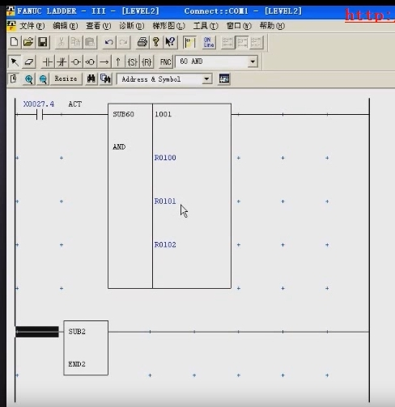

運算前，在 `PMC → STATUS` 的強制（FORCE）畫面中：R100 設為 `1110 0011`，R101 設為 `0101 0101`（常數 85），R102 清零：

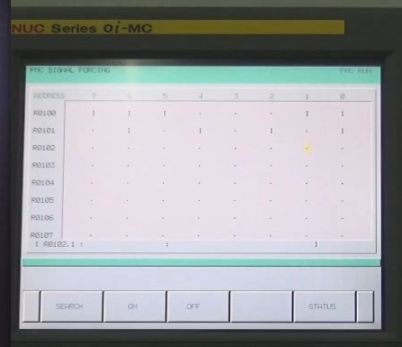

傳送程式後，接通 X27.4，觀察 R102：只有 bit6 與 bit0 為 1，即 `0100 0001`：

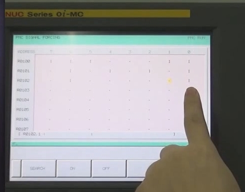

> **R100 與 R101 對應位元都為 1 時，結果位元才為 1**，其餘都是 0。

---

## 九、OR — 邏輯和（SUB 61）

### 9.1 功能與格式

對位址與位址（或位址與常數）進行**邏輯和**運算，並把結果寫入輸出位址。格式與 AND 相同（形式指定、被運算資料位址、運算資料、結果輸出位址）。

邏輯和就是「相或」：**只要有一個位元為 1，輸出就為 1**；只有兩個位元都為 0，輸出才為 0。

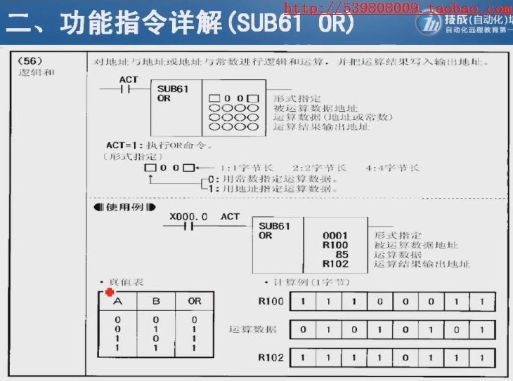

| A | B | 輸出 |
|:--:|:--:|:--:|
| 0 | 0 | 0 |
| 0 | 1 | 1 |
| 1 | 0 | 1 |
| 1 | 1 | 1 |

### 9.2 使用例

X0.0 接通時，把以 R100 為首的 1 位元組，與常數 85 做邏輯和，結果放入 R102：

| | bit7 | bit6 | bit5 | bit4 | bit3 | bit2 | bit1 | bit0 |
|---|:-:|:-:|:-:|:-:|:-:|:-:|:-:|:-:|
| R100 | 1 | 1 | 1 | 0 | 0 | 0 | 1 | 1 |
| 運算資料（85） | 0 | 1 | 0 | 1 | 0 | 1 | 0 | 1 |
| R102（結果） | 1 | 1 | 1 | 1 | 0 | 1 | 1 | 1 |

只要有一個為 1，結果就為 1；只有 bit3（兩者都是 0）結果為 0。

### 9.3 實機演示

梯形圖：功能指令 **61 OR**，執行條件 X27.4；形式指定 `1001`；被運算資料 R0100；運算資料 R0101；結果 R0102。

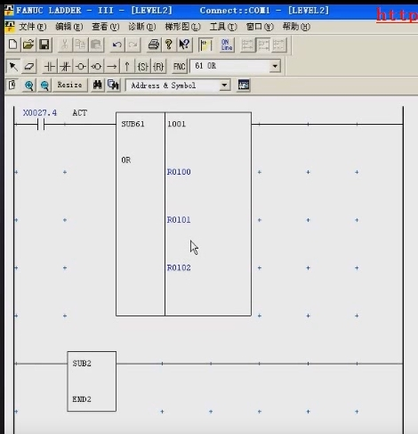

先把 R102 清零（R100、R101 的值與 AND 演示相同），傳送程式後接通 X27.4，觀察 R102：除 bit3 外都為 1，即 `1111 0111`：

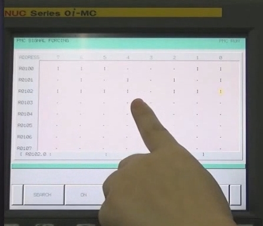

> **只有 R100 和 R101 對應位元都為 0 時，結果才為 0，否則為 1。**

---

## 十、NOT — 邏輯非（SUB 62）

### 10.1 功能與格式

把指定位址中的二進制資料做**邏輯非**運算（把 0 和 1 翻轉），並把結果寫入輸出位址。

| A | 輸出 |
|:--:|:--:|
| 0 | 1 |
| 1 | 0 |

NOT 只有**一個**運算資料，所以形式指定為 `000□`，**只指定資料長度**（1、2、4 位元組），沒有「常數 / 位址」的選擇。參數為：**形式指定**、**被運算資料位址**、**運算結果輸出位址**。

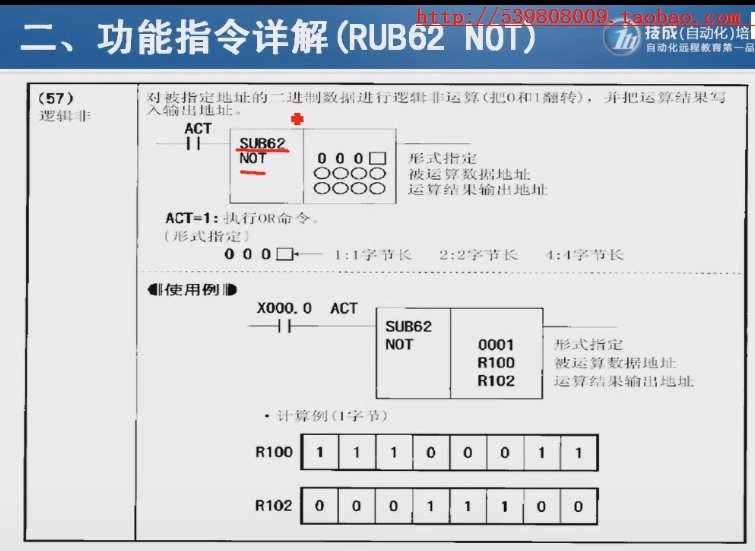

> 備註：投影片標題寫成「RUB62」、說明中寫「執行 OR 命令」，都是原稿的筆誤，應為 SUB62、執行 NOT 命令。

使用例：X0.0 接通時，把 R100 取反，結果放入 R102：

| | bit7 | bit6 | bit5 | bit4 | bit3 | bit2 | bit1 | bit0 |
|---|:-:|:-:|:-:|:-:|:-:|:-:|:-:|:-:|
| R100 | 1 | 1 | 1 | 0 | 0 | 0 | 1 | 1 |
| R102（結果） | 0 | 0 | 0 | 1 | 1 | 1 | 0 | 0 |

### 10.2 實機演示

梯形圖：功能指令 **62 NOT**，執行條件 X27.4；形式指定 `0001`（1 位元組）；被運算資料 **R0100**；結果 **R0102**。

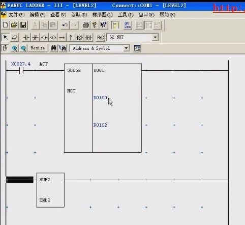

先在強制畫面把 R100 設為 `1110 0011`，R102 清零。傳送程式後接通 X27.4，觀察 R102：R100 中為 1 的位元變 0、為 0 的位元變 1，結果為 `0001 1100`：

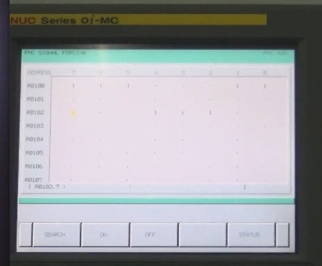

---

## 十一、END — 程式結束（SUB 64）

- 指令號：**64**，助記符：**END**。
- 功能：表示**子程式結束**。編寫子程式時，要在子程式的**最後**寫入此指令。

---

## 十二、CALL / CALLU — 子程式調用（SUB 65 / SUB 66）

### 12.1 CALL（SUB 65）— 有條件調用

- 指令號：**65**，助記符：**CALL**。
- 當 **ACT = 1** 時，轉移到被指定的子程式號，調用該子程式。
- 參數：**子程式號**（P1～P2000）。

子程式號的範圍依 PMC 機型而定：

| PMC 機型 | 子程式號範圍 |
|---|---|
| PMC-RA3、RB3 / RC3 | P1～P512 |
| PMC-RB4、RB6 / RC4 | P1～P2000 |

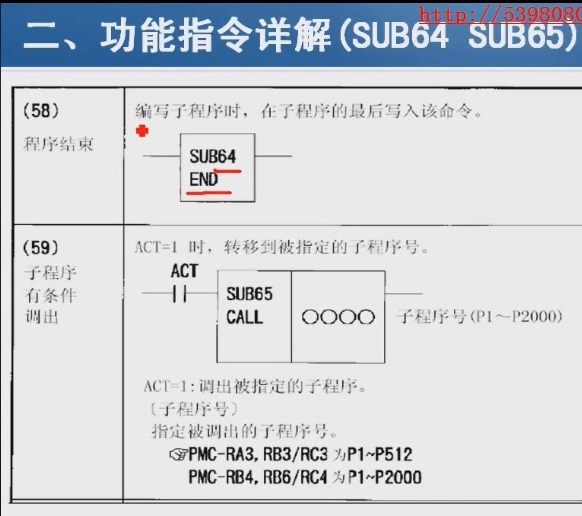

### 12.2 CALLU（SUB 66）— 無條件調用

- 指令號：**66**，助記符：**CALLU**。
- 名稱後多一個 **U**，表示**無條件**：前面的 CALL 是有條件的，CALLU 沒有 ACT 條件，**無條件轉移**到指定的子程式號。
- 參數與範圍同 CALL。

---

## 十三、SP / SPE — 子程式（SUB 71 / SUB 72）

- **SP（SUB 71）**：指示子程式的**開始**，參數為子程式號（範圍同上）。
- **SPE（SUB 72）**：指示子程式的**結束**。
- 位於 **SP 與 SPE 之間**的程式就是子程式，用子程式號（P□）區分，由 CALL / CALLU 調用。


---

## 十四、本課時指令總表

| 指令 | 功能號 | 功能 |
|---|:---:|---|
| DIVB | SUB 39 | 二進制除法，餘數放 R9000 以後 |
| NUME | SUB 23 | BCD 常數定義（2 位 / 4 位） |
| NUMEB | SUB 40 | 二進制常數定義（1、2、4 位元組） |
| DISPB | SUB 41 | 信息顯示（報警 1000～1999，操作信息 2000～2099） |
| DIFU | SUB 57 | 上升沿檢測 |
| DIFD | SUB 58 | 下降沿檢測 |
| EOR | SUB 59 | 異或 |
| AND | SUB 60 | 邏輯乘 |
| OR | SUB 61 | 邏輯和 |
| NOT | SUB 62 | 邏輯非 |
| END | SUB 64 | 子程式結束 |
| CALL | SUB 65 | 條件調用子程式 |
| CALLU | SUB 66 | 無條件調用子程式 |
| SP / SPE | SUB 71 / 72 | 子程式開始 / 結束 |

> 以上就是 PMC 功能指令的最後一部分，功能指令就講到這裡。
