# FANUC LADDER-III Tutorial – Part 1: Introduction and Creating a Project
# FANUC LADDER-III 教程 第 1 部分：簡介與建立專案

> Source video / 來源影片：<https://www.youtube.com/watch?v=-cIVGeLWlAE&list=PLAVTF-IF9aPXg0zNdScXJs6jOqepUE5U7&index=2>
> Images folder / 圖檔目錄：`images/`（`f02_01.jpg` ~ `f02_20.jpg`）

---

## 1. Introduction / 簡介

**EN:** FANUC LADDER-III is a programming system for developing FANUC PMC sequence programs. Knowing its functions helps you use it efficiently. Main functions:

**中文：** FANUC LADDER-III 是用來開發 FANUC PMC 順序程式（梯形圖）的程式設計系統。了解其功能，才能有效率地使用。主要功能如下：

| English | 中文 |
|---|---|
| Input / output, display and editing of the sequence program | 順序程式的輸入／輸出、顯示與編輯 |
| Monitoring and debugging of the sequence program | 順序程式的監控與除錯 |
| Online settings and display of PMC parameters | 線上設定與顯示 PMC 參數 |
| Run and stop of the sequence program | 順序程式的執行與停止 |
| Download and upload of the sequence program | 順序程式的下載與上傳 |
| Writing the sequence program to Flash ROM | 將順序程式寫入 Flash ROM |
| Printing the sequence program | 列印順序程式 |

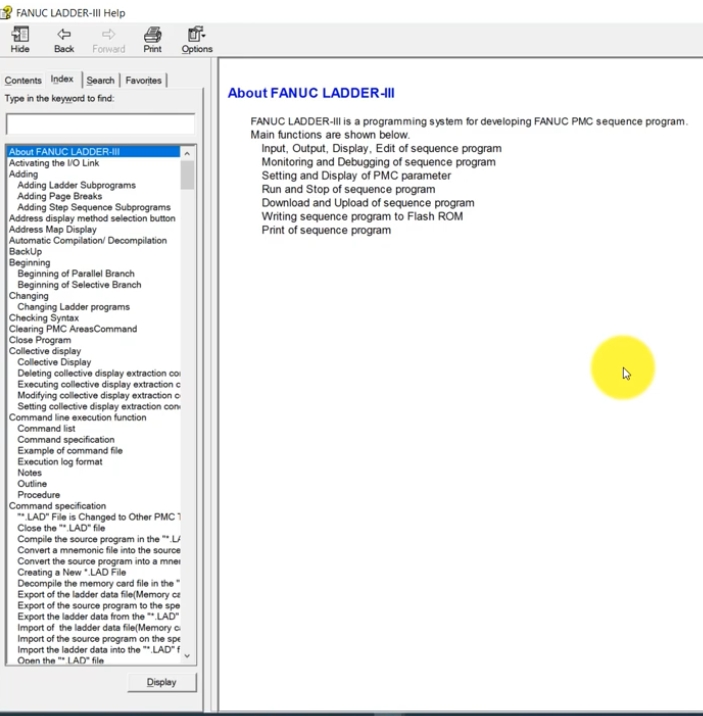

*Fig. 1 – Help window listing the main functions. / 圖 1：說明視窗列出主要功能。*

---

## 2. What Is the PMC? / 什麼是 PMC？

**EN:** Suppose you power on the machine and want to run it in JOG mode. How does the CNC know? Through the PMC, we send a signal to the CNC: "Please switch to JOG mode." There is no direct link between the machine's I/O signals and the CNC; they are linked through the PMC using **G signals** and **F signals**.

- **G signal (PMC → CNC):** the PMC sends the JOG request; the CNC recognizes it and switches to JOG mode.
- **F signal (CNC → PMC):** the CNC reports "I have switched to JOG mode," so the PMC knows the mode has changed.

**中文：** 假設開機後想用 JOG（手動）模式操作機台，CNC 如何得知？是透過 PMC 向 CNC 發送訊號：「請切換到 JOG 模式」。機台的 I/O 訊號與 CNC 之間沒有直接連線，而是透過 PMC，以 **G 訊號** 與 **F 訊號** 連結。

- **G 訊號（PMC → CNC）：** PMC 送出 JOG 請求，CNC 辨識後切換到 JOG 模式。
- **F 訊號（CNC → PMC）：** CNC 回報「已切換到 JOG 模式」，PMC 因此得知模式已改變。

---

## 3. The LADDER-III Interface / LADDER-III 操作介面

**EN:** The main window has the menus File, Edit, View, Diagnose, Ladder, Tool, Window and Help. We start with how to create a project.

**中文：** 主視窗的選單包含 File、Edit、View、Diagnose、Ladder、Tool、Window、Help。首先來看如何建立專案。

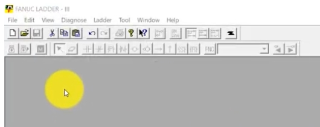

*Fig. 2 – LADDER-III main window. / 圖 2：LADDER-III 主視窗。*

---

## 4. Creating a New Program / 建立新程式

**EN:** Go to **File → New Program** (Ctrl+N) or click the **New** button. A program creation dialog opens.

**中文：** 選擇 **File → New Program**（Ctrl+N），或按 **New** 按鈕，會開啟程式建立對話框。

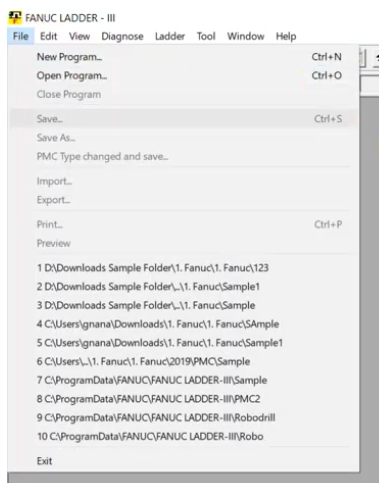

*Fig. 3 – File menu with New Program. / 圖 3：File 選單中的 New Program。*

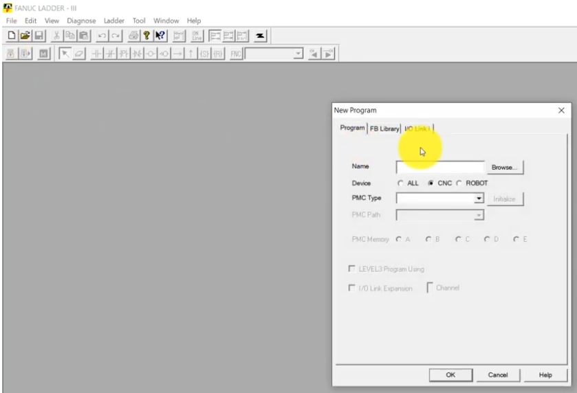

*Fig. 4 – New Program dialog (Program / FB Library / I/O Link i tabs). / 圖 4：New Program 對話框（Program／FB Library／I/O Link i 分頁）。*

### 4.1 Name & Device / 名稱與裝置

**EN:** Enter the file name (e.g. `Demo.LAD`). **Device**: choose CNC or Robot according to your equipment. Choosing **ALL** causes no problem, and the file extension shown is **.LAD** (the ladder file).

**中文：** 輸入檔名（例如 `Demo.LAD`）。**Device（裝置）**：依設備選擇 CNC 或 Robot。選擇 **ALL** 不會有問題，副檔名為 **.LAD**（梯形圖檔）。

### 4.2 PMC Type / PMC 型號

**EN:** Choose the PMC type according to your project. In this demo: **31i-B PMC** (Series 31i Model B).

**中文：** 依專案需求選擇 PMC 型號。本示範選用 **31i-B PMC**（31i B 系列）。

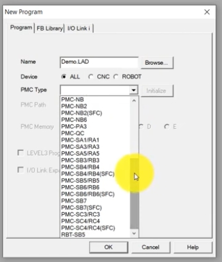

*Fig. 5 – PMC Type drop-down list. / 圖 5：PMC Type 下拉清單。*

### 4.3 PMC Path / PMC 路徑

**EN:** Options: 1st to 5th path, and DCS.
- **Path:** e.g. a CNC machine with two machining systems — the 1st path controls machining axes X, Y, Z; the 2nd path controls loading axes (e.g. X and Y for pick-and-place in a loader). Up to five paths can be controlled.
- **DCS (Dual Check Safety) PMC:** a PMC type purely for safety; adding DCS makes the machine doubly safe (explained in a later video).

**中文：** 選項有第 1 至第 5 路徑，以及 DCS。
- **路徑（Path）：** 例如一台 CNC 有兩套加工系統——第 1 路徑控制加工軸 X、Y、Z；第 2 路徑控制上下料軸（如取放料裝置的 X、Y）。最多可控制五個路徑。
- **DCS（雙重檢查安全）PMC：** 純粹用於安全的 PMC 型態，加入 DCS 可使機台有雙重安全保護（之後影片會說明）。

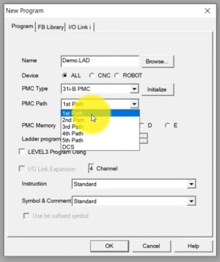

*Fig. 6 – PMC Path options incl. DCS. / 圖 6：PMC Path 選項（含 DCS）。*

### 4.4 PMC Memory, Ladder Program, Level 3 / PMC 記憶體、梯形圖程式、Level 3

**EN:**
- **PMC Memory:** types A, B, C, D, E — choose per requirement (see the manual for details). The demo selects **B**.
- **Ladder program:** **Main** or **Divided**. The demo selects **Main**.
- **LEVEL3 Program Using:** tick if you want to use Level 3 programming.

**中文：**
- **PMC Memory（PMC 記憶體）：** 有 A、B、C、D、E 類型，依需求選擇（詳見手冊）。示範選 **B**。
- **Ladder program（梯形圖程式）：** 可選 **Main（主程式）** 或 **Divided（分割）**。示範選 **Main**。
- **LEVEL3 Program Using：** 若要使用 Level 3 程式則勾選。

### 4.5 Instruction / 指令類型

**EN:** Select the instruction set: Standard, Extended Instruction, Extended Floating point, Function Block, or Function Block + Extended Floating point. Refer to the operator's manual before creating a new program.

**中文：** 選擇指令集：Standard（標準）、Extended Instruction（擴充指令）、Extended Floating point（擴充浮點）、Function Block（功能方塊），或 Function Block + Extended Floating point。建立新程式前請先參閱操作手冊。

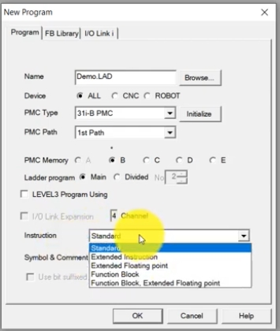

*Fig. 7 – PMC Memory B, Main ladder, Instruction list. / 圖 7：PMC Memory B、Main 梯形圖、Instruction 清單。*

### 4.6 Symbol & Comment / 符號與註解

**EN:** Options: Standard, Extended Symbol, Multi Language Comment. Multi-language lets you display Japanese, Chinese and English in the program. Click **OK** to create the project. This procedure applies to every PMC and every program.

**中文：** 選項有 Standard、Extended Symbol、Multi Language Comment。多語言功能可在程式中顯示日文、中文與英文。按 **OK** 即完成專案建立。此流程適用於所有 PMC 與所有程式。

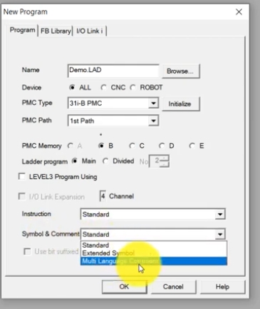

*Fig. 8 – Symbol & Comment drop-down. / 圖 8：Symbol & Comment 下拉選單。*

---

## 5. The Program List / 程式清單

**EN:** The Program List contains: **Title, System parameter, Symbol comment, I/O Module, Message, Ladder** (LEVEL1, LEVEL2, Sub-program), **Duplicate Coil, Collective Display**, and User Folder. (A Ladder entry appears according to what you chose at creation.)

**中文：** 程式清單包含：**Title（標題）、System parameter（系統參數）、Symbol comment（符號註解）、I/O Module（I/O 模組）、Message（訊息）、Ladder（梯形圖）**（LEVEL1、LEVEL2、Sub-program），以及 **Duplicate Coil（重複線圈）、Collective Display（集合顯示）**、User Folder。（Ladder 項目會依建立時的選擇而出現。）

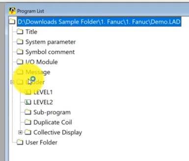

*Fig. 9 – Program List tree. / 圖 9：程式清單樹狀結構。*

### 5.1 Title / 標題

**EN:** Enter machine builder name, machine tool name, PMC & NC name, PMC program number and **edition number**, plus drawing number, date, designer, ROM writer and remarks. This lets builders/customers know which machine the program belongs to. Edition number example: if the previous version is 13, save your modified version as 14 so others can identify the latest edition.

**中文：** 可輸入機台製造商名稱、機台名稱、PMC 與 NC 名稱、PMC 程式編號與 **版本編號（Edition No.）**，以及程式圖號、編寫日期、設計者、ROM 寫入者與備註。這樣製造商或客戶就能辨識此程式屬於哪台機台。版本編號範例：若先前版本為 13，修改後存為 14，其他人即可辨識最新版本。

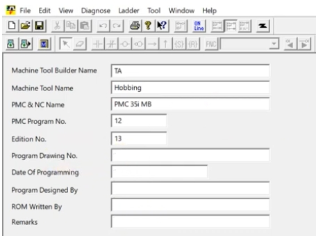

*Fig. 10 – Title screen (demo: Hobbing, Edition 13). / 圖 10：標題畫面（示範：Hobbing、版本 13）。*

### 5.2 System Parameter / 系統參數

**EN:** Not used very often. It includes: counter data type (**Binary** or **BCD**); FS0 operator panel settings (key / LED / key bit image / LED bit image addresses) *[original transcript unclear]*; selectable **I/O Link** assignment (enable/disable channels, basic group count 0–16); and a *Language for Comment* button.

**中文：** 不常使用，包含：計數器資料型態（**Binary** 或 **BCD**）；FS0 操作面板設定（按鍵／LED／按鍵位元影像／LED 位元影像位址）*〔原逐字稿內容不清楚〕*；可選擇的 **I/O Link** 指派（啟用／停用通道，基本群組數 0–16）；以及 *Language for Comment（註解語言）* 按鈕。

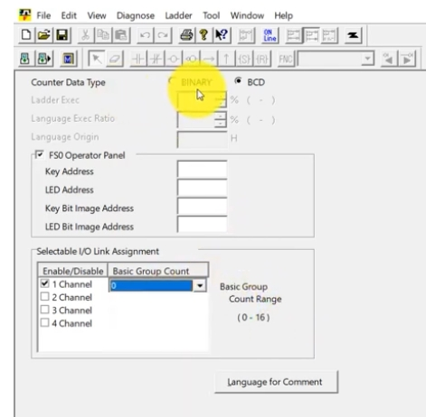

*Fig. 11 – System parameter screen. / 圖 11：系統參數畫面。*

### 5.3 Symbol Comment / 符號註解

**EN:** Registers are grouped as **Machine signal** (X, Y), **NC interface** (F, G), **PMC parameter** (C, K, D, T) and **etc.** (R, A, M, S, P, L, N, E). Selecting X0–X127 gives addresses X0.0 – X0.7 and so on. For every address you can add three items: **Symbol** (e.g. `START_PB`), **First comment** (e.g. "Start conveyor") and **Second comment** (e.g. "Stop conveyor").

**中文：** 暫存器分為 **Machine signal（機台訊號）**（X、Y）、**NC interface（NC 介面）**（F、G）、**PMC parameter（PMC 參數）**（C、K、D、T）與 **etc.（其他）**（R、A、M、S、P、L、N、E）。選取 X0–X127 會列出 X0.0 – X0.7 等位址。每個位址可加入三項識別：**Symbol（符號）**（如 `START_PB`）、**First comment（第一註解）**（如「啟動輸送帶」）、**Second comment（第二註解）**（如「停止輸送帶」）。

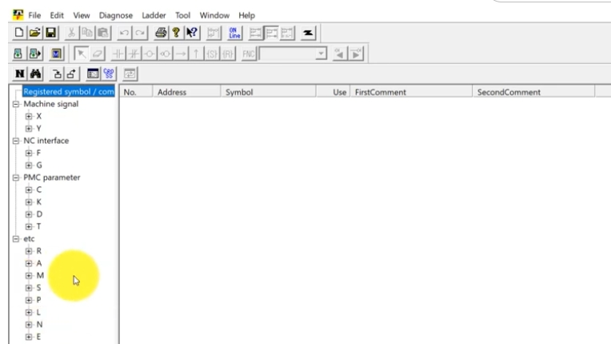

*Fig. 12 – Register tree (X, Y, F, G, C, K, D, T, R, A…). / 圖 12：暫存器樹狀結構。*

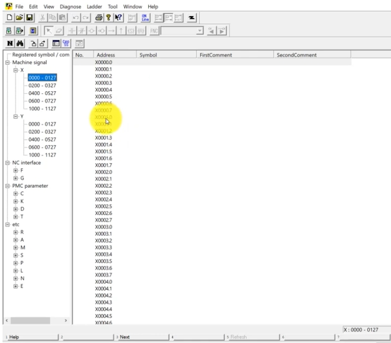

*Fig. 13 – X0000–0127 address list with Symbol / comment columns. / 圖 13：X0000–0127 位址列表及符號／註解欄位。*

### 5.3.1 I/O Module (Input/Output) / I/O 模組

**EN:** When connected online, the software shows group, base, slot and module name for each address, and you can add comments. Module assignments can be selected from the module list (Model A Input, Model A Except, Model B, Connection Unit, Except), with Group / Base / Slot settings.

**中文：** 連線（Online）時，軟體會顯示每個位址的 Group、Base、Slot 與模組名稱，並可加入註解。模組可從模組清單（Model A Input、Model A Except、Model B、Connection Unit、Except）中選取，並設定 Group／Base／Slot。

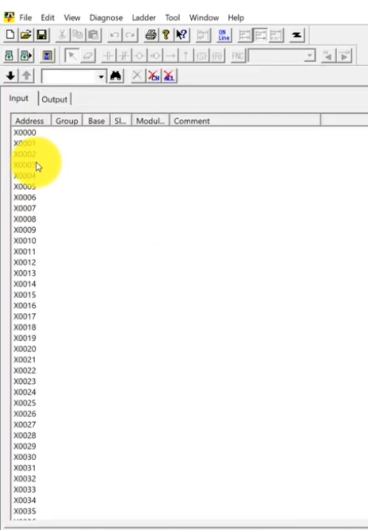

*Fig. 14 – I/O Module, Input tab. / 圖 14：I/O 模組輸入頁。*

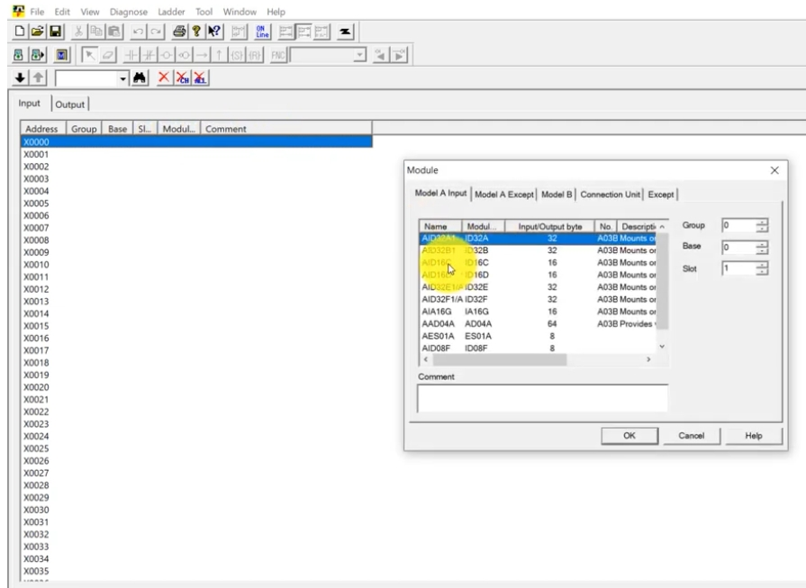

*Fig. 15 – Module selection dialog. / 圖 15：模組選擇對話框。*

### 5.4 Message / 訊息

**EN:** Message uses the **A addresses** (message display request bits), from **A0.0 to A249.7**. When a bit is activated, the machine displays the message/alarm. Example: A0.0 = "Coolant level low". When it appears, you check the program to see why A0.0 was activated, refill the coolant tank, and the machine is ready to run. Messages can be edited for every address.

**中文：** Message 使用 **A 位址**（訊息顯示請求位元），範圍從 **A0.0 到 A249.7**。位元被啟動時，機台會顯示訊息／警報。例如 A0.0 = 「Coolant level low（冷卻液位過低）」。出現時，檢查程式為何啟動 A0.0，補充冷卻液後即可繼續運轉。每個位址的訊息都可編輯。

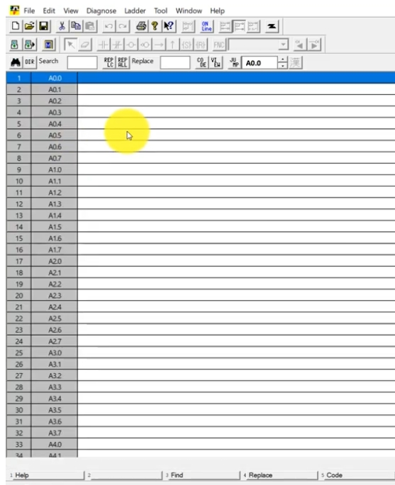

*Fig. 16 – Message screen (A0.0, A0.1 …). / 圖 16：訊息畫面（A0.0、A0.1…）。*

### 5.5 Level 1 and Level 2 / Level 1 與 Level 2

**EN:** There is a big difference: **Level 1 executes very fast; Level 2 does not.** A separate video will cover the difference.

**中文：** 兩者差異很大：**Level 1 執行速度非常快；Level 2 則較慢。** 之後會另做影片說明。

### 5.6 Subprograms / 子程式

**EN:** Example: for a hobbing machine's chip conveyor, develop separate logic instead of mixing it into the main machine logic. Right-click **Sub-program → Add sub-program** (or use the shortcut). Choose a program number — a **"P"** prefix indicates a subprogram (demo: P1; the screenshot shows P8). Enter the symbol and comment, choose the programming type (**Ladder** or **Step Sequence**; mostly Ladder), then click Apply/OK. Logic is created inside SUB1/SUB2 (SP / SPE blocks) and can be called from the Level 1 program when needed.

**中文：** 範例：滾齒機的排屑輸送帶，應另外開發獨立邏輯，而不要混入主機台邏輯。對 **Sub-program** 按右鍵 → **Add sub-program**（或使用快捷鍵）。選擇程式編號——編號前有 **「P」** 即為子程式（示範用 P1；截圖為 P8）。輸入符號與註解，選擇程式類型（**Ladder 梯形圖** 或 **Step Sequence 步進順序**；多數情況使用 Ladder），再按 Apply／OK。邏輯寫在 SUB1/SUB2（SP／SPE 方塊）內，需要時可從 Level 1 程式呼叫。

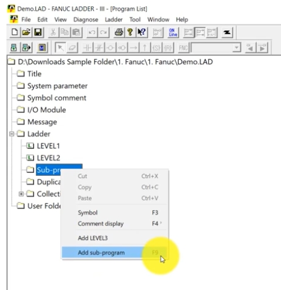

*Fig. 17 – Right-click → Add sub-program. / 圖 17：右鍵 → Add sub-program。*

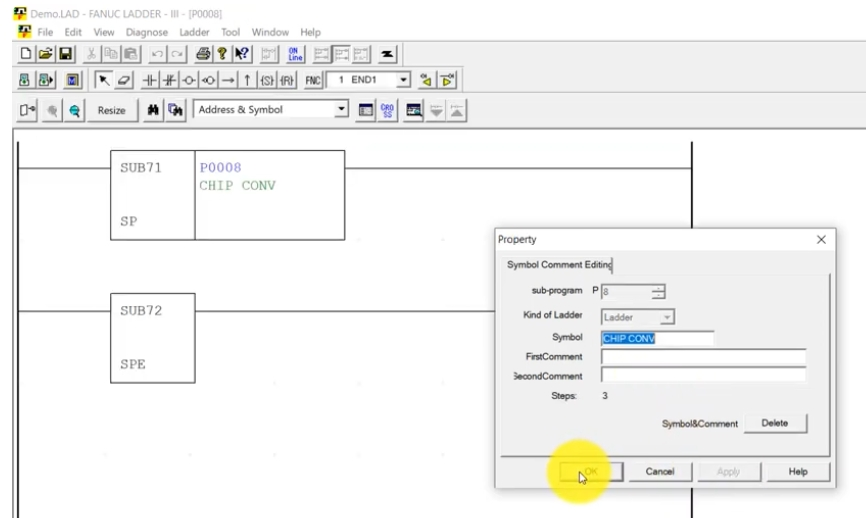

*Fig. 18 – Sub-program P0008 "CHIP CONV" with SP / SPE blocks (SUB71 / SUB72) and Property dialog. / 圖 18：子程式 P0008「CHIP CONV」，含 SP／SPE 方塊（SUB71／SUB72）與屬性對話框。*

### 5.7 Duplicate Coil / 重複線圈

**EN:** A common mistake is using the same output (e.g. Y0.0) repeatedly in the program. The **Duplicate Coil** display helps you find it.

**中文：** 常見錯誤是在程式中重複使用同一輸出（例如 Y0.0）。可用 **Duplicate Coil** 顯示來找出此錯誤。

**EN:** Double-clicking **Duplicate Coil** opens the *Duplicate Coil – Address Setting* dialog. You can check **All** addresses, a specific **Address** (e.g. `Y0, Y10.0, Y20-Y30`), or an **Address Kind** (use *Select…*), then click **OK**.

**中文：** 開啟 **Duplicate Coil** 會出現 *Duplicate Coil – Address Setting（重複線圈—位址設定）* 對話框。可選擇檢查 **All（全部）**、指定 **Address（位址）**（例如 `Y0, Y10.0, Y20-Y30`），或 **Address Kind（位址種類）**（按 *Select…* 選取），再按 **OK**。

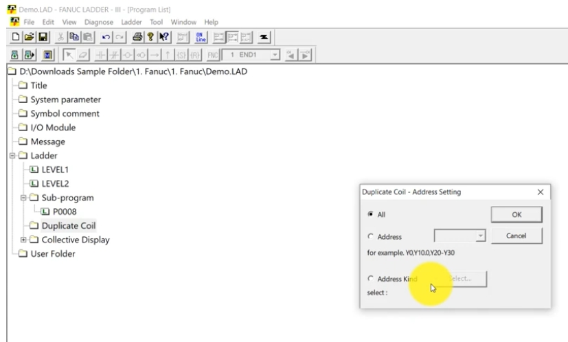

*Fig. 19 – Duplicate Coil address setting dialog. / 圖 19：Duplicate Coil 位址設定對話框。*

### 5.8 Cross Reference (Collective Display) / 交叉參照（集合顯示）

**EN:** Search an address such as X0.0 and it lists every line in the program where that address is used.

**中文：** 搜尋某位址（如 X0.0），會列出程式中所有使用該位址的行。

**EN:** In the *Collective Display* dialog, enter a **Condition Name**, click **Add Condition** to define the search (e.g. "Search of X0.0"), and use Edit / Rename / Delete Condition to manage conditions. Saved conditions appear under **Collective Display** in the Program List (here: "Start").

**中文：** 在 *Collective Display（集合顯示）* 對話框中，輸入 **Condition Name（條件名稱）**，按 **Add Condition（新增條件）** 定義搜尋內容（例如「Search of X0.0」），並可用 Edit／Rename／Delete Condition 管理條件。儲存的條件會顯示在程式清單的 **Collective Display** 底下（此處為「Start」）。

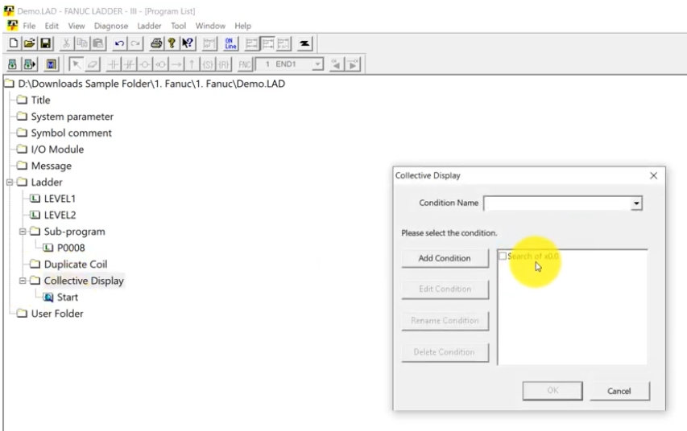

*Fig. 20 – Collective Display condition dialog. / 圖 20：Collective Display 條件對話框。*

---

## 6. Closing / 結語

**EN:** That's the end of Part 1. The next video covers the programming instructions: which are available, which tools exist, and how to use them in the software.

**中文：** 第 1 部分到此結束。下一部影片將介紹程式指令：有哪些指令、有哪些工具，以及如何在軟體中使用。

---

## Appendix: Image Index / 附錄：圖檔對照表

| # | File / 檔名 | Content / 內容 |
|---|---|---|
| 1 | images/f02_01.jpg | Help – About LADDER-III / 說明：關於 LADDER-III |
| 2 | images/f02_02.jpg | Main window / 主視窗 |
| 3 | images/f02_03.jpg | File menu / File 選單 |
| 4 | images/f02_04.jpg | New Program dialog / 新增程式對話框 |
| 5 | images/f02_05.jpg | PMC Type list / PMC 型號清單 |
| 6 | images/f02_06.jpg | PMC Path list / PMC 路徑清單 |
| 7 | images/f02_07.jpg | PMC Memory & Instruction / 記憶體與指令 |
| 8 | images/f02_08.jpg | Symbol & Comment options / 符號與註解選項 |
| 9 | images/f02_09.jpg | Program List / 程式清單 |
| 10 | images/f02_10.jpg | Title / 標題 |
| 11 | images/f02_11.jpg | System parameter / 系統參數 |
| 12 | images/f02_12.jpg | Symbol comment tree / 符號註解樹狀 |
| 13 | images/f02_13.jpg | X address list / X 位址列表 |
| 14 | images/f02_14.jpg | I/O Module Input / I/O 模組輸入 |
| 15 | images/f02_15.jpg | Module dialog / 模組對話框 |
| 16 | images/f02_16.jpg | Message / 訊息 |
| 17 | images/f02_17.jpg | Add sub-program / 新增子程式 |
| 18 | images/f02_18.jpg | Sub-program property / 子程式屬性 |
| 19 | images/f02_19.jpg | Duplicate Coil address setting / 重複線圈位址設定 |
| 20 | images/f02_20.jpg | Collective Display dialog / 集合顯示對話框 |
