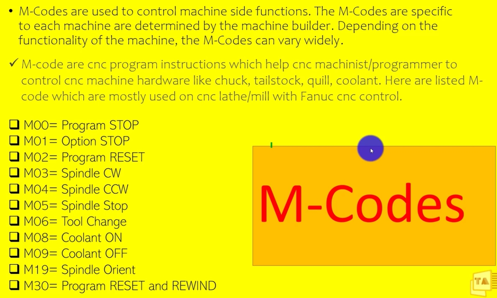
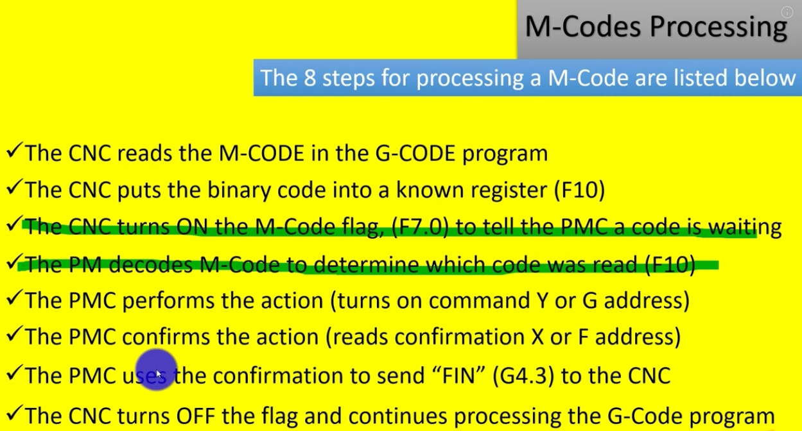

# How M-Codes Are Processed in FANUC CNC Machines
# FANUC CNC 機台中 M 代碼是如何被處理的

> Source video / 來源影片：<https://www.youtube.com/watch?v=tJCm6VR_xoM&list=PLAVTF-IF9aPXg0zNdScXJs6jOqepUE5U7&index=3>
> Images folder / 圖檔目錄：`images/`（`f03_01.jpg` ~ `f03_08.jpg`）

---

## 1. Introduction / 簡介

**EN:** FANUC CNC machines are user-friendly and relatively inexpensive, which is why they are used in most industries. A FANUC CNC runs a part program (G-code program) containing G-codes, M-codes, S-codes and T-codes. G-codes perform the machining itself (turning, milling, drilling). This tutorial explains the purpose of the **M-codes** and exactly how the CNC and the PMC cooperate to execute them.

**中文：** FANUC CNC 操作友善且價格相對便宜，因此大多數工業現場都使用。FANUC CNC 執行零件程式（G 代碼程式），其中包含 G、M、S、T 代碼。G 代碼負責實際加工（車、銑、鑽）。本教程說明 **M 代碼** 的用途，以及 CNC 與 PMC 如何協同執行 M 代碼。

*Fig. 1 – A G-code program containing G-codes and M-codes. / 圖 1：含有 G 代碼與 M 代碼的程式。*

---

## 2. What Is an M-Code? / 什麼是 M 代碼？

**EN:** A machine has a chuck, a tailstock, coolant and so on. During machining, coolant must be switched on for the workpiece. How do we do that from the program? With an **M-code**.

- M-codes control **machine-side functions** (as opposed to axis motion).
- Many M-codes are machine-specific: they are **defined by the machine tool builder**, who decides which M-code does what.
- Some M-codes are standard and common across machines; others (e.g. M100, M200, M300) are unspecified and can be created to suit your own requirements.
- In other words, M-codes are CNC program instructions that let the machinist or programmer control CNC hardware such as the chuck, tailstock, quill and coolant.

**中文：** 機台上有夾頭、尾座、冷卻液等裝置。加工時必須對工件供應冷卻液，要如何在程式中做到？答案就是 **M 代碼**。

- M 代碼用來控制 **機台側功能**（而非軸的移動）。
- 許多 M 代碼因機台而異：由 **機台製造商定義**，由製造商決定哪個 M 代碼做什麼。
- 部分 M 代碼是通用標準；其他（如 M100、M200、M300）為未指定，可依自身需求自行定義。
- 換言之，M 代碼是 CNC 程式指令，讓操作員或程式設計師控制夾頭、尾座、尾軸套筒與冷卻液等 CNC 硬體。

---

## 3. Common M-Codes / 常用 M 代碼

| M-code | English | 中文 |
|---|---|---|
| M00 | Program stop | 程式停止 |
| M01 | Optional stop | 選擇性停止 |
| M02 | Program end / reset | 程式結束／重置 |
| M03 | Spindle clockwise (CW) | 主軸正轉 |
| M04 | Spindle counterclockwise (CCW) | 主軸反轉 |
| M08 | Coolant ON | 冷卻液開 |

*Fig. 2 – Commonly used M-codes on FANUC lathes and mills. / 圖 2：FANUC 車床與銑床常用 M 代碼。*

---

## 4. The Core Question / 核心問題

**EN:** The coolant is switched by a valve, and the valve is a digital device: 0 = off, 1 = on. In the machine we enter **M08**, yet what actually turns on is a PMC **Y output**, for example **Y6.0** (in FANUC, outputs start with the letter **Y**). So how does M08 in the program (or in MDI mode) end up turning on Y6.0?

As a maintenance person you must understand this process, otherwise you cannot troubleshoot M-code problems. (Troubleshooting is covered in the next video; this video focuses on how M-codes are processed.)

**中文：** 冷卻液由閥門控制，閥門是數位裝置：0 = 關，1 = 開。我們在機台輸入的是 **M08**，但實際被打開的是 PMC 的 **Y 輸出**，例如 **Y6.0**（FANUC 中輸出位址以字母 **Y** 開頭）。那麼，程式（或 MDI 模式）中的 M08 是如何讓 Y6.0 動作的？

身為維修人員必須了解此流程，否則無法排除 M 代碼相關故障。（故障排除將在下一部影片說明，本影片聚焦於 M 代碼的處理流程。）

*Fig. 3 – M08 command and the Y6.0 output. / 圖 3：M08 指令與 Y6.0 輸出。*

---

## 5. The Processing Sequence / 處理流程

**EN:** An M-code is processed in the following steps (the video presents it as eight steps):

**中文：** M 代碼依下列步驟處理（影片中以八個步驟說明）：

*Fig. 4 – Overall flow between CNC and PMC. / 圖 4：CNC 與 PMC 的整體流程。*

### Step 1 – CNC reads the M-code / 步驟 1：CNC 讀取 M 代碼

**EN:** The CNC reads the M-code from the G-code program (or from MDI). Here we take the G-code program, which contains M08.

**中文：** CNC 從 G 代碼程式（或 MDI）讀取 M 代碼。此處以 G 代碼程式為例，其中含有 M08。

### Step 2 – CNC places the code in register F10 / 步驟 2：CNC 將代碼放入 F10 暫存器

**EN:** The CNC converts M08 into its equivalent **binary code** and writes it to the **F10** register. This is done by the **CNC**, not by the PMC.

**中文：** CNC 將 M08 轉換為對應的 **二進位碼**，寫入 **F10** 暫存器。這個動作由 **CNC** 完成，不是 PMC。

*Fig. 5 – M-code data stored in F10. / 圖 5：存放於 F10 的 M 代碼資料。*

### Step 3 – CNC turns on the M-code flag F7.0 / 步驟 3：CNC 開啟 M 代碼旗標 F7.0

**EN:** After the code is in F10, the CNC turns on the **M-code strobe flag F7.0**. This tells the PMC: "I have an M-code waiting to be executed — start your processing." **Important step.**

**中文：** 代碼寫入 F10 後，CNC 開啟 **M 代碼旗標 F7.0**，等於通知 PMC：「我有一個 M 代碼等待執行，請開始處理。」**這是關鍵步驟。**

### Step 4 – PMC decodes the M-code / 步驟 4：PMC 解碼 M 代碼

**EN:** The PMC receives the flag but does not yet know *which* code it is. It reads the binary value from **F10** and **decodes** it (using the PMC decode instruction) to determine that the code is M08. The decode instruction is a large topic and will be explained in a later video.

**中文：** PMC 收到旗標，但還不知道是 *哪一個* 代碼。它從 **F10** 讀出二進位值並 **解碼**（使用 PMC 的解碼指令），確認為 M08。解碼指令內容龐大，將在後續影片說明。

*Fig. 6 – Decode instruction reading F10. / 圖 6：解碼指令讀取 F10。*

### Step 5 – PMC performs the action / 步驟 5：PMC 執行動作

**EN:** Once M08 is identified, the PMC executes what the ladder program defines for it: for M08 the ladder turns on the output **Y6.0** (the coolant relay). This mapping is written by the machine builder/user in the ladder, **not** by the CNC. Standard M-codes should not be modified, but unspecified M-codes can be assigned freely according to your needs.

**中文：** 辨識出 M08 後，PMC 依梯形圖的定義動作：M08 對應開啟輸出 **Y6.0**（冷卻液繼電器）。此對應關係由機台製造商／使用者寫在梯形圖中，**不是** CNC 決定的。標準 M 代碼不應修改，但未指定的 M 代碼可依需求自行指派。

### Step 6 – PMC confirms the action (FIN) / 步驟 6：PMC 回報完成（FIN）

**EN:** After the coolant is on, the PMC tells the CNC: "The function is done — you can continue the program." It does this by turning on the **FIN (finish) signal, G4.3**. Without this confirmation the CNC would wait forever.

**中文：** 冷卻液開啟後，PMC 通知 CNC：「功能已完成，可繼續執行程式。」做法是開啟 **FIN（完成）訊號 G4.3**。若沒有此確認，CNC 會一直等待。

*Fig. 7 – PMC returns FIN (G4.3) to the CNC. / 圖 7：PMC 回傳 FIN（G4.3）給 CNC。*

### Step 7 – CNC turns off the flag and continues / 步驟 7：CNC 關閉旗標並繼續執行

**EN:** When the CNC receives FIN, it turns off the M-code flag (F7.0) and continues processing the G-code program. This completes one M-code cycle.

**中文：** CNC 收到 FIN 後，關閉 M 代碼旗標（F7.0），並繼續執行 G 代碼程式。至此完成一個 M 代碼的處理週期。

---

## 6. Summary / 總結

| Step | Who / 執行者 | Action / 動作 | Signal / 訊號 |
|---|---|---|---|
| 1 | CNC | Reads M-code from program / 讀取 M 代碼 | — |
| 2 | CNC | Writes binary code to F10 / 寫入二進位碼 | F10 |
| 3 | CNC | Turns on M-code flag / 開啟 M 代碼旗標 | F7.0 |
| 4 | PMC | Decodes F10 / 解碼 F10 | F10 |
| 5 | PMC | Turns on output (e.g. Y6.0) / 開啟輸出 | Y6.0 (G if needed) |
| 6 | PMC | Reports completion / 回報完成 | G4.3 (FIN) |
| 7 | CNC | Turns off flag, continues program / 關閉旗標並繼續 | F7.0 OFF |

*Fig. 8 – Summary of the M-code handshake. / 圖 8：M 代碼交握流程總結。*

> **Note / 備註：** The speaker lists "eight steps" but describes the flow in roughly seven stages; the table above merges them in logical order. 講者說有「八個步驟」，但實際敘述約為七個階段，上表依邏輯順序整理。
> The speaker mentions F10, F7.0 and G4.3 by address; in FANUC documentation these are the M-code data (F10), the M strobe **MF** (F7.0) and the **FIN** signal (G4.3). 講者以位址稱呼 F10、F7.0、G4.3；在 FANUC 文件中分別為 M 代碼資料（F10）、M 選通訊號 **MF**（F7.0）與 **FIN** 訊號（G4.3）。

---

## 7. Closing / 結語

**EN:** That's how M-codes are processed in a FANUC CNC. The next video explains how to troubleshoot M-codes that are not executing, with a practical M08 example using the decode instruction.

**中文：** 以上就是 FANUC CNC 處理 M 代碼的方式。下一部影片將說明 M 代碼無法執行時如何排除故障，並以 M08 搭配解碼指令做實機範例。

---

## Appendix: Image Index / 附錄：圖檔對照表

| # | File / 檔名 | Content / 內容 |
|---|---|---|
| 1 | images/f03_01.jpg | G-code program with M-codes / 含 M 代碼的程式 |
| 2 | images/f03_02.jpg | Common M-code list / 常用 M 代碼表 |
| 3 | images/f03_03.jpg | M08 → Y6.0 / M08 對應 Y6.0 |
| 4 | images/f03_04.jpg | CNC ↔ PMC flow / CNC 與 PMC 流程 |
| 5 | images/f03_05.jpg | F10 register / F10 暫存器 |
| 6 | images/f03_06.jpg | Decode instruction / 解碼指令 |
| 7 | images/f03_07.jpg | FIN signal G4.3 / FIN 訊號 G4.3 |
| 8 | images/f03_08.jpg | Summary / 流程總結 |
