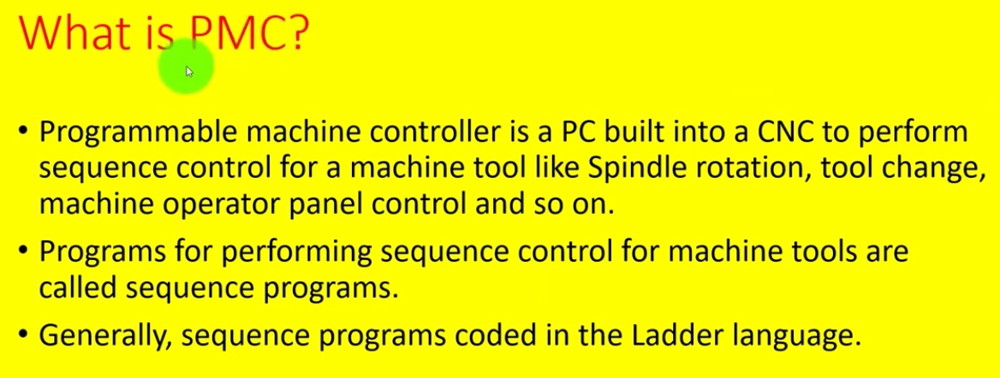
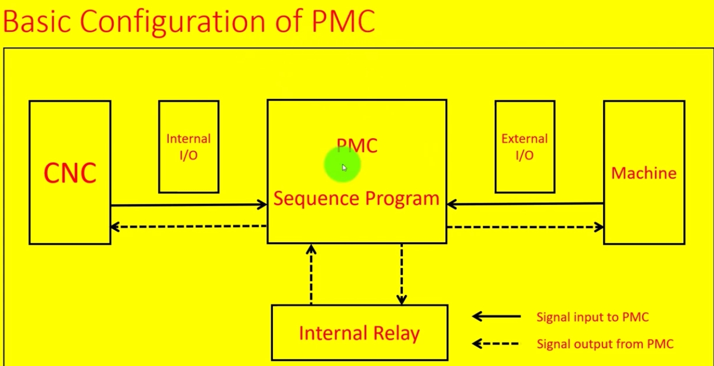
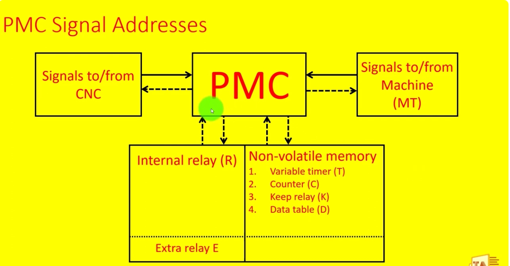
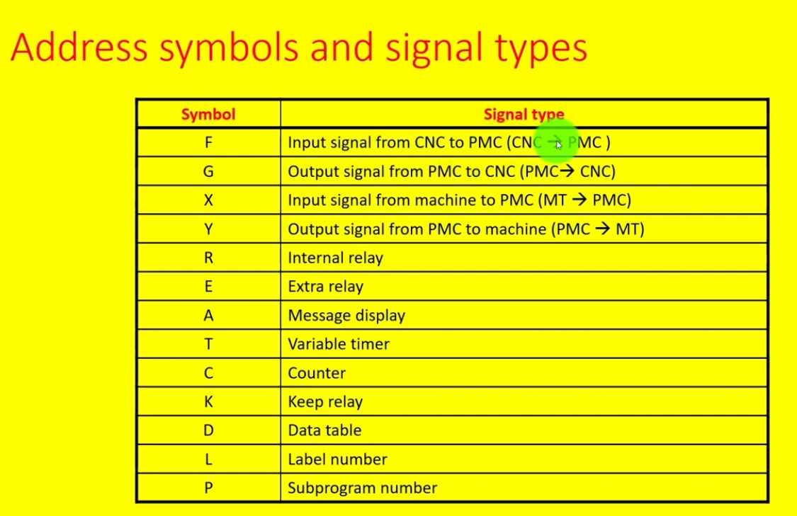

# FANUC PMC Tutorial – Part 4: Basic Configuration of the PMC
# FANUC PMC 教程 第 4 部分：PMC 基本架構

> Source video / 來源影片：<https://www.youtube.com/watch?v=XFto9jENKfc&list=PLAVTF-IF9aPXg0zNdScXJs6jOqepUE5U7&index=4>
> Images folder / 圖檔目錄：`images/`（`f04_01.jpg` ~ `f04_04.jpg`）

---

## 1. What Is the PMC? / 什麼是 PMC？

**EN:** PMC stands for **Programmable Machine Controller**. It is a programmable controller (PLC-like) **built into the CNC**, used to perform **sequence control** for a machine tool, such as spindle rotation, tool change and operator-panel control. Other typical machine equipment includes in-feed and out-feed conveyors and hydraulic power packs.

Example: with an in-feed conveyor delivering a workpiece, you cannot simply drop the part into the machine and start. The part must be loaded properly, then clamped, then the cycle started — in that order. This kind of ordered operation is what the PMC controls. Any FANUC-based CNC has a PMC to control the machine's sequence operations.

- Programs that perform sequence control for machine tools are called **sequence programs**.
- Sequence programs are generally written in **Ladder language**, a graphical language made of normally-open (NO) and normally-closed (NC) contacts and output coils.

**中文：** PMC 是 **Programmable Machine Controller（可程式機械控制器）** 的縮寫。它是 **內建於 CNC 中** 的可程式控制器（類似 PLC），用來對工具機執行 **順序控制**，例如主軸旋轉、換刀、操作面板控制等。其他常見的機台設備還有進料輸送帶、出料輸送帶與液壓動力單元。

範例：進料輸送帶送來工件時，不能直接把工件丟進機台就開始加工，必須先正確載入工件，再夾緊，最後啟動循環，且必須依此順序進行。這類有順序的動作就是由 PMC 控制。只要是 FANUC 系統的 CNC，都有 PMC 負責控制機台的順序動作。

- 用來對工具機執行順序控制的程式，稱為 **順序程式（Sequence Program）**。
- 順序程式通常以 **梯形圖（Ladder）語言** 編寫，這是一種圖形化語言，由常開（NO）接點、常閉（NC）接點與輸出線圈組成。

*Fig. 1 – Definition of PMC, sequence program and Ladder language. / 圖 1：PMC、順序程式與梯形圖語言的定義。*

---

## 2. Basic Configuration of the PMC / PMC 基本架構

**EN:** The block diagram contains: **Machine, External I/O, PMC (Sequence Program), Internal I/O, CNC** and **Internal Relay**. In the diagram, solid arrows are signals input to the PMC and dashed arrows are signals output from the PMC.

- **Machine and External I/O:** the machine includes the operator panel, with cycle-start and cycle-stop buttons, AUTO/MANUAL switches, selector switches and many other inputs. These physical signals are the *external I/O*.
- **Internal I/O:** signals exchanged between the PMC and the CNC. They are fixed in software; you will not find them on any external terminal.
- **Internal Relay:** software relays (bits) inside the PMC.

**Example – starting a cycle:**
1. The operator presses Cycle Start on the panel; the PMC receives the cycle-start signal from the machine (external I/O).
2. The PMC passes a start request to the CNC through internal I/O signals.
3. The CNC starts the cycle and reports back to the PMC that the cycle is running.
4. The PMC tells the machine (e.g. a lamp) that the cycle has started.

So the **PMC is the interface between the CNC and the machine**. Without the PMC, neither the CNC nor the machine can be operated.

**Internal relays:** mostly used by ladder developers and machine builders. For example, to know whether both inputs A and B are ON, you can set one internal-relay bit and use it later (e.g. in an interlock). This avoids wasting a hardware output just to hold a status. Internal relays are purely software and cannot drive external devices.

**中文：** 方塊圖包含：**機台（Machine）、外部 I/O、PMC（順序程式）、內部 I/O、CNC** 以及 **內部繼電器（Internal Relay）**。圖中實線箭頭為輸入 PMC 的訊號，虛線箭頭為 PMC 輸出的訊號。

- **機台與外部 I/O：** 機台包含操作面板，有循環啟動、循環停止按鈕、自動／手動開關、選擇開關等許多輸入。這些實體訊號即為 *外部 I/O*。
- **內部 I/O：** PMC 與 CNC 之間交換的訊號，由軟體固定，在任何外部端子上都找不到。
- **內部繼電器：** PMC 內部的軟體繼電器（位元）。

**範例：啟動循環**
1. 操作員按下面板上的循環啟動；PMC 從機台（外部 I/O）收到循環啟動訊號。
2. PMC 透過內部 I/O 訊號向 CNC 發出啟動要求。
3. CNC 啟動循環，並回報 PMC 循環已在運行。
4. PMC 通知機台（例如點亮指示燈）循環已啟動。

因此 **PMC 是 CNC 與機台之間的介面**。沒有 PMC，CNC 與機台都無法操作。

**內部繼電器：** 多半由梯形圖開發者或機台製造商使用。例如想知道輸入 A 與 B 是否同時為 ON，可以設定一個內部繼電器位元，之後再用於互鎖等邏輯，這樣就不必浪費實體輸出來保存狀態。內部繼電器純屬軟體，無法驅動外部裝置。

*Fig. 2 – Block diagram: CNC, Internal I/O, PMC (Sequence Program), External I/O, Machine, Internal Relay. / 圖 2：方塊圖——CNC、內部 I/O、PMC（順序程式）、外部 I/O、機台、內部繼電器。*

---

## 3. PMC Signal Addresses / PMC 訊號位址

**EN:** The PMC exchanges signals with the **CNC**, with the **machine tool (MT)**, with the **internal relays (R, E)** and with **non-volatile memory**.

- **F signals** come from the CNC. You can read and use them anywhere in the ladder (as NO/NC contacts), but you **cannot edit or write** them. Example: if the CNC turns on F0.5, that contact is ON in the ladder; otherwise it is OFF. F bits tell you the **status of the CNC**.
- **G signals** are written by the PMC to **command the CNC**. Example: send the cycle-start signal to the CNC through a G bit.
- **Non-volatile memory:** holds the **variable timer (T), counter (C), keep relay (K)** and **data table (D)**. This data is **retained when power is switched off**.

**中文：** PMC 與 **CNC**、**機台（MT）**、**內部繼電器（R、E）** 以及 **非揮發性記憶體** 交換訊號。

- **F 訊號** 來自 CNC。可在梯形圖中任意讀取使用（作為 NO／NC 接點），但 **不能編輯或寫入**。例如 CNC 使 F0.5 為 ON，梯形圖中該接點即為 ON，否則為 OFF。F 位元用來得知 **CNC 的狀態**。
- **G 訊號** 由 PMC 寫入，用來 **命令 CNC**。例如以 G 位元向 CNC 送出循環啟動訊號。
- **非揮發性記憶體：** 儲存 **可變計時器（T）、計數器（C）、保持型繼電器（K）** 與 **資料表（D）**。這些資料在 **斷電後仍會保留**。

*Fig. 3 – Signals to/from CNC and machine; Internal relay (R) with Extra relay (E); Non-volatile memory (T, C, K, D). / 圖 3：與 CNC、機台的訊號；內部繼電器（R）與擴充繼電器（E）；非揮發性記憶體（T、C、K、D）。*

---

## 4. Address Symbols and Signal Types / 位址符號與訊號類型

*Fig. 4 – Address symbol table. / 圖 4：位址符號對照表。*

| Symbol / 符號 | Signal type | 訊號類型 |
|---|---|---|
| **F** | Input signal from CNC to PMC (CNC → PMC) | 由 CNC 輸入 PMC 的訊號 |
| **G** | Output signal from PMC to CNC (PMC → CNC) | 由 PMC 輸出到 CNC 的訊號 |
| **X** | Input signal from machine to PMC (MT → PMC) | 由機台輸入 PMC 的訊號 |
| **Y** | Output signal from PMC to machine (PMC → MT) | 由 PMC 輸出到機台的訊號 |
| **R** | Internal relay | 內部繼電器 |
| **E** | Extra relay | 擴充繼電器 |
| **A** | Message display | 訊息顯示 |
| **T** | Variable timer | 可變計時器 |
| **C** | Counter | 計數器 |
| **K** | Keep relay | 保持型繼電器 |
| **D** | Data table | 資料表 |
| **L** | Label number | 標籤編號 |
| **P** | Subprogram number | 子程式編號 |

### 4.1 F and G / F 與 G

**EN:** **F** = CNC → PMC (check the CNC's status). **G** = PMC → CNC (command the CNC).

**中文：** **F** = CNC → PMC（查看 CNC 狀態）。**G** = PMC → CNC（命令 CNC）。

### 4.2 X and Y / X 與 Y

**EN:**
- **X** = machine → PMC. Examples: cycle-start push button, cycle-stop push button, emergency stop. Every machine terminal input must come in through an X address.
- **Y** = PMC → machine. Example: once the cycle starts, the CNC reports it to the PMC through an F bit (the video uses F1.2 as an example); the PMC then turns on a Y output to light the cycle-running lamp, so the operator can see whether the machine is in run or stop mode.

**中文：**
- **X** = 機台 → PMC。例如：循環啟動按鈕、循環停止按鈕、緊急停止。所有機台端子的輸入都必須經由 X 位址進入。
- **Y** = PMC → 機台。例如：循環啟動後，CNC 透過 F 位元回報 PMC（影片以 F1.2 為例）；PMC 再開啟 Y 輸出點亮「循環運轉」指示燈，讓操作員知道機台處於運轉或停止狀態。

### 4.3 R and E / R 與 E

**EN:** **R** is the internal relay and **E** is the extra relay — both are software relays used for internal logic.

**中文：** **R** 為內部繼電器，**E** 為擴充繼電器，兩者都是用於內部邏輯的軟體繼電器。

### 4.4 A – Message Display / A：訊息顯示

**EN:** The **A** address displays alarm/messages on the CNC screen. Without such messages you would have to check levels physically, which most people will not do. Example: **A0.0** is assigned to "Lubrication level low". When the machine detects low lubrication, the ladder turns on A0.0 and the CNC displays a message such as "Lubrication level low – need to fill". After filling, reset the alarm and the cycle can start again.

**中文：** **A** 位址用來在 CNC 畫面上顯示警報／訊息。若沒有這些訊息，就得親自去檢查液位，多數人不會這樣做。範例：**A0.0** 指定為「潤滑油位過低（Lubrication level low）」。機台偵測到潤滑油不足時，梯形圖開啟 A0.0，CNC 畫面便顯示例如「潤滑油位過低，需要補充」的訊息。補充後復歸警報，循環即可重新啟動。

### 4.5 T, C, K, D / T、C、K、D

**EN:**
- **T** – variable timer
- **C** – counter
- **K** – keep relay: also an internal relay, used in the PMC to set ladder options (a separate video will cover it)
- **D** – data table: stores values such as part counts, tool counts, production counts and daily data

**中文：**
- **T**：可變計時器
- **C**：計數器
- **K**：保持型繼電器：同為內部繼電器，用於在 PMC 中設定梯形圖選項（之後會另做影片說明）
- **D**：資料表：儲存如計數、刀具計數、生產計數、每日資料等數值

### 4.6 L and P / L 與 P

**EN:** **L** is the label number and **P** is the subprogram number, both used in the ladder program.

**中文：** **L** 為標籤編號，**P** 為子程式編號，兩者都用於梯形圖程式中。

---

## 5. Closing / 結語

**EN:** That's the basic configuration of the FANUC PMC. The next video covers the PMC function, the CNC function and the machine function.

**中文：** 以上就是 FANUC PMC 的基本架構。下一部影片將說明 PMC 功能、CNC 功能與機台功能。

> **Note / 備註：** The original auto-captioned transcript contains many recognition errors (e.g. "C and Z" = CNC, "latter language" = Ladder language, "NO, NC context" = NO/NC contacts, "final PMC" = FANUC PMC); they were corrected here using the slide images. 原逐字稿有許多語音辨識錯誤（如「C and Z」＝CNC、「latter language」＝Ladder language、「final PMC」＝FANUC PMC），已對照投影片圖片修正。

---

## Appendix: Image Index / 附錄：圖檔對照表

| # | File / 檔名 | Content / 內容 |
|---|---|---|
| 1 | images/f04_01.jpg | What is PMC? / 什麼是 PMC？ |
| 2 | images/f04_02.jpg | Basic configuration of PMC / PMC 基本架構 |
| 3 | images/f04_03.jpg | PMC signal addresses / PMC 訊號位址 |
| 4 | images/f04_04.jpg | Address symbols and signal types / 位址符號與訊號類型 |
