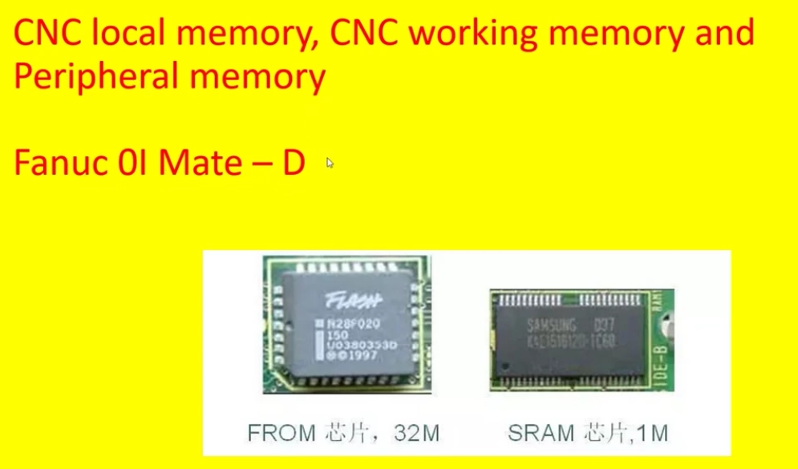
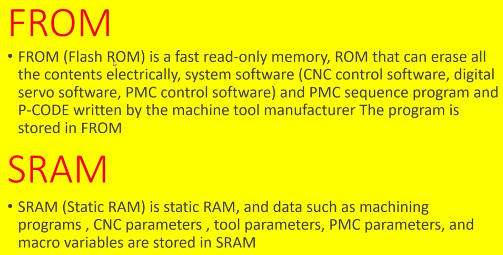
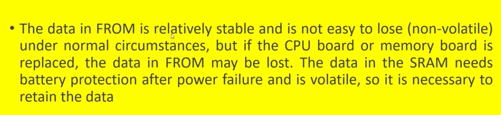
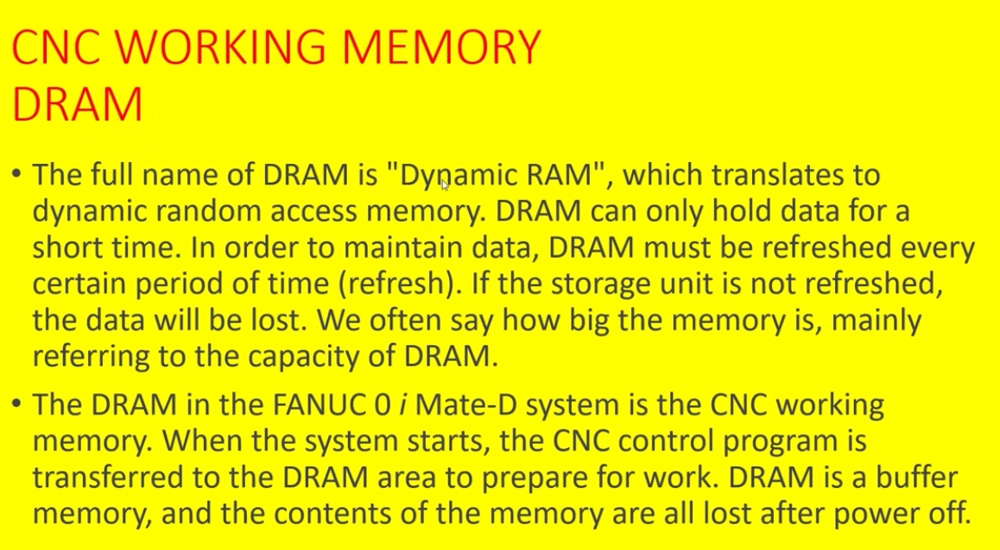
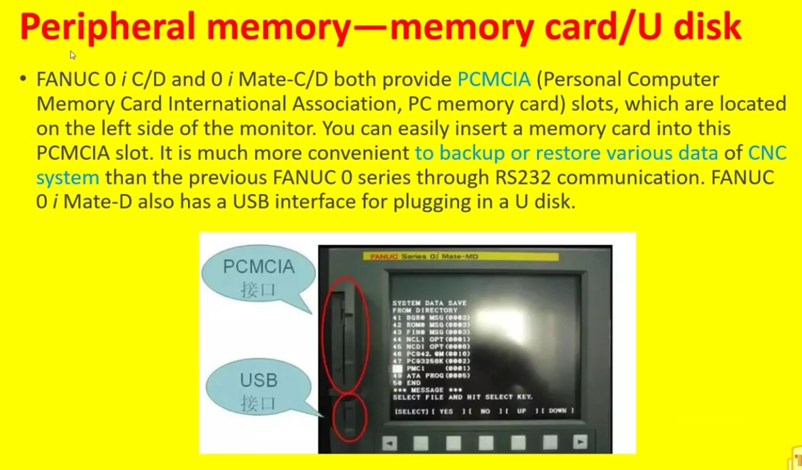
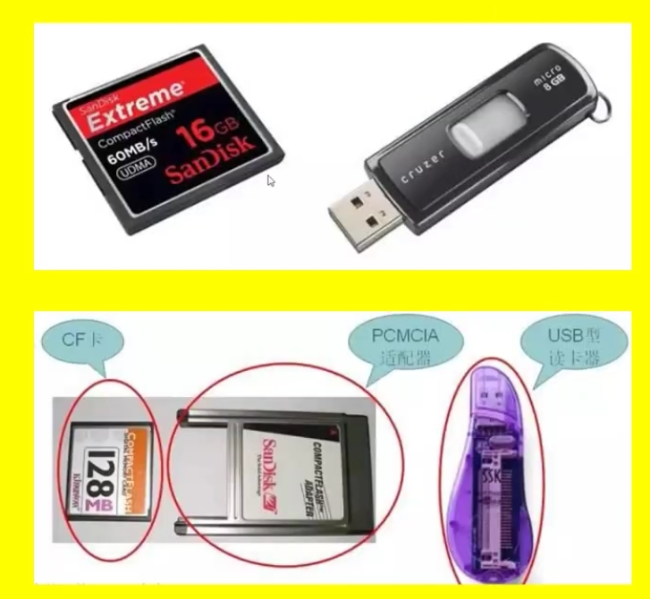
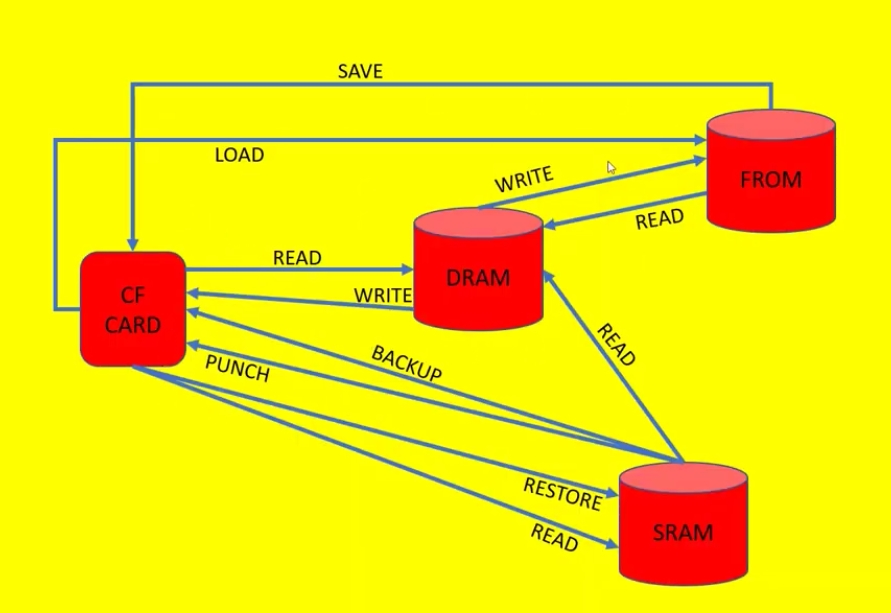

# FANUC Tutorial – Part 5: Memory (FROM, SRAM, DRAM) Explained
# FANUC 教程 第 5 部分：記憶體（FROM、SRAM、DRAM）說明

> Source video / 來源影片：<https://www.youtube.com/watch?v=bvrhMp5pjeQ&list=PLAVTF-IF9aPXg0zNdScXJs6jOqepUE5U7&index=5>
> Images folder / 圖檔目錄：`images/`（`f05_01.jpg` ~ `f05_07.jpg`）

---

## 1. Overview: Three Kinds of Memory / 概述：三種記憶體

**EN:** A FANUC CNC system has three kinds of memory. The video uses the **FANUC 0i Mate-D** as the reference system.

1. **CNC local memory:** **FROM** (32 MB) and **SRAM** (1 MB)
2. **CNC working memory:** **DRAM**
3. **Peripheral memory:** memory card (PCMCIA / CF card) and U-disk (USB)

**中文：** FANUC CNC 系統有三種記憶體。影片以 **FANUC 0i Mate-D** 作為參考系統。

1. **CNC 本地記憶體：** **FROM**（32 MB）與 **SRAM**（1 MB）
2. **CNC 工作記憶體：** **DRAM**
3. **周邊記憶體：** 記憶卡（PCMCIA／CF 卡）與 U 碟（USB）

*Fig. 1 – FROM chip (32M) and SRAM chip (1M) on the FANUC 0i Mate-D board. / 圖 1：FANUC 0i Mate-D 主板上的 FROM 晶片（32M）與 SRAM 晶片（1M）。*

---

## 2. CNC Local Memory / CNC 本地記憶體

### 2.1 FROM (Flash ROM) / FROM（快閃唯讀記憶體）

**EN:** FROM (Flash ROM) is a fast read-only memory — a ROM whose contents can be **erased electrically** (and only electrically). It stores:

- **System software:** CNC control software, digital servo software and PMC control software
- **PMC sequence program** and **P-CODE** written by the machine tool builder

**Maintenance tip:** if you meet problems such as PMC data lost or PMC parameter lost, loading a **FROM backup** into the CNC lets the machine run normally again.

**中文：** FROM（Flash ROM，快閃唯讀記憶體）是高速唯讀記憶體，內容可用 **電氣方式清除**（且只能以電氣方式清除）。它儲存：

- **系統軟體：** CNC 控制軟體、數位伺服軟體與 PMC 控制軟體
- 由機台製造商編寫的 **PMC 順序程式** 與 **P-CODE**

**維修提示：** 若發生 PMC 資料遺失、PMC 參數遺失等問題，將 **FROM 備份** 載入 CNC，機台即可恢復正常運轉。

### 2.2 SRAM (Static RAM) / SRAM（靜態隨機存取記憶體）

**EN:** SRAM stores user-level data:

- Machining (part) programs
- CNC parameters
- Tool parameters (tool offsets)
- PMC parameters
- Macro variables

**Maintenance tip:** if alarms come from CNC-parameter, tool-parameter or PMC-parameter problems, restoring an **SRAM backup** clears the alarms caused by that data. Backups are critically important in maintenance; many companies schedule a backup of every CNC machine regularly (e.g. monthly).

**中文：** SRAM 儲存使用者層級的資料：

- 加工（零件）程式
- CNC 參數
- 刀具參數（刀具補正）
- PMC 參數
- 巨集變數

**維修提示：** 若因 CNC 參數、刀具參數或 PMC 參數問題而出現警報，回存 **SRAM 備份** 即可消除該類資料造成的警報。備份在維修工作中非常重要，許多公司會定期（例如每月）替每台 CNC 機台做備份。

*Fig. 2 – What FROM and SRAM store. / 圖 2：FROM 與 SRAM 所儲存的資料。*

### 2.3 Stability and Battery Backup / 穩定性與電池備份

**EN:**
- Data in **FROM** is relatively stable and not easily lost, because FROM is **non-volatile** under normal circumstances. However, if the **CPU board or memory board is replaced**, the data in FROM may be lost.
- Data in **SRAM** is **volatile**: it needs **battery protection** after power-off. Without the battery, the data is gone when power is turned off. This is why a FANUC CNC control module has a battery; the servo module also uses a battery to retain the axes' current position.

**中文：**
- **FROM** 中的資料相對穩定、不易遺失，因為在正常情況下 FROM 為 **非揮發性**。但若 **更換 CPU 板或記憶體板**，FROM 中的資料可能遺失。
- **SRAM** 中的資料為 **揮發性**：斷電後需要 **電池保護**。沒有電池，斷電後資料就會消失。這就是 FANUC CNC 控制單元內有電池的原因；伺服單元也使用電池來保存各軸的當前位置。

*Fig. 3 – Non-volatile FROM vs. battery-backed SRAM. / 圖 3：非揮發性 FROM 與需電池備份的 SRAM。*

---

## 3. CNC Working Memory – DRAM / CNC 工作記憶體：DRAM

**EN:** DRAM is **Dynamic RAM** (dynamic random access memory).

- DRAM can hold data only for a short time. To keep the data it must be **refreshed** at regular intervals; if the cells are not refreshed, the data is lost. (The speaker uses "every 5 seconds" only as an illustration of the idea.)
- In the 0i Mate-D, DRAM is the **CNC working memory**. At power-on (the boot messages and numbers on screen), the **CNC control program is transferred into DRAM** to prepare the system for work.
- DRAM is a **buffer memory**: you can read and write it, but not store data permanently. **All contents are lost at power-off.**

**中文：** DRAM 是 **動態隨機存取記憶體（Dynamic RAM）**。

- DRAM 只能短時間保存資料，必須定期 **刷新（refresh）** 才能保持資料；若儲存單元未被刷新，資料就會遺失。（講者用「每 5 秒」只是為了說明概念。）
- 在 0i Mate-D 中，DRAM 是 **CNC 工作記憶體**。開機時（畫面出現開機訊息與數字），**CNC 控制程式會被傳送到 DRAM**，使系統準備就緒。
- DRAM 是 **緩衝記憶體**：可讀寫，但不能永久儲存資料。**斷電後內容全部消失。**

*Fig. 4 – DRAM as the CNC working memory. / 圖 4：作為 CNC 工作記憶體的 DRAM。*

---

## 4. Peripheral Memory – Memory Card / U-Disk / 周邊記憶體：記憶卡／U 碟

**EN:** The FANUC 0i-C/D and 0i Mate-C/D provide a **PCMCIA** slot (Personal Computer Memory Card International Association, i.e. PC memory card), located on the **left side of the monitor** (on some machines, behind it). Inserting a memory card here makes it much easier to **back up and restore** CNC data than the older FANUC 0 series, which used RS-232 communication. The **0i Mate-D** also has a **USB interface** for a U-disk (USB flash drive). Both can be used to back up and restore CNC data.

Because PCMCIA slots take PC cards, a **CF (CompactFlash) card** is normally used with a **PCMCIA adapter**: insert the CF card into the adapter, and the whole assembly goes into the slot. A **USB card reader** is used to read the CF card on a PC.

**中文：** FANUC 0i-C/D 與 0i Mate-C/D 提供 **PCMCIA** 插槽（Personal Computer Memory Card International Association，即 PC 記憶卡），位於 **螢幕左側**（部分機台在螢幕後方）。將記憶卡插入此處，比舊款 FANUC 0 系列透過 RS-232 通訊更容易 **備份與還原** CNC 資料。**0i Mate-D** 另有 **USB 介面**，可插入 U 碟（USB 隨身碟）。兩者都可用來備份與還原 CNC 資料。

PCMCIA 插槽使用 PC 卡，因此通常將 **CF（CompactFlash）卡** 搭配 **PCMCIA 轉接器**：把 CF 卡插入轉接器，整體再插入插槽。**USB 讀卡機** 則用於在電腦上讀取 CF 卡。

*Fig. 5 – PCMCIA and USB ports on the left of the FANUC 0i Mate-MD screen; the screen shows the SYSTEM DATA SAVE menu. / 圖 5：FANUC 0i Mate-MD 螢幕左側的 PCMCIA 與 USB 接口；畫面為 SYSTEM DATA SAVE 選單。*

*Fig. 6 – CompactFlash card, USB flash drive, PCMCIA adapter and USB card reader. / 圖 6：CF 卡、USB 隨身碟、PCMCIA 轉接器與 USB 讀卡機。*

---

## 5. Memory Data-Flow Diagram / 記憶體資料傳輸架構圖

*Fig. 7 – Data flow between CF card, FROM, SRAM and DRAM. / 圖 7：CF 卡、FROM、SRAM、DRAM 之間的資料流向。*

| Operation / 操作 | Between / 對象 | Meaning / 說明 |
|---|---|---|
| **LOAD** | CF card → FROM | Load data from the card into FROM / 由記憶卡載入 FROM |
| **SAVE** | FROM → CF card | Save FROM data to the card / 將 FROM 資料存到記憶卡 |
| **READ** | FROM → DRAM | DRAM reads FROM / DRAM 讀取 FROM |
| **WRITE** | DRAM → FROM | DRAM writes FROM / DRAM 寫入 FROM |
| **READ** | SRAM → DRAM | DRAM reads SRAM / DRAM 讀取 SRAM |
| **BACKUP** | SRAM → CF card | Back up SRAM data to the card / 將 SRAM 資料備份到記憶卡 |
| **PUNCH** | SRAM → CF card | Output (punch) data such as programs to the card / 將程式等資料輸出到記憶卡 |
| **RESTORE** | CF card → SRAM | Restore a backup into SRAM / 將備份回存到 SRAM |
| **READ** | CF card → SRAM | Read data from the card into SRAM (e.g. programs) / 由記憶卡讀入 SRAM（如程式） |
| **READ** | CF card → DRAM | DRAM reads the card / DRAM 讀取記憶卡 |
| **WRITE** | DRAM → CF card | DRAM writes the card / DRAM 寫入記憶卡 |

**EN:** DRAM sits in the middle: it can read from FROM, SRAM and the CF card, and write to FROM and the CF card. The architecture is the same for all FANUC CNCs.

**中文：** DRAM 位於中心位置：可從 FROM、SRAM 與 CF 卡讀取，也可寫入 FROM 與 CF 卡。這個架構適用於所有 FANUC CNC。

---

## 6. Summary / 總結

| Memory / 記憶體 | Type / 類別 | Volatile? / 揮發性 | Stores / 儲存內容 | Backup / 備份 |
|---|---|---|---|---|
| **FROM** (32 MB) | Local / 本地 | No / 否 | System software, PMC sequence program, P-CODE / 系統軟體、PMC 順序程式、P-CODE | FROM backup |
| **SRAM** (1 MB) | Local / 本地 | Yes – battery needed / 是，需電池 | Programs, CNC/tool/PMC parameters, macro variables / 程式、CNC／刀具／PMC 參數、巨集變數 | SRAM backup |
| **DRAM** | Working / 工作 | Yes – lost at power-off / 是，斷電即失 | CNC control program loaded at boot / 開機時載入的 CNC 控制程式 | — |
| **CF card / USB** | Peripheral / 周邊 | No / 否 | Backups, programs / 備份、程式 | — |

---

## 7. Closing / 結語

**EN:** The CNC local memory is FROM and SRAM, the working memory is DRAM, and the peripheral memory is the PCMCIA card and USB U-disk. Regular backups of FROM and SRAM are the key to fast recovery.

**中文：** CNC 本地記憶體為 FROM 與 SRAM，工作記憶體為 DRAM，周邊記憶體為 PCMCIA 記憶卡與 USB U 碟。定期備份 FROM 與 SRAM，是快速恢復機台的關鍵。

> **Note / 備註：** The auto-captioned transcript has many recognition errors (e.g. "S-ROM" = SRAM, "batch production" = battery protection, "FANUC OMETT/OIMED" = 0i Mate-D, "DRAM modeling" = DRAM). Also, the spoken explanation of the CF-card/DRAM/FROM transfers is garbled, so the table in Section 5 follows the labels on the slide (Fig. 7). 原逐字稿有許多語音辨識錯誤（如「S-ROM」＝SRAM、「batch production」＝電池保護、「FANUC OMETT/OIMED」＝0i Mate-D），且講者對 CF 卡／DRAM／FROM 傳輸關係的口述內容混亂，因此第 5 節表格依投影片（圖 7）上的標示整理。

---

## Appendix: Image Index / 附錄：圖檔對照表

| # | File / 檔名 | Content / 內容 |
|---|---|---|
| 1 | images/f05_01.jpg | Memory overview, FROM 32M / SRAM 1M chips / 記憶體總覽與晶片 |
| 2 | images/f05_02.jpg | FROM and SRAM contents / FROM 與 SRAM 內容 |
| 3 | images/f05_03.jpg | FROM stability, SRAM battery / FROM 穩定性、SRAM 電池 |
| 4 | images/f05_04.jpg | CNC working memory DRAM / 工作記憶體 DRAM |
| 5 | images/f05_05.jpg | PCMCIA and USB ports / PCMCIA 與 USB 接口 |
| 6 | images/f05_06.jpg | CF card, adapter, card reader / CF 卡、轉接器、讀卡機 |
| 7 | images/f05_07.jpg | Memory data-flow diagram / 記憶體資料流向圖 |
