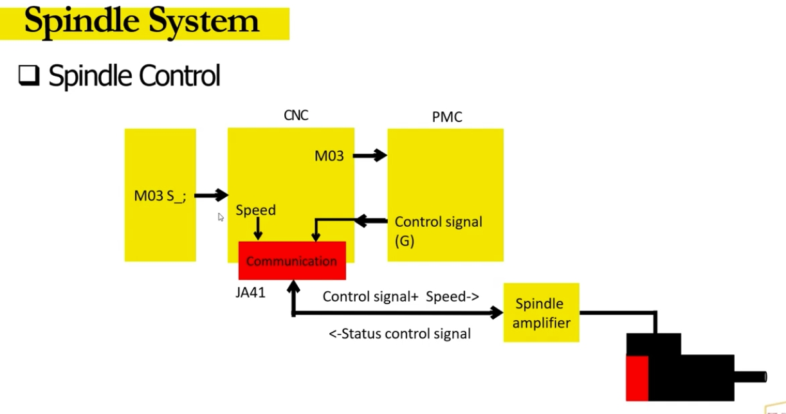
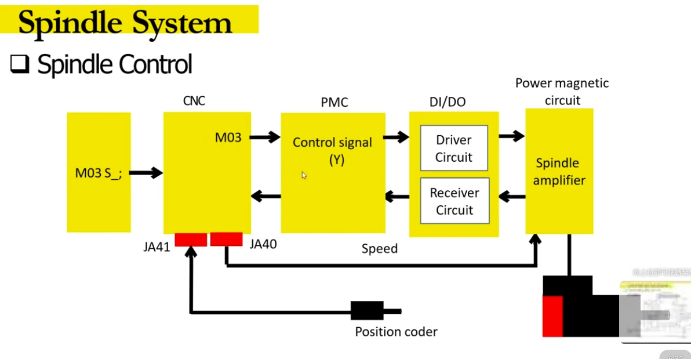
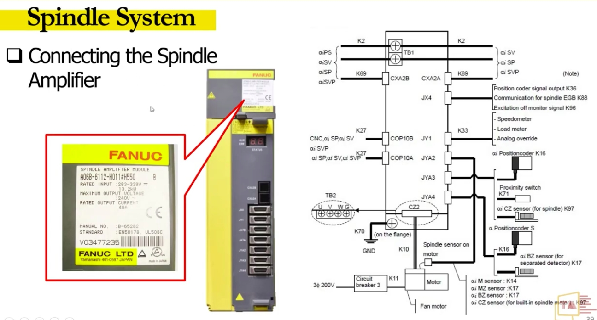
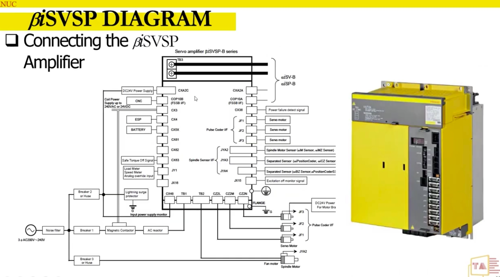

# FANUC Tutorial – Part 6: Spindle System Training
# FANUC 教程 第 6 部分：主軸系統

> Source video / 來源影片：<https://www.youtube.com/watch?v=8Y1hMGlmBNM&list=PLAVTF-IF9aPXg0zNdScXJs6jOqepUE5U7&index=6>
> Images folder / 圖檔目錄：`images/`（`f06_01.jpg` ~ `f06_04.jpg`）

---

## 1. Spindle Commands / 主軸指令

**EN:** In a part program, the spindle is commanded with **M** and **S** codes:

- **M03** – spindle rotates clockwise (CW)
- **S** – spindle speed. For example, `M03 S1000;` means "rotate the spindle clockwise at 1000 RPM".

**中文：** 在零件程式中，以 **M** 與 **S** 代碼指令主軸：

- **M03**：主軸正轉（順時針）
- **S**：主軸轉速。例如 `M03 S1000;` 表示「主軸以 1000 RPM 正轉」。

**EN – How the two parts of the command are handled:** the CNC processes the **speed (S)** itself and sends it **directly to the spindle drive**, while the **M03** command is passed to the **PMC**. The PMC turns on the corresponding control signal, which then goes to the spindle amplifier.

**中文：處理方式：** CNC 自行處理 **轉速（S）**，並 **直接送給主軸驅動器**；**M03** 指令則交給 **PMC**，由 PMC 開啟對應的控制訊號，再送到主軸放大器。

---

## 2. Spindle Control Method 1: Serial Spindle (JA41) / 主軸控制方式一：串列主軸（JA41）

*Fig. 1 – Spindle control through the communication interface JA41. / 圖 1：透過通訊介面 JA41 的主軸控制。*

**EN:** Signal flow for `M03 S1000;` in this method:

1. The CNC receives `M03 S…;`.
2. The CNC sends **M03** to the PMC through **F signals** (CNC → PMC).
3. The PMC returns the corresponding control signal through **G signals** (PMC → CNC), e.g. spindle CW.
4. The CNC's **communication** block combines the **control signal + speed** and sends them to the **spindle amplifier** over the **JA41** cable. The control signals are things like CW, CCW, start and stop.
5. The spindle amplifier drives the spindle motor electrically.
6. The amplifier sends **status control signals** back to the CNC over the same cable (e.g. "spindle is running at 1000 RPM"). If everything is normal, the CNC runs without an alarm.

**中文：** 此方式下 `M03 S1000;` 的訊號流程：

1. CNC 收到 `M03 S…;`。
2. CNC 透過 **F 訊號** 將 **M03** 傳給 PMC（CNC → PMC）。
3. PMC 透過 **G 訊號** 回傳對應的控制訊號（PMC → CNC），例如主軸正轉。
4. CNC 的 **通訊（Communication）** 區塊將 **控制訊號 + 轉速** 組合後，經 **JA41** 纜線送給 **主軸放大器**。控制訊號包括正轉、反轉、啟動、停止等。
5. 主軸放大器以電氣方式驅動主軸馬達。
6. 放大器經同一條纜線將 **狀態控制訊號** 回傳 CNC（例如「主軸正以 1000 RPM 運轉」）。一切正常時，CNC 不會產生警報。

---

## 3. Spindle Control Method 2: DI/DO + Analog Speed (JA40) / 主軸控制方式二：DI/DO + 類比轉速（JA40）

*Fig. 2 – Spindle control through PMC, DI/DO, JA40 and a position coder on JA41. / 圖 2：透過 PMC、DI/DO、JA40，以及接在 JA41 的位置編碼器的主軸控制。*

**EN:** With the same command `M03 S1000;`:

1. **Speed** is sent **directly** from the CNC to the spindle amplifier through **JA40**.
2. **M03** goes to the **PMC**, which outputs a **control signal (Y)**.
3. The Y signal goes through the **DI/DO driver circuit** to the spindle amplifier (the power magnetic circuit side).
4. The amplifier's status comes back through the **receiver circuit** of the DI/DO, to the PMC (X signals), and then to the CNC.

So here the speed goes directly over JA40, but the **control signals are processed by the PMC through DI/DO**.

**Position monitoring:** if you need to monitor the spindle position, install a **position coder** on the spindle. The position coder connects **directly to the CNC (JA41)**, **not** to the spindle amplifier.

**中文：** 同樣的指令 `M03 S1000;`：

1. **轉速** 由 CNC 經 **JA40** **直接** 送給主軸放大器。
2. **M03** 交給 **PMC**，由 PMC 輸出 **控制訊號（Y）**。
3. Y 訊號經 **DI/DO 驅動電路（Driver Circuit）** 送到主軸放大器（動力電磁電路側）。
4. 放大器的狀態經 DI/DO 的 **接收電路（Receiver Circuit）** 回到 PMC（X 訊號），再傳到 CNC。

因此，此方式的轉速直接經 JA40 傳送，但 **控制訊號是由 PMC 透過 DI/DO 處理**。

**位置監控：** 若需要監控主軸位置，須在主軸上安裝 **位置編碼器（Position Coder）**。位置編碼器 **直接連接 CNC（JA41）**，**不是** 連接主軸放大器。

### Comparison / 兩種方式比較

| Item / 項目 | Method 1 / 方式一 | Method 2 / 方式二 |
|---|---|---|
| Speed path / 轉速路徑 | CNC → amplifier via JA41 (serial) / 經 JA41 串列通訊 | CNC → amplifier via JA40 / 經 JA40 |
| Control signal path / 控制訊號路徑 | Together with speed over JA41 / 與轉速一起經 JA41 | PMC (Y) → DI/DO → amplifier / PMC（Y）→ DI/DO → 放大器 |
| Status feedback / 狀態回饋 | Over JA41 to CNC / 經 JA41 回 CNC | Receiver circuit → PMC (X) → CNC / 接收電路 → PMC（X）→ CNC |
| Position coder / 位置編碼器 | — | To CNC JA41 / 接 CNC 的 JA41 |

---

## 4. Spindle Amplifier (αi Series) / 主軸放大器（αi 系列）

*Fig. 3 – Spindle amplifier module, its nameplate sticker and connection diagram. / 圖 3：主軸放大器模組、銘牌貼紙與連接圖。*

### 4.1 Nameplate / 銘牌貼紙

**EN:** The sticker on the amplifier carries a lot of information. On the example in the video:

| Item | Value |
|---|---|
| Type | Spindle amplifier module, A06B-6112-H011#H550 |
| Rated input | 283–339 V DC (the sticker shows the DC symbol) |
| Output power | 13.2 kW |
| Maximum output voltage | 240 V |
| Rated output current | 48 A |
| Manual No. | B-65282 |

Use the **manual number** to search for the matching manual (αi series spindle amplifier module) on the internet, where you can read much more about the drive.

**中文：** 放大器上的貼紙包含許多資訊。影片中的例子：

| 項目 | 數值 |
|---|---|
| 型式 | 主軸放大器模組，A06B-6112-H011#H550 |
| 額定輸入 | 283–339 V DC（貼紙上為直流符號） |
| 輸出功率 | 13.2 kW |
| 最大輸出電壓 | 240 V |
| 額定輸出電流 | 48 A |
| 手冊編號 | B-65282 |

可用 **手冊編號** 在網路上搜尋對應手冊（αi 系列主軸放大器模組），了解更多驅動器細節。

### 4.2 Connectors in the Block Diagram / 方塊圖中的連接器

**EN:** The connection diagram also tells you a lot:

| Connector | Purpose |
|---|---|
| **JY1** | Speedometer, load meter, analog override |
| **JYA2** | Spindle motor sensor / αi position coder (as shown on the slide) |
| **JYA3** | Position coder, proximity switch, αi CZ sensor (spindle), used to detect spindle RPM/position |
| **JYA4** | Separated detector: αi BZ sensor, position coder S |
| **CZ2** | Motor power connector (U, V, W, G via TB2) |
| **K70** | Ground (GND) connection (on the flange) |
| **COP10B / COP10A** | Fiber-optic (K27) connection: **COP10B** is the input from the CNC (or the previous amplifier), **COP10A** is the output to the next servo/spindle amplifier |

**中文：** 連接圖也提供許多資訊：

| 連接器 | 用途 |
|---|---|
| **JY1** | 轉速表、負載表、類比倍率（override） |
| **JYA2** | 主軸馬達感測器／αi 位置編碼器（依投影片所示） |
| **JYA3** | 位置編碼器、接近開關、αi CZ 感測器（主軸），用於偵測主軸轉速／位置 |
| **JYA4** | 分離式檢出器：αi BZ 感測器、位置編碼器 S |
| **CZ2** | 馬達動力連接器（透過 TB2 接 U、V、W、G） |
| **K70** | 接地（GND）連接（位於法蘭上） |
| **COP10B / COP10A** | 光纖（K27）連接：**COP10B** 為來自 CNC（或前一台放大器）的輸入，**COP10A** 為輸出到下一台伺服／主軸放大器 |

---

## 5. βiSVSP Amplifier / βiSVSP 放大器

*Fig. 4 – Connecting the βiSVSP servo/spindle amplifier (βiSVSP-B series). / 圖 4：βiSVSP 伺服／主軸放大器（βiSVSP-B 系列）的連接。*

**EN:** The β series is a **servo and spindle amplifier in one unit** (βiSVSP). Its configuration is basically the same as the α series; only some functions differ, so choose according to the application. Typical connections on the diagram include:

- **COP10B / COP10A:** FSSB optical interface (CNC in / next amplifier out)
- **JF1 / JF2 / JF3:** pulse coder interface for the servo motors
- **JYA2 / JYA3 / JYA4:** spindle sensor interface (spindle motor sensor and separated sensors)
- **JY1:** load meter, speed meter, analog override input
- **CX4 (ESP):** emergency stop, **CX5X:** battery, **CXA2C:** DC24V power supply
- **CZ2L / CZ2M / CZ2N:** motor power outputs; **TB1 / TB2 / CX48:** power and input-supply monitoring
- Power path: noise filter → breaker → magnetic contactor → AC reactor, with a separate breaker for the fan motor

**中文：** β 系列是 **伺服與主軸二合一的放大器**（βiSVSP）。其架構與 α 系列基本相同，只是部分功能有差異，應依應用需求選用。圖中常見的連接包括：

- **COP10B / COP10A：** FSSB 光纖介面（輸入來自 CNC／輸出到下一台放大器）
- **JF1 / JF2 / JF3：** 伺服馬達的脈衝編碼器介面
- **JYA2 / JYA3 / JYA4：** 主軸感測器介面（主軸馬達感測器與分離式感測器）
- **JY1：** 負載表、轉速表、類比倍率輸入
- **CX4（ESP）：** 緊急停止，**CX5X：** 電池，**CXA2C：** DC24V 電源
- **CZ2L / CZ2M / CZ2N：** 馬達動力輸出；**TB1 / TB2 / CX48：** 電源與輸入電源監視
- 電源路徑：雜訊濾波器 → 斷路器 → 電磁接觸器 → 交流電抗器，風扇馬達另有獨立斷路器

---

## 6. Summary / 總結

**EN:**
- The CNC sends **speed** straight to the spindle amplifier; **M03/M04/M05-type commands** go through the **PMC**.
- Method 1: control signal + speed over the **JA41 serial** link, status returned the same way.
- Method 2: speed over **JA40**; control signals via **PMC → DI/DO**; position coder to **JA41** on the CNC.
- Learn to read the amplifier's **nameplate** and **connection diagram** — they tell you power, current, manual number and which connector serves which sensor.
- The next videos will explain how M-codes and G-codes work and how to create a new M-code.

**中文：**
- CNC 將 **轉速** 直接送給主軸放大器；**M03／M04／M05 類指令** 則經 **PMC** 處理。
- 方式一：控制訊號 + 轉速經 **JA41 串列** 傳送，狀態以同樣路徑回傳。
- 方式二：轉速經 **JA40**；控制訊號經 **PMC → DI/DO**；位置編碼器接 CNC 的 **JA41**。
- 要會看放大器的 **銘牌** 與 **連接圖**，從中得知功率、電流、手冊編號，以及各連接器對應的感測器。
- 後續影片將說明 M 代碼與 G 代碼的運作，以及如何新增 M 代碼。

> **Note / 備註：** The auto-captioned transcript is garbled in many places (e.g. "first error box" = first block, "batch" / "CZ2 center" mis-hearings, "JYA4 BZ sensor like that"). Signal paths and connector names here follow the **slides**. The connector details in Sections 4–5 are read from the slide images; please verify against the FANUC manual (B-65282 for the αi amplifier) before wiring. 原逐字稿有許多語音辨識錯誤；訊號路徑與連接器名稱以 **投影片** 為準。第 4–5 節的連接器細節係由投影片圖片判讀，實際配線前請對照 FANUC 手冊（αi 放大器為 B-65282）確認。

---

## Appendix: Image Index / 附錄：圖檔對照表

| # | File / 檔名 | Content / 內容 |
|---|---|---|
| 1 | images/f06_01.jpg | Spindle control via JA41 (serial) / 以 JA41 串列控制主軸 |
| 2 | images/f06_02.jpg | Spindle control via PMC, DI/DO, JA40, position coder / 以 PMC、DI/DO、JA40、位置編碼器控制 |
| 3 | images/f06_03.jpg | αi spindle amplifier, nameplate, connections / αi 主軸放大器、銘牌、連接 |
| 4 | images/f06_04.jpg | βiSVSP amplifier diagram / βiSVSP 放大器連接圖 |
