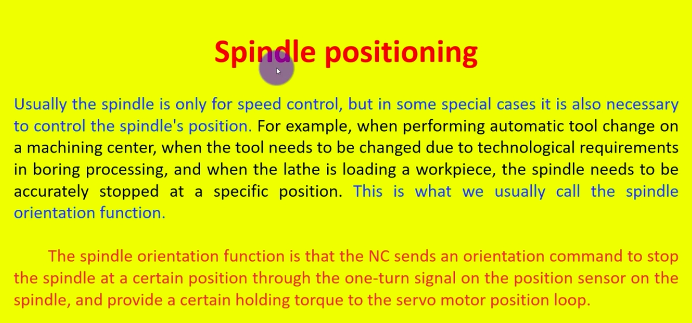
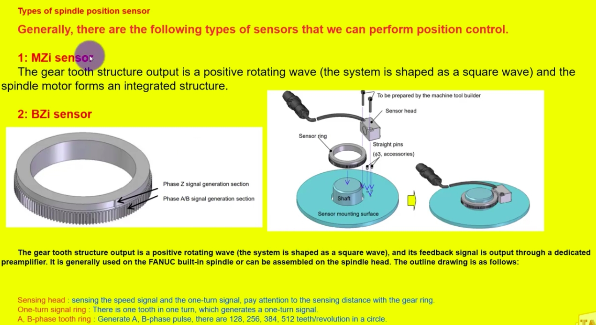
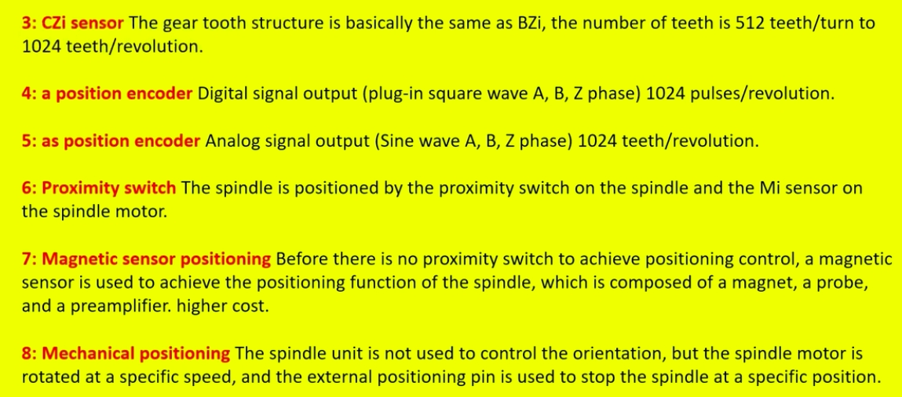
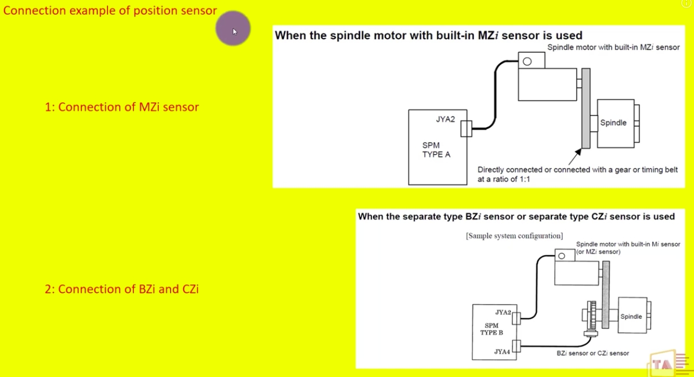
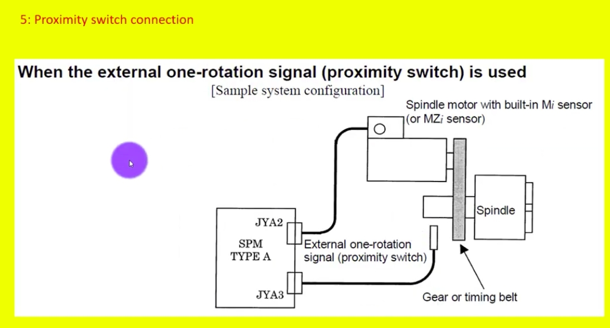

# FANUC Tutorial – Part 7: Spindle Positioning (Orientation) and Types of Spindle Sensors
# FANUC 教程 第 7 部分：主軸定位（定向）與主軸感測器類型

> Source video / 來源影片：<https://www.youtube.com/watch?v=pb0FPiLbAwE&list=PLAVTF-IF9aPXg0zNdScXJs6jOqepUE5U7&index=7>
> Images folder / 圖檔目錄：`images/`（`f07_01.jpg` ~ `f07_05.jpg`）

---

## 1. Why Spindle Positioning? / 為什麼需要主軸定位？

**EN:** Usually the spindle is used only for **speed control**. In some special cases the **spindle position** must be controlled as well, for example:

- **Automatic tool change (ATC)** on a machining center
- Tool change required by **boring** operations
- **Loading a workpiece** on a lathe

In these cases the spindle must stop accurately at a **specific position**. Otherwise the tool may drop or a collision may occur between the spindle and the ATC. This is what we call the **spindle orientation function**.

This matters for maintenance: when someone reports "the spindle is not orienting properly", you need to understand what orientation is before you can troubleshoot efficiently.

**中文：** 一般情況下主軸只做 **速度控制**。在某些特殊情況下，也必須控制 **主軸位置**，例如：

- 加工中心的 **自動換刀（ATC）**
- **搪孔** 加工所需的換刀
- 車床 **裝載工件** 時

這些情況下，主軸必須精確停在 **特定位置**，否則刀具可能掉落，或主軸與 ATC 之間發生碰撞。這就是所謂的 **主軸定向（Spindle Orientation）功能**。

這對維修很重要：當有人反映「主軸定向不正常」時，必須先了解什麼是定向，才能有效地排除故障。

*Fig. 1 – Spindle positioning and the orientation function. / 圖 1：主軸定位與定向功能。*

---

## 2. How Spindle Orientation Works / 主軸定向如何運作

**EN:** The NC sends an **orientation command** to stop the spindle at a certain position, using the **one-turn signal** of the **position sensor on the spindle**, and provides a certain **holding torque** to the servo-motor position loop (the position loop is explained in a later video).

In practice: when you press the orientation button (or the program issues the orientation command), the spindle rotates, the sensor head detects the **single "one-turn" tooth** on the sensor ring, and the spindle stops at that tooth. The spindle is now in the **orientation position**. The stop position can be adjusted to the position the application requires.

**中文：** NC 發出 **定向指令**，利用主軸上 **位置感測器的一轉訊號（one-turn signal）** 使主軸停在某一位置，並對伺服馬達位置迴路提供一定的 **保持扭矩**（位置迴路將在後續影片說明）。

實際動作：按下定向按鈕（或程式發出定向指令）後，主軸旋轉，感測頭偵測感測環上 **唯一的一個「一轉」齒**，主軸便停在該齒的位置，此時主軸即處於 **定向位置**。停止位置可依應用需求調整。

---

## 3. Types of Spindle Position Sensors / 主軸位置感測器類型

The slides list eight methods. / 投影片列出八種方式。

*Fig. 2 – MZi sensor and BZi sensor (sensor ring, sensor head, mounting surface). / 圖 2：MZi 感測器與 BZi 感測器（感測環、感測頭、安裝面）。*

*Fig. 3 – CZi sensor, position encoders, proximity switch, magnetic sensor, mechanical positioning. / 圖 3：CZi 感測器、位置編碼器、接近開關、磁性感測器與機械定位。*

### 3.1 MZi Sensor / MZi 感測器

**EN:** A gear-tooth structure that forms an **integrated structure with the spindle motor** (built into the motor). Output is shown on the slide as a "positive rotating wave (shaped as a square wave)" system.

**中文：** 齒輪齒結構，與 **主軸馬達形成一體** （內建於馬達中）。投影片標示其輸出為「positive rotating wave（系統整形為方波）」。

### 3.2 BZi Sensor / BZi 感測器

**EN:** A gear-tooth structure with the same type of output; the feedback signal goes through a **dedicated preamplifier** to the controller. It is generally used on FANUC built-in spindles, or can be **assembled on the spindle head**.

Mounting: the **sensor ring** is fitted on the spindle shaft at the **sensor mounting surface**, and the **sensor head** is then mounted next to it (positioned with straight pins; the head and mounting parts are prepared by the machine tool builder). Mind the **sensing distance** between the head and the gear ring.

Parts of the sensor:

| Part | Function |
|---|---|
| **Sensing head** | Senses the speed signal and the one-turn signal; keep the correct sensing distance from the gear ring |
| **One-turn signal ring (phase Z)** | There is **one tooth per turn**, which generates the one-turn signal (used for orientation) |
| **A/B-phase tooth ring** | Generates the **A and B phase pulses**; **128, 256, 384 or 512 teeth per revolution** |

**中文：** 齒輪齒結構，輸出類型相同；回授訊號經 **專用前置放大器（preamplifier）** 送到控制器。通常用於 FANUC 內建式主軸，或可 **組裝在主軸頭上**。

安裝方式：先將 **感測環（sensor ring）** 裝在主軸軸上的 **感測器安裝面**，再於旁邊安裝 **感測頭（sensor head）**（以直銷定位；感測頭與安裝件由機台製造商自備）。須注意感測頭與齒環之間的 **檢出距離**。

感測器各部分：

| 部分 | 功能 |
|---|---|
| **感測頭** | 檢出轉速訊號與一轉訊號；須與齒環保持正確的檢出距離 |
| **一轉訊號環（Z 相）** | **每轉一個齒**，產生一轉訊號（用於定向） |
| **A/B 相齒環** | 產生 **A、B 相脈衝**；**每轉 128、256、384 或 512 齒** |

### 3.3 CZi Sensor / CZi 感測器

**EN:** Gear-tooth structure basically the same as BZi, but with **512 to 1024 teeth per revolution**.

**中文：** 齒輪齒結構與 BZi 基本相同，但 **每轉 512 至 1024 齒**。

### 3.4 αi Position Encoder / αi 位置編碼器

**EN:** **Digital** signal output (square wave A, B, Z phase), **1024 pulses per revolution**. By counting the pulses you can control the spindle position.

**中文：** **數位** 訊號輸出（方波 A、B、Z 相），**每轉 1024 個脈衝**。計算脈衝數即可控制主軸位置。

### 3.5 αi Position Encoder S / αi 位置編碼器 S

**EN:** **Analog** signal output (sine wave A, B, Z phase), **1024 teeth per revolution**.

**中文：** **類比** 訊號輸出（正弦波 A、B、Z 相），**每轉 1024 齒**。

### 3.6 Proximity Switch / 接近開關

**EN:** The spindle is positioned by a **proximity switch on the spindle** together with the **Mi sensor on the spindle motor**. The proximity switch provides the one-turn (orientation) signal.

**中文：** 利用 **主軸上的接近開關** 配合 **主軸馬達上的 Mi 感測器** 進行主軸定位。接近開關提供一轉（定向）訊號。

### 3.7 Magnetic Sensor Positioning / 磁性感測器定位

**EN:** Used before proximity switches were available for positioning control. It consists of a **magnet, a probe and a preamplifier**, and is **higher in cost**.

**中文：** 在尚無接近開關可用於定位控制之前所採用的方式，由 **磁鐵、感測探頭與前置放大器** 組成，**成本較高**。

### 3.8 Mechanical Positioning / 機械定位

**EN:** The spindle control itself does not perform orientation; the spindle motor is rotated at a **specific speed** and an **external positioning pin** stops the spindle at the specified position.

**中文：** 不由主軸控制單元執行定向；而是讓主軸馬達以 **特定速度** 旋轉，再由 **外部定位銷** 把主軸停在指定位置。

---

## 4. Connection Examples / 連接範例

SPM = spindle amplifier module. / SPM＝主軸放大器模組。

*Fig. 4 – Top: motor with built-in MZi sensor on SPM Type A (JYA2). Bottom: separate BZi/CZi sensor on SPM Type B (JYA2 and JYA4). / 圖 4：上：內建 MZi 感測器的馬達接 SPM Type A（JYA2）。下：分離式 BZi／CZi 感測器接 SPM Type B（JYA2 與 JYA4）。*

### 4.1 MZi Sensor / MZi 感測器

**EN:** The spindle motor has a **built-in MZi sensor**, connected directly to the spindle or through a gear or timing belt at a **1:1 ratio**. The sensor signal goes to **JYA2** of the SPM (Type A).

**中文：** 主軸馬達 **內建 MZi 感測器**，與主軸直接連接，或以齒輪／皮帶以 **1:1 比例** 連接。感測器訊號接到 SPM（Type A）的 **JYA2**。

### 4.2 BZi and CZi Sensors / BZi 與 CZi 感測器

**EN:** With a **separate-type BZi or CZi sensor**, the motor's built-in Mi (or MZi) sensor still connects to **JYA2**, and the separate BZi/CZi sensor — mounted on the spindle on the timing-belt side — connects to **JYA4** (SPM Type B).

**中文：** 使用 **分離式 BZi 或 CZi 感測器** 時，馬達內建的 Mi（或 MZi）感測器仍接 **JYA2**，而安裝在主軸（皮帶側）的分離式 BZi／CZi 感測器接 **JYA4**（SPM Type B）。

### 4.3 Position Encoder / 位置編碼器

**EN:** The speaker explains verbally (not shown on these slides) that with the **αi position coder**, SPM **Type A** connects it to **JYA3**, while with the **αi position coder S**, SPM **Type B** connects it to **JYA4**. For details of Type A and Type B, download the corresponding SPM manuals.

**中文：** 講者口頭說明（這幾張投影片上未顯示）：使用 **αi 位置編碼器** 時，SPM **Type A** 接到 **JYA3**；使用 **αi 位置編碼器 S** 時，SPM **Type B** 接到 **JYA4**。Type A 與 Type B 的詳細內容，請下載對應的 SPM 手冊查閱。

### 4.4 Proximity Switch / 接近開關

*Fig. 5 – External one-rotation signal (proximity switch) on JYA3 of SPM Type A; motor Mi/MZi sensor on JYA2. / 圖 5：外部一轉訊號（接近開關）接 SPM Type A 的 JYA3；馬達 Mi／MZi 感測器接 JYA2。*

**EN:** When an **external one-rotation (one-turn) signal** is used, a **proximity switch** is installed on the spindle side and wired to **JYA3**; the motor's Mi/MZi sensor stays on **JYA2**. The spindle stops at the orientation position using this signal.

**中文：** 使用 **外部一轉（one-turn）訊號** 時，在主軸側安裝 **接近開關**，接到 **JYA3**；馬達的 Mi／MZi 感測器仍接 **JYA2**。主軸利用此訊號停在定向位置。

---

## 5. Summary / 總結

| # | Method / 方式 | Output / Teeth / 輸出與齒數 | SPM connector / 連接器 |
|---|---|---|---|
| 1 | MZi (built into motor / 內建馬達) | Gear tooth / 齒輪齒 | JYA2 |
| 2 | BZi (separate / 分離式) | 128 / 256 / 384 / 512 teeth/rev | JYA4 |
| 3 | CZi (separate / 分離式) | 512–1024 teeth/rev | JYA4 |
| 4 | αi position encoder / αi 位置編碼器 | Digital square wave, 1024 pulses/rev / 數位方波 | JYA3 (Type A, per speaker / 依講者) |
| 5 | αi position encoder S / αi 位置編碼器 S | Analog sine wave, 1024 teeth/rev / 類比正弦波 | JYA4 (Type B, per speaker / 依講者) |
| 6 | Proximity switch / 接近開關 | External one-turn signal / 外部一轉訊號 | JYA3 |
| 7 | Magnetic sensor / 磁性感測器 | Magnet + probe + preamp, higher cost / 成本較高 | — |
| 8 | Mechanical positioning / 機械定位 | External positioning pin / 外部定位銷 | — |

**EN:** The next video covers more topics on the FANUC spindle and servo.

**中文：** 下一部影片將說明更多關於 FANUC 主軸與伺服的主題。

> **Note / 備註：** The auto-captioned transcript has many recognition errors (e.g. "m is the" = MZi, "b is a" = BZi, "c is a" = CZi, "jy2 / jy a2" = JYA2, "positive rotating wave" is the slide's own wording). Content here follows the slides. The connector assignments in 4.3 and the summary table for items 2–5 should be checked against the FANUC SPM manual for your amplifier type. 原逐字稿有許多語音辨識錯誤（如「m is the」＝MZi、「b is a」＝BZi、「c is a」＝CZi）；內容以投影片為準。4.3 節與總結表第 2–5 項的連接器指定，請對照你所用放大器型號的 FANUC SPM 手冊確認。

---

## Appendix: Image Index / 附錄：圖檔對照表

| # | File / 檔名 | Content / 內容 |
|---|---|---|
| 1 | images/f07_01.jpg | Spindle positioning / 主軸定位 |
| 2 | images/f07_02.jpg | Sensor types: MZi, BZi / 感測器類型：MZi、BZi |
| 3 | images/f07_03.jpg | Sensor types: CZi … mechanical / 感測器類型：CZi 至機械定位 |
| 4 | images/f07_04.jpg | MZi / BZi / CZi connection / MZi、BZi、CZi 連接 |
| 5 | images/f07_05.jpg | Proximity switch connection / 接近開關連接 |
