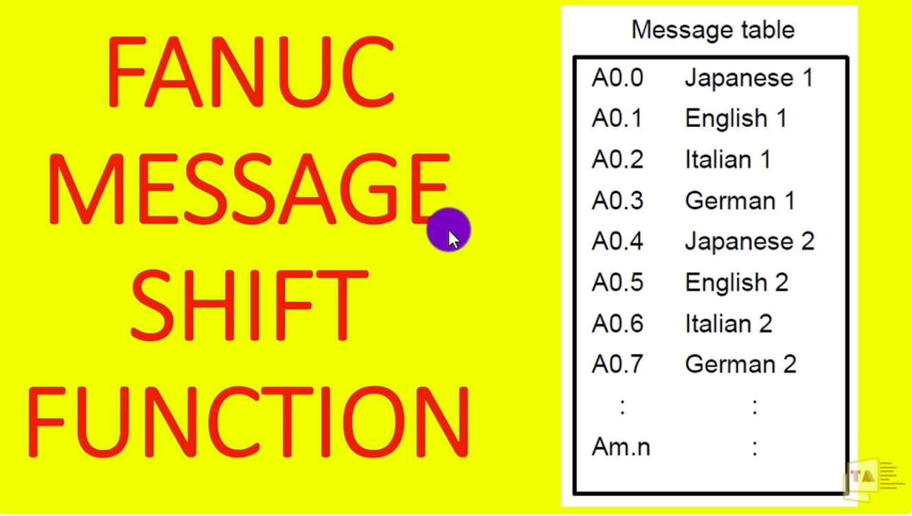
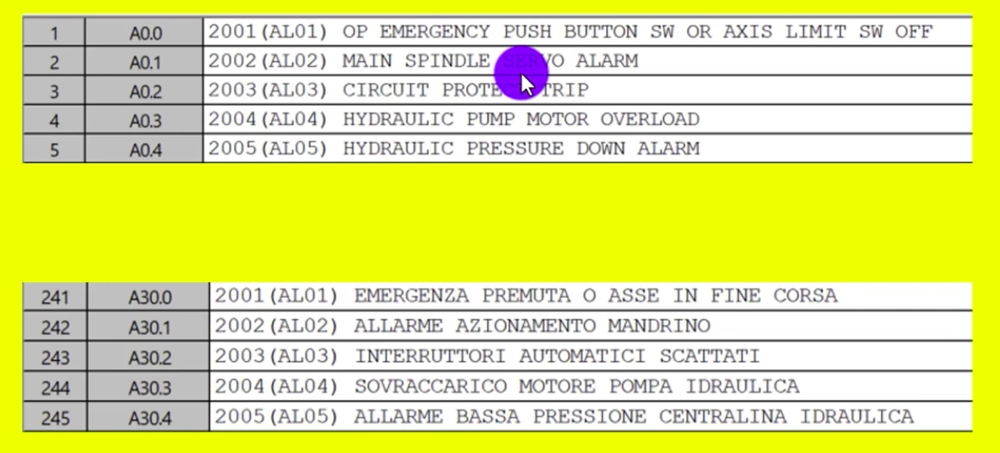
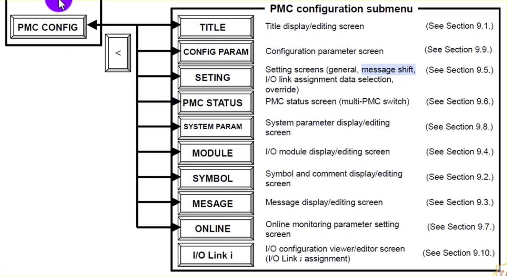
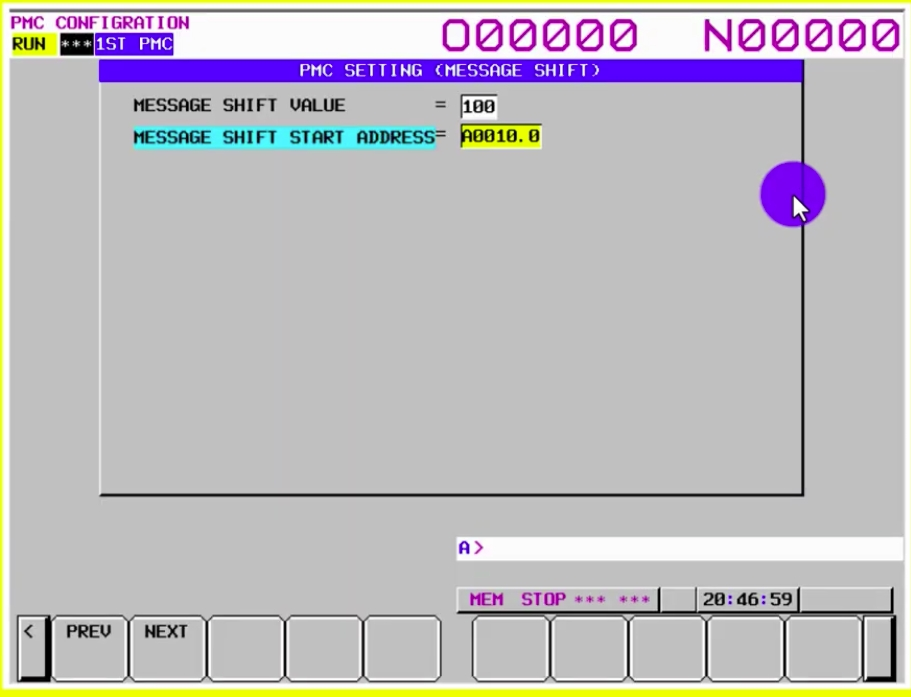
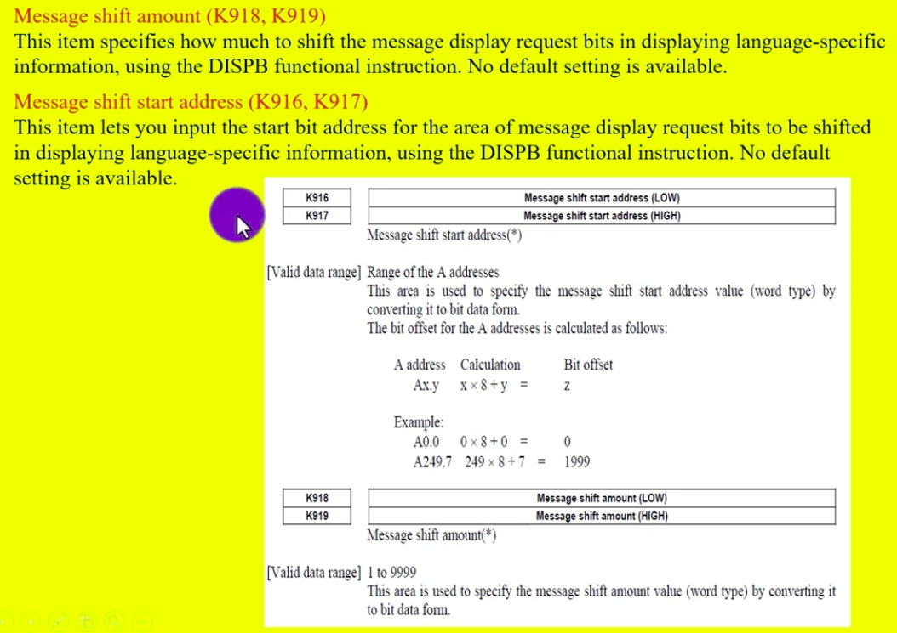

# FANUC Tutorial – Part 8: PMC Message Shift Function
# FANUC 教程 第 8 部分：PMC 訊息移位（Message Shift）功能

> Source video / 來源影片：<https://www.youtube.com/watch?v=K_GsMQawunM&list=PLAVTF-IF9aPXg0zNdScXJs6jOqepUE5U7&index=8>
> Images folder / 圖檔目錄：`images/`（`f08_01.jpg` ~ `f08_05.jpg`）

---

## 1. Why a Message Shift Function? / 為什麼需要訊息移位功能？

**EN:** Suppose a CNC machine is set up in English, but its operator is Japanese and reads only Japanese. When an alarm appears in English, the operator cannot understand it. We would like the alarm to be shown **in Japanese** (or Italian, German, …) instead.

FANUC's **message shift function** achieves this: the same alarm can be written in several languages in the PMC message table, and a **shift value** selects which language is displayed.

**中文：** 假設某台 CNC 機台設定為英文，但操作員是只看得懂日文的日本人。警報以英文顯示時，操作員無法理解。我們希望警報改以 **日文**（或義大利文、德文等）顯示。

FANUC 的 **訊息移位（message shift）功能** 可以做到：同一則警報在 PMC 訊息表中以多種語言寫好，再以 **移位值（shift value）** 選擇要顯示哪一種語言。

---

## 2. Background: The A Address (Message Display) / 背景：A 位址（訊息顯示）

**EN:** In the PMC, an **A address bit** is tied to a message in the message table. When the ladder turns that bit ON, the CNC displays the message. For example (taken from the video's slide):

| Address | Message |
|---|---|
| A0.0 | Operator-panel emergency stop push button / axis limit release switch |
| A0.1 | Main spindle alarm |
| A0.2 | Circuit protector tripped |

The same texts can also be written again in another language at other addresses (the video shows Italian text at A30.0). With the message shift function, which language appears depends on a setting, not on rewriting the ladder.

**中文：** 在 PMC 中，每個 **A 位址位元** 對應訊息表中的一則訊息。梯形圖將該位元設為 ON 時，CNC 即顯示該訊息。例如（取自影片投影片）：

| 位址 | 訊息 |
|---|---|
| A0.0 | 操作面板緊急停止按鈕／軸極限解除開關 |
| A0.1 | 主軸警報 |
| A0.2 | 斷路器跳脫 |

相同內容也可以另一種語言寫在其他位址（影片中以 A30.0 的義大利文為例）。使用訊息移位功能後，顯示哪種語言取決於設定，而不必修改梯形圖。

*Fig. 1 – Example messages at A0.0, A0.1, A0.2 and the Italian copy at A30.0. / 圖 1：A0.0、A0.1、A0.2 的範例訊息，以及 A30.0 的義大利文版本。*

---

## 3. Where to Set It / 設定位置

**EN:** Go to **PMC Configuration → Setting → Message Shift**. The window has two items:

- **Message shift value** – how many bits to shift
- **Message shift start address** – the A address from which shifting starts

*Fig. 2 – Message Shift setting window. / 圖 2：訊息移位設定視窗。*

**中文：** 進入 **PMC 設定（PMC Configuration）→ Setting → Message Shift**。視窗中有兩個項目：

- **訊息移位值（Message shift value）**：要移位的位元數
- **訊息移位起始位址（Message shift start address）**：從哪個 A 位址開始移位

### Keep Relays / 保持型繼電器

**EN:** Before using the function, the corresponding **Keep relays** must be set. According to the speaker:

- **K916 and K917** – message shift **start address**
- **K918 and K919** – message shift **amount** (how many messages/bits are shifted)

The setting window above is the convenient way to set them.

**中文：** 使用此功能前，必須設定對應的 **保持型繼電器（Keep relay）**。依講者說明：

- **K916、K917**：訊息移位的 **起始位址**
- **K918、K919**：訊息移位的 **移位量**（要移位多少則訊息／位元）

上述設定視窗是設定它們的簡便方式。

*Fig. 3 – Keep relays used by the message shift function. / 圖 3：訊息移位功能使用的保持型繼電器。*

---

## 4. Example 1: Four Languages at A0.0 / 範例 1：從 A0.0 開始的四種語言

**EN:** Message data in four languages is laid out starting at **A0.0**, in the order **Japanese, English, Italian, German**, repeating for each message. Each message therefore occupies **4 bits**:

| Shift value | Language displayed |
|---|---|
| 0 | Japanese |
| 1 | English |
| 2 | Italian |
| 3 | German |

Layout of the message table:

| Address | Content |
|---|---|
| A0.0 – A0.3 | Message 1 (e.g. emergency stop): Japanese, English, Italian, German |
| A0.4 – A0.7 | Message 2 (e.g. lubrication level low): Japanese, English, Italian, German |
| A1.0 – A1.3 | Message 3: Japanese, English, Italian, German |
| A1.4 – A1.7 | Message 4: Japanese, English, Italian, German |

**Setting:** message shift **value = 2**, **start address = A0.0**.

**Result:** when the ladder turns on **A0.0**, the system shifts **2 bits** (1, 2) and the **Italian** message is displayed on the CNC screen. With value **1** you get English; with value **3** you get German (3 bits shifted).

**Ladder note:** the ladder only has coils for **A0.0, A0.4, A1.0 and A1.4** — the first (Japanese) slot of each message. The other three bits of each group (e.g. A0.1, A0.2, A0.3) are *not* driven in the ladder; they are reserved for the other languages.

**中文：** 四種語言的訊息資料從 **A0.0** 開始排列，順序為 **日文、英文、義大利文、德文**，每則訊息重複此順序。因此每則訊息佔 **4 個位元**：

| 移位值 | 顯示語言 |
|---|---|
| 0 | 日文 |
| 1 | 英文 |
| 2 | 義大利文 |
| 3 | 德文 |

訊息表配置：

| 位址 | 內容 |
|---|---|
| A0.0 – A0.3 | 訊息 1（例如緊急停止）：日、英、義、德 |
| A0.4 – A0.7 | 訊息 2（例如潤滑油位過低）：日、英、義、德 |
| A1.0 – A1.3 | 訊息 3：日、英、義、德 |
| A1.4 – A1.7 | 訊息 4：日、英、義、德 |

**設定：** 訊息移位 **值 = 2**，**起始位址 = A0.0**。

**結果：** 當梯形圖使 **A0.0** 為 ON 時，系統移位 **2 個位元**（1、2），CNC 畫面即顯示 **義大利文** 訊息。移位值為 **1** 時顯示英文；為 **3** 時顯示德文（移位 3 位元）。

**梯形圖注意事項：** 梯形圖中只有 **A0.0、A0.4、A1.0、A1.4** 的線圈，即每則訊息的第一個（日文）位置。每組其餘三個位元（如 A0.1、A0.2、A0.3）在梯形圖中 *不會被驅動*，它們是為其他語言保留的。

*Fig. 4 – Message table with Japanese / English / Italian / German at A0.0 onward, shift value 2. / 圖 4：從 A0.0 起的日／英／義／德訊息表，移位值 2。*

---

## 5. Example 2: Common English Messages + Shifted Messages from A10.0 / 範例 2：共用英文訊息 + 從 A10.0 開始移位

**EN:** Here the **common alarm messages** are in English at **A0.0 through A9.7** (default). These are **not** shifted and not changed.

The shifted messages start at **A10.0**:

- Set the **shift start address = A10.0**.
- Each message again uses 4 bits (Japanese, English, Italian, German). With **shift value = 3**, when **A10.0** turns ON, 3 bits are skipped (1, 2, 3) and the **German** message is displayed.
- When **A10.4** turns ON, the second message (in German with this setting, "German 2") is displayed.

**Ladder note:** in the ladder you will find coils only for **A10.0, A10.4, …**. Searching the ladder for A10.1, A10.2 or A10.3 will find **no coil**, because those bits are already occupied by the message-shift mapping of A10.0 (they hold the other-language versions of the same message). Do not be confused by this when reading the ladder.

**中文：** 此例中，**共用警報訊息** 以英文放在 **A0.0 至 A9.7**（預設）。這些訊息 **不** 移位，也不更動。

需要移位的訊息從 **A10.0** 開始：

- 設定 **移位起始位址 = A10.0**。
- 每則訊息同樣佔 4 個位元（日、英、義、德）。設定 **移位值 = 3** 時，**A10.0** 為 ON 後會跳過 3 個位元（1、2、3），顯示 **德文** 訊息。
- **A10.4** 為 ON 時，顯示第二則訊息（此設定下為德文，即「German 2」）。

**梯形圖注意事項：** 梯形圖中只會有 **A10.0、A10.4 …** 的線圈。在梯形圖中搜尋 A10.1、A10.2 或 A10.3 會 **找不到線圈**，因為這些位元已被 A10.0 的訊息移位對應所佔用（存放同一則訊息的其他語言版本）。閱讀梯形圖時不要因此混淆。

*Fig. 5 – English common messages A0.0–A9.7; shifted multilingual messages from A10.0. / 圖 5：A0.0–A9.7 為共用英文訊息；A10.0 起為移位的多語言訊息。*

---

## 6. Summary / 總結

| Item | Description | 說明 |
|---|---|---|
| Purpose | Show the same alarm in different languages | 以不同語言顯示同一則警報 |
| Message layout | 4 bits per message: JP, EN, IT, DE | 每則訊息 4 位元：日、英、義、德 |
| Shift value | 0 = JP, 1 = EN, 2 = IT, 3 = DE | 0＝日，1＝英，2＝義，3＝德 |
| Start address | A address where shifting begins (e.g. A0.0, A10.0) | 開始移位的 A 位址 |
| Keep relays | K916/K917 start address; K918/K919 shift amount | K916/K917 起始位址；K918/K919 移位量 |
| In the ladder | Only the first bit of each group (A0.0, A0.4 …) has a coil | 每組只有第一個位元（A0.0、A0.4 …）有線圈 |

> **Note / 備註：** The auto-captioned transcript has recognition errors (e.g. "funnel" = FANUC, "KEEP release" = Keep relay, "circuit protect tree" = circuit protector trip, "access limit off switch" – probably an axis-limit release switch, please check against your slide/machine). The speaker's wording on the Keep relays (K916–K919) is somewhat unclear; confirm the exact functions in the FANUC PMC manual. No slide images were provided, so the figures above are placeholders for your screenshots. 原逐字稿有語音辨識錯誤（如「funnel」＝FANUC、「KEEP release」＝Keep relay、「circuit protect tree」＝斷路器跳脫、「access limit off switch」可能是軸極限解除開關，請對照投影片或機台確認）。講者對 Keep relay（K916–K919）的說明不太清楚，請以 FANUC PMC 手冊確認其確切功能。本次未提供投影片圖片，上列圖檔為預留給你截圖的位置。

---

## Appendix: Image Index / 附錄：圖檔對照表

| # | File / 檔名 | Content / 內容 |
|---|---|---|
| 1 | images/f08_01.jpg | Message table example (A0.0–A0.2, A30.0) / 訊息表範例 |
| 2 | images/f08_02.jpg | Message Shift setting window / 訊息移位設定視窗 |
| 3 | images/f08_03.jpg | Keep relays K916–K919 / 保持型繼電器 K916–K919 |
| 4 | images/f08_04.jpg | Example 1 – four-language table, shift 2 / 範例 1 |
| 5 | images/f08_05.jpg | Example 2 – start address A10.0 / 範例 2 |
