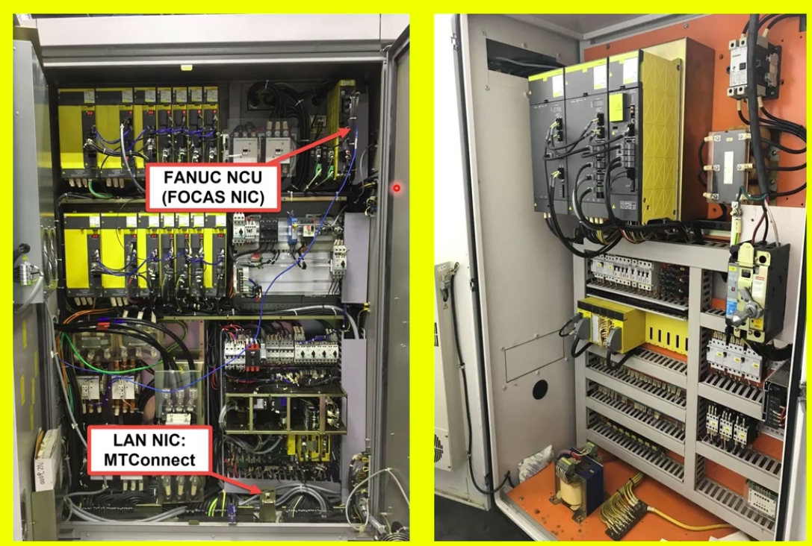
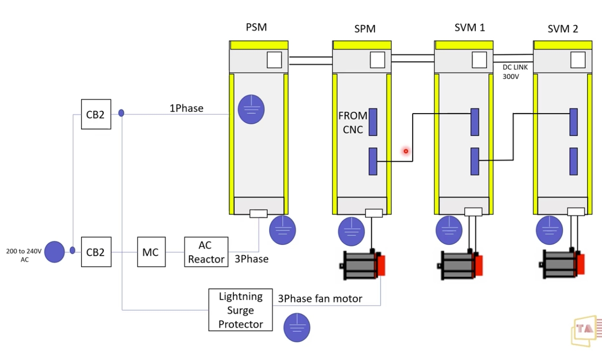

# FANUC Tutorial – Part 9: Drive Configuration (PSM, SPM, SVM)
# FANUC 教程 第 9 部分：驅動器配置（PSM、SPM、SVM）

> Source video / 來源影片：<https://www.youtube.com/watch?v=I8U57TOfWsc&list=PLAVTF-IF9aPXg0zNdScXJs6jOqepUE5U7&index=9>
> Images folder / 圖檔目錄：`images/`（`f09_01.jpg` ~ `f09_02.jpg`）

---

## 1. The Electrical Cabinet of a FANUC Machine / FANUC 機台的電氣控制櫃

**EN:** Open the electrical cabinet of any FANUC-based machine and it looks much alike: the cabinet contents (extra components) vary, but the **drives are common to all FANUC machines**. You will see many cables connected to the drives, and some cables interconnect the drives with each other. Why are they interconnected, which drive comes first and which comes last? This lesson explains how FANUC drives are configured and connected.

**中文：** 打開任何一台 FANUC 機台的電氣控制櫃，外觀都大同小異：櫃內其他元件可能不同，但 **驅動器是所有 FANUC 機台共通的**。你會看到許多電纜接到驅動器，且有些電纜在驅動器之間互相連接。為什麼要互相連接？哪一台在最前、哪一台在最後？本課說明 FANUC 驅動器的配置與連接方式。

*Fig. 1 – Two FANUC control cabinets. The left photo marks the FANUC NCU (FOCAS NIC) and a LAN NIC (MTConnect). / 圖 1：兩個 FANUC 控制櫃。左圖標示 FANUC NCU（FOCAS NIC）與 LAN NIC（MTConnect）。*

---

## 2. Overview: PSM, SPM, SVM / 概述：PSM、SPM、SVM

**EN:** A FANUC CNC machine normally has these drive modules, which drive the axes and spindle:

| Module | Name | Role |
|---|---|---|
| **PSM** | Power Supply Module | Powers all servo and spindle drives |
| **SPM** | Spindle Amplifier Module | Drives the spindle motor |
| **SVM** | Servo Amplifier Module | Drives the servo (axis) motors |

Each module has a PCB and **LED indicators** showing the drive status.

**中文：** FANUC CNC 機台通常配有下列驅動模組，用來驅動各軸與主軸：

| 模組 | 名稱 | 作用 |
|---|---|---|
| **PSM** | 電源模組（Power Supply Module） | 供電給所有伺服與主軸驅動器 |
| **SPM** | 主軸放大器模組（Spindle Amplifier Module） | 驅動主軸馬達 |
| **SVM** | 伺服放大器模組（Servo Amplifier Module） | 驅動伺服（進給軸）馬達 |

每個模組都有電路板與 **LED 指示燈**，顯示驅動器狀態。

---

## 3. System Diagram / 系統接線圖

*Fig. 2 – PSM, SPM, SVM1 and SVM2 with the DC link (300 V), CB2, MC, AC reactor and lightning surge protector. / 圖 2：PSM、SPM、SVM1、SVM2 與 DC link（300V）、CB2、MC、AC 電抗器及突波保護器。*

---

## 4. PSM – Power Supply Module / PSM：電源模組

**EN:** The PSM receives two kinds of supply from the **200–240 V AC, 3-phase** source:

1. **Control power (single phase):** one phase is taken through a circuit breaker (**CB2**) to the PSM to generate the **24 V DC control voltage**. This 24 V is distributed to the other drives to operate their PCBs and electronic devices.
2. **Main power (3-phase):** goes through **CB2 → MC → AC reactor → PSM**.
   - **MC** = magnetic contactor. When an alarm or emergency occurs, or the emergency-stop button is pressed, the **MC switches off** and cuts the 3-phase supply to the drives.
   - The **AC reactor** is in the 3-phase path before the PSM.

**What the PSM does with the main power:** AC cannot be controlled directly, so the PSM **converts the 3-phase AC into about 300 V DC**. It distributes this through the **DC link** — two bus bars, **plus and minus** — to all the SPM and SVM modules. Each drive then converts the DC back to AC for its motor, so speed and position can be controlled precisely.

In the diagram, a **lightning surge protector** also supplies the **3-phase fan motor** of the spindle motor. Every module is **grounded** (earth symbols).

**中文：** PSM 從 **200–240 V AC 三相** 電源取得兩種供電：

1. **控制電源（單相）：** 取其中一相，經斷路器（**CB2**）接到 PSM，產生 **24 V DC 控制電壓**。此 24 V 分配給其他驅動器，供其電路板與電子元件運作。
2. **主電源（三相）：** 經 **CB2 → MC → AC 電抗器 → PSM**。
   - **MC** 為電磁接觸器。發生警報或緊急狀況，或按下緊急停止鈕時，**MC 會跳脫（OFF）**，切斷送往驅動器的三相電源。
   - **AC 電抗器** 位於進入 PSM 之前的三相線路上。

**PSM 如何處理主電源：** 交流電無法直接控制，因此 PSM 將 **三相交流轉換為約 300 V 直流**，再經 **DC link**（正、負兩條匯流排）分配給所有 SPM 與 SVM 模組。各驅動器再把直流轉回交流供給馬達，因此能精確控制速度與位置。

圖中另有 **突波保護器（lightning surge protector）**，供電給主軸馬達的 **三相風扇馬達**。各模組皆有 **接地**（接地符號）。

---

## 5. SPM – Spindle Amplifier Module / SPM：主軸放大器模組

**EN:** The SPM drives the spindle motor. A machine usually has one spindle (twin spindles exist). The spindle needs **constant power** over a very wide speed range, e.g. 500 RPM, 5000 RPM, even 20000 RPM, which is why a dedicated spindle module is used. A **spindle motor cannot be driven by an SVM**, and a servo motor cannot be driven by an SPM — each motor and amplifier is specially designed for its own purpose and they are not interchangeable.

**中文：** SPM 驅動主軸馬達。機台通常有一支主軸（也有雙主軸）。主軸需要在很寬的轉速範圍內（例如 500、5000 甚至 20000 RPM）提供 **恆定功率**，因此使用專用的主軸模組。**主軸馬達不能用 SVM 驅動**，伺服馬達也不能用 SPM 驅動——馬達與放大器都是為各自用途專門設計的，不能互換。

---

## 6. SVM – Servo Amplifier Module / SVM：伺服放大器模組

**EN:** The SVM (servo amplifier) takes the **300 V DC** input and converts it to AC using **IGBTs**, which are triggered as required. That AC drives the **AC servo motor**, allowing the **position** of the machine axis to be controlled. In the diagram there are **SVM1** and **SVM2**; if more axes are needed, add another module (the speaker mentions an **SVM3**). The number of drives depends on the application.

**中文：** SVM（伺服放大器）輸入 **300 V DC**，以 **IGBT** 轉換成交流，IGBT 依需求觸發。此交流驅動 **交流伺服馬達**，藉此控制機台各軸的 **位置**。圖中有 **SVM1** 與 **SVM2**；若需要更多軸，可再增加模組（講者提到 **SVM3**）。驅動器的數量依應用需求而定。

---

## 7. Connection Order / 連接順序

**EN:** From the diagram:

- **Power:** PSM → SPM → SVM1 → SVM2 are joined by the **DC link (300 V)** bus bars.
- **Signal:** the cable **from the CNC** enters the **SPM** first, then goes on to **SVM1**, and then to **SVM2** — a daisy chain, so the order in which the drives are connected matters. (In FANUC systems this signal link is normally the optical FSSB cable; the video itself does not name it.)
- **Motors:** the SPM drives the spindle motor; SVM1 and SVM2 each drive their servo motor(s).

**中文：** 依圖所示：

- **電力：** PSM → SPM → SVM1 → SVM2 以 **DC link（300 V）** 匯流排串接。
- **訊號：** 來自 **CNC** 的電纜先進入 **SPM**，再接到 **SVM1**，然後到 **SVM2**——是串接（菊鏈）方式，因此驅動器的連接順序很重要。（FANUC 系統中此訊號連線通常為 FSSB 光纖電纜；影片本身並未提及名稱。）
- **馬達：** SPM 驅動主軸馬達；SVM1、SVM2 各自驅動其伺服馬達。

---

## 8. Summary / 總結

| Item | Function | 說明 |
|---|---|---|
| **CB2 (1-phase)** | Control power to the PSM | 供 PSM 控制電源 |
| **CB2 → MC → AC reactor (3-phase)** | Main power to the PSM; MC cuts it on alarm / E-stop | 供 PSM 主電源；警報／急停時 MC 切斷 |
| **PSM** | 3-phase AC → ~300 V DC; also 24 V control voltage | 三相交流轉約 300V 直流；並產生 24V 控制電壓 |
| **DC link** | Plus/minus bus bars distributing 300 V DC | 正負匯流排分配 300V 直流 |
| **SPM** | Spindle motor drive | 驅動主軸馬達 |
| **SVM** | Servo motor drive (IGBTs convert DC → AC) | 驅動伺服馬達（IGBT 將直流轉交流） |

> **Note / 備註：** The auto-captioned transcript is rough in places (e.g. "funnel" = FANUC, "SPM, SPM also" = SPM, "additional access" = additional axes, "short bus" = bus bar). Voltages follow the speaker (300 V DC link, 200–240 V AC, 24 V control); actual values depend on the module series — check the FANUC amplifier manual. 原逐字稿有些地方辨識不佳（如「funnel」＝FANUC、「additional access」＝增加的軸、「short bus」＝匯流排）。電壓數值依講者說法（DC link 300V、200–240V AC、24V 控制電壓）；實際數值依模組系列而異，請參閱 FANUC 放大器手冊。

---

## Appendix: Image Index / 附錄：圖檔對照表

| # | File / 檔名 | Content / 內容 |
|---|---|---|
| 1 | images/f09_01.jpg | FANUC electrical cabinets / FANUC 電氣控制櫃 |
| 2 | images/f09_02.jpg | Drive configuration diagram (PSM, SPM, SVM1, SVM2) / 驅動器配置圖 |
